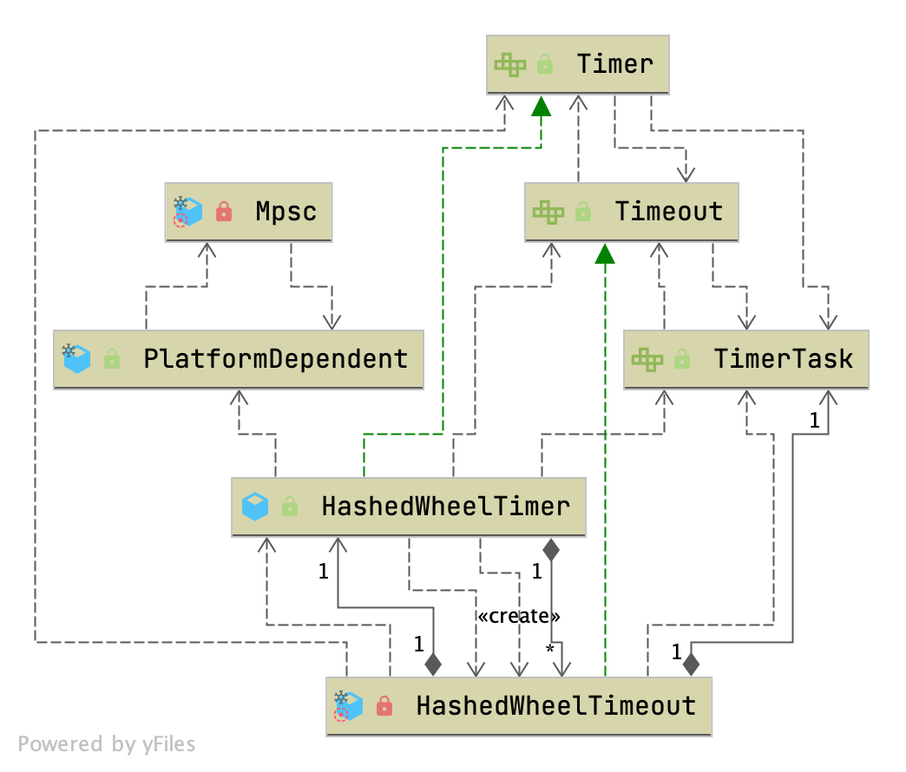

## Introduction



`HashedWheelTimer` 是 Netty 的 `Timer` 实现，一个**为近似 I/O 超时调度而优化**的单层时间轮。它解决的问题与 `ScheduledThreadPoolExecutor` 相同，但取舍完全不同：后者用最小堆（优先级队列）保证精确，`schedule` / `cancel` 都是 O(log n)；时间轮则把任务按到期时间散列到固定数量的槽位里，**插入与取消都是 O(1)**，代价是执行时刻只能精确到 tick，且轮子会「空转」。

对 Netty 的典型场景——海量连接、每个连接一个读/写超时、超时时间不要求精确——O(1) 比 O(log n) 更重要，所以时间轮是更合适的选择。反过来，少量需要精确时刻的任务应该走 EventLoop 自带的 `schedule()`（最小堆），这部分在 [compare schedule](#compare-schedule) 展开。

按下面顺序读：先看 Tick Duration 与 Ticks per Wheel 两个可调参数（决定了精度和容量），再看 Worker 的 tick 主循环如何推进，然后看 `HashedWheelTimeout` / `HashedWheelBucket` 这两个数据结构，最后看时间轮与优先级队列的对比。

### Tick Duration

`HashedWheelTimer` 并不在到期时刻精确唤醒任务：它每走一个 tick，就检查当前槽位里有没有已经到期的任务并执行。换句话说，**调度误差的上界就是一个 tick**。

默认值是 100 毫秒：

```java
// 源码：common/src/main/java/io/netty/util/HashedWheelTimer.java:168
public HashedWheelTimer(ThreadFactory threadFactory) {
    this(threadFactory, 100, TimeUnit.MILLISECONDS);
}
```

网络应用里的 I/O 超时通常不需要精确，所以默认 100ms 在绝大多数情况下不必调。要更精确就把 `tickDuration` 调小，但**最小不能低于 1ms**——低于 1ms 会被夹到 1ms 并打 WARN 日志：

```java
// 源码：common/src/main/java/io/netty/util/HashedWheelTimer.java:302
if (duration < MILLISECOND_NANOS) {
    logger.warn("Configured tickDuration {} smaller than {}, using 1ms.",
                tickDuration, MILLISECOND_NANOS);
    this.tickDuration = MILLISECOND_NANOS;
} else {
    this.tickDuration = duration;
}
```

### Ticks per Wheel (Wheel Size)

`HashedWheelTimer` 维护一个叫 wheel 的数据结构，本质是一张以「任务到期时间」为哈希函数的哈希表。默认 ticks per wheel（即 wheel 数组长度）为 **512**（源码：`common/src/main/java/io/netty/util/HashedWheelTimer.java:185`，类 javadoc 亦写明 `The default number of ticks per wheel (i.e. the size of the wheel) is 512.`，`:65`）：

```java
// 源码：common/src/main/java/io/netty/util/HashedWheelTimer.java:183
public HashedWheelTimer(
        ThreadFactory threadFactory, long tickDuration, TimeUnit unit) {
    this(threadFactory, tickDuration, unit, 512);
}
```

要调度大量超时任务时可以调大这个值。因为 tick 与槽位的映射是 `tick & mask`，而 `mask = wheel.length - 1`，所以**槽位数必须是 2 的幂**——构造时会强制向上取整：

```java
// 源码：common/src/main/java/io/netty/util/HashedWheelTimer.java:335
private static HashedWheelBucket[] createWheel(int ticksPerWheel) {
    ticksPerWheel = MathUtil.findNextPositivePowerOfTwo(ticksPerWheel);

    HashedWheelBucket[] wheel = new HashedWheelBucket[ticksPerWheel];
    for (int i = 0; i < wheel.length; i ++) {
        wheel[i] = new HashedWheelBucket();
    }
    return wheel;
}
```

> [!NOTE]
>
> [!NOTE]
>
> 早期版本有自己的 `normalizeTicksPerWheel()` 手搓循环，并显式校验 `ticksPerWheel <= 0` 与 `> 1073741824` 后抛 `IllegalArgumentException`。自 **4.1.107.Final** 起（提交 `9f19909b7d`）改为先 `ObjectUtil.checkPositive(ticksPerWheel, "ticksPerWheel")`（`:285`），再用 `MathUtil.findNextPositivePowerOfTwo()`（`:336`，定义见 `common/src/main/java/io/netty/util/internal/MathUtil.java:34-37`）取整，边界由 `safeFindNextPositivePowerOfTwo` 的 `<= 0 → 1`、`>= 2^30 → 2^30` 约定兜住（`MathUtil.java:51-53`）。

### Do not create many instances.

`HashedWheelTimer` 每次实例化并启动都会**新建一个线程**，因此全应用应该只建一个实例共享。最常见的误用就是为每个连接 new 一个，最终把应用拖垮。Netty 在实例数超过 64 时会主动打 ERROR 日志：

```java
// 源码：common/src/main/java/io/netty/util/HashedWheelTimer.java:90
private static final AtomicInteger INSTANCE_COUNTER = new AtomicInteger();
private static final AtomicBoolean WARNED_TOO_MANY_INSTANCES = new AtomicBoolean();
private static final int INSTANCE_COUNT_LIMIT = 64;
```

```java
// 源码：common/src/main/java/io/netty/util/HashedWheelTimer.java:316
if (INSTANCE_COUNTER.incrementAndGet() > INSTANCE_COUNT_LIMIT &&
    WARNED_TOO_MANY_INSTANCES.compareAndSet(false, true)) {
    reportTooManyInstances();
}
```

`stop()` 与 `finalize()` 都会把计数减回去（`:415`、`:327-329`）。

### Implementation Details

`HashedWheelTimer` 基于 [George Varghese](https://cseweb.ucsd.edu/users/varghese/) 与 Tony Lauck 的论文 ['Hashed and Hierarchical Timing Wheels: data structures to efficiently implement a timer facility'](https://cseweb.ucsd.edu/users/varghese/PAPERS/twheel.ps.Z)，更完整的 slides 在[这里](https://www.cse.wustl.edu/~cdgill/courses/cs6874/TimingWheels.ppt)。

> [!NOTE]
>
> **没有 `HashedWheelBucket.java` / `HashedWheelTimeout.java` 这两个文件**——它们都是 `HashedWheelTimer.java` 里的 `private static final` 嵌套类（源码：`common/src/main/java/io/netty/util/HashedWheelTimer.java:626`、`:774`），`common/src/main/java/io/netty/util/` 下只有 `HashedWheelTimer.java`、`Timer.java`、`TimerTask.java` 三个文件。

## Timer

`Timer` 负责把 `TimerTask` 安排到后台线程做一次性延迟执行。

```java
// 源码：common/src/main/java/io/netty/util/Timer.java:26
public interface Timer {
    Timeout newTimeout(TimerTask task, long delay, TimeUnit unit);
    Set<Timeout> stop();
}
```

`TimerTask` 在 4.2 多了一个 `cancelled` 默认方法，取消时会回调（`common/src/main/java/io/netty/util/TimerTask.java:32`、`:40-41`）：

```java
// 源码：common/src/main/java/io/netty/util/TimerTask.java:24
public interface TimerTask {
    void run(Timeout timeout) throws Exception;

    default void cancelled(Timeout timeout) {
        // By default do nothing.
    }
}
```

## HashedWheelTimer

核心字段（源码：`common/src/main/java/io/netty/util/HashedWheelTimer.java:110-120`）：

```java
private final long tickDuration;
private final HashedWheelBucket[] wheel;
private final int mask;
private final CountDownLatch startTimeInitialized = new CountDownLatch(1);
private final Queue<HashedWheelTimeout> timeouts = PlatformDependent.newMpscQueue();
private final Queue<HashedWheelTimeout> cancelledTimeouts = PlatformDependent.newMpscQueue();
private final AtomicLong pendingTimeouts = new AtomicLong(0);
private final long maxPendingTimeouts;
private final Executor taskExecutor;

private volatile long startTime;
```

两个队列都是 [MPSC 队列](/docs/CS/Framework/Netty/MpscLinkedQueue.md)：`timeouts` 承接任意线程的 `newTimeout` 提交（多生产者），`cancelledTimeouts` 承接任意线程的 `cancel()`（多生产者），而**消费者只有 worker 线程一个**——正好是 MPSC 的经典形态，无需加锁。

构造器的关键步骤（源码：`common/src/main/java/io/netty/util/HashedWheelTimer.java:277-320`）：

```java
// 源码：common/src/main/java/io/netty/util/HashedWheelTimer.java:282
checkNotNull(threadFactory, "threadFactory");
checkNotNull(unit, "unit");
checkPositive(tickDuration, "tickDuration");
checkPositive(ticksPerWheel, "ticksPerWheel");
this.taskExecutor = checkNotNull(taskExecutor, "taskExecutor");

// Normalize ticksPerWheel to power of two and initialize the wheel.
wheel = createWheel(ticksPerWheel);
mask = wheel.length - 1;

// Convert tickDuration to nanos.
long duration = unit.toNanos(tickDuration);

// Prevent overflow.
if (duration >= Long.MAX_VALUE / wheel.length) {
    throw new IllegalArgumentException(String.format(
            "tickDuration: %d (expected: 0 < tickDuration in nanos < %d",
            tickDuration, Long.MAX_VALUE / wheel.length));
}
```

> [!NOTE]
>
> **`taskExecutor` 自 4.1.69.Final 起可用**（提交 `3a5495864e`，构造参数见 `:277-280`、`:286`），默认 `ImmediateExecutor.INSTANCE`（`:252`）。它的意义是：到期任务可以不占用 worker 线程执行，见 [expire](#expire)。

### timeout

添加一个延时任务时分两步：先入 `timeouts` 队列，**下一个 tick 才由 worker 搬进对应的 bucket**。

```java
// 源码：common/src/main/java/io/netty/util/HashedWheelTimer.java:432
public Timeout newTimeout(TimerTask task, long delay, TimeUnit unit) {
    checkNotNull(task, "task");
    checkNotNull(unit, "unit");

    long pendingTimeoutsCount = pendingTimeouts.incrementAndGet();

    if (maxPendingTimeouts > 0 && pendingTimeoutsCount > maxPendingTimeouts) {
        pendingTimeouts.decrementAndGet();
        throw new RejectedExecutionException("Number of pending timeouts ("
            + pendingTimeoutsCount + ") is greater than or equal to maximum allowed pending "
            + "timeouts (" + maxPendingTimeouts + ")");
    }

    try {
        start();
    } catch (Throwable cause) {
        pendingTimeouts.decrementAndGet();
        throw cause;
    }

    // Add the timeout to the timeout queue which will be processed on the next tick.
    // During processing all the queued HashedWheelTimeouts will be added to the correct HashedWheelBucket.
    long deadline = System.nanoTime() + unit.toNanos(delay) - startTime;

    // Guard against overflow.
    if (delay > 0 && deadline < 0) {
        deadline = Long.MAX_VALUE;
    }
    HashedWheelTimeout timeout = new HashedWheelTimeout(this, task, deadline);
    timeouts.add(timeout);
    ...
}
```

注意 `deadline` 是**以 `startTime` 为基准的绝对时间**（`System.nanoTime() - startTime` 的同一坐标系），不是相对值。

> [!NOTE]
>
> **4.2.19.Final**（本次核验的版本）刚补上一个竞态处理（提交 `751a5edc22`）：`start()` 返回后可能 `stop()` 已被调用、worker 已最后一次排空 `timeouts` 队列，此时这个新 timeout 永远不会被执行。于是再检查一次状态，若已 shutdown 就把它置为 CANCELLED 并抛 `IllegalStateException`（源码：`common/src/main/java/io/netty/util/HashedWheelTimer.java:463-470`）。

### start

后台线程可以显式启动，不调用也会按需自动启动。

```java
// 源码：common/src/main/java/io/netty/util/HashedWheelTimer.java:352
public void start() {
    int state = WORKER_STATE_UPDATER.get(this);
    switch (state) {
        case WORKER_STATE_INIT:
            if (WORKER_STATE_UPDATER.compareAndSet(this, WORKER_STATE_INIT, WORKER_STATE_STARTED)) {
                workerThread.start();
            }
            break;
        case WORKER_STATE_STARTED:
            break;
        case WORKER_STATE_SHUTDOWN:
            throw new IllegalStateException("cannot be started once stopped");
        default:
            throw new Error("Invalid WorkerState: " + state);
    }

    // Wait until the startTime is initialized by the worker.
    while (startTime == 0) {
        try {
            startTimeInitialized.await();
        } catch (InterruptedException ignore) {
            // Ignore - it will be ready very soon.
        }
    }
}
```

那个 `while (startTime == 0)` 是必须的：因为 `newTimeout` 里算 `deadline` 要用 `startTime`，而 `startTime` 是 worker 线程起来之后才赋值的，所以提交线程必须等它就绪（用 `CountDownLatch`，worker 里 `countDown()`）。

## Worker

### run

worker 是唯一的消费者线程，主循环每轮做五件事：等下一个 tick → 处理取消 → 搬运新 timeout → 执行到期 timeout → tick 自增。

```java
// 源码：common/src/main/java/io/netty/util/HashedWheelTimer.java:496
public void run() {
    // Initialize the startTime.
    startTime = System.nanoTime();
    if (startTime == 0) {
        // We use 0 as an indicator for the uninitialized value here, so make sure it's not 0 when initialized.
        startTime = 1;
    }

    // Notify the other threads waiting for the initialization at start().
    startTimeInitialized.countDown();

    do {
        final long deadline = waitForNextTick();
        if (deadline > 0) {
            int idx = (int) (tick & mask);
            processCancelledTasks();
            HashedWheelBucket bucket =
                    wheel[idx];
            transferTimeoutsToBuckets();
            bucket.expireTimeouts(deadline);
            tick++;
        }
    } while (WORKER_STATE_UPDATER.get(HashedWheelTimer.this) == WORKER_STATE_STARTED);

    // Fill the unprocessedTimeouts so we can return them from stop() method.
    for (HashedWheelBucket bucket: wheel) {
        bucket.clearTimeouts(unprocessedTimeouts);
    }
    for (;;) {
        HashedWheelTimeout timeout = timeouts.poll();
        if (timeout == null) {
            break;
        }
        if (!timeout.isCancelled()) {
            unprocessedTimeouts.add(timeout);
        }
    }
    processCancelledTasks();
}
```

`idx = (int) (tick & mask)` 就是「当前 tick 落在 wheel 数组的哪个槽」。`tick` 只增不减，绕圈靠 `& mask` 完成。

只有一个 worker 线程，且**本轮 bucket 里的任务全部执行完，tick 才会前进**——所以放进时间轮的任务必须短小，慢任务会堵住整个轮子。

### waitForNextTick

按 `startTime` 和当前 tick 号算出目标纳秒时间，然后睡到那个点：

```java
// 源码：common/src/main/java/io/netty/util/HashedWheelTimer.java:584
private long waitForNextTick() {
    long deadline = tickDuration * (tick + 1);

    for (;;) {
        final long currentTime = System.nanoTime() - startTime;
        long sleepTimeMs = (deadline - currentTime + 999999) / 1000000;

        if (sleepTimeMs <= 0) {
            if (currentTime == Long.MIN_VALUE) {
                return -Long.MAX_VALUE;
            } else {
                return currentTime;
            }
        }

        // Check if we run on windows, as if thats the case we will need
        // to round the sleepTime as workaround for a bug that only affect
        // the JVM if it runs on windows.
        //
        // See https://github.com/netty/netty/issues/356
        if (PlatformDependent.isWindows()) {
            sleepTimeMs = sleepTimeMs / 10 * 10;
            if (sleepTimeMs == 0) {
                sleepTimeMs = 1;
            }
        }

        try {
            Thread.sleep(sleepTimeMs);
        } catch (InterruptedException ignored) {
            if (WORKER_STATE_UPDATER.get(HashedWheelTimer.this) == WORKER_STATE_SHUTDOWN) {
                return Long.MIN_VALUE;
            }
        }
    }
}
```

`sleepTimeMs` 那个 `+ 999999` 是为了**向上取整**（不足 1ms 也按 1ms 睡）。Windows 上再向下取整到 10ms 的倍数，绕开 JVM 在 Windows 上的 sleep 精度 bug（issue #356）。这也意味着 Windows 上实际精度比 100ms 更粗。

> [!NOTE]
>
`currentTime == Long.MIN_VALUE` 这一分支返回 `-Long.MAX_VALUE`（`:593`），而「收到 shutdown 请求」返回 `Long.MIN_VALUE`（`:615`）——两者都不满足 `deadline > 0`，主循环因此不会推进 tick。

### transferTimeoutsToBuckets

把 `timeouts` 队列里的任务搬到对应 bucket，并算出 `remainingRounds`：

```java
// 源码：common/src/main/java/io/netty/util/HashedWheelTimer.java:536
private void transferTimeoutsToBuckets() {
    // transfer only max. 100000 timeouts per tick to prevent a thread to stale the workerThread when it just
    // adds new timeouts in a loop.
    for (int i = 0; i < 100000; i++) {
        HashedWheelTimeout timeout = timeouts.poll();
        if (timeout == null) {
            // all processed
            break;
        }
        if (timeout.state() == HashedWheelTimeout.ST_CANCELLED) {
            // Was cancelled in the meantime.
            continue;
        }

        long calculated = timeout.deadline / tickDuration;
        timeout.remainingRounds = (calculated - tick) / wheel.length;

        final long ticks = Math.max(calculated, tick); // Ensure we don't schedule for past.
        int stopIndex = (int) (ticks & mask);

        HashedWheelBucket bucket = wheel[stopIndex];
        bucket.addTimeout(timeout);
    }
}
```

几个关键点：

- **每 tick 最多搬 100000 个**，防止某个线程在循环里疯狂提交，把 worker 拖死。
- `calculated = deadline / tickDuration` 把绝对时间换算成绝对 tick 号；`remainingRounds = (calculated - tick) / wheel.length` 就是「还要转几整圈」。
- `Math.max(calculated, tick)` 保证不会因为「任务已过期但还没执行」而算出一个过去的 tick（`& mask` 会绕回错误槽位）。
- 新 timeout 至少要到**下一个 tick** 才会被搬进 bucket（本 tick 的 `expireTimeouts` 已经跑完），所以实际延迟至少多一个 tickDuration。

`remainingRounds` 正是单层时间轮能撑住「延迟跨度远大于一圈」的原因：超出一圈的任务先挂在槽位上，靠轮数递减来延后，而不是为每个跨度建槽。

### processCancelledTasks

取消是异步的：`cancel()` 只改状态并入 `cancelledTimeouts` 队列，真正的链表摘除由 worker 在每 tick 做。这样取消操作对调用方是 O(1)，代价是**取消后最多残留一个 tickDuration 才被 GC**（注释里写明这是可接受的权衡）：

```java
// 源码：common/src/main/java/io/netty/util/HashedWheelTimer.java:561
private void processCancelledTasks() {
    for (;;) {
        HashedWheelTimeout timeout = cancelledTimeouts.poll();
        if (timeout == null) {
            // all processed
            break;
        }
        try {
            timeout.removeAfterCancellation();
        } catch (Throwable t) {
            if (logger.isWarnEnabled()) {
                logger.warn("An exception was thrown while process a cancellation task", t);
            }
        }
    }
}
```

> [!NOTE]
>
> 4.1 这里调用的是 `timeout.remove()`，4.2 改成 `removeAfterCancellation()`（`:569`）——多出来的事情是回调 `TimerTask.cancelled(this)`，见 [remove](#remove)。

## HashedWheelTimeout

任务模型。`deadline` 是以 `startTime` 为基准的绝对到期时间；`next` / `prev` 用于把 timeout 自身当作双向链表节点（**只有 worker 线程会动它们，所以不需要 volatile / 同步**）：

```java
// 源码：common/src/main/java/io/netty/util/HashedWheelTimer.java:626
private static final class HashedWheelTimeout implements Timeout, Runnable {

    private static final int ST_INIT = 0;
    private static final int ST_CANCELLED = 1;
    private static final int ST_EXPIRED = 2;
    private static final AtomicIntegerFieldUpdater<HashedWheelTimeout> STATE_UPDATER =
            AtomicIntegerFieldUpdater.newUpdater(HashedWheelTimeout.class, "state");

    private final HashedWheelTimer timer;
    private final TimerTask task;
    private final long deadline;

    @SuppressWarnings({"unused", "FieldMayBeFinal", "RedundantFieldInitialization" })
    private volatile int state = ST_INIT;

    // remainingRounds will be calculated and set by Worker.transferTimeoutsToBuckets() before the
    // HashedWheelTimeout will be added to the correct HashedWheelBucket.
    long remainingRounds;

    // This will be used to chain timeouts in HashedWheelTimerBucket via a double-linked-list.
    // As only the workerThread will act on it there is no need for synchronization / volatile.
    HashedWheelTimeout next;
    HashedWheelTimeout prev;

    // The bucket to which the timeout was added
    HashedWheelBucket bucket;
```

> [!NOTE]
>
> **`implements Timeout, Runnable` 中的 `Runnable` 自 4.1.69.Final 起加上**（与 `taskExecutor` 同一次提交 `3a5495864e`），为的是让 timeout 自己可以被提交给 `Executor`，见下面 [expire](#expire)。

### cancel

```java
// 源码：common/src/main/java/io/netty/util/HashedWheelTimer.java:670
public boolean cancel() {
    // only update the state it will be removed from HashedWheelBucket on next tick.
    if (!compareAndSetState(ST_INIT, ST_CANCELLED)) {
        return false;
    }
    // If a task should be canceled we put this to another queue which will be processed on each tick.
    // So this means that we will have a GC latency of max. 1 tick duration which is good enough. This way
    // we can make again use of our MpscLinkedQueue and so minimize the locking / overhead as much as possible.
    timer.cancelledTimeouts.add(this);
    return true;
}
```

用 `compareAndSetState(ST_INIT, ST_CANCELLED)` 保证只有 INIT 态能取消，已 EXPIRED 的取消返回 `false`。

### expire

到期执行。**4.2 不再直接在 worker 线程上跑 `task.run()`，而是先摘链表、再把 `this` 交给 `taskExecutor`**：

```java
// 源码：common/src/main/java/io/netty/util/HashedWheelTimer.java:712
public void expire() {
    if (!compareAndSetState(ST_INIT, ST_EXPIRED)) {
        return;
    }

    try {
        remove();
        timer.taskExecutor.execute(this);
    } catch (Throwable t) {
        if (logger.isWarnEnabled()) {
            logger.warn("An exception was thrown while submit " + TimerTask.class.getSimpleName()
                    + " for execution.", t);
        }
    }
}

// 源码：common/src/main/java/io/netty/util/HashedWheelTimer.java:729
@Override
public void run() {
    try {
        task.run(this);
    } catch (Throwable t) {
        if (logger.isWarnEnabled()) {
            logger.warn("An exception was thrown by " + TimerTask.class.getSimpleName() + '.', t);
        }
    }
}
```

默认 `taskExecutor` 是 `ImmediateExecutor.INSTANCE`，`execute()` 直接 `command.run()`（`common/src/main/java/io/netty/util/concurrent/ImmediateExecutor.java:33-35`），所以默认行为与 4.1 一致——仍在 worker 线程上执行。但传入自定义 `Executor` 后，慢任务就**不再阻塞 tick 推进**，这恰好补上了「时间轮任务不能耗时」这个传统限制。注意 `run()` 吞掉了 `TimerTask` 抛出的异常，只打 WARN。

### remove

```java
// 源码：common/src/main/java/io/netty/util/HashedWheelTimer.java:682
private void remove() {
    HashedWheelBucket bucket = this.bucket;
    if (bucket != null) {
        bucket.remove(this);
    }
    timer.pendingTimeouts.decrementAndGet();
}

void removeAfterCancellation() {
    remove();
    task.cancelled(this);
}
```

> [!NOTE]
>
> 两处值得注意的演进：① `pendingTimeouts` 的递减现在**无条件执行**——早期版本是 `bucket == null` 时才递减，递减逻辑分散在 `HashedWheelTimeout.remove()` 与 `HashedWheelBucket.remove()` 两处，容易算错（自 4.2.1.Final 起修，提交 `37514ce5e8`）；② `removeAfterCancellation()` 是 **4.2.0.Final** 新增（提交 `4c152ec0f7`），在摘除后回调 `TimerTask.cancelled(this)`（`TimerTask.java:40-41`），让用户能在取消时释放资源。

## HashedWheelBucket

bucket 是一条**双向链表**，且 timeout 自身就是节点，不额外创建对象：

```java
// 源码：common/src/main/java/io/netty/util/HashedWheelTimer.java:774
private static final class HashedWheelBucket {
    // Used for the linked-list datastructure
    private HashedWheelTimeout head;
    private HashedWheelTimeout tail;

    // 源码：common/src/main/java/io/netty/util/HashedWheelTimer.java:782
    public void addTimeout(HashedWheelTimeout timeout) {
        assert timeout.bucket == null;
        timeout.bucket = this;
        if (head == null) {
            head = tail = timeout;
        } else {
            tail.next = timeout;
            timeout.prev = tail;
            tail = timeout;
        }
    }
```

挂在同一个 bucket 里的 timeout，它们的 `deadline` 落在同一个 `[tick, tick + 1) * tickDuration` 区间（或相差整数圈）。尾插是 O(1)。

### expireTimeouts

```java
// 源码：common/src/main/java/io/netty/util/HashedWheelTimer.java:797
public void expireTimeouts(long deadline) {
    HashedWheelTimeout timeout = head;

    // process all timeouts
    while (timeout != null) {
        HashedWheelTimeout next = timeout.next;
        if (timeout.remainingRounds <= 0) {
            if (timeout.deadline <= deadline) {
                timeout.expire();
            } else {
                // The timeout was placed into a wrong slot. This should never happen.
                throw new IllegalStateException(String.format(
                        "timeout.deadline (%d) > deadline (%d)", timeout.deadline, deadline));
            }
        } else if (!timeout.isCancelled()) {
            timeout.remainingRounds --;
        }
        timeout = next;
    }
}
```

轮数没减完的任务只是 `remainingRounds--` 并留在链表里——这就是「空推进」的来源：轮子每转一圈都要遍历到它们，即使什么也不做。

> [!NOTE]
>
> 这段在 **4.2.1.Final** 被改过（提交 `37514ce5e8`，修 `pendingTimeouts` 计数不准的问题）：此前 `remainingRounds <= 0` 时先 `next = remove(timeout)` 再 `expire()`，并对 `isCancelled()` 单独 `remove()`；现在把摘链表的动作收进 `HashedWheelTimeout.expire()` 内部（`:718`），bucket 自己不再调 `remove()`，取消分支也从「已取消则移除」改成「未取消才递减轮数」（`:811-812`）——已取消的任务在 `processCancelledTasks()` 里统一处理。

### Remove From Bucket

```java
// 源码：common/src/main/java/io/netty/util/HashedWheelTimer.java:818
public HashedWheelTimeout remove(HashedWheelTimeout timeout) {
    HashedWheelTimeout prev = timeout.prev;
    HashedWheelTimeout next = timeout.next;

    // remove timeout that was either processed or cancelled by updating the linked-list
    if (prev != null) {
        prev.next = next;
    }
    if (next != null) {
        next.prev = prev;
    }

    if (timeout == head) {
        head = next;
    }
    if (timeout == tail) {
        tail = prev;
    }
    // null out prev, next and bucket to allow for GC.
    timeout.prev = null;
    timeout.next = null;
    timeout.bucket = null;
    return next;
}
```

head / tail 是两个独立判断（早期版本把 tail 的调整嵌在 `timeout == head` 分支里）；同时不再递减 `pendingTimeouts`，改由调用方 `HashedWheelTimeout.remove()` 统一递减。`clearTimeouts()` 与 `pollTimeout()` 用于 `stop()` 时收集未处理的任务（源码：`:846-877`）。

## stop

```java
// 源码：common/src/main/java/io/netty/util/HashedWheelTimer.java:415
} finally {
    INSTANCE_COUNTER.decrementAndGet();
    if (leak != null) {
        boolean closed = leak.close(this);
        assert closed;
    }
}
Set<Timeout> unprocessed = worker.unprocessedTimeouts();
Set<Timeout> cancelled = new HashSet<Timeout>(unprocessed.size());
for (Timeout timeout : unprocessed) {
    if (timeout.cancel()) {
        cancelled.add(timeout);
    }
}
return cancelled;
```

`stop()` 不允许在 worker 线程（即 `TimerTask` 内部）调用，否则抛 `IllegalStateException`（`:380-385`）。它会 interrupt worker 并 `join(100)` 循环等待其退出。

> [!NOTE]
>
> 早期版本的 `stop()` 直接 `return worker.unprocessedTimeouts()`。自 **4.2.0.Final** 起（提交 `14b1c2fd78`）多了一步：**把每个未处理的 timeout 逐个 `cancel()` 后再返回**（`:421-428`），保证返回出去的任务状态一定是已取消，调用方不必自己再处理一遍。

## compare schedule

EventLoop 自带的 `schedule()` 走的是**最小堆**路线，与时间轮形成对照：

```java
// 源码：common/src/main/java/io/netty/util/concurrent/AbstractScheduledEventExecutor.java:257
public ScheduledFuture<?> schedule(Runnable command, long delay, TimeUnit unit) {
    ObjectUtil.checkNotNull(command, "command");
    ObjectUtil.checkNotNull(unit, "unit");
    if (delay < 0) {
        delay = 0;
    }
    validateScheduled0(delay, unit);

    return schedule(new ScheduledFutureTask<Void>(
            this,
            command,
            deadlineNanos(getCurrentTimeNanos(), unit.toNanos(delay))));
}
```

```java
// 源码：common/src/main/java/io/netty/util/concurrent/AbstractScheduledEventExecutor.java:137
PriorityQueue<ScheduledFutureTask<?>> scheduledTaskQueue() {
    if (scheduledTaskQueue == null) {
        scheduledTaskQueue = new DefaultPriorityQueue<ScheduledFutureTask<?>>(
                SCHEDULED_FUTURE_TASK_COMPARATOR,
                // Use same initial capacity as java.util.PriorityQueue
                11);
    }
    return scheduledTaskQueue;
}
```

```java
// 源码：common/src/main/java/io/netty/util/concurrent/AbstractScheduledEventExecutor.java:338
final void scheduleFromEventLoop(final ScheduledFutureTask<?> task) {
    // nextTaskId a long and so there is no chance it will overflow back to 0
    if (task.getId() == 0L) {
        task.setId(++nextTaskId);
    }
    scheduledTaskQueue().add(task);
}
```

> [!NOTE]
>
> 这里用的是**两参**的 `deadlineNanos(getCurrentTimeNanos(), unit.toNanos(delay))`，时间基准来自 `Ticker`（`AbstractScheduledEventExecutor.java:134`），而非单参的 `deadlineNanos(unit.toNanos(delay))`。`Ticker` 自 **4.1.78.Final** 起引入（提交 `c18fc2bc68`），目的是让调度时间可注入、便于测试。
>
> 另外 `scheduleFromEventLoop` 现在多了 `if (task.getId() == 0L)` 判断，避免重复设置 id（`:340-342`）。

不在 EventLoop 线程上时，会走 `beforeScheduledTaskSubmitted` / `afterScheduledTaskSubmitted` 这对钩子决定是否要 `execute(WAKEUP_TASK)` 唤醒 EventLoop（`:346-364`）。

### Timing Wheel vs PriorityQueue Comparison

看完上面的时间复杂度对比，你可能会觉得：

- Q：时间轮的复杂度只有 O(1)，`ScheduledExecutorService` 这种都是 O(log(n))，那时间轮不是碾压吗？
- A：你不要忘了，如果任务是在很久之后才执行的，那么时间轮就会产生很多空转，这是非常浪费 CPU 性能的，这种空转消耗可以通过增大 tickDuration 来避免，但这样做又会产生降低定时任务的精度，可能导致一些任务推到很迟才执行。
- A：而 ScheduledExecutorService 不会有这个问题。

| 维度 | `HashedWheelTimer`（时间轮） | `AbstractScheduledEventExecutor` / `ScheduledThreadPoolExecutor`（最小堆） |
| --- | --- | --- |
| 插入 | O(1)，入 MPSC 队列 + 尾插链表 | O(log n)，堆上浮 |
| 取消 | O(1)，改状态入队，下个 tick 摘除 | O(log n)，堆下沉（还需查找位置） |
| 到期判定 | O(1)，`tick & mask` 定位槽位 | O(log n) 取堆顶 |
| 精度 | 一个 `tickDuration`，默认 100ms | 精确到纳秒级 deadline |
| 空转 | 有，轮子每 tick 都要遍历（即使无任务） | 无，直接睡到最近 deadline |
| 长时间跨度 | 靠 `remainingRounds` 递减，槽位不膨胀 | 天然支持 |
| 慢任务影响 | 阻塞 tick 推进（4.2 可用 `taskExecutor` 规避） | 影响同线程后续任务 |

另外，Netty 时间轮的实现模型抽象出来是大概这个样子的：

```
for(Tasks task : tasks) {
    task.doXxx();
}
```

这个抽象是个什么意思呢？你要注意一个点，这里的任务循环执行是同步的，**这意味着你第一个任务执行很慢延迟很高，那么后面的任务全都会被堵住**，所以你加进时间轮的任务不可以是耗时任务，比如一些延迟很高的数据库查询，如果有这种耗时任务，最好再嵌入线程池处理，不要让任务阻塞在这一层——也可以直接在构造时传入 `taskExecutor`，让到期任务离开 worker 线程执行（但默认 `ImmediateExecutor` 仍是原地执行，见 [expire](#expire)）。

## Links

- [Netty](/docs/CS/Framework/Netty/Netty.md)
- [EventLoop](/docs/CS/Framework/Netty/EventLoop.md)
- [ChannelHandler](/docs/CS/Framework/Netty/ChannelHandler.md)
- [MpscLinkedQueue](/docs/CS/Framework/Netty/MpscLinkedQueue.md)
- [Scheduled Task](/docs/CS/SE/Scheduled_Task.md)

## References

1. [HashedWheelTimer (Netty API Reference 4.2)](https://netty.io/4.2/api/io/netty/util/HashedWheelTimer.html)
2. [Hashed and Hierarchical Timing Wheels: data structures to efficiently implement a timer facility — Varghese & Lauck](https://cseweb.ucsd.edu/users/varghese/PAPERS/twheel.ps.Z)
3. [Timing Wheels (slides) — Washington University in St. Louis](https://www.cse.wustl.edu/~cdgill/courses/cs6874/TimingWheels.ppt)
4. [netty/netty#356 — Windows 上 Thread.sleep 精度问题](https://github.com/netty/netty/issues/356)
