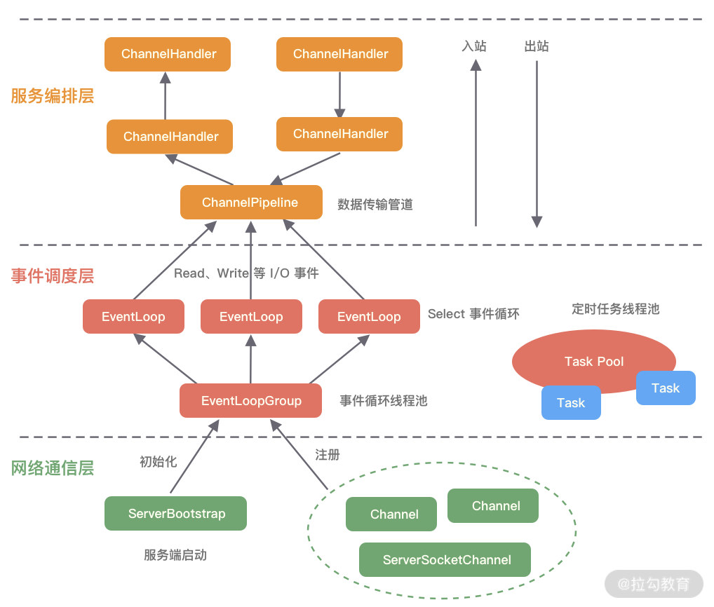

## Introduction

[Netty](https://netty.io) 是*一个异步的、事件驱动的网络应用框架*，用于快速开发可维护的高性能协议服务端与客户端。

Netty 是一个基于 [NIO](/docs/CS/Java/JDK/IO/NIO.md) 的客户端/服务端框架，可以快速、轻松地开发协议服务端、客户端这类网络应用，并把 TCP、UDP socket 服务端这种网络编程大幅化简。

- **易用性**：比原生 Java NIO 简单得多，且自带覆盖大多数使用场景的完整示例
- **依赖极小**：整个框架只需引入一个依赖（下文示例即可看到）
- **高性能**：相比 JDK 核心 API 有更高的吞吐与更低的延迟；内部的资源池化让它同样具备良好的伸缩性
- **安全性**：完整支持 SSL/TLS 与 StartTLS

## Version Baseline

本文以 **Netty 4.2** 源码为准。版本事实（2026-10 核实）：

| 系列   | 最新 GA                        | 说明                                                |
| :--- | :--------------------------- | :------------------------------------------------ |
| 4.1  | **4.1.139.Final**（2026-10-06） | 存量项目主流选择，`pooled` 分配器仍为默认                         |
| 4.2  | **4.2.19.Final**（2026-10-06）  | 2025-04-03 首次 GA（4.2.0.Final）；4.1 升级无需改 API       |
| 5.0  | 5.0.0.Alpha5（2022-09-28）     | 分支仍在活跃开发，未 GA；包名改为 `io.netty5.*`；不在本文范围          |

Netty **不存在 4.3 分支**。4.2 相对 4.1 的四个破坏性/结构性变化（详见各专题页）：

1. **IO 循环抽象成 `IoHandler`**：`NioEventLoop` / `EpollEventLoop` / `KQueueEventLoop` 全部 `@Deprecated`，改用 `MultiThreadIoEventLoopGroup` + `*IoHandler.newFactory()`，见 [原生传输层](/docs/CS/Framework/Netty/Transport.md?id=iohandler-abstraction)
2. **默认分配器改为 `AdaptiveByteBufAllocator`**：`io.netty.allocator.type` 默认值由 `pooled` 变为 `adaptive`，见 [内存池](/docs/CS/Framework/Netty/memory.md?id=adaptivebytebufallocator)
3. **引用计数实现换成 `RefCnt`**：`AbstractReferenceCountedByteBuf` 不再直接用 `AtomicIntegerFieldUpdater`，见 [ByteBuf](/docs/CS/Framework/Netty/ByteBuf.md?id=referencecounting)
4. **`ioRatio` 默认 100 并引入任务时间片**：见 [EventLoop](/docs/CS/Framework/Netty/EventLoop.md)

## Architecture

Netty 的架构有两张常见的图、两个不同的视角：**模块视角**回答"代码分成哪几块"，**逻辑视角**回答"一次请求穿过哪些层"。先分模块，再分层。

### Modules

<div style="text-align: center;">


</div>

<p style="text-align: center;">
图 1. Netty 架构。
</p>


Netty 结构一共分为三个模块：

- Core
  Core 核心层是 Netty 最精华的内容，它提供了底层网络通信的通用抽象和实现，包括可扩展的事件模型、通用的通信 API、支持零拷贝的 [ByteBuf](/docs/CS/Framework/Netty/ByteBuf.md) 等。
- Protocol Support
  协议支持层基本上覆盖了主流协议的编解码实现，如 HTTP、SSL、Protobuf、压缩、大文件传输、WebSocket、文本、二进制等主流协议，此外 Netty 还支持自定义应用层协议。Netty 丰富的协议支持降低了用户的开发成本，基于 Netty 我们可以快速开发 HTTP、WebSocket 等服务。
- Transport Service
  传输服务层提供了网络传输能力的定义和实现方法。它支持 Socket、HTTP 隧道、虚拟机管道等传输方式。Netty 对 TCP、UDP 等数据传输做了抽象和封装，用户可以更聚焦在业务逻辑实现上，而不必关系底层数据传输的细节


### Logical Architecture

Netty 的逻辑处理架构为典型网络分层架构设计，共分为网络通信层、事件调度层、服务编排层，每一层各司其职


<div style="text-align: center;">



</div>

<p style="text-align: center;">
图 2. Netty 逻辑架构。
</p>


网络通信层的**核心组件**包含 Bootstrap、ServerBootstrap、Channel 三个组件


[Bootstrap](/docs/CS/Framework/Netty/Bootstrap.md) 是“引导”的意思，它主要负责整个 Netty 程序的启动、初始化、服务器连接等过程，它相当于一条主线，串联了 Netty 的其他核心组件

Netty 自己实现的 [Channel](/docs/CS/Framework/Netty/Channel.md) 是以 JDK NIO Channel 为基础的，相比较于 JDK NIO，Netty 的 Channel 提供了更高层次的抽象，同时屏蔽了底层 Socket 的复杂性，赋予了 Channel 更加强大的功能


事件调度层的职责是通过 Reactor 线程模型对各类事件进行聚合处理，通过 Selector 主循环线程集成多种事件（ I/O 事件、信号事件、定时事件等），实际的业务处理逻辑是交由服务编排层中相关的 Handler 完成。

事件调度层的**核心组件**包括 EventLoopGroup、[EventLoop](/docs/CS/Framework/Netty/EventLoop.md)


服务编排层的职责是负责组装各类服务，它是 Netty 的核心处理链，用以实现网络事件的动态编排和有序传播。

服务编排层的核心组件包括 ChannelPipeline、[ChannelHandler](/docs/CS/Framework/Netty/ChannelHandler.md)、ChannelHandlerContext

## Sequence

下面五条时序图串起服务端从启动到关闭的完整链路：Bind（绑定端口）→ Connect（接受连接）→ Read（读数据）→ Write（写数据）→ Shutdown（优雅关闭）。


在 Java 网络编程里，最基础的构造是 `Socket` 类；直接操作它来屏蔽连接、读写、关闭的细节相当繁琐。Netty 的 `Channel` 接口提供的 API 把这份复杂度大幅收敛。要处理 TCP/IP 连接，落到具体的类型是 `SocketChannel`，它代表客户端与服务端之间的一条 TCP 连接。

`SocketChannel` 由 `EventLoop` 管理：EventLoop 一直在等待新事件（比如有数据到达），事件发生后最终会被交给合适的 Handler（例如某个 `ChannelHandler`）处理。

多个 EventLoop 为了共享线程等资源，会被 Netty 归入同一个 `EventLoopGroup`。

最后，Netty 自身及其资源的引导启动交给 `Bootstrap` 类完成。

下面用一个最简单的服务端 echo 例子把这些类串起来。

> [写一个 Discard Server 的完整示例](https://netty.io/wiki/user-guide-for-4.x.html#writing-a-discard-server)

### Startup

服务端从配置到监听就绪，按顺序走完八步；下面 Bind 时序图展示的是第 7 步 `bind()` 内部发生了什么。

1. [创建 EventLoopGroup](/docs/CS/Framework/Netty/EventLoop.md?id=create-eventloopgroup)
2. [创建 ServerBootstrap](/docs/CS/Framework/Netty/Bootstrap.md?id=bind)
3. 设置 [Channel](/docs/CS/Framework/Netty/Channel.md)
4. 设置 [ChannelHandler](/docs/CS/Framework/Netty/ChannelHandler.md)
5. Option
6. ChildOption
7. [ServerBootstrap#bind()](/docs/CS/Framework/Netty/Bootstrap.md?id=bind)
8. [ChannelFuture](/docs/CS/Framework/Netty/Future.md)

### Bind

- [创建 EventLoopGroup](/docs/CS/Framework/Netty/EventLoop.md?id=create-eventloopgroup)
- 注册 ServerSocketChannel 时，BossEventLoop 才启动线程
- 首次注册为 `register(Selector, 0, ServerSocketChannel)`，此时 interestOps 为 0
- bind 之后在 `fireChannelActive()` 里才把 `selectionKey.interestOps` 置为 OP_ACCEPT

```plantuml
skinparam backgroundColor #DDDDDD

title: Bind sequence
participant MainThread as ma
participant ServerBootstrap as sb
participant BossEventLoopGroup as we
participant BossEventLoop as bl
participant ServerSocketChannel as cc
activate ma
ma ->> we: create EventLoopGroup
we ->> bl: create EventLoops
bl -->> bl: openSelector
note right: one Selector per EventLoop
we -->> ma: EventLoopGroup
ma ->> sb: bind()
sb ->> cc: init ServerSocketChannel
note right
init ChannelPipeline 
with ServerBootstrapAceptor
end note
cc -->> sb: ServerSocketChannel with OP_ACCEPT
sb ->> we: register()
note right: not inEventLoop
we ->> bl: execute
sb --> ma: ChannelFuture
deactivate ma
bl --> bl: startThread()
activate bl
bl ->> cc: register(Selector, 0, ServerSocketChannel)
cc ->> cc: invokeHandlerAddedIfNeeded
cc ->> cc: notify the promise
note right: call doBind task
cc ->> cc: fireChannelRegistered
cc --> bl: Registration was complete and successful
bl ->> cc: Channel.bind()
participant AbstractUnsafe as au
cc ->> au: bind()
au -->> cc: doBind()
note left #AAAAAA: javaChannel().bind()
cc ->> au: fireChannelActive
au -->> cc: doBeginRead()
note left: selectionKey.interestOps(OP_ACCEPT)
deactivate bl
```

### Connect

当Main Reactor监听到OP_ACCPET事件活跃后，会在NioServerSocketChannel中accept完成三次握手的客户端连接。并创建NioSocketChannel，伴随着NioSocketChannel的创建其对应的配置类NioSocketChannelConfig类也会随之创建

NioServerSocketChannel 中包含了一种特殊的处理器 ServerBootstrapAcceptor，最终通过  ServerBootstrapAcceptor 的 channelRead() 方法将新建的客户端 Channel 分配到  WorkerEventLoopGroup 中。WorkerEventLoopGroup 中包含多个 NioEventLoop，它会选择其中一个  NioEventLoop 与新建的客户端 Channel 绑定


- BossEventLoop 通过 `select()` 等待 OP_ACCEPT 事件
- WorkerEventLoop 在被注册时才启动线程
- 首次注册为 `register(Selector, 0, SocketChannel)`，interestOps 为 0
- 在 `fireChannelActive()` 里才把 `selectionKey.interestOps` 置为 OP_READ

```plantuml
skinparam backgroundColor #DDDDDD

title: Connect sequence
participant BossNioEventLoop as bg
participant Channel.Unsafe as us
participant ServerSocketChannel as sc
participant ServerBootstrapAceptor as sa
participant WorkerEventLoopGroup as wg
participant WorkerEventLoop as el
participant SocketChannel as sl
participant ChannelPipeline as pipe
activate bg
bg ->> bg: Selector.select()
note left: OP_ACCEPT event
bg ->> us: NioUnsafe.read()
us ->> sc: create SocketChannel
note right: ServerSocketChannel.accept()
sc -->> us: SocketChannel
us ->> sa: pipeline.fireChannelRead()
sa ->> sa: init SocketChannel
sa ->> wg: regster()
wg ->> el: execute()
el --> el: startThread()
activate el
el -> sl: register(selector, 0, Channel)
sl ->> pipe: fireChannelRegistered()
sl ->> pipe: fireChannelActive()
note right: selectionKey.interestOps(OP_READ)
```

### Read

当客户端向服务端发送数据时，NioEventLoop 会监听到 OP_READ 事件，然后分配 ByteBuf 并读取数据，读取完成后将数据传递给 Pipeline 进行处理


Netty 读取数据的核心流程，Netty 会在一个 read loop 中不断循环读取 Socket 中的数据直到数据读取完毕或者读取次数已满 16 次，当循环读取了 16 次还没有读取完毕时，Netty 就不能在继续读了，因为 Netty 要保证 Reactor 线程可以均匀的处理注册在它上边的所有 Channel 中的 IO 事件。剩下未读取的数据等到下一次 read loop 在开始读取。

除此之外，在每次 read loop 开始之前，Netty 都会分配一个初始化大小为 2048 的 DirectByteBuffer 来装载从 Socket 中读取到的数据，当整个 read loop 结束时，会根据本次读取数据的总量来判断是否为该 DirectByteBuffer 进行扩容或者缩容，目的是在下一次 read loop 的时候可以为其分配一个容量大小合适的 DirectByteBuffer


Netty服务端对于一次OP_READ事件的处理，会在一个do{}while()循环read loop中分多次从客户端NioSocketChannel中读取网络数据。每次读取我们分配的ByteBuffer容量大小，初始容量为2048。
- ChanneRead事件：一次循环读取一次数据，就触发一次ChannelRead事件。本次最多读取在read loop循环开始分配的DirectByteBuffer容量大小。这个容量会动态调整
- ChannelReadComplete事件：当读取不到数据或者不满足continueReading的任意一个条件就会退出read loop，这时就会触发ChannelReadComplete事件。表示本次OP_READ事件处理完毕

> 触发ChannelReadComplete事件并不代表NioSocketChannel中的数据已经读取完了，只能说明本次OP_READ事件处理完毕
> 因为有可能是客户端发送的数据太多，Netty读了16次还没读完，那就只能等到下次OP_READ事件到来的时候在进行读取了


- 一次 ReadComplete 包含多次 Read（最多 16 次）
- `AdaptiveRecvByteBufAllocator` 缩容要连续满足两次条件才动手，扩容一次就放大
- Handler 默认在 WorkerEventLoop 上执行，也可以在添加 Handler 时指定独立线程池

> [!TIP]
>
> 不要用 EventLoopGroup 执行业务逻辑——它的线程亲和性会让业务阻塞直接顶在 IO 线程上。

```plantuml
skinparam backgroundColor #DDDDDD

title: Read sequence
participant WorkEventLoop as we
participant Selector as se
activate we
we ->> we: Selector.select()
note right: OP_READ event
participant Channel.Unsafe as ue
we ->> ue: read()
participant NioSocketChannel as so
participant Allocator as ac
participant ByteBuf as bb
participant ChannelPipeline as pipe
participant ChannelInboundHandler as ch
loop continueReading
    ue ->> ac: allocate()
    ac -->> ue: ByteBuf 
    ue ->> so: doReadBytes(ByteBuf) 
        note over so, bb #AAAAAA
            javaChannel.readBytes()
        end note
    break read EOF
    bb -->> bb: release()
        note over so #AAAAAA
            close = true
        end note
    end
    break IOException | OOM
        so -->> so: closeOnRead()
    end
    alt readPending
        so ->> pipe: fireChannelRead()
        pipe ->> ch: fireChannelRead()
            note right
                handle data
                From Head to Tail
            end note
    end
end
so ->> ac: readComplete()
so ->> pipe: fireChannelReadComplete()
participant ChannelOutboundBuffer as ob
alt close == true
    so -->> so: closeOnRead()
    so -->> pipe: deRegister()
    so -->> so: doCLose()
        note right 
        close javaChannel
        cancel SelectionKey
        end note
    so -->> pipe: deRegister()
    so -->> ob: fail pending message \n ChannelOutboundBuffer = null
    so -->> pipe: fireChannelInactive()
    so -->> pipe: fireChannelUnRegister()
end

```


#### AdaptiveRecvByteBufAllocator

上面 read loop 里「每轮从 2048 起步、按上轮读取量扩容缩容」的策略由 AdaptiveRecvByteBufAllocator 决定。它并不真正分配内存，只负责给出"这次该分多大"的建议，真正动手的是 `ByteBufAllocator`（池化场景即 `PooledByteBufAllocator`）。源码走一遍：

最终会在NioSocketChannelConfig的父类DefaultChannelConfig的构造器中创建AdaptiveRecvByteBufAllocator。并保存在RecvByteBufAllocator rcvBufAllocator字段中

在new AdaptiveRecvByteBufAllocator()创建AdaptiveRecvByteBufAllocator类实例的时候会先触发AdaptiveRecvByteBufAllocator类的初始化


扩容索引表 SIZE_TABLE 维护size 和 索引的关系
- 当size < 512，索引增加 size + 16
- 当size >= 512，索引增加 size 翻倍

扩容步长 4 缩容步长 1 以initital size 2048为例 对应索引表为33 扩容步长 + 4 = 37 对应size = 32768， 缩容步长 -1 = 32 对应size = 1024


```java

public class AdaptiveRecvByteBufAllocator extends DefaultMaxMessagesRecvByteBufAllocator {

    static final int DEFAULT_MINIMUM = 64;
    // Use an initial value that is bigger than the common MTU of 1500
    static final int DEFAULT_INITIAL = 2048;
    static final int DEFAULT_MAXIMUM = 65536;

    private static final int INDEX_INCREMENT = 4;
    private static final int INDEX_DECREMENT = 1;

    private static final int[] SIZE_TABLE;

    static {
        List<Integer> sizeTable = new ArrayList<Integer>();
        for (int i = 16; i < 512; i += 16) {
            sizeTable.add(i);
        }

        // Suppress a warning since i becomes negative when an integer overflow happens
        for (int i = 512; i > 0; i <<= 1) {
            sizeTable.add(i);
        }

        SIZE_TABLE = new int[sizeTable.size()];
        for (int i = 0; i < SIZE_TABLE.length; i ++) {
            SIZE_TABLE[i] = sizeTable.get(i);
        }
    }
}
```

创建 AdaptiveRecvByteBufAllocator 时设置了size的 最小 最大和默认capcity 同时设置index范围

```java
public class AdaptiveRecvByteBufAllocator extends DefaultMaxMessagesRecvByteBufAllocator {

    private final int minIndex;
    private final int maxIndex;
    private final int initialIndex;
    private final int minCapacity;
    private final int maxCapacity;

    public AdaptiveRecvByteBufAllocator() {
        this(DEFAULT_MINIMUM, DEFAULT_INITIAL, DEFAULT_MAXIMUM);
    }

    public AdaptiveRecvByteBufAllocator(int minimum, int initial, int maximum) {
        checkPositive(minimum, "minimum");
        if (initial < minimum) {
            throw new IllegalArgumentException("initial: " + initial);
        }
        if (maximum < initial) {
            throw new IllegalArgumentException("maximum: " + maximum);
        }

        int minIndex = getSizeTableIndex(minimum);
        if (SIZE_TABLE[minIndex] < minimum) {
            this.minIndex = minIndex + 1;
        } else {
            this.minIndex = minIndex;
        }

        int maxIndex = getSizeTableIndex(maximum);
        if (SIZE_TABLE[maxIndex] > maximum) {
            this.maxIndex = maxIndex - 1;
        } else {
            this.maxIndex = maxIndex;
        }

        int initialIndex = getSizeTableIndex(initial);
        if (SIZE_TABLE[initialIndex] > initial) {
            this.initialIndex = initialIndex - 1;
        } else {
            this.initialIndex = initialIndex;
        }
        this.minCapacity = minimum;
        this.maxCapacity = maximum;
    }

}
```


设置的index 和 capcity 等值被带入到 Handle 中

```java
@SuppressWarnings("deprecation")
@Override
public Handle newHandle() {
    return new HandleImpl(minIndex, maxIndex, initialIndex, minCapacity, maxCapacity);
}
```


在每次read loop循环中都会判断是否continueReading 此时会
对于客户端NioSocketChannel来说，它里边包含的IO数据时客户端发送来的网络数据，长度是不定的，所以才会需要这样一个可以根据每次IO数据的大小来自适应动态调整容量的ByteBuffer来接收
AdaptiveRecvByteBufAllocator并不会真正的去分配ByteBuffer，它只是负责动态调整分配ByteBuffer的大小
真正具体执行内存分配动作的是这里的ByteBufAllocator类型为PooledByteBufAllocator。它会根据AdaptiveRecvByteBufAllocator动态调整出来的大小去真正的申请内存分配ByteBuffer


```java
public class DefaultMaxBytesRecvByteBufAllocator implements MaxBytesRecvByteBufAllocator {
    private volatile int maxBytesPerRead;
    private volatile int maxBytesPerIndividualRead;

    private final class HandleImpl implements ExtendedHandle {
        private int individualReadMax;
        private int bytesToRead;
        private int lastBytesRead;
        private int attemptBytesRead;
    }
}
```


在每次开始从NioSocketChannel中读取数据之前，需要利用PooledByteBufAllocator在内存池中为ByteBuffer分配内存


```java
byteBuf = allocHandle.allocate(allocator);
```


默认初始化大小为2048，这个容量由guess()方法决定


```java
@Override
public ByteBuf allocate(ByteBufAllocator alloc) {
    return alloc.ioBuffer(guess());
}


@Override
public int guess() {
    return Math.min(individualReadMax, bytesToRead);
}
```


在每次通过doReadBytes从NioSocketChannel中读取到数据后，都会调用allocHandle.lastBytesRead(doReadBytes(byteBuf))记录本次读取了多少字节数据


```java
@Override
public void lastBytesRead(int bytes) {
    lastBytesRead = bytes;
    // Ignore if bytes is negative, the interface contract states it will be detected externally after call.
    // The value may be "invalid" after this point, but it doesn't matter because reading will be stopped.
    bytesToRead -= bytes;
}
```


每次read loop循环的末尾都需要通过调用allocHandle.continueReading()来判断是否继续read loop循环读取NioSocketChannel中的数据

```java
private final class HandleImpl implements ExtendedHandle {
    private int individualReadMax;
    private int bytesToRead;
    private int lastBytesRead;
    private int attemptBytesRead;
    private final UncheckedBooleanSupplier defaultMaybeMoreSupplier = new UncheckedBooleanSupplier() {
        @Override
        public boolean get() {
            return attemptBytesRead == lastBytesRead;
        }
    };

    @Override
    public boolean continueReading() {
        return continueReading(defaultMaybeMoreSupplier);
    }

    @Override
    public boolean continueReading(UncheckedBooleanSupplier maybeMoreDataSupplier) {
        // Keep reading if we are allowed to read more bytes, and our last read filled up the buffer we provided.
        return bytesToRead > 0 && maybeMoreDataSupplier.get();
    }

}
```


在每轮read loop结束之后，我们都会调用allocHandle.readComplete()来根据在allocHandle中统计的在本轮read loop中读取字节总大小，来决定在下一轮read loop中是否对DirectByteBuffer进行扩容或者缩容


满足两次缩容条件才会进行缩容，且缩容步长为1，缩容比较谨慎
满足一次扩容条件就进行扩容，并且扩容步长为4， 扩容比较奔放


### Write

Netty 中有两个触发 write 事件传播的方法，它们的传播处理逻辑都是一样的，只不过它们在 pipeline 中的传播起点是不同的。
- channelHandlerContext.write() 方法会从当前 ChannelHandler 开始在 pipeline 中向前传播 write 事件直到 HeadContext。
- channelHandlerContext.channel().write() 方法则会从 pipeline 的尾结点 TailContext 开始在 pipeline 中向前传播 write 事件直到 HeadContext


当异步事件在 pipeline 传播的过程中发生异常时，异步事件就会停止在 pipeline 中传播。所以我们在日常开发中，需要对写操作异常情况进行处理。
- 其中 inbound 类异步事件发生异常时，会触发exceptionCaught事件传播。exceptionCaught 事件本身也是一种 inbound 事件，传播方向会从当前发生异常的 ChannelHandler 开始一直向后传播直到 TailContext。
- 而 outbound 类异步事件发生异常时，则不会触发exceptionCaught事件传播。一般只是通知相关 ChannelFuture。但如果是 flush 事件在传播过程中发生异常，则会触发当前发生异常的 ChannelHandler 中 exceptionCaught 事件回调。


findContextOutbound 方法接收的参数是一个掩码，这个掩码表示要向前查找具有什么样执行资格的 ChannelHandler。因为我们这里调用的是 ChannelHandlerContext 的 write 方法所以 flush = false，传递进来的掩码为 MASK_WRITE，表示我们要向前查找覆盖实现了 write 回调方法的 ChannelOutboundHandler

```java
private AbstractChannelHandlerContext findContextOutbound(int mask) {
    AbstractChannelHandlerContext ctx = this;
    EventExecutor currentExecutor = executor();
    do {
        ctx = ctx.prev;
    } while (skipContext(ctx, currentExecutor, mask, MASK_ONLY_OUTBOUND));
    return ctx;
}

private static boolean skipContext(
        AbstractChannelHandlerContext ctx, EventExecutor currentExecutor, int mask, int onlyMask) {
    // Ensure we correctly handle MASK_EXCEPTION_CAUGHT which is not included in the MASK_EXCEPTION_CAUGHT
    return (ctx.executionMask & (onlyMask | mask)) == 0 ||
            // We can only skip if the EventExecutor is the same as otherwise we need to ensure we offload
            // everything to preserve ordering.
            //
            // See https://github.com/netty/netty/issues/10067
            (ctx.executor() == currentExecutor && (ctx.executionMask & mask) == 0);
}
```


```java


final class ChannelHandlerMask {
    // Using to mask which methods must be called for a ChannelHandler.
    static final int MASK_EXCEPTION_CAUGHT = 1;
    static final int MASK_CHANNEL_REGISTERED = 1 << 1;
    static final int MASK_CHANNEL_UNREGISTERED = 1 << 2;
    static final int MASK_CHANNEL_ACTIVE = 1 << 3;
    static final int MASK_CHANNEL_INACTIVE = 1 << 4;
    static final int MASK_CHANNEL_READ = 1 << 5;
    static final int MASK_CHANNEL_READ_COMPLETE = 1 << 6;
    static final int MASK_USER_EVENT_TRIGGERED = 1 << 7;
    static final int MASK_CHANNEL_WRITABILITY_CHANGED = 1 << 8;
    static final int MASK_BIND = 1 << 9;
    static final int MASK_CONNECT = 1 << 10;
    static final int MASK_DISCONNECT = 1 << 11;
    static final int MASK_CLOSE = 1 << 12;
    static final int MASK_DEREGISTER = 1 << 13;
    static final int MASK_READ = 1 << 14;
    static final int MASK_WRITE = 1 << 15;
    static final int MASK_FLUSH = 1 << 16;

    static final int MASK_ONLY_INBOUND =  MASK_CHANNEL_REGISTERED |
            MASK_CHANNEL_UNREGISTERED | MASK_CHANNEL_ACTIVE | MASK_CHANNEL_INACTIVE | MASK_CHANNEL_READ |
            MASK_CHANNEL_READ_COMPLETE | MASK_USER_EVENT_TRIGGERED | MASK_CHANNEL_WRITABILITY_CHANGED;
    private static final int MASK_ALL_INBOUND = MASK_EXCEPTION_CAUGHT | MASK_ONLY_INBOUND;
    static final int MASK_ONLY_OUTBOUND =  MASK_BIND | MASK_CONNECT | MASK_DISCONNECT |
            MASK_CLOSE | MASK_DEREGISTER | MASK_READ | MASK_WRITE | MASK_FLUSH;
    private static final int MASK_ALL_OUTBOUND = MASK_EXCEPTION_CAUGHT | MASK_ONLY_OUTBOUND;
}
```


在 ChannelHandler 被添加进 pipeline 的时候，Netty 会根据当前 ChannelHandler 的类型以及其覆盖实现的异步事件回调方法，通过 | 运算向 ChannelHandlerContext#executionMask 字段添加该 ChannelHandler 的执行资格


需要在 pipeline 中传播 write 事件，它是一种 outbound 事件，所以需要向前传播，这里通过 ChannelHandlerContext 的前驱指针 prev 拿到当前 ChannelHandler 在 pipeline 中的前一个节点
通过 skipContext 方法判断前驱节点是否具有执行的资格。如果没有执行资格则跳过继续向前查找。如果具有执行资格则返回并响应 write 事件。
在 write 事件传播场景中，执行资格指的是前驱 ChannelHandler 是否是ChannelOutboundHandler 类型的，并且它是否覆盖实现了 write 事件回调方


```java
protected abstract class AbstractUnsafe implements Unsafe {

    private volatile ChannelOutboundBuffer outboundBuffer = new ChannelOutboundBuffer(AbstractChannel.this);
}
```


ChannelOutboundBuffer 其实是一个单链表结构的缓冲队列，链表中的节点类型为 Entry ，由于 ChannelOutboundBuffer 在 Netty 中的作用就是缓存应用程序待发送的网络数据，所以 Entry 中封装的就是待写入 Socket 中的网络发送数据相关的信息，以及 ChannelHandlerContext#write 方法中返回给用户的 ChannelPromise 。这样可以在数据写入Socket之后异步通知应用程序


```java
public final class ChannelOutboundBuffer {
    static final int CHANNEL_OUTBOUND_BUFFER_ENTRY_OVERHEAD =
    SystemPropertyUtil.getInt("io.netty.transport.outboundBufferEntrySizeOverhead", 96);

    private static final InternalLogger logger = InternalLoggerFactory.getInstance(ChannelOutboundBuffer.class);

    private static final FastThreadLocal<ByteBuffer[]> NIO_BUFFERS = new FastThreadLocal<ByteBuffer[]>() {
        @Override
        protected ByteBuffer[] initialValue() throws Exception {
            return new ByteBuffer[1024];
        }
    };

    private final Channel channel;

    // Entry(flushedEntry) --> ... Entry(unflushedEntry) --> ... Entry(tailEntry)
    //
    // The Entry that is the first in the linked-list structure that was flushed
    private Entry flushedEntry;
    // The Entry which is the first unflushed in the linked-list structure
    private Entry unflushedEntry;
    // The Entry which represents the tail of the buffer
    private Entry tailEntry;
    // The number of flushed entries that are not written yet
    private int flushed;

    private int nioBufferCount;
    private long nioBufferSize;
}
```


此外 ChannelOutboundBuffer 中还封装了三个重要的指针：
- unflushedEntry ：该指针指向 ChannelOutboundBuffer 中第一个待发送数据的 Entry。
- tailEntry ：该指针指向 ChannelOutboundBuffer 中最后一个待发送数据的 Entry。通过 unflushedEntry 和 tailEntry 这两个指针，我们可以很方便的定位到待发送数据的 Entry 范围。
- flushedEntry ：当我们通过 flush 操作需要将 ChannelOutboundBuffer 中缓存的待发送数据发送到 Socket 中时，flushedEntry 指针会指向 unflushedEntry 的位置，这样 flushedEntry 指针和 tailEntry 指针之间的 Entry 就是我们即将发送到 Socket 中的网络数据。


Netty 为了防止 ChannelOutboundBuffer 中的待发送数据内存占用无限制的增长从而导致 OOM ，所以引入了高低水位线，作为待发送数据内存占用的上限和下限


```java
public final class WriteBufferWaterMark {

    private static final int DEFAULT_LOW_WATER_MARK = 32 * 1024;
    private static final int DEFAULT_HIGH_WATER_MARK = 64 * 1024;

    public static final WriteBufferWaterMark DEFAULT =
            new WriteBufferWaterMark(DEFAULT_LOW_WATER_MARK, DEFAULT_HIGH_WATER_MARK, false);

    private final int low;
    private final int high;
}
```


每个 Channel 中的待发送数据如果超过 64 KB。Channel 的状态就会变为不可写状态。当内存占用量低于 32 KB时，Channel 的状态会再次变为可写状态


在关闭压缩指针的情况下Entry对象在堆中占用内存大小为96字节
开启则为64字节


这里有一点和 write 事件处理不同的是，当调用 nextChannelHandler 的 flush 回调出现异常的时候，会触发 nextChannelHandler 的 exceptionCaught 回调。

最终flush事件会在pipeline中一直向前传播至HeadContext中，并在 HeadContext 里调用 channel 的 unsafe 类完成 flush 事件的最终处理逻辑


在 Netty 在发送数据的时候，如果发现当前 channel 处于非活跃状态，则将 ChannelOutboundBuffer 中 flushedEntry 与tailEntry 之间的 Entry 对象节点全部删除，并释放发送数据占用的内存空间，同时回收 Entry 对象实例


```java
void failFlushed(Throwable cause, boolean notify) {
    // Make sure that this method does not reenter.  A listener added to the current promise can be notified by the
    // current thread in the tryFailure() call of the loop below, and the listener can trigger another fail() call
    // indirectly (usually by closing the channel.)
    //
    // See https://github.com/netty/netty/issues/1501
    if (inFail) {
        return;
    }

    try {
        inFail = true;
        for (;;) {
            if (!remove0(cause, notify)) {
                break;
            }
        }
    } finally {
        inFail = false;
    }
}
```


当一个 Entry 节点需要从 ChannelOutboundBuffer 中清除时，Netty 需要释放该 Entry 节点中包裹的发送数据 msg 所占用的内存空间。并标记对应的 promise 为失败同时通知对应的 listener ，由于 msg 得到释放，所以需要降低 channelOutboundBuffer 中的内存占用水位线，并根据 boolean notifyWritability 决定是否触发 ChannelWritabilityChanged 事件。最后需要将该 Entry 实例回收至 Recycler 对象池中

```java
private boolean remove0(Throwable cause, boolean notifyWritability) {
    Entry e = flushedEntry;
    if (e == null) {
        clearNioBuffers();
        return false;
    }
    Object msg = e.msg;

    ChannelPromise promise = e.promise;
    int size = e.pendingSize;

    removeEntry(e);

    if (!e.cancelled) {
        // only release message, fail and decrement if it was not canceled before.
        ReferenceCountUtil.safeRelease(msg);

        safeFail(promise, cause);
        decrementPendingOutboundBytes(size, false, notifyWritability);
    }

    // recycle the entry
    e.unguardedRecycle();

    return true;
}
```

doWriteFileRegion 方法中通过 FileChannel#transferTo 方法底层用到的系统调用为 sendFile 实现零拷贝网络文件的传输


OP_WRITE 事件发生后，Netty 直接调用 channel 的 forceFlush 方法
clearOpWrite() 方法，由于 channel 上的 OP_WRITE 事件就绪，表明此时 Socket 缓冲区变为可写状态，从而 Reactor 线程再次来到了 flush 流程中。
当 ChannelOutboundBuffer 中的数据全部写完后 in.isEmpty() ，就需要清理 OP_WRITE 事件，因为此时 Socket 缓冲区是可写的，这种情况下当数据全部写完后，就需要取消对 OP_WRITE 事件的监听，否则 epoll 会不断的通知 Reactor。
同理在 incompleteWrite 方法的 else 分支也需要执行 clearOpWrite() 方法取消对 OP_WRITE 事件的监听


- 写之前先校验 `isActive` 与 `isWritable`
- Socket 缓冲区不可写时注册 OP_WRITE，等可写后再继续写
- `write` / `flush` 最终都在 EventLoop 线程里执行

```plantuml
skinparam backgroundColor #DDDDDD

participant Handler as hl
participant ChannelPipeline as pipe
participant ByteBuf as bb
participant HeadContext as hc
participant Channel.Unsafe as ue
participant WorkerEventLoop as we
activate we
hl ->> pipe: write()
pipe ->> hc: write()
hc ->> ue: write()

bb -->> ue: addMessage()
participant SocketChannel as so
participant ChannelOutboundBuffer as ob
alt ChannelOutboundBuffer == null
    note over ue
        release msg prevent resource-leak
        safeSetFailure
    end note
else 
    ue ->> ob: addMessage()
    note over ob: Increment the pending bytes
end
hl ->> pipe: flush()
pipe ->> hc: flush()
hc ->> ue: flush()
ue ->> ob: addFlush()
ue ->> so: doWrite()
loop writeSpinCount > 0
    break msg done
        so ->> so: clearOpWrite()
    end
    ue ->> so: writeInternal()
    so -->> ue: doWriteBytes/doWriteFileRegion
    note left #AAAAAA: javaChannel.write()
end

alt incompleteWrite
    so ->> so: setOpWrite()
else completely
    so ->> so: clearOpWrite()
    so -->> we: Schedule flush again later
end
```


### Read vs Write

Read 与 Write 都跑在 EventLoop 上、都受 16 次循环上限约束，但缓冲策略与背压手段完全不同：

在每次 read loop 之前，会分配一个大小固定的 diretByteBuffer 用来装载读取数据。每轮 read loop 完全结束之后，才会决定是否对下一轮的读取过程分配的 directByteBuffer 进行扩容或者缩容。
在每次 write loop 之前，都会获取本次 write loop 最大能够写入的字节数，根据这个最大写入字节数从 ChannelOutboundBuffer 中转换 JDK NIO ByteBuffer 。每次写入 Socket 之后都需要重新评估是否对这个最大写入字节数进行扩容或者缩容。
read loop 和 write loop 都被默认限定最多执行 16 次。
在一个完整的 read loop 中，如果还读取不完数据，直接退出。等到 reactor 线程执行完其他 channel 上的 IO 事件再来读取未读完的数据。
而在一个完整的 write loop 中，数据发送不完，则分两种情况。
Socket 缓冲区满无法在继续写入。这时就需要向 reactor 注册 OP_WRITE 事件。等 Socket 缓冲区变的可写时，epoll 通知 reactor 线程继续发送。
Socket 缓冲区可写，但是由于发送数据太多，导致虽然写满 16 次但依然没有写完。这时就直接向 reactor 丢一个 flushTask 进去，等到 reactor 线程执行完其他 channel 上的 IO 事件，在回过头来执行 flushTask。
OP_READ 事件的注册是在 NioSocketChannel 被注册到对应的 Reactor 中时就会注册。而 OP_WRITE 事件只会在 Socket 缓冲区满的时候才会被注册。当 Socket 缓冲区再次变得可写时，要记得取消 OP_WRITE 事件的监听。否则的话就会一直被通知

### Shutdown

```plantuml
skinparam backgroundColor #DDDDDD

title: shutdown
actor User
participant EventLoopGroup as eg
participant EventLoop as el
activate el
el -> el: runAllTasks()
User -> eg: shutdownGracefully()
eg -> el: shutdownGracefully()
loop shutdown

    break isShuttingDown
        note over el #AAAAAA: return
    end
    note over el: cas set state \n ST_STARTED -> ST_SHUTTING_DOWN
end
el -> el: confirmShutdown()
note right: runAllTasks() || runShutdownHooks()
el -> el: closeAll()
activate el
participant Channel as ch
participant Selector as se
el -> se: cancel registed channels
el -> ch: close NIO channels
el -> se: cleanup()
se -> se: Selector.close()
deactivate el
deactivate el
```


## Under Hood


### Memory

网络框架最主要的延迟来自对象与内存分配，Netty 的应对分三层：少分配、可预期、分配完再池化。

- 少分配：用原始类型代替包装类型（`long` + `AtomicLongFieldUpdater` 而非 `AtomicLong`），用类字段代替实例字段，摊薄每对象头开销
- 可预期：`AdaptiveRecvByteBufAllocator` 按历史读取大小预测下一次 `ByteBuf` 容量，避免缓冲区与 map 反复扩容
- 池化：`PooledByteBufAllocator` → `PoolArena` → `PoolChunk` → `PoolSubpage` 四级分配，配合 `PoolThreadCache` 线程本地缓存，见 [Memory Pool](/docs/CS/Framework/Netty/memory.md)

### Zero Copy

Netty 语境下的"零拷贝"不是某一个系统调用，而是三组各不相同的省拷贝手段：

- **缓冲层不拷贝**：用 Direct Memory 分配 `ByteBuf`，写 socket 时省掉堆到堆外的一次拷贝；用 `CompositeByteBuf` 或 `Unpooled.wrappedBuffer` 组合多个 `ByteBuf`，合并消息时只拼指针不动内容
- **文件传输不拷贝**：`DefaultFileRegion` 把 `FileChannel#transferTo` 包装成 pipeline 可传播的对象，底层即 `sendfile` 系统调用——数据从 page cache 直接进 socket 缓冲区，用户态全程不经过
- **大文件边读边写**：`ChunkedWriteHandler` 把 `ChunkedFile` 切成固定小块逐块写入，避免把整个文件读进内存

## Practice

机制讲完之后，落到代码里真正踩得到的三件事：调什么参数、怎么测、避开哪些坑。

### Tuning

Netty 的调优面分两层：全局的 `io.netty.*` 系统属性（进程级、启动时定），以及每个 Channel 的 `ChannelOption`（连接级、[Bootstrap](/docs/CS/Framework/Netty/Bootstrap.md) 装配时定）。常用项：

| 系统属性 | 默认值 | 说明 |
| :--- | :--- | :--- |
| `io.netty.allocator.type` | 4.1 `pooled` / **4.2 `adaptive`** | 分配器类型：`pooled` / `unpooled` / `adaptive` |
| `io.netty.leakDetection.level` | `simple` | 泄漏检测级别：`disabled` < `simple` < `advanced` < `paranoid`，`paranoid` 每个 Buffer 都记录采样，压测环境慎用 |
| `io.netty.maxDirectMemory` | `0`（跟随 `-XX:MaxDirectMemorySize`） | 直接内存上限，`0` 表示不覆盖 JDK 行为 |
| `io.netty.threadLocalDirectBufferSize` | `65536` | 线程本地直接内存缓存块大小，8KB~16MB |
| `io.netty.recycler.maxCapacityPerThread` | `4096` | 每线程 `Recycler` 对象池上限 |
| `io.netty.recycler.linkCapacity` | `16` | 池满时退化的 weak/soft 引用链长度 |
| `io.netty.transport.native.workdir` | `java.io.tmpdir` | native transport 库的解压目录 |

| `ChannelOption` | 默认值 | 说明 |
| :--- | :--- | :--- |
| `SO_BACKLOG` | `128` | 服务端全连接队列长度，同时受内核 `net.core.somaxconn` 截断 |
| `TCP_NODELAY` | `true` | 禁 Nagle，小包即时发；批量场景可考虑关 |
| `SO_KEEPALIVE` | `false` | 内核保活，默认探测间隔约 2 小时，应用层保活一般用 `IdleStateHandler` 替代 |
| `SO_SNDBUF` / `SO_RCVBUF` | `-1`（取系统值） | 收发缓冲区，`-1` 表示用内核默认 |
| `SO_LINGER` | `-1` | close 时是否等数据发完 |
| `WRITE_BUFFER_WATER_MARK` | `32KB` / `64KB` | 写水位线，超过 high 判不可写，见 [Limiter](/docs/CS/Framework/Netty/Limiter.md) |
| `ALLOCATOR` / `RCVBUF_ALLOCATOR` | 跟随全局属性 | 该 Channel 的 Buffer 分配器与读缓冲分配策略 |

其余调优点（EventLoop 线程数、线程亲和、IO 比）见 [EventLoop - Tuning](/docs/CS/Framework/Netty/EventLoop.md?id=tuning)。

### Testing

handler 是可以脱离 socket 单测的：`EmbeddedChannel`（`io.netty.channel.embedded`）在内存里模拟整条 pipeline，`writeInbound` 模拟收到字节，`readInbound` 取出解码后的对象；`writeOutbound` / `readOutbound` 同理覆盖出站。

```java
EmbeddedChannel channel = new EmbeddedChannel(
        new LengthFieldBasedFrameDecoder(65536, 0, 4, 0, 4),
        new StringDecoder(CharsetUtil.UTF_8));

channel.writeInbound(Unpooled.wrappedBuffer(frameBytes)); // 送入一帧
String decoded = channel.readInbound();                   // 取解码结果
assertEquals("hello", decoded);
channel.finishAndReleaseAll();                            // 断言无残留并释放
```

`EmbeddedChannel` 是 transport 层的测试替身，不覆盖 selector、真实 socket 选项与 native transport 行为——那部分仍要上真机。

### Pitfalls

1. **在 EventLoop 里阻塞**：同步 RPC、慢 SQL、大 JSON 序列化都会把该线程上所有 Channel 的 IO 全部拖死。解法：自定义 `EventExecutorGroup` 给重 handler 单独线程，或丢给业务线程池，**不要用 EventLoopGroup 执行业务**（见上文 `[!TIP]`）
2. **ByteBuf 泄漏**：解出 `msg` 后忘记 `release`，或释放后继续读；`SimpleChannelInboundHandler` 会自动 release 收到的 msg，手工 decode 的场景要自己负责。用 `-Dio.netty.leakDetection.level=paranoid` 抓现场
3. **出站 handler 放错位置**：outbound 事件从 Tail 向 Head 传播，编码器必须加在业务 handler **之后**（靠近 Tail），否则编出来的字节没人往下传
4. **只 write 不 flush**：`write` 只入 `ChannelOutboundBuffer`，必须 `flush` 才真正写 socket
5. **忽略 `ChannelFuture` 失败**：对端已关闭时写失败若无 listener，错误静默消失，表现为"偶发丢消息"
6. **跨线程操作共享状态**：`channel.write()` 从业务线程调用是安全的（内部会转成 task 提交），但 handler 里的字段没有同步——先想清楚哪些状态只被 EventLoop 线程访问
7. **不优雅停机**：直接退出 JVM 会丢掉 `ChannelOutboundBuffer` 里未写完的数据，正确做法是 `shutdownGracefully()` 并在其 `ChannelFuture` 完成后再退出

## What to Read Next

Netty 的组件是层层引用的，按依赖顺序读比按包结构读省力。

起点是 [Bootstrap](/docs/CS/Framework/Netty/Bootstrap.md)：它把 `EventLoopGroup`、`Channel` 类型、option 和 `childHandler` 攒成一份配置，直到 `bind()` 或 `connect()` 才真正实例化并注册，因此它是穿过其余组件的那条主线。

被引导起来的是线程模型。[EventLoop](/docs/CS/Framework/Netty/EventLoop.md) 说明一个 EventLoop 如何独占一个线程、如何 select 就绪事件并顺带跑任务队列，以及 4.2 之后 IO 语义怎样被抽进 `IoHandler`；它依赖的 `select` / `epoll` 能力本身记在 [Linux IO 多路复用](/docs/CS/OS/Linux/IO/multiplexing.md)。

每个连接被抽象成 [Channel](/docs/CS/Framework/Netty/Channel.md)，注册、读、写、关闭这些真正落地的动作挂在 `Unsafe` 上；事件到达后不在 Channel 里处理，而是交给 [ChannelHandler](/docs/CS/Framework/Netty/ChannelHandler.md) 组成的 pipeline 传播，粘包拆包、空闲检测、异常兜底都发生在这一层。

数据载荷是 [ByteBuf](/docs/CS/Framework/Netty/ByteBuf.md)，它的引用计数决定何时归还；归还之后内存在哪一级缓存里被复用属于内存池主题，统一记在 [Memory Pool](/docs/CS/Framework/Netty/memory.md)。所有异步动作的结果由 [Future and Promise](/docs/CS/Framework/Netty/Future.md) 承载，写侧背压的水位变化也靠它回报。

支撑上述组件的 common 工具件各自对应一个 JDK 层面的具体缺陷：[FastThreadLocal](/docs/CS/Framework/Netty/FastThreadLocal.md) 用数组寻址替代 ThreadLocal 的哈希探测，并允许在池化对象上批量清理；[MpscLinkedQueue](/docs/CS/Framework/Netty/MpscLinkedQueue.md) 讲 EventLoop 任务队列采用的**多生产者单消费者（MPSC）**无锁队列；[HashedWheelTimer](/docs/CS/Framework/Netty/HashedWheelTimer.md) 用时间轮把海量超时的管理成本从 O(log n) 降到 O(1)。

协议相关的内容分三块：[编解码器体系](/docs/CS/Framework/Netty/Codec.md) 讲粘包拆包与 `ByteToMessageDecoder` 的累积机制；[HTTP / WebSocket / TLS 协议栈](/docs/CS/Framework/Netty/Protocol.md) 讲协议支持层的 handler 组装与握手流程；[原生传输层](/docs/CS/Framework/Netty/Transport.md) 讲 NIO / epoll / kqueue / io_uring 四种实现的差异与 4.2 的 `IoHandler` 重构。

另有两个横切专题：[流量整形 TrafficShaping](/docs/CS/Framework/Netty/Limiter.md) 讲读写速率控制及其与写水位线的相互作用；[TCP Fast Open 支持](/docs/CS/Framework/Netty/TPO.md) 说明省下一个 RTT 的能力为什么必须走 native epoll transport 才拿得到。

## Links

- [Netty 目录索引（按层导航）](/docs/CS/Framework/Netty/README.md)
- [Java NIO](/docs/CS/Java/JDK/IO/NIO.md)
- [Dubbo](/docs/CS/Framework/Dubbo/Dubbo.md)
- [Flink](/docs/CS/Framework/Flink/Flink.md)
- [RocketMQ](/docs/CS/MQ/RocketMQ/RocketMQ.md)
- [ElasticSearch](/docs/CS/Framework/ES/ES.md)
- [Linux IO 多路复用](/docs/CS/OS/Linux/IO/multiplexing.md)

## References

1. [Netty](https://netty.io/)
2. [Thread model](https://netty.io/wiki/thread-model.html)
