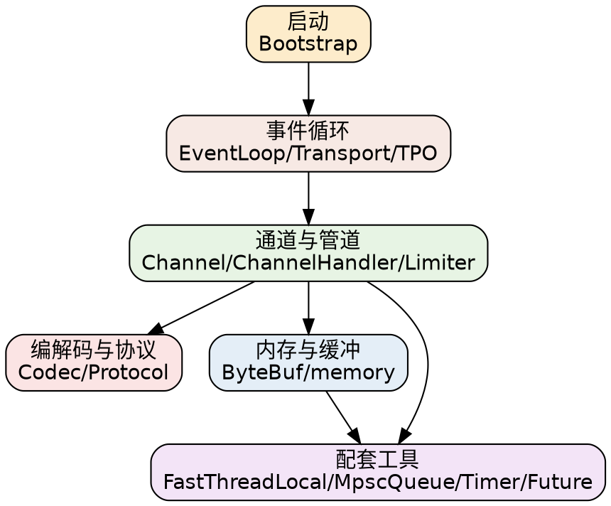

## Introduction

本目录是 **Netty** 的专题索引。Netty 的主线是从「事件循环驱动」出发的一条异步链路：Bootstrap 引导启动 → EventLoop 驱动 → Channel 承载连接 → Pipeline 装配 ChannelHandler → ByteBuf 在内存中读写。围绕这条主线，本目录收录了内存池、线程模型、以及配套的私有工具类笔记。

版本基线以 **Netty 4.2**（最新 GA 4.2.19.Final，2026-10-06）源码为准；4.1 系列最新为 4.1.139.Final。4.2 相对 4.1 的破坏性变化集中在 `IoHandler` 抽象、默认分配器改为 `adaptive`、引用计数改 `RefCnt` 三处，各专题页已就地标注。

## Startup and Bootstrap

- [Bootstrap](/docs/CS/Framework/Netty/Bootstrap.md)：客户端 / 服务端引导，事件循环组与 ChannelPipeline 装配。

## Event Loop and Thread Model

- [EventLoop](/docs/CS/Framework/Netty/EventLoop.md)：事件循环、单线程串行语义、任务提交与执行。
- [Transport](/docs/CS/Framework/Netty/Transport.md)：NIO / epoll / kqueue / io_uring 四种传输实现，4.2 的 `IoHandler` 重构与 `MultiThreadIoEventLoopGroup` 迁移。
- [TPO](/docs/CS/Framework/Netty/TPO.md)：TCP Fast Open 在 Netty 中的支持（仅 native transport）。
- [FastThreadLocal](/docs/CS/Framework/Netty/FastThreadLocal.md)：Netty 对 JDK `ThreadLocal` 的高性能替代，数组寻址取代哈希探测。

## Channel and Pipeline

- [Channel](/docs/CS/Framework/Netty/Channel.md)：Channel 抽象与状态、事件回调。
- [ChannelHandler](/docs/CS/Framework/Netty/ChannelHandler.md)：入站 / 出站 handler、pipeline 传播机制、编解码器。
- [Codec](/docs/CS/Framework/Netty/Codec.md)：粘包拆包、`ByteToMessageDecoder` 的累积与判活、长度字段帧解码、编码器家族。
- [Protocol](/docs/CS/Framework/Netty/Protocol.md)：TLS / HTTP/1.1 / WebSocket / HTTP/2 / HTTP/3 协议栈与握手流程。
- [Limiter](/docs/CS/Framework/Netty/Limiter.md)：流量整形与写水位线的相互作用。

## Memory and Buffering

- [ByteBuf](/docs/CS/Framework/Netty/ByteBuf.md)：字节缓冲、堆内 / 直接内存、引用计数与泄漏检测。
- [memory](/docs/CS/Framework/Netty/memory.md)：内存池（`Arena` / `Chunk` / `Page`）、`Recycler` 对象池、4.2 默认的 `AdaptiveByteBufAllocator`。

## Asynchronous and Supporting Tools

- [Future](/docs/CS/Framework/Netty/Future.md)：`Future` / `Promise` 异步结果、状态机与监听器通知。
- [MpscLinkedQueue](/docs/CS/Framework/Netty/MpscLinkedQueue.md)：多生产者单消费者无锁队列（jctools 数组队列家族）。
- [HashedWheelTimer](/docs/CS/Framework/Netty/HashedWheelTimer.md)：时间轮定时器，海量超时的 O(1) 管理。

## Links

- [Netty（架构与入口）](/docs/CS/Framework/Netty/Netty.md)
- [Tomcat（同样基于 NIO 的容器）](/docs/CS/Framework/Tomcat/Tomcat.md)
- [Jetty（selector 与请求处理同线程）](/docs/CS/Framework/Jetty/Threading.md)
- [Undertow（站在 XNIO 上的容器）](/docs/CS/Framework/Undertow/Undertow.md)
- [gRPC（Netty 上跑 RPC）](/docs/CS/Framework/gRPC/gRPC.md)
- [Framework 总索引](/docs/CS/Framework/README.md)

## References

1. [Netty 4.1 Reference](https://netty.io/wiki/)
2. [Netty Source (GitHub)](https://github.com/netty/netty)
