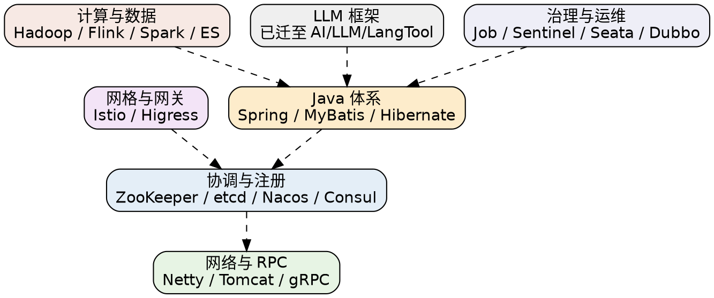

## Introduction

本目录是 **Framework（框架与中间件）** 领域的入口页，收录后端与基础设施层的技术栈笔记：Java 体系（Spring / MyBatis / Dubbo）、分布式协调与服务治理（ZooKeeper / etcd / Nacos / Consul / Sentinel / Seata）、网络与 RPC（Netty / Tomcat / gRPC）、服务网格与网关（Istio / Higress）、计算与数据（Hadoop / Flink / Spark / ES）、响应式编程。LLM 应用开发框架（LangChain / LangGraph / Langflow / Pydantic AI 等）已迁至 [AI/LLM/LangTool/](/docs/CS/AI/LLM/LangTool/LangChain.md)，本目录仅保留指向它的入口链接。**分布式存储（HDFS / Ceph / MinIO / TiKV 等）作为子领域归在 [Distributed/](/docs/CS/Distributed/Distributed.md)，本目录按"产品 / 中间件"视角只保留 [Hadoop](/docs/CS/Framework/Hadoop/Hadoop.md)（含 HDFS）入口。**

目录按**技术栈**组织，每个领域一个子目录，多数子目录以与目录同名的笔记为主入口（如 [Spring](/docs/CS/Framework/Spring/Spring.md) 是Spring 全家桶的枢纽）。若某个领域内部笔记较多且已具备完整分层（如 [etcd](/docs/CS/Framework/etcd/README.md)、[ZooKeeper](/docs/CS/Framework/ZooKeeper/README.md)、[nacos](/docs/CS/Framework/nacos/README.md)、[consul](/docs/CS/Framework/consul/README.md)），则额外提供目录首页 `README.md` 作为该领域的分层索引。

## Java Ecosystem

- [Spring](/docs/CS/Framework/Spring/Spring.md)：Spring Framework 7.x 枢纽——IoC/AOP、事务、数据访问、Web、测试，是本库最核心的 Java 笔记。
- [Spring Boot](/docs/CS/Framework/Spring_Boot/Spring_Boot.md)：Boot 4.x 自动装配、内嵌服务器、starter、生产特性。
- [Spring Cloud](/docs/CS/Framework/Spring_Cloud/Spring_Cloud.md)：Cloud 微服务组件（Gateway / OpenFeign / LoadBalancer / Config / Bus / Stream 等），常与 [Nacos](/docs/CS/Framework/nacos/README.md) 搭配。
- [MyBatis](/docs/CS/Framework/MyBatis/MyBatis.md)：持久层框架，源码级解析 mapper、插件、动态 SQL 与一级/二级缓存。
- [MyBatis-Plus](/docs/CS/Framework/MyBatis-Plus/MyBatis-Plus.md)：MyBatis 第三方增强（baomidou），自动注入单表 CRUD、分页 / 逻辑删除 / 多租户 / 代码生成；基线 3.5.18，编译锁定 mybatis 3.5.19。
- [Hibernate](/docs/CS/Framework/Hibernate/Hibernate.md)：JPA 实现，实体映射与会话语义。

## Distributed Coordination and Service Registry

按"强一致键值底座 / 配置与注册中心"两类定位取舍，完整维度矩阵见 [etcd 横向对照](/docs/CS/Framework/etcd/compare.md)。

- [etcd](/docs/CS/Framework/etcd/README.md)：K8s 后端首选的强一致 KV；枢纽 + boot（启动生命周期）/ request（请求路径）/ features（服务发现·事务）分册，配套完整的共识（raft/tracker）、存储（boltdb/MVCC）、网关、运维笔记。
- [ZooKeeper](/docs/CS/Framework/ZooKeeper/README.md)：经典协调底座，Zab 共识、znode树、watch 与 session 配方。
- [Nacos](/docs/CS/Framework/nacos/README.md)：配置中心 + 注册中心，AP（Distro）与 CP（JRaft）双模式。
- [Apollo](/docs/CS/Framework/Apollo/Apollo.md)：携程出品的分布式**配置管理中心**，定位是「配置发布平台」——app/env/cluster/namespace 四维坐标、修改与发布双权限、灰度分支、编辑审计。已拆为**枢纽 + 分册**（[Architecture](/docs/CS/Framework/Apollo/Architecture.md) / [Client](/docs/CS/Framework/Apollo/Client.md) / [Config Push](/docs/CS/Framework/Apollo/Config_Push.md) / [Namespace](/docs/CS/Framework/Apollo/Namespace.md) / [Portal](/docs/CS/Framework/Apollo/Portal.md) / [Storage](/docs/CS/Framework/Apollo/Storage.md) / [Deployment and Ops](/docs/CS/Framework/Apollo/Deployment_and_Ops.md)），四条判定线是「四维坐标先问维度、服务端唯一外部依赖 MySQL、推送是通知+拉取两段式、Java 客户端已拆到独立仓库 apollo-java」。版本基线：服务端 3.0.0（Java 17，database-discovery 默认），客户端线独立演进。
- [Consul](/docs/CS/Framework/consul/README.md)：服务网络平台，服务发现 + 服务网格（Envoy mTLS）+ 多DC 联邦，另有成员发现（Serf）与网关专篇。
- [Eureka](/docs/CS/Framework/eureka/README.md)：Netflix 注册中心，AP 自注册/续约。枢纽 + Server/Client 两端 + [注册表](/docs/CS/Framework/eureka/registry.md)（写路径与剔除）、[缓存](/docs/CS/Framework/eureka/cache.md)、[自我保护](/docs/CS/Framework/eureka/self_preservation.md)、[集群复制](/docs/CS/Framework/eureka/replication.md) 四条主线，配套 REST 契约、传输层、[配置](/docs/CS/Framework/eureka/config.md)、[调优](/docs/CS/Framework/eureka/tuning.md) 与 [排障](/docs/CS/Framework/eureka/troubleshooting.md)。
- [BookKeeper](/docs/CS/Framework/BookKeeper/BookKeeper.md)：可独立部署的 **append-only 分布式日志存储**（WAL / 消息存储底座，[Pulsar](/docs/CS/MQ/Pulsar/Pulsar.md) 的存储引擎）。枢纽 + [Ledger](/docs/CS/Framework/BookKeeper/Ledger.md)（元数据与 fencing/recovery）、[Write](/docs/CS/Framework/BookKeeper/Write.md)（quorum 与 ensemble change）、[Read](/docs/CS/Framework/BookKeeper/Read.md)（LAC 与 speculative read）、[Storage](/docs/CS/Framework/BookKeeper/Storage.md)（journal/entry log/index 与 GC）、[Cluster](/docs/CS/Framework/BookKeeper/Cluster.md)（元数据布局与 auto-recovery）、[Ops](/docs/CS/Framework/BookKeeper/Ops.md)（配置与运维）。

## Service Governance and Operations

- [Dubbo](/docs/CS/Framework/Dubbo/Dubbo.md)：RPC 框架，SPI 扩展、自定义协议、服务治理与注册发现。
- [Sentinel](/docs/CS/Framework/Sentinel/Sentinel.md)：流量治理（限流、熔断、热点、系统自适应保护）。
- [Seata](/docs/CS/Framework/Seata/Seata.md)：分布式事务（AT / TCC / XA）。
- [HSF](/docs/CS/Framework/HSF/HSF.md)、[SOFARegistry](/docs/CS/Framework/SOFARegistry.md)：阿里 Sofas 中间件体系（RPC 框架与注册中心）。
- [Hippo4j](/docs/CS/Framework/Hippo4j.md)：动态线程池与监控告警。
- [Job（任务调度）](/docs/CS/Framework/Job/Job.md)：分布式任务调度枢纽——核心概念对齐（调度中心/执行器/路由/分片/阻塞/misfire）、四族演进与选型。成员：[Quartz](/docs/CS/Framework/Job/Quartz.md)（内嵌库，[集群](/docs/CS/Framework/Job/Quartz/Clustering.md) 分册）、[xxl-job](/docs/CS/Framework/Job/xxl-job.md)（中心式平台，[执行器](/docs/CS/Framework/Job/xxl-job/Executor.md) / [调度中心](/docs/CS/Framework/Job/xxl-job/Scheduler.md) / [触发链路](/docs/CS/Framework/Job/xxl-job/Trigger.md) 等十篇分册）、[ElasticJob](/docs/CS/Framework/Job/ElasticJob.md)（去中心化 + ZK 分片）、[PowerJob](/docs/CS/Framework/Job/PowerJob.md)（调度 + MapReduce 计算 + Workflow），另有大数据工作流方向的 [DolphinScheduler](/docs/CS/Framework/Job/DolphinScheduler.md) 与云调度 [ScheduleX](/docs/CS/Framework/Job/ScheduleX.md)。跨语言与跨层（内核定时器、时间轮、MQ 延时消息、DB 自建延迟队列）的总览见 [Scheduled Task](/docs/CS/SE/Scheduled_Task.md)。
- [Workflow（工作流引擎）](/docs/CS/Framework/Workflow/Workflow.md)：BPMN 2.0 工作流引擎三强——[Flowable](/docs/CS/Framework/Workflow/Flowable.md)（轻量嵌入式、Apache 2.0、BPMN+CMMN+DMN）/ [Camunda](/docs/CS/Framework/Workflow/Camunda.md)（7 嵌入式+RDBMS 与 8/Zeebe 云原生双线，8 为 source-available 许可证）/ [Activiti](/docs/CS/Framework/Workflow/Activiti.md)（三者共同祖先，activiti-core/cloud 拆分）。三者共祖 Activiti 5、表前缀同为 `ACT_`，枢纽页给出血统、三向对比与选型指引；概念层与"与相关概念区分"见 [SE/Workflow](/docs/CS/SE/Workflow.md)。

## Networking and RPC

- [Netty](/docs/CS/Framework/Netty/Netty.md)：NIO 框架，内存池、编解码器、零拷贝、事件循环。
- [Tomcat](/docs/CS/Framework/Tomcat/Tomcat.md)：Servlet/JSP 容器子树（11.0.x）——连接器、容器与 Pipeline、认证与 TLS、HTTP/2、部署与内嵌 API。
- [Jetty](/docs/CS/Framework/Jetty/Jetty.md)：轻量容器与嵌入式服务器子树（12.1.x）——核心与 EE 层解耦、连接与线程模型、请求推进链路、非阻塞 IO 抽象。
- [Undertow](/docs/CS/Framework/Undertow/Undertow.md)：基于 XNIO 的非阻塞容器子树（2.4.x）——exchange 与 dispatch、handler 链与 predicate、Servlet 部署层。
- 三者的线程模型、Servlet 依赖位置与版本线差异对照见 [三容器横向对照](/docs/CS/Framework/Tomcat/compare.md)。
- [gRPC](/docs/CS/Framework/gRPC/gRPC.md)：跨语言 RPC 框架，配合 Protobuf；子树分三册——[Architecture](/docs/CS/Framework/gRPC/Architecture.md)（HTTP/2 帧映射、状态码、codec）、[Streaming](/docs/CS/Framework/gRPC/Streaming.md)（四种流模式、流控与超时传播）、[Ecosystem](/docs/CS/Framework/gRPC/Ecosystem.md)（拦截器、命名解析与负载均衡、xDS、可观测性、grpc-gateway）。
- [kitex](/docs/CS/Framework/kitex.md)（Go）、[Netpoll](/docs/CS/Framework/Netpoll.md)（Go）、[evio](/docs/CS/Framework/evio.md)（Go）：Go 生态的 RPC/网络库。
- [Pandora](/docs/CS/Framework/Pandora.md)：容器内进程管理与网络接管，常与多进程后端服务配合。

## Service Mesh and Gateway

- [Istio](/docs/CS/Framework/Istio/Istio.md)：K8s 原生服务网格，流量治理、安全、Ambient、Envoy 扩展。
- [Higress](/docs/CS/Framework/Higress/Higress.md)：基于 Istio + Envoy 的云原生 AI 网关。

## Computing and Data

- [Hadoop](/docs/CS/Framework/Hadoop/Hadoop.md)：HDFS 与 MapReduce 生态。
- [Flink](/docs/CS/Framework/Flink/Flink.md)：流批一体计算，DataStream / Table API / 状态与Checkpoint。
- [Spark](/docs/CS/Framework/Spark/Spark.md)：批处理与 Spark SQL。
- [ES](/docs/CS/Framework/ES/ES.md)：Elasticsearch 分布式检索与倒排索引。已拆为**枢纽 + 17 分册**（基线 9.5.5，默认值均带 `文件:行号`），打假点集中在 `not_analyzed` 已抛异常、`minimum_master_nodes` 已移除、bundled JDK 27、写路径是 Lucene 先/translog 后、熔断器默认 95%/40%/60%、堆上限 31GB。机制层：[Replication](/docs/CS/Framework/ES/Replication.md)（bulk 分组/seq_no/primary_term/in-sync/noop/translog）、[Search_Internals](/docs/CS/Framework/ES/Search_Internals.md)（分片 topN=from+size/batched reduce/11 个 fetch 子 phase/scroll 内部）、[Cluster_State](/docs/CS/Framework/ES/Cluster_State.md)（publication 四级/`_state` 持久化/21 决策器/磁盘水位）、[Merge](/docs/CS/Framework/ES/Merge.md)（Tiered vs LogByteSize/ThreadPoolMergeScheduler/HybridDirectory）、[Thread_Pools](/docs/CS/Framework/ES/Thread_Pools.md)（24 池/协调执行分离/429 来源/两条背压）；应用层：[Install](/docs/CS/Framework/ES/Install.md)、[Mapping](/docs/CS/Framework/ES/Mapping.md)、[Query_DSL](/docs/CS/Framework/ES/Query_DSL.md)、[Analyzer](/docs/CS/Framework/ES/Analyzer.md)、[Troubleshooting](/docs/CS/Framework/ES/Troubleshooting.md)、[Lucene](/docs/CS/Framework/ES/Lucene.md)、[Cluster](/docs/CS/Framework/ES/Cluster.md)、[Script](/docs/CS/Framework/ES/Script.md)、[Kibana](/docs/CS/Framework/ES/Kibana.md)、[Beats](/docs/CS/Framework/ES/Beats.md)、[Logstash](/docs/CS/Framework/ES/Logstash.md)、[OpenSearch](/docs/CS/Framework/ES/OpenSearch.md)。

## Distributed Storage

分布式存储（HDFS / Ceph / MinIO / TiKV 等）作为**子领域**归在 [Distributed/](/docs/CS/Distributed/Distributed.md)，按"访问接口分类 + 选型"的学科视角串起 GFS → HDFS、Haystack → S3 / MinIO 等。本目录按"产品 / 中间件"视角只保留 [Hadoop](/docs/CS/Framework/Hadoop/Hadoop.md)（含 HDFS）作为入口。

## Reactive Programming

- [Reactor](/docs/CS/Framework/reactor/reactor.md)：Project Reactor 响应式数据流。
- [RxJava](/docs/CS/Framework/RxJava/RxJava.md)：JVM 响应式库，与 Reactor 对照。

## Cross-Language and AI Frameworks

- [LangTool（LLM Agent 框架）](/docs/CS/AI/LLM/LangTool/LangChain.md)：以 [LangChain](/docs/CS/AI/LLM/LangTool/LangChain.md) 为主线串起 [LangGraph](/docs/CS/AI/LLM/LangTool/LangGraph.md)、[Langflow](/docs/CS/AI/LLM/LangTool/Langflow.md)、[LangChain4j](/docs/CS/AI/LLM/LangTool/LangChain4j.md)——Java/Python 双生态的 Agent 编排框架。
- [FastAPI](/docs/CS/Framework/FastAPI.md)：Python 现代 Web 框架（异步、类型注解、OpenAPI）。**已拆为枢纽 + 13 分册**（版本基线 0.146.0，2026-10，需 Python 3.10+）：类型即契约（参数解析/校验/序列化/OpenAPI 全由注解驱动）、依赖注入做横切、`fastapi` CLI（`dev`/`run`）、数据层自选 SQLAlchemy 2.0 + Alembic（框架**不自带 ORM**）、原生 WebSocket 与 ASGI、鉴权靠 `fastapi.security` 组合而非内置后端、OpenAPI schema 可派生客户端 SDK。分册按主题切开：[Architecture](/docs/CS/Framework/FastAPI/Architecture.md)（分层栈/请求链路/中间件/lifespan/CORS/ASGI vs WSGI）、[Routing](/docs/CS/Framework/FastAPI/Routing.md)（`APIRouter` 与 `include_router`）、[Request and Response](/docs/CS/Framework/FastAPI/Request_and_Response.md)（Pydantic 请求体/参数来源表/`response_model`）、[Dependency Injection](/docs/CS/Framework/FastAPI/Dependency_Injection.md)（`Depends`/嵌套依赖/测试覆盖）、[Data Layer](/docs/CS/Framework/FastAPI/Data_Layer.md)（SQLAlchemy 2.0 异步会话/Alembic）、[Security](/docs/CS/Framework/FastAPI/Security.md)（`fastapi.security` 提取器/JWT/Django 对照）、[Async and WebSockets](/docs/CS/Framework/FastAPI/Async_and_WebSockets.md)（`async def` vs `def`/原生 WS）、[Error Handling](/docs/CS/Framework/FastAPI/Error_Handling.md)（`HTTPException`/422 vs 400/统一 envelope）、[Testing](/docs/CS/Framework/FastAPI/Testing.md)（`TestClient`/依赖覆盖/异步测试）、[Background Tasks](/docs/CS/Framework/FastAPI/Background_Tasks.md)（后处理定位 vs broker 队列）、[Configuration and Observability](/docs/CS/Framework/FastAPI/Configuration_and_Observability.md)（`pydantic-settings`/健康/日志/指标/追踪）、[Deployment](/docs/CS/Framework/FastAPI/Deployment.md)（Uvicorn spawn/Gunicorn `uvicorn-worker`/原生 `asgi` worker/容器化）、[OpenAPI and SDK Generation](/docs/CS/Framework/FastAPI/OpenAPI_and_SDK.md)（schema 定制/SDK 生成）。部署要点：Uvicorn 多 worker 用 **spawn**；Gunicorn 侧的 `uvicorn.workers` 已弃用，改用独立包 `uvicorn-worker`（`uvicorn_worker.UvicornWorker`），Gunicorn 26 另有原生 `--worker-class asgi`。
- [Django](/docs/CS/Framework/Django.md)：Python 全栈 Web 框架（ORM / admin / auth / migration 一体化，MVT 架构，约定强耦合）——与 FastAPI 的选型对照见 [Python/Ecosystem](/docs/CS/Python/Ecosystem.md)。API 层通常再接 [Django REST Framework](https://www.django-rest-framework.org/)（第三方事实标准）。版本基线 6.1（2026-08 特性版）+ 5.2 LTS（维护至 2028-04），DEP 20 已定 2028 起改年度发布。
- [gorm](/docs/CS/Framework/gorm.md)：Go ORM 框架。
- [PydanticAI](/docs/CS/AI/LLM/LangTool/PydanticAI.md)：Python 侧的类型驱动 AI Agent 框架。

## Links

- [CS 主目录](/docs/CS/CS.md)
- [etcd 横向对照（协调组件选型）](/docs/CS/Framework/etcd/compare.md)
- [Istio](/docs/CS/Framework/Istio/Istio.md)
- [LangTool（AI 领域入口）](/docs/CS/AI/LLM/LLM.md)

## References

1. [Spring Framework Reference](https://docs.spring.io/spring-framework/reference/)
2. [Consul Architecture](https://developer.hashicorp.com/consul/docs/architecture)
3. [etcd Documentation](https://etcd.io/docs/)
4. [Istio Documentation](https://istio.io/latest/docs/)
5. [LangChain Documentation](https://python.langchain.com/docs/)
