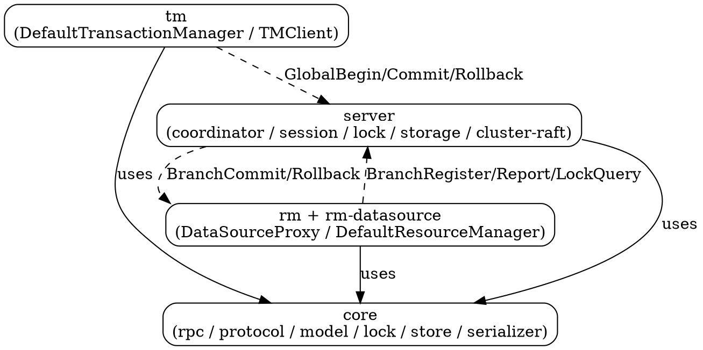

## Introduction

Seata（Simple Extensible Autonomous Transaction Architecture）是阿里开源、后捐给 Apache 的**分布式事务框架**。本笔记基于 **apache/seata @ v2.7.0** 源码做架构级拆解，与 Seata.md 枢纽的概念性介绍互补：这里聚焦**模块拓扑、核心抽象与启动装配**；全局事务链路、RPC 传输层、TC 内部与 RM/AT 资源实现则分别由 Transaction Flow、RPC Transport、TC Coordinator、AT and Undo Log 各册展开。

## Three Roles

Seata 的架构围绕三个角色展开，三者通过 Netty RPC 通信：

- **TC（Transaction Coordinator，事务协调者）**：独立部署的服务端（`server` 模块，即 `seata-server`）。维护全局事务与分支事务的状态，驱动全局提交/回滚，是全局锁与事务日志（session）的持有者。
- **TM（Transaction Manager，事务管理器）**：嵌入在业务应用里的客户端（`tm` 模块）。定义全局事务的边界——开启、提交或回滚全局事务。一个 `@GlobalTransactional` 注解就对应一个 TM 驱动的全局事务。
- **RM（Resource Manager，资源管理器）**：同样嵌入业务应用（`rm` + `rm-datasource` 模块）。管理分支事务使用的资源（如一个 JDBC 数据源），向 TC 注册分支、上报状态，并在 TC 指令下提交/回滚分支。

> 关键：XA / TCC / SAGA 三种模式复用同一套 TC/TM/RM 角色与 RPC 通道，差别只在 RM 侧的 `BranchType` 与对应的 `Core` / `ResourceManager` 实现。

## Module Topology

各模块职责：

| 模块 | 包根 | 职责 |
| :--- | :--- | :--- |
| `core` | `org.apache.seata.core` | 公共内核：RPC 传输（`rpc.netty`）、协议（`protocol`）、模型（`model`）、锁接口（`lock`）、存储接口（`store`）、序列化（`serializer`）、压缩（`compressor`）。TC/TM/RM 都依赖它。 |
| `tm` | `org.apache.seata.tm` | TM 客户端：`DefaultTransactionManager`、`TMClient`、`TransactionalTemplate`。 |
| `rm` | `org.apache.seata.rm` | RM 客户端骨架：`DefaultRMHandler`、`DefaultResourceManager`、`RMClient`。 |
| `rm-datasource` | `org.apache.seata.rm.datasource` | AT 模式的资源实现：`DataSourceProxy`、`ExecuteTemplate`、executor、undo。 |
| `server` | `org.apache.seata.server` | TC：`DefaultCoordinator`、`DefaultCore`、`session`、`lock`、`storage`、`cluster`(Raft)、`console`。 |
| `config` / `discovery` / `namingserver` | `org.apache.seata.config` / `discovery` | 配置中心、注册中心、TC 注册发现（namingserver 是 Seata 自带的无依赖注册中心）。 |
| `sqlparser` | `org.apache.seata.sqlparser` | SQL 解析，AT 模式识别 DML 类型与表/列元数据。 |
| `saga` / `tcc` / `xa` | 各自包 | 三种非 AT 模式的实现。 |
| `spring` | `org.apache.seata.spring` | Spring 集成：`GlobalTransactionScanner` 把 `@GlobalTransactional` 织成 Advisor。 |
| `integration-tx-api` | `org.apache.seata.integration.tx.api` | 跨框架的通用切面与注解（`@GlobalTransactional` / `@GlobalLock` 定义、核心拦截 handler）—— 本笔记写作时该模块未随源码落盘，仅描述其在调用链中的位置。 |

## Core Abstractions

全局/分支事务在 TC 侧以**会话（Session）** 形式存在，在客户端以**模板/管理器** 形式存在：

| 抽象 | 所在 | 角色 |
| :--- | :--- | :--- |
| `GlobalSession` / `BranchSession` | `server.session` | TC 侧全局/分支事务的内存态，可持久化、可加锁。 |
| `GlobalTransaction` / `DefaultGlobalTransaction` | `tm.api` | TM 侧全局事务句柄；`Launcher`（有 XID 时）才真正驱动 TC。 |
| `TransactionManager` | `core.model` (SPI) | TM 与 TC 的契约：`begin/commit/rollback/getStatus`。 |
| `ResourceManager` (`Inbound`/`Outbound`) | `core.model` (SPI) | RM 与 TC 的契约：`branchRegister/branchReport/branchCommit/branchRollback/lockQuery`。 |
| `Core` / `AbstractCore` / `ATCore` | `server.coordinator` / `server.transaction.at` | TC 侧按 `BranchType` 分派的事务核心。 |
| `DefaultCoordinator` | `server.coordinator` | 既是 `TransactionMessageHandler`（入站入口）又是各 `doXxx` 的实现，并持有全部调度线程。 |
| `RootContext` | `core.context` | 线程级上下文，持有当前 XID / BranchType / GlobalLockFlag，是 XID 在调用链中传播的基础。 |

## Startup and Wiring

TC 启动（`server` 模块）：
1. `Server.start()` 创建 `NettyRemotingServer` 与 `DefaultCoordinator`（Raft 模式下为 `RaftCoordinator`）。
2. `SessionHolder.init()` + `LockerManagerFactory.init()` 装配会话管理器与锁管理器（后端可为 db/file/redis/raft）。
3. `coordinator.init()` 启动调度线程（retry commit/rollback、timeout check、async commit、undo log 清理）。
4. `nettyRemotingServer.setHandler(coordinator)` 把协调者注入 Netty；`init()` 时 `registerProcessor()` 把所有事务消息类型注册到 `ServerOnRequestProcessor`。

客户端启动（`GlobalTransactionScanner`，`spring` 模块）：
1. `afterPropertiesSet()` 中 `initClient()` 一次性初始化 `TMClient` 与 `RMClient`，分别向 TC 发 `RegisterTMRequest` / `RegisterRMRequest` 完成注册。
2. 为携带 `@GlobalTransactional` / `@GlobalLock` / TCC 的 bean 织入 Seata Advisor，调用时由 `TransactionalTemplate` 编排 begin/commit/rollback。

## Links
- [Seata](/docs/CS/Framework/Seata/Seata.md)
- [Transaction Flow](/docs/CS/Framework/Seata/Transaction_Flow.md)
- [RPC Transport](/docs/CS/Framework/Seata/RPC_Transport.md)
- [TC Coordinator](/docs/CS/Framework/Seata/TC_Coordinator.md)
- [AT and Undo Log](/docs/CS/Framework/Seata/AT_UndoLog.md)

## References
- Apache Seata source (v2.7.0): https://github.com/apache/seata/tree/v2.7.0
- Seata official docs: https://seata.io/en-us/docs/overview/what-is-seata.html
