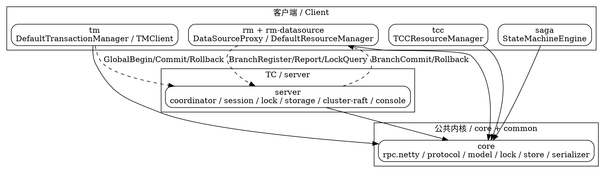

# Architecture

## Introduction

本笔记从模块拓扑、核心抽象与启动装配三个角度拆解 Seata 架构，与枢纽 [Seata](/docs/CS/Framework/Seata/Seata.md) 的概念介绍互补：全局事务链路、RPC、TC 内部与 RM/AT 资源实现分别由 [Transaction Flow](/docs/CS/Framework/Seata/Transaction_Flow.md)、[RPC Transport](/docs/CS/Framework/Seata/RPC_Transport.md)、[TC Coordinator](/docs/CS/Framework/Seata/TC_Coordinator.md)、[AT and Undo Log](/docs/CS/Framework/Seata/AT_UndoLog.md) 展开。

> 版本基线：apache/seata **v2.7.0**。以下类名与片段均取自该 tag。

## Module Topology

源码顶层是一组 Maven 模块，`tm`/`rm`/`rm-datasource`/`tcc`/`saga` 是客户端侧，`server` 是 TC，`core` 为三者共用内核：



模块职责速览：

| 模块 | 包根 | 职责 |
| :--- | :--- | :--- |
| `core` | `org.apache.seata.core` | RPC（`rpc.netty`）、协议（`protocol`）、模型（`model`）、锁/存储接口、序列化、压缩 |
| `common` | `org.apache.seata.core.model`（GlobalStatus 等） | 跨端共享枚举与工具；`GlobalStatus` 实际落在此模块 |
| `tm` | `org.apache.seata.tm` | TM：`DefaultTransactionManager`、`TMClient`、`TransactionalTemplate` |
| `rm` / `rm-datasource` | `org.apache.seata.rm` / `.datasource` | RM 骨架 + AT 资源实现（`DataSourceProxy`、`undo`） |
| `tcc` / `saga` | 各自包 | TCC 反射调用与 Fence、Saga 状态机引擎 |
| `server` | `org.apache.seata.server` | TC：`DefaultCoordinator`、`session`、`lock`、`storage`、`cluster-raft` |
| `sqlparser` | `org.apache.seata.sqlparser` | AT 模式 SQL 解析，识别 DML 类型与表/列元数据 |
| `spring` | `org.apache.seata.spring` | `GlobalTransactionScanner` 把 `@GlobalTransactional` 织成 Advisor |
| `integration-tx-api` | `org.apache.seata.integration.tx.api` | 跨框架注解、拦截器参数与通用 Fence（`DefaultCommonFenceHandler`） |

## Core Abstractions

全局/分支事务在 TC 侧以 **Session** 存在，在客户端以模板/管理器存在：

| 抽象 | 所在 | 角色 |
| :--- | :--- | :--- |
| `GlobalSession` / `BranchSession` | `server.session` | TC 侧会话，可持久化、可加锁 |
| `GlobalTransaction` / `DefaultGlobalTransaction` | `tm.api` | TM 侧句柄；`Launcher` 才真正驱动 TC，`Participant` 是 no-op |
| `TransactionManager` | SPI | TM 与 TC 契约：`begin/commit/rollback/getStatus` |
| `ResourceManager` | SPI | RM 与 TC 契约：`branchRegister/branchReport/branchCommit/branchRollback/lockQuery` |
| `Core` / `AbstractCore` / `ATCore` | `server.coordinator` / `server.transaction.at` | TC 侧按 `BranchType` 分派的事务核心 |
| `DefaultCoordinator` | `server.coordinator` | 既是入站 `TransactionMessageHandler`，又实现各 `doXxx`，并持有全部调度线程 |
| `RootContext` | `core.context` | 线程级上下文，持有 XID / BranchType / GlobalLockFlag |

### Session Holds XID and Lock

`GlobalSession` 构造函数同时初始化事务 ID、状态与 XID——这是"XID 由 TC 生成"的源码落点：

```java
this.transactionId = UUIDGenerator.generateUUID();
this.status = GlobalStatus.Begin;
this.lazyLoadBranch = lazyLoadBranch;
if (!lazyLoadBranch) {
    this.branchSessions = new ArrayList<>();
}
this.applicationId = applicationId;
this.transactionServiceGroup = transactionServiceGroup;
this.transactionName = transactionName;
this.timeout = timeout;
this.xid = XID.generateXID(transactionId);
```

`GlobalStatus` 枚举（定义在 `common` 模块）列出全局事务的完整状态机，二阶段重试状态用 `CommitRetrying` / `RollbackRetrying`，AT 专用异步提交态是 `AsyncCommitting`：

```java
Begin(1, "global transaction start"),
Committing(2, "2Phase committing"),
CommitRetrying(3, "2Phase committing failure retry"),
Rollbacking(4, "2Phase rollbacking"),
RollbackRetrying(5, "2Phase rollbacking failure retry"),
TimeoutRollbacking(6, "after global transaction timeout rollbacking"),
TimeoutRollbackRetrying(7, "after global transaction timeout rollback retrying"),
AsyncCommitting(8, "2Phase committing, used for AT mode"),
Committed(9, "global transaction completed with status committed"),
```

### Dispatch by BranchType

`DefaultCore` 是二阶段总控，所有 `branchXxx` 都按 `BranchType` 委托给对应 Core——这是四种模式共存的枢纽：

```java
@Override
public BranchStatus branchCommit(GlobalSession globalSession, BranchSession branchSession)
        throws TransactionException {
    return getCore(branchSession.getBranchType()).branchCommit(globalSession, branchSession);
}

@Override
public BranchStatus branchRollback(GlobalSession globalSession, BranchSession branchSession)
        throws TransactionException {
    return getCore(branchSession.getBranchType()).branchRollback(globalSession, branchSession);
}
```

## Startup and Wiring

### TC Startup

TC 启动顺序：`Server` → `NettyRemotingServer` + `DefaultCoordinator`（Raft 模式下为 `RaftCoordinator`）→ `SessionHolder.init()` + `LockerManagerFactory.init()` → `coordinator.init()` 起调度线程 → `registerProcessor()` 把消息类型注册到 `ServerOnRequestProcessor`。

`SessionHolder.init(sessionMode)` 按会话模式分装配：DB 模式加载 `SessionManager` 并 `reload`；RAFT/FILE 模式另走分支，RAFT 模式还会 `RaftServerManager.init()` + `start()`：

```java
public static void init(SessionMode sessionMode) {
    if (null == sessionMode) {
        sessionMode = StoreConfig.getSessionMode();
    }
    LOGGER.info("use session store mode: {}", sessionMode.getName());
    DISTRIBUTED_LOCKER = DistributedLockerFactory.getDistributedLocker(sessionMode.getName());
    if (SessionMode.DB.equals(sessionMode)) {
        ROOT_SESSION_MANAGER = EnhancedServiceLoader.load(SessionManager.class, SessionMode.DB.getName());
        reload(sessionMode);
        ROOT_VGROUP_MAPPING_MANAGER =
                EnhancedServiceLoader.load(VGroupMappingStoreManager.class, SessionMode.DB.getName());
    } else if (SessionMode.RAFT.equals(sessionMode) || SessionMode.FILE.equals(sessionMode)) {
        if (SessionMode.RAFT.equals(sessionMode)) {
            String group = CONFIG.getConfig(ConfigurationKeys.SERVER_RAFT_GROUP, DEFAULT_SEATA_GROUP);
            ROOT_SESSION_MANAGER = EnhancedServiceLoader.load(
                    SessionManager.class, SessionMode.RAFT.getName(), new Object[] {ROOT_SESSION_MANAGER_NAME});
            SESSION_MANAGER_MAP = new HashMap<>();
            SESSION_MANAGER_MAP.put(group, ROOT_SESSION_MANAGER);
            ROOT_VGROUP_MAPPING_MANAGER =
                    EnhancedServiceLoader.load(VGroupMappingStoreManager.class, SessionMode.RAFT.getName());
            RaftServerManager.init();
            RaftServerManager.start();
        }
        // 其余 FILE / REDIS 分支分别 EnhancedServiceLoader.load 对应 SessionManager 后 reload(sessionMode)
    }
}
```

> 源码细节：FILE 分支按 `store.file.dir` 装配 `SessionManager` 并 `reload`；REDIS 分支类似。这里只贴 DB 与 RAFT 两段连续代码，其余分支用文字概括。

`coordinator.init()` 用 `scheduleAtFixedRate` 起 5 组调度线程（retry rollback / retry commit / async commit / timeout check / undoLog delete），每组都套 `SessionHolder.distributedLockAndExecute` 保证多 TC 下只跑一份：

```java
public void init() {
    retryRollbacking.scheduleAtFixedRate(
            () -> SessionHolder.distributedLockAndExecute(RETRY_ROLLBACKING, this::handleRetryRollbacking),
            0, CONFIG.getScheduledAtFixedRate(), TimeUnit.MILLISECONDS);
    retryCommitting.scheduleAtFixedRate(
            () -> SessionHolder.distributedLockAndExecute(RETRY_COMMITTING, this::handleRetryCommitting),
            0, CONFIG.getScheduledAtFixedRate(), TimeUnit.MILLISECONDS);
    asyncCommitting.scheduleAtFixedRate(
            () -> SessionHolder.distributedLockAndExecute(ASYNC_COMMITTING, this::handleAsyncCommitting),
            0, CONFIG.getScheduledAtFixedRate(), TimeUnit.MILLISECONDS);
    timeoutCheck.scheduleAtFixedRate(
            () -> SessionHolder.distributedLockAndExecute(TX_TIMEOUT_CHECK, this::timeoutCheck),
            0, CONFIG.getScheduledAtFixedRate(), TimeUnit.MILLISECONDS);
    undoLogDelete.scheduleAtFixedRate(
            () -> SessionHolder.distributedLockAndExecute(UNDOLOG_DELETE, this::undoLogDelete),
            0, CONFIG.getScheduledAtFixedRate(), TimeUnit.MILLISECONDS);
}
```

### Client Startup

客户端由 `GlobalTransactionScanner.afterPropertiesSet()` 一次性初始化 `TMClient` / `RMClient`，分别向 TC 注册；并为 `@GlobalTransactional` / TCC / Saga 注解的 bean 织入 Advisor，调用时经 `TransactionalTemplate` 编排。

## Links
- [Seata](/docs/CS/Framework/Seata/Seata.md)
- [Transaction Flow](/docs/CS/Framework/Seata/Transaction_Flow.md)
- [TC Coordinator](/docs/CS/Framework/Seata/TC_Coordinator.md)
- [RPC Transport](/docs/CS/Framework/Seata/RPC_Transport.md)
- [AT and Undo Log](/docs/CS/Framework/Seata/AT_UndoLog.md)
- [TC Storage](/docs/CS/Framework/Seata/TC_Storage.md)

## References
- Apache Seata source (v2.7.0): https://github.com/apache/seata/tree/v2.7.0
- Seata official docs: https://seata.io/en-us/docs/overview/what-is-seata.html
