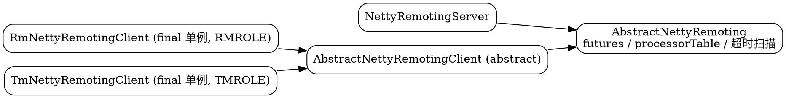

# RPC Transport

## Introduction

本笔记拆解 Seata 的 **RPC 传输层与通信协议**（apache/seata @ v2.7.0）。一次事务的端到端链路与 TC/RM 内部实现分别见 [Transaction Flow](/docs/CS/Framework/Seata/Transaction_Flow.md)、[TC Coordinator](/docs/CS/Framework/Seata/TC_Coordinator.md)。

> 版本基线：apache/seata **v2.7.0**。以下片段均取自该 tag。

## Two Type Axes

源码里有两套"类型"，务必区分——这是读 RPC 代码最容易踩的坑：

1. **线级消息种类** `RpcMessage.messageType`（`byte`）：只表示请求/响应/单向/心跳，与业务无关。定义在同包的 `ProtocolConstants`（**注意不是 `core.constants` 包**）：

```java
byte[] MAGIC_CODE_BYTES = {(byte) 0xda, (byte) 0xda};

byte MSGTYPE_RESQUEST_SYNC = 0;
byte MSGTYPE_RESPONSE = 1;
byte MSGTYPE_RESQUEST_ONEWAY = 2;
byte MSGTYPE_HEARTBEAT_REQUEST = 3;
byte MSGTYPE_HEARTBEAT_RESPONSE = 4;
```

2. **业务消息类型** `MessageType.getTypeCode()`（`short`）：这才是 TM/RM/TC 之间的链路契约，也是 `processorTable` 分派的 key：

```java
short TYPE_GLOBAL_BEGIN = 1;
short TYPE_GLOBAL_BEGIN_RESULT = 2;
short TYPE_GLOBAL_COMMIT = 7;
short TYPE_GLOBAL_COMMIT_RESULT = 8;
short TYPE_GLOBAL_ROLLBACK = 9;
short TYPE_GLOBAL_ROLLBACK_RESULT = 10;
```

```java
short TYPE_BRANCH_REGISTER = 11;
short TYPE_BRANCH_REGISTER_RESULT = 12;
short TYPE_BRANCH_STATUS_REPORT = 13;
short TYPE_BRANCH_STATUS_REPORT_RESULT = 14;
```

`RpcMessage` 头里写的是前者（线级种类），`processorTable` 用后者（业务类型）查处理器。两者都叫 "type"，极易看错。

## Remoting Classes



- `AbstractNettyRemoting`：收发、超时、`processorTable` 分派的公共基类。
- `NettyRemotingServer`：服务端；`registerProcessor()` 把所有 server 侧消息类型注册到 `ServerOnRequestProcessor`。
- **没有 `NettyRemotingClient` 这个具体类**（全仓无此类）：客户端侧是抽象基类 `AbstractNettyRemotingClient` + 两个 `final` 单例子类 `RmNettyRemotingClient` / `TmNettyRemotingClient`，均用 `volatile instance` + synchronized 双重检查的 `getInstance()`。

## Wire Format (V1 equals V2)

帧布局（`ProtocolEncoderV1.encode`，V2 仅覆写 `protocolVersion()`，字节布局完全一致）：

```
 0       2   3        7        9     10    11    12    16
+--------+---+--------+--------+-----+-----+-----+-----+
| magic  |ver|fullLen |headLen |type |code |comp | id  |
|0xda da | 1 |  4B    |  2B    | 1B  | 1B  | 1B  | 4B  |
+--------+---+--------+--------+-----+-----+-----+-----+
| headMap(可选, 零拷贝)        | body(codec 序列化 -> compressor 压缩) |
```

`encode` 真实片段（注意最后回填 fullLength/headLength，心跳跳过 body）：

```java
byte messageType = rpcMessage.getMessageType();
out.writeBytes(ProtocolConstants.MAGIC_CODE_BYTES);
out.writeByte(protocolVersion());
// full Length(4B) and head length(2B) will fix in the end.
out.writerIndex(out.writerIndex() + 6);
out.writeByte(messageType);
out.writeByte(rpcMessage.getCodec());
out.writeByte(rpcMessage.getCompressor());
out.writeInt(rpcMessage.getId());

Map<String, String> headMap = rpcMessage.getHeadMap();
if (headMap != null && !headMap.isEmpty()) {
    int headMapBytesLength = HeadMapSerializer.getInstance().encode(headMap, out);
    headLength += headMapBytesLength;
    fullLength += headMapBytesLength;
}

byte[] bodyBytes = null;
if (messageType != ProtocolConstants.MSGTYPE_HEARTBEAT_REQUEST
        && messageType != ProtocolConstants.MSGTYPE_HEARTBEAT_RESPONSE) {
    // heartbeat has no body
    Serializer serializer = SerializerServiceLoader.load(
            SerializerType.getByCode(rpcMessage.getCodec()), protocolVersion());
    bodyBytes = serializer.serialize(rpcMessage.getBody());
    Compressor compressor = CompressorFactory.getCompressor(rpcMessage.getCompressor());
    bodyBytes = compressor.compress(bodyBytes);
    fullLength += bodyBytes.length;
}
```

- `magic = 0xda,0xda`；`MAX_FRAME_LENGTH = 8MB`；`V1_HEAD_LENGTH = 16`。
- 默认 `codec = SEATA(1)`（`SerializerType.SEATA`），默认 `compressor = NONE(0)`（`CompressorType.NONE`，可由 `COMPRESSOR_FOR_RPC` 覆盖）。
- **心跳线上无 body**（`// heartbeat has no body`），但内存对象 `RpcMessage.body` 仍持有 `HeartbeatMessage` 引用，只是编码时跳过——"内存有 body 对象"与"线上有 body 字节"是两回事。

## Version Detection

`MultiProtocolDecoder` 用 `LengthFieldBasedFrameDecoder(maxFrameLength, 3, 4, -7, 0)` 按 fullLength 切帧，`decideVersion` 读前 3 字节（magic + version）嗅探版本，从 map 取对应 decoder/encoder，解码后把自己从 pipeline 移除：

```java
protected byte decideVersion(Object in) {
    if (in instanceof ByteBuf) {
        ByteBuf frame = (ByteBuf) in;
        frame.markReaderIndex();
        byte b0 = frame.readByte();
        byte b1 = frame.readByte();
        if (ProtocolConstants.MAGIC_CODE_BYTES[0] != b0 || ProtocolConstants.MAGIC_CODE_BYTES[1] != b1) {
            throw new IllegalArgumentException("Unknown magic code: " + b0 + ", " + b1);
        }
        byte version = frame.readByte();
        frame.resetReaderIndex();
        return version;
    }
    return -1;
}
```

V2 编解码器都只改版本号，帧布局与 V1 字节级一致：

```java
public class ProtocolEncoderV2 extends ProtocolEncoderV1 {
    @Override
    public byte protocolVersion() {
        return ProtocolConstants.VERSION_2;
    }
}
```

## Processor Dispatch

分派入口恒为 `AbstractNettyRemoting.processMessage`：取 body 的 `getTypeCode()`（业务类型）转 int 查 `processorTable`——**决定处理器的是业务 typeCode，不是帧头的 messageType**：

```java
Object body = rpcMessage.getBody();
if (body instanceof MessageTypeAware) {
    MessageTypeAware messageTypeAware = (MessageTypeAware) body;
    final Pair<RemotingProcessor, ExecutorService> pair =
            this.processorTable.get((int) messageTypeAware.getTypeCode());
    if (pair != null) {
        if (pair.getSecond() != null) {
            pair.getSecond().execute(() -> {
                try {
                    pair.getFirst().process(ctx, rpcMessage);
                } catch (Throwable th) {
                    LOGGER.error(FrameworkErrorCode.NetDispatch.getErrCode(), th.getMessage(), th);
                } finally {
                    MDC.clear();
                }
            });
        } else {
            pair.getFirst().process(ctx, rpcMessage);
        }
    } else {
        LOGGER.error("This message type [{}] has no processor.", messageTypeAware.getTypeCode());
    }
}
```

TC 侧所有事务类请求统一进 `ServerOnRequestProcessor` → `TransactionMessageHandler.onRequest()` → `request.handle()` → `AbstractTCInboundHandler` 的 8 个 `handle(...)` → `DefaultCoordinator` 的 `doXxx`（见 [TC Coordinator](/docs/CS/Framework/Seata/TC_Coordinator.md)）。`executor == null` 的处理器（注册、心跳、响应）在 Netty IO 线程直接跑；请求类走 `messageExecutor`。

## Request / Response Correlation

关联 key = `RpcMessage.id`（int，自增）。`sendSync` 把 `id → MessageFuture(CompletableFuture)` 放进 `futures`，`future.get(timeout)` 阻塞。响应回来由 `ClientOnResponseProcessor` 用 id 取出并唤醒：

```java
Integer id = rpcMessage.getId();
MessageFuture messageFuture = futures.remove(id);
if (messageFuture != null) {
    messageFuture.setResultMessage(rpcMessage.getBody());
}
```

合并/批量响应 `MergeResultMessage` 则按 `mergeMsgMap` 拆回各子消息 id，逐个子 future 唤醒。`MergedWarpMessage` 把多条子消息合成一帧；超时由独立 timer 每 3s 扫描 `futures` 置 `TimeoutException`。

## Corrections

- **两套 type 体系**：帧头 `messageType`（byte，线级种类）vs body `getTypeCode()`（short，业务类型）；分派依据后者。
- **V2 帧布局 == V1**：`ProtocolEncoderV2`/`ProtocolDecoderV2` 只覆写 `protocolVersion()`；按版本分流的是 `MultiProtocolDecoder` 首帧嗅探（首帧驱动，非握手）。
- **常量包路径**：`MessageType` 与 `ProtocolConstants` 都在 `core/src/main/java/org/apache/seata/core/protocol/`，不是 `core.constants`。
- **客户端无 `NettyRemotingClient` 具体类**：只有两个 final 单例 `RmNettyRemotingClient` / `TmNettyRemotingClient`。
- **连接管理**：服务端 `ChannelManager` 用 `resourceId→appId→ip→port` 多级索引 RM 通道；客户端 `NettyClientChannelManager` 负责连接池与重连；reader-idle 服务端关通道，writer-idle 客户端发 PING。

## Links
- [Seata](/docs/CS/Framework/Seata/Seata.md)
- [Architecture](/docs/CS/Framework/Seata/Architecture.md)
- [Transaction Flow](/docs/CS/Framework/Seata/Transaction_Flow.md)
- [TC Coordinator](/docs/CS/Framework/Seata/TC_Coordinator.md)
- [Raft HA](/docs/CS/Framework/Seata/Raft_HA.md)

## References
- Apache Seata source (v2.7.0): https://github.com/apache/seata/tree/v2.7.0
