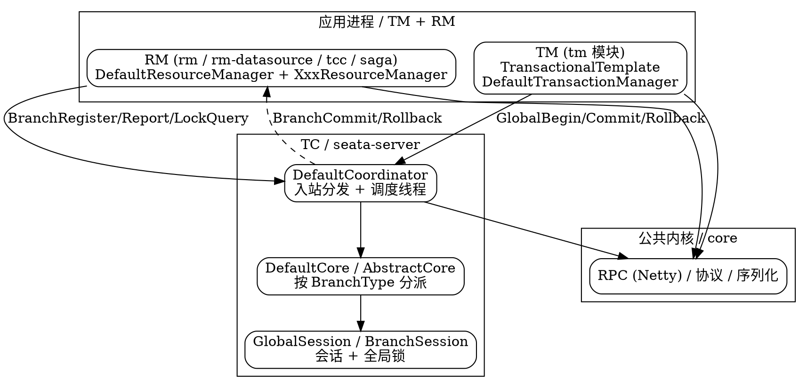

# Seata

## Introduction

Seata（Simple Extensible Autonomous Transaction Architecture）是阿里开源、后捐给 Apache 的分布式事务框架，用 TC / TM / RM 三个角色统一承载 AT、TCC、Saga、XA 四种事务模式。

> 版本基线：apache/seata **v2.7.0**（tag `v2.7.0`，commit `ddd37ff`）。以下源码片段均取自该 tag，正文不写行号，按全库规范直接贴真实代码。

先抛三个容易搞错的直觉：

- **XID 不是 TM 拼的，而是 TC 端 `GlobalSession` 构造时生成的**——`DefaultCore.begin` 只是 `GlobalSession.createGlobalSession(...)`，XID 在 `GlobalSession` 构造函数里 `XID.generateXID(transactionId)`。
- **四种模式不是四套事务框架**，而是同一套 TC/TM/RM + Netty 通道，靠 `BranchType`（`AT/TCC/SAGA/XA`）在 RM 侧分派到不同 `ResourceManager`。
- **AT 的二阶段 commit 不碰业务数据**，只异步删 `undo_log`；TM 收到 `Committed` ≠ RM 已删日志。

## Architecture

### Three Roles and Three Tiers

Seata 把「应用内的 TM/RM / 独立部署的 TC / 公共内核」拆成三层：业务应用嵌 TM（定义全局事务边界）与 RM（管理分支资源），TC（`seata-server`）持有会话、全局锁并驱动二阶段，`core` 提供 RPC、协议、模型、锁与存储接口供三者共用。



### Global Transaction Boundary (TM)

一次 `@GlobalTransactional` 的执行边界由 `TransactionalTemplate.execute()` 编排。v2.7.0 这里**已支持完整的 7 种事务传播行为**（REQUIRED / REQUIRES_NEW / NOT_SUPPORTED / SUPPORTS / NEVER / MANDATORY 等），并带 suspend/resume——不只是旧资料里"嵌套注解 no-op"那么简单：

```java
// 1.1 Get current transaction, if not null, the tx role is 'GlobalTransactionRole.Participant'.
GlobalTransaction tx = GlobalTransactionContext.getCurrent();

// 1.2 Handle the transaction propagation.
Propagation propagation = txInfo.getPropagation();
SuspendedResourcesHolder suspendedResourcesHolder = null;
try {
    switch (propagation) {
        case NOT_SUPPORTED:
            if (existingTransaction(tx)) {
                suspendedResourcesHolder = tx.suspend(false);
            }
            return business.execute();
        case REQUIRES_NEW:
            if (existingTransaction(tx)) {
                suspendedResourcesHolder = tx.suspend(false);
            }
            tx = GlobalTransactionContext.createNew();
            break;
        case SUPPORTS:
            if (notExistingTransaction(tx)) {
                return business.execute();
            }
            break;
        case REQUIRED:
            tx = GlobalTransactionContext.getCurrentOrCreate();
            break;
        case NEVER:
            if (existingTransaction(tx)) {
                throw new TransactionException(String.format(
                        "Existing transaction found for transaction marked with propagation 'never', xid = %s",
                        tx.getXid()));
            } else {
                return business.execute();
            }
        case MANDATORY:
            if (notExistingTransaction(tx)) {
                throw new TransactionException(
                        "No existing transaction found for transaction marked with propagation 'mandatory'");
            }
            break;
        default:
            throw new TransactionException("Not Supported Propagation:" + propagation);
    }
```

只有 `Launcher`（最外层）真正驱动 TC，`Participant`（已有 XID）的 begin/commit/rollback 是 no-op：

```java
// 2. If the tx role is 'GlobalTransactionRole.Launcher', send the request of beginTransaction to TC,
//    else do nothing. Of course, the hooks will still be triggered.
beginTransaction(txInfo, tx);

Object rs;
try {
    // Do Your Business
    rs = business.execute();
} catch (Throwable ex) {
    // 3. The needed business exception to rollback.
    completeTransactionAfterThrowing(txInfo, tx, ex);
    throw ex;
}

// 4. everything is fine, commit.
commitTransaction(tx, txInfo);
```

### XID Is Generated on TC

`DefaultCore.begin` 只是创建会话并返回 XID，真正的 XID 生成在 `GlobalSession` 构造函数里：

```java
public String begin(String applicationId, String transactionServiceGroup, String name, int timeout)
        throws TransactionException {
    GlobalSession session =
            GlobalSession.createGlobalSession(applicationId, transactionServiceGroup, name, timeout);
    MDC.put(RootContext.MDC_KEY_XID, session.getXid());
    session.begin();
    MetricsPublisher.postSessionDoingEvent(session, false);
    return session.getXid();
}
```

```java
// GlobalSession 构造函数
this.transactionId = UUIDGenerator.generateUUID();
this.status = GlobalStatus.Begin;
this.lazyLoadBranch = lazyLoadBranch;
if (!lazyLoadBranch) {
    this.branchSessions = new ArrayList<>();
}
this.applicationId = applicationId;
this.transactionServiceGroup = transactionServiceGroup;
this.transactionName = transactionName;
this.timeout = timeout;
this.xid = XID.generateXID(transactionId);
```

### Modes Share One Infrastructure

`BranchType` 是四种模式的唯一分派键，`DefaultResourceManager` 用 `Map<BranchType, ResourceManager>` 把二阶段请求路由到对应实现——AT/TCC/Saga/XA 共用同一个 TC、TM 与 Netty 通道：

```java
public enum BranchType {
    // AT Branch
    AT,
    // TCC Branch
    TCC,
    // SAGA Branch
    SAGA,
    // XA Branch
    XA,
    // SAGA_ANNOTATION
    SAGA_ANNOTATION;
}
```

```java
protected static Map<BranchType, ResourceManager> resourceManagers = new ConcurrentHashMap<>();

@Override
public BranchStatus branchCommit(
        BranchType branchType, String xid, long branchId, String resourceId, String applicationData)
        throws TransactionException {
    return getResourceManager(branchType).branchCommit(branchType, xid, branchId, resourceId, applicationData);
}
```

各模式沿这条主干展开：[AT and Undo Log](/docs/CS/Framework/Seata/AT_UndoLog.md) 是默认模式（自动代理 + 前后镜像 + `undo_log`）；[XA](/docs/CS/Framework/Seata/XA.md) 把两阶段委托数据库原生 XA；[TCC](/docs/CS/Framework/Seata/TCC.md) 由业务手写 Try/Confirm/Cancel 并用 Fence 防悬挂；[Saga](/docs/CS/Framework/Seata/Saga.md) 用状态机编排长事务。TC 侧的会话、锁与高可用则分别见 [TC Coordinator](/docs/CS/Framework/Seata/TC_Coordinator.md)、[Global Lock](/docs/CS/Framework/Seata/Global_Lock.md)、[Raft HA](/docs/CS/Framework/Seata/Raft_HA.md)。

## Links
- [Architecture](/docs/CS/Framework/Seata/Architecture.md)
- [Transaction Flow](/docs/CS/Framework/Seata/Transaction_Flow.md)
- [AT and Undo Log](/docs/CS/Framework/Seata/AT_UndoLog.md)
- [TC Coordinator](/docs/CS/Framework/Seata/TC_Coordinator.md)
- [Global Lock](/docs/CS/Framework/Seata/Global_Lock.md)
- [RPC Transport](/docs/CS/Framework/Seata/RPC_Transport.md)

## References
- Apache Seata source (v2.7.0): https://github.com/apache/seata/tree/v2.7.0
- Seata official docs: https://seata.io/en-us/docs/overview/what-is-seata.html
