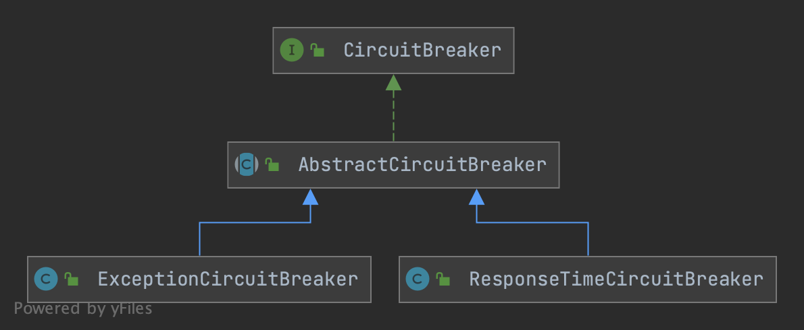

## Introduction

熔断降级用于自动切断不稳定的弱依赖调用，避免局部不稳定在调用链上被放大成雪崩。在 Sentinel 1.8.0 起，熔断被重构为**以熔断器（CircuitBreaker）为核心的状态机**，由链上的 `DegradeSlot` 执行。`SphU.entry()` 触发熔断规则时同样抛出 `BlockException`（`DegradeException`），可 catch 后走降级逻辑。

> [!NOTE] 版本基线
> 下文以 **Sentinel 1.8.0+** 的熔断模型为准（慢调用比例策略、半开探测恢复、熔断事件监听均自 1.8.0 引入）。

<div style="text-align: center;">

</div>
<p style="text-align: center;">Fig.1. CircuitBreaker 状态机</p>

## 状态机

熔断器有三个状态（与原有接口一致）：

```java
public interface CircuitBreaker {
    DegradeRule getRule();
    boolean tryPass(Context context);
    State currentState();
    void onRequestComplete(Context context);

    enum State {
        OPEN,       // 熔断打开，拒绝所有请求
        HALF_OPEN,  // 半开，仅放行探测请求
        CLOSED      // 关闭，正常放行
    }
}
```

`AbstractCircuitBreaker` 持有状态、熔断规则与两个关键字段：

```java
public abstract class AbstractCircuitBreaker implements CircuitBreaker {
    protected final DegradeRule rule;
    protected final int recoveryTimeoutMs;        // = rule.timeWindow * 1000，熔断时长
    protected final AtomicReference<State> currentState = new AtomicReference<>(State.CLOSED);
    protected volatile long nextRetryTimestamp;   // 下一次允许半开探测的时间戳
}
```

状态流转：

```
        CLOSED ──(指标超阈值)──▶ OPEN
          ▲                      │
          │                      │ 经过 recoveryTimeoutMs
          │                      ▼
          └────(探测成功)──── HALF_OPEN
                 ▲                │
                 │                │ 探测失败
                 └────(重置计时)───┘
```

- **CLOSED → OPEN**：在 CLOSED 态，`onRequestComplete()` 按策略评估，若统计窗口内指标（慢调用比例 / 异常比例 / 异常数）超阈值，则切换到 OPEN，并设 `nextRetryTimestamp = 当前时间 + recoveryTimeoutMs`。
- **OPEN → HALF_OPEN**：OPEN 态下，若「当前时间 ≥ nextRetryTimestamp」，`tryPass()` 会用 CAS 把状态从 OPEN 切到 HALF_OPEN；切换成功的那个请求即「探测请求」，被放行。
- **HALF_OPEN → CLOSED / OPEN**：探测请求在 `onRequestComplete()` 中判定——若探测健康（未触发慢/异常），恢复 CLOSED；否则回到 OPEN 并重新设置 `nextRetryTimestamp`（重新计时冷却）。

> [!NOTE]
> `tryPass()` 在 HALF_OPEN 态直接返回 `false`（除已抢到探测资格的请求外），保证同一时刻只有一个探测请求在飞。

## 三种熔断策略

`DegradeRule.grade` 决定策略，`count` 为阈值：

| grade | 策略 | `count` 含义 | 触发条件 |
| :--- | :--- | :--- | :--- |
| `RT`（0） | **慢调用比例** | 慢调用 RT 上界（ms） | 统计窗口内 RT 超上界的请求**占比** ≥ `slowRatioThreshold`，且总请求数 ≥ `minRequestAmount` |
| `EXCEPTION_RATIO`（1） | **异常比例** | 异常比例阈值（0~1） | 统计窗口内异常比例 ≥ `count`，且总请求数 ≥ `minRequestAmount` |
| `EXCEPTION_COUNT`（2） | **异常数** | 异常数阈值（整数） | 统计窗口内异常数 ≥ `count` |

辅助字段：

- `timeWindow`：熔断时长（秒），即 `recoveryTimeoutMs`，OPEN 后到半开探测的冷却时间。
- `minRequestAmount`：最小请求数（默认 5），低于该值不触发熔断，避免低流量误判。
- `statIntervalMs`：统计时长（默认 1000ms，最大 60s），可配置为秒级或分钟级。
- `slowRatioThreshold`：慢调用比例阈值（默认 1.0），**仅 RT 策略**使用。

> [!WARNING]
> RT 策略在 1.8.0 由「平均 RT」升级为「慢调用比例」。平均 RT 对稀疏请求不友好、且会被个别极慢调用拉高；改为「超过稳态 RT 上界的请求占比」更稳健。稳态 RT 上界应结合控制台实时监控来定。

## 实现类

两个内置实现都继承 `AbstractCircuitBreaker`，差别在「如何判定一次完成是否健康」：

- **`ExceptionCircuitBreaker`**：用于异常比例 / 异常数策略，`onRequestComplete()` 中按异常比例或异常数评估是否打开 / 半开恢复。
- **`ResponseTimeCircuitBreaker`**：用于慢调用比例策略，按 RT 是否超过上界、以及慢调用占比评估。

`DegradeSlot` 在链路中为资源取出（或创建）对应的 `CircuitBreaker`，进入时调用 `tryPass()`：未通过则抛 `DegradeException`（`BlockException` 子类）；通过后，在 `exit()` 阶段由 `onRequestComplete()` 回写本次请求的RT/异常结果，驱动状态机演进。

```java
// 概念性示意：DegradeSlot 的判定入口
CircuitBreaker cb = degradeRuleManager.getCircuitBreaker(resource, rule);
if (cb != null && !cb.tryPass(context)) {
    throw new DegradeException(rule, cb.currentState());
}
```

## 配置示例（Java API）

```java
// 慢调用比例策略：RT 上界 100ms，慢调用占比阈值 0.5，最小请求数 10，熔断 10s
DegradeRule rtRule = new DegradeRule("resourceA")
        .setGrade(CircuitBreakerStrategy.SLOW_REQUEST_RATIO.getType())
        .setCount(100)                 // 慢调用 RT 上界(ms)
        .setSlowRatioThreshold(0.5)
        .setMinRequestAmount(10)
        .setStatIntervalMs(10000)
        .setTimeWindow(10);

// 异常比例策略：异常比例阈值 0.5，熔断 10s
DegradeRule errRatioRule = new DegradeRule("resourceB")
        .setGrade(CircuitBreakerStrategy.ERROR_RATIO.getType())
        .setCount(0.5)
        .setMinRequestAmount(5)
        .setStatIntervalMs(10000)
        .setTimeWindow(10);

// 异常数策略：统计窗口内异常数达到 50 即熔断
DegradeRule errCountRule = new DegradeRule("resourceC")
        .setGrade(CircuitBreakerStrategy.ERROR_COUNT.getType())
        .setCount(50)
        .setStatIntervalMs(10000)
        .setTimeWindow(10);

DegradeRuleManager.loadRules(Arrays.asList(rtRule, errRatioRule, errCountRule));
```

## 事件监听

可注册状态变化观察者，用于日志或告警：

```java
EventObserverRegistry.getInstance().addStateChangeObserver("logging",
    (prevState, newState, rule, snapshotValue) -> {
        if (newState == State.OPEN) {
            System.err.println(prevState + " -> OPEN at " + TimeUtil.currentTimeMillis()
                + ", snapshotValue=" + snapshotValue);
        }
    });
```

## Links

- [Sentinel 枢纽](/docs/CS/Framework/Sentinel/Sentinel.md)
- [架构与工作原理](/docs/CS/Framework/Sentinel/Architecture.md)
- [Slot 机制](/docs/CS/Framework/Sentinel/Slot.md)
- [流量控制 FlowControl](/docs/CS/Framework/Sentinel/FlowControl.md)
- [Spring Cloud](/docs/CS/Framework/Spring_Cloud/Spring_Cloud.md?id=circuit-breaker)

## References

1. [Circuit Breaking (官方文档)](https://sentinelguard.io/en-us/docs/circuit-breaking.html)
2. [How-to-Use: 熔断降级规则](https://github.com/alibaba/Sentinel/wiki/How-to-Use#circuit-breaking-rules-degraderule)
