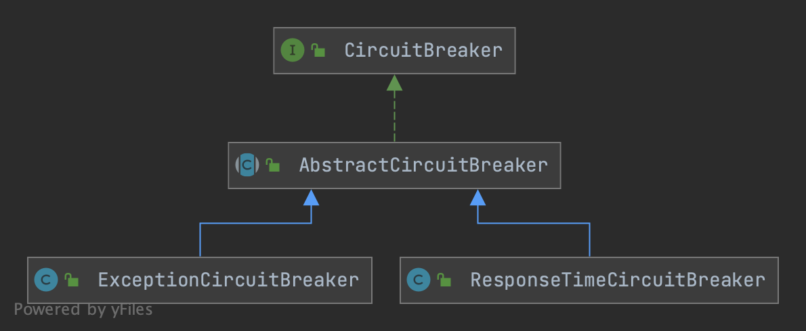

## Introduction

熔断降级用于自动切断不稳定的弱依赖调用，避免局部不稳定在调用链上被放大成雪崩。自 1.8.0 起熔断被重构为**以熔断器（CircuitBreaker）为核心的状态机**，由链上的 `DegradeSlot`（`@Spi(order = -1000)`）执行。`SphU.entry()` 触发熔断规则时抛出 `DegradeException`（`BlockException` 子类），可 catch 后走降级逻辑。1.8.10 在 `DegradeSlot` 之前还多了一个 `DefaultCircuitBreakerSlot`(-1500)（通用默认熔断器），是个反直觉点，见 [Counterintuitive: Two Degrade Slots](#counterintuitive-two-degrade-slots)。

> 版本基线：Sentinel 1.8.10

<div style="text-align: center;">

</div>
<p style="text-align: center;">Fig.1. CircuitBreaker 状态机</p>

## State Machine and CircuitBreaker Interface

`CircuitBreaker` 接口定义四个方法与三个状态；`tryPass` 在进入时询问「此刻可否通过」，`onRequestComplete` 在请求**正常完成之后**回写结果驱动状态机（不处理被 Block 的请求，因为那些不会走到 `exit` 的这条分支）。`sentinel-core/.../slots/block/degrade/circuitbreaker/CircuitBreaker.java`：

```java
public interface CircuitBreaker {

    /**
     * Get the associated circuit breaking rule.
     *
     * @return associated circuit breaking rule
     */
    DegradeRule getRule();

    /**
     * Acquires permission of an invocation only if it is available at the time of invoking.
     *
     * @param context context of current invocation
     * @return {@code true} if permission was acquired and {@code false} otherwise
     */
    boolean tryPass(Context context);

    /**
     * Get current state of the circuit breaker.
     *
     * @return current state of the circuit breaker
     */
    State currentState();

    /**
     * <p>Record a completed request with the context and handle state transformation of the circuit breaker.</p>
     * <p>Called when a <strong>passed</strong> invocation finished.</p>
     *
     * @param context context of current invocation
     */
    void onRequestComplete(Context context);

    enum State {
        /**
         * In {@code OPEN} state, all requests will be rejected until the next recovery time point.
         */
        OPEN,
        /**
         * In {@code HALF_OPEN} state, the circuit breaker will allow a "probe" invocation.
         * If the invocation is abnormal according to the strategy (e.g. it's slow), the circuit breaker
         * will re-transform to the {@code OPEN} state and wait for the next recovery time point;
         * otherwise the resource will be regarded as "recovered" and the circuit breaker
         * will cease cutting off requests and transform to {@code CLOSED} state.
         */
        HALF_OPEN,
        /**
         * In {@code CLOSED} state, all requests are permitted. When current metric value exceeds the threshold,
         * the circuit breaker will transform to {@code OPEN} state.
         */
        CLOSED
    }
}
```

`AbstractCircuitBreaker`（`@since 1.8.0`）持有状态引用、熔断规则、`recoveryTimeoutMs`（= `rule.timeWindow * 1000`）与 `nextRetryTimestamp`，另有 `MAX_RATIO = 1.0d` 常量（后面 100% 特判会用到）：

```java
public abstract class AbstractCircuitBreaker implements CircuitBreaker {
    protected static final double MAX_RATIO = 1.0d;

    protected final DegradeRule rule;
    protected final int recoveryTimeoutMs;

    private final EventObserverRegistry observerRegistry;

    protected final AtomicReference<State> currentState = new AtomicReference<>(State.CLOSED);
    protected volatile long nextRetryTimestamp;
```

状态流转：CLOSED 下 `onRequestComplete()` 按策略评估，指标超阈值则 CAS 到 OPEN 并设 `nextRetryTimestamp = now + recoveryTimeoutMs`；OPEN 经过冷却期后由 `tryPass()` CAS 到 HALF_OPEN 并放行唯一一个探测请求；探测请求在 `onRequestComplete()` 中判定——健康则回 CLOSED 并 `resetStat()`，不健康则回 OPEN 重新计时。

## DegradeSlot: performChecking and exit

旧笔记的「概念性示意」伪代码在 1.8.10 已不存在，真实逻辑是 `DegradeSlot.performChecking()`：取 `DegradeRuleManager.getCircuitBreakers(resource)`，逐个 `cb.tryPass(context)`，任一不通过即抛 `DegradeException`。路径 `sentinel-core/.../slots/block/degrade/DegradeSlot.java`：

```java
void performChecking(Context context, ResourceWrapper r) throws BlockException {
    List<CircuitBreaker> circuitBreakers = DegradeRuleManager.getCircuitBreakers(r.getName());
    if (circuitBreakers == null || circuitBreakers.isEmpty()) {
        return;
    }
    for (CircuitBreaker cb : circuitBreakers) {
        if (!cb.tryPass(context)) {
            throw new DegradeException(cb.getRule().getLimitApp(), cb.getRule());
        }
    }
}
```

`entry()` 先 `performChecking` 再 `fireEntry`；`exit()` 则对**通过的请求**（`curEntry.getBlockError() == null`）逐个调 `cb.onRequestComplete(context)` 回写本次结果。被后续规则 Block 的请求直接 `fireExit` 返回、不喂给熔断器——这正是下一节 `whenTerminate` 钩子要补救的场景：

```java
@Override
public void exit(Context context, ResourceWrapper r, int count, Object... args) {
    Entry curEntry = context.getCurEntry();
    if (curEntry.getBlockError() != null) {
        fireExit(context, r, count, args);
        return;
    }
    List<CircuitBreaker> circuitBreakers = DegradeRuleManager.getCircuitBreakers(r.getName());
    if (circuitBreakers == null || circuitBreakers.isEmpty()) {
        fireExit(context, r, count, args);
        return;
    }

    if (curEntry.getBlockError() == null) {
        // passed request
        for (CircuitBreaker circuitBreaker : circuitBreakers) {
            circuitBreaker.onRequestComplete(context);
        }
    }

    fireExit(context, r, count, args);
}
```

## AbstractCircuitBreaker.tryPass: CLOSED / OPEN / HALF_OPEN

`tryPass()` 三条路径泾渭分明：CLOSED 直接 `true`；OPEN 时只有「冷却时间到 && 成功 CAS 到 HALF_OPEN」才放行；**其余情况（含 HALF_OPEN）直接 `false`**——即同一时刻只允许一个探测请求在飞。

```java
@Override
public boolean tryPass(Context context) {
    // Template implementation.
    if (currentState.get() == State.CLOSED) {
        return true;
    }
    if (currentState.get() == State.OPEN) {
        // For half-open state we allow a request for probing.
        return retryTimeoutArrived() && fromOpenToHalfOpen(context);
    }
    return false;
}
```

### Counterintuitive: the whenTerminate Hook in fromOpenToHalfOpen

`fromOpenToHalfOpen()` 有个关键点：CAS 到 HALF_OPEN 后，它给当前 `Entry` 挂了一个 `whenTerminate` 钩子——若这个探测请求最终被**后续规则**（不只降级规则，可能是流控、权限等）Block 掉（`entry.getBlockError() != null`），则 CAS 把状态**回退到 OPEN**。源码注释明确这是 [issue #1638](https://github.com/alibaba/Sentinel/issues/1638) 的 workaround：没有这个钩子，探测请求被拦时熔断器会卡在 HALF_OPEN 无法恢复。这是旧笔记完全没有的反直觉细节。

```java
protected boolean fromOpenToHalfOpen(Context context) {
    if (currentState.compareAndSet(State.OPEN, State.HALF_OPEN)) {
        notifyObservers(State.OPEN, State.HALF_OPEN, null);
        Entry entry = context.getCurEntry();
        entry.whenTerminate(new BiConsumer<Context, Entry>() {
            @Override
            public void accept(Context context, Entry entry) {
                // Note: This works as a temporary workaround for https://github.com/alibaba/Sentinel/issues/1638
                // Without the hook, the circuit breaker won't recover from half-open state in some circumstances
                // when the request is actually blocked by upcoming rules (not only degrade rules).
                if (entry.getBlockError() != null) {
                    // Fallback to OPEN due to detecting request is blocked
                    currentState.compareAndSet(State.HALF_OPEN, State.OPEN);
                    notifyObservers(State.HALF_OPEN, State.OPEN, 1.0d);
                }
            }
        });
        return true;
    }
    return false;
}
```

## DegradeRule: Strategies and Defaults

`CircuitBreakerStrategy` 三种策略对应 `DegradeRule.grade`：

| grade | 策略 | `count` 含义 |
| :--- | :--- | :--- |
| `SLOW_REQUEST_RATIO`（0） | 慢调用比例 | 慢调用 RT 上界（ms） |
| `ERROR_RATIO`（1） | 异常比例 | 异常比例阈值（0~1） |
| `ERROR_COUNT`（2） | 异常数 | 异常数阈值（整数） |

```java
public enum CircuitBreakerStrategy {

    /**
     * Circuit breaker opens (cuts off) when slow request ratio exceeds the threshold.
     */
    SLOW_REQUEST_RATIO(0),
    /**
     * Circuit breaker opens (cuts off) when error ratio exceeds the threshold.
     */
    ERROR_RATIO(1),
    /**
     * Circuit breaker opens (cuts off) when error count exceeds the threshold.
     */
    ERROR_COUNT(2);
```

`DegradeRule` 字段默认值（1.8.10 源码，`sentinel-core/.../slots/block/degrade/DegradeRule.java`）：

```java
/**
 * Circuit breaking strategy (0: average RT, 1: exception ratio, 2: exception count).
 */
private int grade = RuleConstant.DEGRADE_GRADE_RT;

/**
 * Threshold count. The exact meaning depends on the field of grade.
 * <ul>
 *     <li>In average RT mode, it means the maximum response time(RT) in milliseconds.</li>
 *     <li>In exception ratio mode, it means exception ratio which between 0.0 and 1.0.</li>
 *     <li>In exception count mode, it means exception count</li>
 * <ul/>
 */
private double count;

/**
 * Recovery timeout (in seconds) when circuit breaker opens. After the timeout, the circuit breaker will
 * transform to half-open state for trying a few requests.
 */
private int timeWindow;

/**
 * Minimum number of requests (in an active statistic time span) that can trigger circuit breaking.
 *
 * @since 1.7.0
 */
private int minRequestAmount = RuleConstant.DEGRADE_DEFAULT_MIN_REQUEST_AMOUNT;

/**
 * The threshold of slow request ratio in RT mode.
 *
 * @since 1.8.0
 */
private double slowRatioThreshold = 1.0d;

/**
 * The interval statistics duration in millisecond.
 *
 * @since 1.8.0
 */
private int statIntervalMs = 1000;
```

其中 `DEGRADE_DEFAULT_MIN_REQUEST_AMOUNT = 5`、`DEGRADE_GRADE_RT = 0`、异常比例 = 1、异常数 = 2（见 `RuleConstant`）。即 `minRequestAmount` 默认 **5**、`statIntervalMs` 默认 **1000ms**、`slowRatioThreshold` 默认 **1.0**。`minRequestAmount` 的意义是低于该请求数不熔断，避免低流量误判；`slowRatioThreshold` 仅在慢调用比例策略使用；`timeWindow` 为熔断时长（秒）。

> [!WARNING]
> RT 策略在 1.8.0 由「平均 RT」升级为「慢调用比例」：`DegradeRule` 的类注释仍残留旧的平均 RT 描述，但真正执行的是 `ResponseTimeCircuitBreaker`，按「RT 超过上界的请求占比」判断。不要被注释误导。

## ExceptionCircuitBreaker (ERROR_RATIO / ERROR_COUNT)

异常比例 / 异常数共用 `ExceptionCircuitBreaker`（`strategy` 取 `rule.getGrade()`，校验必须是两种异常策略之一）。`onRequestComplete` 取当前 Entry 的 `error`，有异常则 `errorCount + 1`，无论成败 `totalCount + 1`，再调阈值判定：

```java
@Override
public void onRequestComplete(Context context) {
    Entry entry = context.getCurEntry();
    if (entry == null) {
        return;
    }
    Throwable error = entry.getError();
    SimpleErrorCounter counter = stat.currentWindow().value();
    if (error != null) {
        counter.getErrorCount().add(1);
    }
    counter.getTotalCount().add(1);

    handleStateChangeWhenThresholdExceeded(error);
}
```

阈值判定覆盖三态：OPEN 直接返回；HALF_OPEN 是探测请求（无错则 `fromHalfOpenToClose`、有错则 `fromHalfOpenToOpen(1.0)`）；CLOSED 汇总滑动窗口计数，低于 `minRequestAmount` 不判。异常比例策略把 `curCount` 换算成 `errCount/totalCount`。

```java
private void handleStateChangeWhenThresholdExceeded(Throwable error) {
    if (currentState.get() == State.OPEN) {
        return;
    }
    
    if (currentState.get() == State.HALF_OPEN) {
        // In detecting request
        if (error == null) {
            fromHalfOpenToClose();
        } else {
            fromHalfOpenToOpen(1.0d);
        }
        return;
    }
    
    List<SimpleErrorCounter> counters = stat.values();
    long errCount = 0;
    long totalCount = 0;
    for (SimpleErrorCounter counter : counters) {
        errCount += counter.errorCount.sum();
        totalCount += counter.totalCount.sum();
    }
    if (totalCount < minRequestAmount) {
        return;
    }
    double curCount = errCount;
    if (strategy == DEGRADE_GRADE_EXCEPTION_RATIO) {
        // Use errorRatio
        curCount = errCount * 1.0d / totalCount;
        // special case when ratio equals 1.0
        if (Double.compare(curCount, threshold) == 0 && Double.compare(threshold, MAX_RATIO) == 0) {
            transformToOpen(curCount);
            return;
        }
    }
    if (curCount > threshold) {
        transformToOpen(curCount);
    }
}
```

## ResponseTimeCircuitBreaker (SLOW_REQUEST_RATIO)

慢调用比例策略由 `ResponseTimeCircuitBreaker` 执行：`rt = completeTimestamp - createTimestamp`，超过 `maxAllowedRt` 则 `slowCount + 1`，再 `totalCount + 1`。`maxAllowedRt = round(rule.count)`、`maxSlowRequestRatio = rule.slowRatioThreshold`。

```java
@Override
public void onRequestComplete(Context context) {
    SlowRequestCounter counter = slidingCounter.currentWindow().value();
    Entry entry = context.getCurEntry();
    if (entry == null) {
        return;
    }
    long completeTime = entry.getCompleteTimestamp();
    if (completeTime <= 0) {
        completeTime = TimeUtil.currentTimeMillis();
    }
    long rt = completeTime - entry.getCreateTimestamp();
    if (rt > maxAllowedRt) {
        counter.slowCount.add(1);
    }
    counter.totalCount.add(1);

    handleStateChangeWhenThresholdExceeded(rt);
}
```

判定逻辑与异常版对称，但用 `currentRatio = slowCount/totalCount` 与 `maxSlowRequestRatio` 比较：

```java
private void handleStateChangeWhenThresholdExceeded(long rt) {
    if (currentState.get() == State.OPEN) {
        return;
    }
    
    if (currentState.get() == State.HALF_OPEN) {
        // In detecting request
        // TODO: improve logic for half-open recovery
        if (rt > maxAllowedRt) {
            fromHalfOpenToOpen(1.0d);
        } else {
            fromHalfOpenToClose();
        }
        return;
    }

    List<SlowRequestCounter> counters = slidingCounter.values();
    long slowCount = 0;
    long totalCount = 0;
    for (SlowRequestCounter counter : counters) {
        slowCount += counter.slowCount.sum();
        totalCount += counter.totalCount.sum();
    }
    if (totalCount < minRequestAmount) {
        return;
    }
    double currentRatio = slowCount * 1.0d / totalCount;
    if (currentRatio > maxSlowRequestRatio) {
        transformToOpen(currentRatio);
    }
    if (Double.compare(currentRatio, maxSlowRequestRatio) == 0 &&
            Double.compare(maxSlowRequestRatio, MAX_RATIO) == 0) {
        transformToOpen(currentRatio);
    }
}
```

## Bugfix #1857: Ratio == 100% Must Also Trip

1.8.10 包含一个重要 bugfix（[#1857](https://github.com/alibaba/Sentinel/issues/1857)）：旧版用 `curCount > threshold` / `currentRatio > maxSlowRequestRatio` 的**严格大于**比较，当比率为 **100%（=1.0）而阈值也恰好是 1.0** 时会漏判，导致异常率/慢调用率 100% 却不熔断。修复是在两个 `handleStateChangeWhenThresholdExceeded` 里补一个 `Double.compare(...) == 0 && Double.compare(threshold, MAX_RATIO) == 0` 的特判（上面两段源码末尾均已包含）。异常版：

```java
if (strategy == DEGRADE_GRADE_EXCEPTION_RATIO) {
    // Use errorRatio
    curCount = errCount * 1.0d / totalCount;
    // special case when ratio equals 1.0
    if (Double.compare(curCount, threshold) == 0 && Double.compare(threshold, MAX_RATIO) == 0) {
        transformToOpen(curCount);
        return;
    }
}
if (curCount > threshold) {
    transformToOpen(curCount);
}
```

慢调用版同理（`currentRatio` 与 `maxSlowRequestRatio`）：

```java
if (currentRatio > maxSlowRequestRatio) {
    transformToOpen(currentRatio);
}
if (Double.compare(currentRatio, maxSlowRequestRatio) == 0 &&
        Double.compare(maxSlowRequestRatio, MAX_RATIO) == 0) {
    transformToOpen(currentRatio);
}
```

## Counterintuitive: Two Degrade Slots

反直觉点：1.8.10 的 core 默认 slot 链在 `DegradeSlot`(-1000) **之前**还有个 `DefaultCircuitBreakerSlot`(-1500)（`Constants.ORDER_DEFAULT_CIRCUIT_BREAKER_SLOT` = -1500）。它标注 `@since 2.0.0`、注释为「通用默认熔断器」，走 `DefaultCircuitBreakerRuleManager.getDefaultCircuitBreakers()` 而非 `DegradeRuleManager`。关键：**当资源已配置 `DegradeRuleManager.hasConfig(resource)` 时它主动 `return` 让位**，不启用默认熔断，让 `DegradeSlot` 接管。路径 `sentinel-core/.../slots/block/degrade/DefaultCircuitBreakerSlot.java`：

```java
@Spi(order = Constants.ORDER_DEFAULT_CIRCUIT_BREAKER_SLOT)
public class DefaultCircuitBreakerSlot extends AbstractLinkedProcessorSlot<DefaultNode> {

    @Override
    public void entry(Context context, ResourceWrapper resourceWrapper, DefaultNode node, int count,
                      boolean prioritized, Object... args) throws Throwable {
        performChecking(context, resourceWrapper);

        fireEntry(context, resourceWrapper, node, count, prioritized, args);
    }

    private void performChecking(Context context, ResourceWrapper r) throws BlockException {
        // If user has set a degrade rule for the resource, the default rule will not be activated
        if (DegradeRuleManager.hasConfig(r.getName())) {
            return;
        }

        List<CircuitBreaker> circuitBreakers = DefaultCircuitBreakerRuleManager.getDefaultCircuitBreakers(r.getName());

        if (circuitBreakers == null || circuitBreakers.isEmpty()) {
            return;
        }

        for (CircuitBreaker cb : circuitBreakers) {
            if (!cb.tryPass(context)) {
                throw new DegradeException(cb.getRule().getLimitApp(), cb.getRule());
            }
        }
    }
```

即两套熔断井水不犯河水：**有自定义 `DegradeRule` → 只有 `DegradeSlot` 生效；什么都没配 → `DefaultCircuitBreakerSlot` 可用默认熔断器兜底**。`exit()` 里同样以 `hasConfig` 为开关二选一。

## Configuration Example (Java API)

```java
// 慢调用比例：RT 上界 100ms，慢调用占比 0.5，最小请求数 10，熔断 10s
DegradeRule rtRule = new DegradeRule("resourceA")
        .setGrade(CircuitBreakerStrategy.SLOW_REQUEST_RATIO.getType())
        .setCount(100)
        .setSlowRatioThreshold(0.5)
        .setMinRequestAmount(10)
        .setStatIntervalMs(10000)
        .setTimeWindow(10);

// 异常比例 0.5 / 异常数 50
DegradeRule errRatioRule = new DegradeRule("resourceB")
        .setGrade(CircuitBreakerStrategy.ERROR_RATIO.getType())
        .setCount(0.5)
        .setMinRequestAmount(5)
        .setStatIntervalMs(10000)
        .setTimeWindow(10);

DegradeRule errCountRule = new DegradeRule("resourceC")
        .setGrade(CircuitBreakerStrategy.ERROR_COUNT.getType())
        .setCount(50)
        .setStatIntervalMs(10000)
        .setTimeWindow(10);

DegradeRuleManager.loadRules(Arrays.asList(rtRule, errRatioRule, errCountRule));
```

## State Change Observers

可注册状态变化观察者用于日志或告警，状态切换时 `notifyObservers` 会回调 `onStateChange(prevState, newState, rule, snapshotValue)`：

```java
EventObserverRegistry.getInstance().addStateChangeObserver("logging",
    (prevState, newState, rule, snapshotValue) -> {
        if (newState == State.OPEN) {
            System.err.println(prevState + " -> OPEN at " + TimeUtil.currentTimeMillis()
                + ", snapshotValue=" + snapshotValue);
        }
    });
```

## Links

- [Sentinel 枢纽](/docs/CS/Framework/Sentinel/Sentinel.md)
- [架构与工作原理](/docs/CS/Framework/Sentinel/Sentinel.md?id=architecture)
- [Slot 机制](/docs/CS/Framework/Sentinel/Slot.md)
- [流量控制 FlowControl](/docs/CS/Framework/Sentinel/FlowControl.md)
- [统计节点 Node](/docs/CS/Framework/Sentinel/Node.md)
- [Spring Cloud Circuit Breaker](/docs/CS/Framework/Spring_Cloud/Spring_Cloud.md?id=circuit-breaker)

## References

- <https://github.com/alibaba/Sentinel/blob/1.8.10/sentinel-core/src/main/java/com/alibaba/csp/sentinel/slots/block/degrade/DegradeSlot.java>
- <https://github.com/alibaba/Sentinel/blob/1.8.10/sentinel-core/src/main/java/com/alibaba/csp/sentinel/slots/block/degrade/circuitbreaker/AbstractCircuitBreaker.java>
- <https://github.com/alibaba/Sentinel/blob/1.8.10/sentinel-core/src/main/java/com/alibaba/csp/sentinel/slots/block/degrade/circuitbreaker/ExceptionCircuitBreaker.java>
- <https://github.com/alibaba/Sentinel/blob/1.8.10/sentinel-core/src/main/java/com/alibaba/csp/sentinel/slots/block/degrade/circuitbreaker/ResponseTimeCircuitBreaker.java>
- <https://github.com/alibaba/Sentinel/blob/1.8.10/sentinel-core/src/main/java/com/alibaba/csp/sentinel/slots/block/degrade/DefaultCircuitBreakerSlot.java>
- <https://sentinelguard.io/en-us/docs/circuit-breaking.html>
