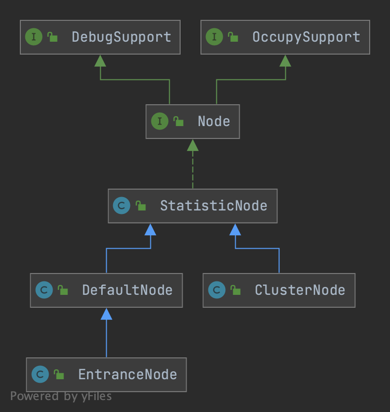

## Introduction

Sentinel 的所有流控/熔断决策都依赖**实时统计**。统计的载体是 `Node`，统计的数据结构底层是**滑动窗口 `LeapArray`**。本页梳理四种 Node 的区别、滑动窗口原理与确定的默认参数；它们何时被创建、如何建树见 [Slot 机制](/docs/CS/Framework/Sentinel/Slot.md) 中的 `NodeSelectorSlot` 与 `ClusterBuilderSlot`，入口流程见 [架构与工作原理](/docs/CS/Framework/Sentinel/Sentinel.md?id=architecture)。

> 版本基线：Sentinel 1.8.10



## Four Kinds of Node

继承关系（`sentinel-core/src/main/java/com/alibaba/csp/sentinel/node/`）：`StatisticNode` 实现 `Node`；`DefaultNode`、`ClusterNode` 继承 `StatisticNode`；`EntranceNode` 继承 `DefaultNode`。所以 `EntranceNode` 本质是一个特殊的 `DefaultNode`——它是每个 Context 在调用树上的根。

| 类型 | 标识维度 | 作用 |
| :--- | :--- | :--- |
| `EntranceNode` | 每个 Context name 全局唯一 | 调用树的根，代表一条入口链路；挂在全局 `Constants.ROOT`（machine-root）下 |
| `DefaultNode` | 资源名 + Context 共同标识 | 某资源在「某个具体 Context」下的统计（用于建调用树） |
| `ClusterNode` | 仅资源名全局唯一 | 某资源的汇总统计（RT、线程数、QPS…），与 Context 无关 |
| `StatisticNode` | —— | 具体指标容器，被上述节点组合持有 |

- **`ClusterNode` 由 ResourceId 唯一标识**；**`DefaultNode` 由「资源 id + Context」共同标识**。同一资源 id 在不同 Context 下会生成多个 `DefaultNode`，但只有一个 `ClusterNode`（见 `NodeSelectorSlot` 的注释与 `ClusterBuilderSlot`）。
- 为区分来自不同来源（`ContextUtil.enter(name, origin)` 的 origin，通常是服务消费方应用名）的调用，`ClusterNode` 内部维护 `originCountMap`，通过 `getOrCreateOriginNode(origin)` 取得对应来源的统计节点（`sentinel-core/.../node/ClusterNode.java`）：

```java
    private Map<String, StatisticNode> originCountMap = new HashMap<>();

    public Node getOrCreateOriginNode(String origin) {
        StatisticNode statisticNode = originCountMap.get(origin);
        if (statisticNode == null) {
            lock.lock();
            try {
                statisticNode = originCountMap.get(origin);
                if (statisticNode == null) {
                    // The node is absent, create a new node for the origin.
                    statisticNode = new StatisticNode();
                    HashMap<String, StatisticNode> newMap = new HashMap<>(originCountMap.size() + 1);
                    newMap.putAll(originCountMap);
                    newMap.put(origin, statisticNode);
                    originCountMap = newMap;
                }
            } finally {
                lock.unlock();
            }
        }
        return statisticNode;
    }
```

调用树示意（`NodeSelectorSlot` 源码注释里的结构，同一资源在两个 Context 下各一个 `DefaultNode`、共享一个 `ClusterNode`）：

```text
                  machine-root (Constants.ROOT)
                  /                     \
          EntranceNode1            EntranceNode2
               |                         |
        DefaultNode(nodeA)         DefaultNode(nodeA)   ← 同一资源，两个 Context 各一个
               |                         |
               +- - - - - - - - - - - - -+---> ClusterNode(nodeA)   ← 资源全局唯一
                                                |
                                    originCountMap {caller1 -> Node, caller2 -> Node}
```

调用树可用 `curl http://localhost:8719/tree?type=root` 实时查看；按来源统计可用 `curl http://localhost:8719/origin?id=xxxx` 查看。

## StatisticNode and the Sliding Window

`StatisticNode` 维护秒级窗口、分钟级窗口和当前线程数三类实时指标（`sentinel-core/src/main/java/com/alibaba/csp/sentinel/node/StatisticNode.java`）：

```java
public class StatisticNode implements Node {

    /**
     * Holds statistics of the recent {@code INTERVAL} milliseconds. The {@code INTERVAL} is divided into time spans
     * by given {@code sampleCount}.
     */
    private transient volatile Metric rollingCounterInSecond = new ArrayMetric(SampleCountProperty.SAMPLE_COUNT,
        IntervalProperty.INTERVAL);

    /**
     * Holds statistics of the recent 60 seconds. The windowLengthInMs is deliberately set to 1000 milliseconds,
     * meaning each bucket per second, in this way we can get accurate statistics of each second.
     */
    private transient Metric rollingCounterInMinute = new ArrayMetric(60, 60 * 1000, false);

    /**
     * The counter for thread count.
     */
    private LongAdder curThreadNum = new LongAdder();
```

Sentinel 用**滑动窗口**记录资源指标：底层是 `ArrayMetric`，`ArrayMetric` 背后是 `LeapArray`。所有指标累加都落到当前 bucket：`addPassRequest()` → `ArrayMetric.addPass()` → `data.currentWindow()` 拿桶 → `wrap.value().addPass(count)`（`sentinel-core/.../slots/statistic/metric/ArrayMetric.java`）：

```java
    @Override
    public void addPass(int count) {
        WindowWrap<MetricBucket> wrap = data.currentWindow();
        wrap.value().addPass(count);
    }
```

## LeapArray Internals

`LeapArray`（`sentinel-core/src/main/java/com/alibaba/csp/sentinel/slots/statistic/base/LeapArray.java`）把时间轴切成固定长度的 bucket，放进一个环形 `AtomicReferenceArray`。构造器里 `windowLengthInMs = intervalInMs / sampleCount`，并要求 `intervalInMs % sampleCount == 0`：

```java
    public LeapArray(int sampleCount, int intervalInMs) {
        AssertUtil.isTrue(sampleCount > 0, "bucket count is invalid: " + sampleCount);
        AssertUtil.isTrue(intervalInMs > 0, "total time interval of the sliding window should be positive");
        AssertUtil.isTrue(intervalInMs % sampleCount == 0, "time span needs to be evenly divided");

        this.windowLengthInMs = intervalInMs / sampleCount;
        this.intervalInMs = intervalInMs;
        this.intervalInSecond = intervalInMs / 1000.0;
        this.sampleCount = sampleCount;

        this.array = new AtomicReferenceArray<>(sampleCount);
    }
```

`currentWindow()` 是核心：先用 `calculateTimeIdx(timeMillis)`（时间戳 / 桶长 再对数组长度取模）定位槽位，`calculateWindowStart(timeMillis)` 算出该桶起点，然后进入 `while (true)` 自旋，按 `windowStart` 与旧桶起点 `old.windowStart()` 的关系分**四种情况**：

```java
    public WindowWrap<T> currentWindow(long timeMillis) {
        if (timeMillis < 0) {
            return null;
        }

        int idx = calculateTimeIdx(timeMillis);
        // Calculate current bucket start time.
        long windowStart = calculateWindowStart(timeMillis);

        /*
         * Get bucket item at given time from the array.
         *
         * (1) Bucket is absent, then just create a new bucket and CAS update to circular array.
         * (2) Bucket is up-to-date, then just return the bucket.
         * (3) Bucket is deprecated, then reset current bucket.
         */
        while (true) {
            WindowWrap<T> old = array.get(idx);
            if (old == null) {
                /*
                 *     B0       B1      B2    NULL      B4
                 * ||_______|_______|_______|_______|_______||___
                 * 200     400     600     800     1000    1200  timestamp
                 *                             ^
                 *                          time=888
                 *            bucket is empty, so create new and update
                 *
                 * If the old bucket is absent, then we create a new bucket at {@code windowStart},
                 * then try to update circular array via a CAS operation. Only one thread can
                 * succeed to update, while other threads yield its time slice.
                 */
                WindowWrap<T> window = new WindowWrap<T>(windowLengthInMs, windowStart, newEmptyBucket(timeMillis));
                if (array.compareAndSet(idx, null, window)) {
                    // Successfully updated, return the created bucket.
                    return window;
                } else {
                    // Contention failed, the thread will yield its time slice to wait for bucket available.
                    Thread.yield();
                }
            } else if (windowStart == old.windowStart()) {
                /*
                 *     B0       B1      B2     B3      B4
                 * ||_______|_______|_______|_______|_______||___
                 * 200     400     600     800     1000    1200  timestamp
                 *                             ^
                 *                          time=888
                 *            startTime of Bucket 3: 800, so it's up-to-date
                 *
                 * If current {@code windowStart} is equal to the start timestamp of old bucket,
                 * that means the time is within the bucket, so directly return the bucket.
                 */
                return old;
            } else if (windowStart > old.windowStart()) {
                /*
                 *   (old)
                 *             B0       B1      B2    NULL      B4
                 * |_______||_______|_______|_______|_______|_______||___
                 * ...    1200     1400    1600    1800    2000    2200  timestamp
                 *                              ^
                 *                           time=1676
                 *          startTime of Bucket 2: 400, deprecated, should be reset
                 *
                 * If the start timestamp of old bucket is behind provided time, that means
                 * the bucket is deprecated. We have to reset the bucket to current {@code windowStart}.
                 * Note that the reset and clean-up operations are hard to be atomic,
                 * so we need a update lock to guarantee the correctness of bucket update.
                 *
                 * The update lock is conditional (tiny scope) and will take effect only when
                 * bucket is deprecated, so in most cases it won't lead to performance loss.
                 */
                if (updateLock.tryLock()) {
                    try {
                        // Successfully get the update lock, now we reset the bucket.
                        return resetWindowTo(old, windowStart);
                    } finally {
                        updateLock.unlock();
                    }
                } else {
                    // Contention failed, the thread will yield its time slice to wait for bucket available.
                    Thread.yield();
                }
            } else if (windowStart < old.windowStart()) {
                // Should not go through here, as the provided time is already behind.
                return new WindowWrap<T>(windowLengthInMs, windowStart, newEmptyBucket(timeMillis));
            }
        }
    }
```

四分支归纳：

| 条件 | 处理 |
| :-- | :-- |
| `old == null`（空桶） | `newEmptyBucket()` 建桶，`array.compareAndSet(idx, null, window)` CAS 写入；失败则 `Thread.yield()` 重试 |
| `windowStart == old.windowStart()` | 时间仍在当前桶内，**直接返回 `old`** |
| `windowStart > old.windowStart()`（桶过期） | `updateLock.tryLock()` 抢条件锁，成功后 `resetWindowTo(old, windowStart)` 重置；抢不到则 `yield()` 重试 |
| `windowStart < old.windowStart()`（时钟回拨） | 注释称「不应走到这里」，直接返回一个**新的空桶** `new WindowWrap<>(..., newEmptyBucket(...))`，不写入数组 |

旧桶是否过期的判定用 `isWindowDeprecated()`，判据是 `time - windowStart > intervalInMs`（落后超过**整个窗口区间**，而非单个桶长）：

```java
    public boolean isWindowDeprecated(/*@NonNull*/ WindowWrap<T> windowWrap) {
        return isWindowDeprecated(TimeUtil.currentTimeMillis(), windowWrap);
    }

    public boolean isWindowDeprecated(long time, WindowWrap<T> windowWrap) {
        return time - windowWrap.windowStart() > intervalInMs;
    }
```

> [!NOTE]
> 「leap」的重置不是 CAS：空桶创建走 CAS，过期桶重置走 `updateLock.tryLock()` 这把条件锁（作用域极小，仅在桶过期时生效，正常路径无锁）。这样统计是增量、无锁的，且环形数组循环复用，天然只保留最近一个时间窗口的数据。

## Window Defaults

秒级统计窗口的参数是**确定值**，不是「通常 2 个」：

- `SampleCountProperty.SAMPLE_COUNT = 2`（`sentinel-core/.../node/SampleCountProperty.java`）
- `IntervalProperty.INTERVAL = RuleConstant.DEFAULT_WINDOW_INTERVAL_MS`，而 `RuleConstant.DEFAULT_WINDOW_INTERVAL_MS = 1000`（`sentinel-core/.../node/IntervalProperty.java`、`sentinel-core/.../slots/block/RuleConstant.java`）

```java
    public static volatile int SAMPLE_COUNT = 2;
```

```java
    public static volatile int INTERVAL = RuleConstant.DEFAULT_WINDOW_INTERVAL_MS;
```

```java
    public static final int DEFAULT_WINDOW_INTERVAL_MS = 1000;
```

因此 `StatisticNode` 的秒级窗口 = `new ArrayMetric(2, 1000)` → **2 个桶、每桶 500ms、总跨度 1000ms**；分钟级窗口 = `new ArrayMetric(60, 60 * 1000, false)` → **60 个桶、每桶 1000ms、总跨度 60s**。秒级窗口的两参数构造器用 `OccupiableBucketLeapArray`（支持占用未来桶以平滑预热），分钟级显式传 `false` 用普通 `BucketLeapArray`（`sentinel-core/.../slots/statistic/metric/ArrayMetric.java`）：

```java
    public ArrayMetric(int sampleCount, int intervalInMs) {
        this.data = new OccupiableBucketLeapArray(sampleCount, intervalInMs);
    }

    public ArrayMetric(int sampleCount, int intervalInMs, boolean enableOccupy) {
        if (enableOccupy) {
            this.data = new OccupiableBucketLeapArray(sampleCount, intervalInMs);
        } else {
            this.data = new BucketLeapArray(sampleCount, intervalInMs);
        }
    }
```

`passQps()` 等 = 窗口内 pass 总数 / 窗口秒数（`intervalInSecond`），因此流量在窗口边界会平滑过渡，这也是 Sentinel 统计比「固定计数器」更精准的原因。

## Links

- [Sentinel 枢纽](/docs/CS/Framework/Sentinel/Sentinel.md)
- [架构与工作原理](/docs/CS/Framework/Sentinel/Sentinel.md?id=architecture)
- [Slot 机制](/docs/CS/Framework/Sentinel/Slot.md)
- [流量控制 FlowControl](/docs/CS/Framework/Sentinel/FlowControl.md)
- [熔断降级 CircuitBreaker](/docs/CS/Framework/Sentinel/CircuitBreaker.md)
- [规则与动态数据源 RuleDataSource](/docs/CS/Framework/Sentinel/RuleDataSource.md)

## References

1. [StatisticNode.java](https://github.com/alibaba/Sentinel/blob/1.8.10/sentinel-core/src/main/java/com/alibaba/csp/sentinel/node/StatisticNode.java)
2. [LeapArray.java](https://github.com/alibaba/Sentinel/blob/1.8.10/sentinel-core/src/main/java/com/alibaba/csp/sentinel/slots/statistic/base/LeapArray.java)
3. [ArrayMetric.java](https://github.com/alibaba/Sentinel/blob/1.8.10/sentinel-core/src/main/java/com/alibaba/csp/sentinel/slots/statistic/metric/ArrayMetric.java)
4. [SampleCountProperty.java](https://github.com/alibaba/Sentinel/blob/1.8.10/sentinel-core/src/main/java/com/alibaba/csp/sentinel/node/SampleCountProperty.java)
5. [IntervalProperty.java](https://github.com/alibaba/Sentinel/blob/1.8.10/sentinel-core/src/main/java/com/alibaba/csp/sentinel/node/IntervalProperty.java)
6. [RuleConstant.java](https://github.com/alibaba/Sentinel/blob/1.8.10/sentinel-core/src/main/java/com/alibaba/csp/sentinel/slots/block/RuleConstant.java)
