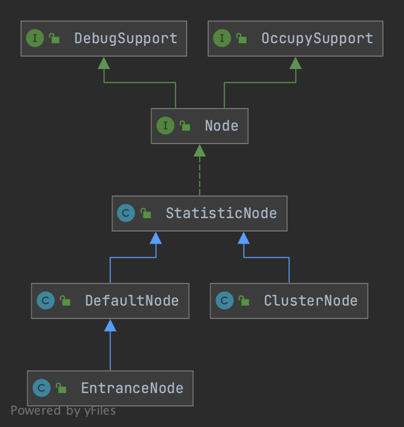

## Introduction

Sentinel 的所有流控/熔断决策都依赖**实时统计**。统计的载体是 `Node`，而统计的数据结构底层是**滑动窗口 `LeapArray`**。本页梳理四种 Node 的区别与滑动窗口原理；它们何时被创建、如何建树见 [Slot 机制](/docs/CS/Framework/Sentinel/Slot.md) 中的 `NodeSelectorSlot` 与 `ClusterBuilderSlot`，入口流程见 [架构与工作原理](/docs/CS/Framework/Sentinel/Architecture.md)。



## 四种 Node

| 类型 | 标识维度 | 作用 |
| :--- | :--- | :--- |
| `EntranceNode` | 每个 Context name 全局唯一 | 调用树的根，代表一条入口链路 |
| `DefaultNode` | 资源名 + Context 共同标识 | 某资源在「某个具体 Context」下的统计（建调用树） |
| `ClusterNode` | 仅资源名全局唯一 | 某资源的汇总统计（RT、线程数、QPS…），与 Context 无关 |
| `StatisticNode` | —— | 具体指标容器，被上述节点组合持有 |

- **`ClusterNode` 由 ResourceId 唯一标识**；**`DefaultNode` 由「资源 id + Context」共同标识**。同一个资源 id 在不同的 Context 下会生成多个 `DefaultNode`，但只有一个 `ClusterNode`。
- 为了区分来自不同来源（`ContextUtil.enter(name, origin)` 中的 origin，通常是服务消费方应用名）的调用，`ClusterNode` 内部维护 `originCountMap`，通过 `getOrCreateOriginNode(origin)` 取得对应来源的统计 `Node`。

```text
                  machine-root (EntranceNode)
                  /                     \
          EntranceNode1            EntranceNode2
               |                         |
        DefaultNode(nodeA)         DefaultNode(nodeA)   ← 同一资源，两个 Context 各一个
               |
        ClusterNode(nodeA)                    ← 资源全局唯一，汇总所有 DefaultNode
               |
        originCountMap {caller1 -> Node, caller2 -> Node}
```

调用树可用 `curl http://localhost:8719/tree?type=root` 实时查看；按来源统计可用 `curl http://localhost:8719/origin?id=xxxx` 查看。

## StatisticNode 与滑动窗口

`StatisticNode` 维护三类实时指标：

- 秒级指标（`rollingCounterInSecond`）
- 分钟级指标（`rollingCounterInMinute`）
- 当前线程数（`threadNum`）

Sentinel 用**滑动窗口**记录与统计资源指标，其底层是 `ArrayMetric`，而 `ArrayMetric` 背后正是 `LeapArray`。

```java
public class StatisticNode implements Node {
    // 秒级滑动窗口
    private transient volatile Metric rollingCounterInSecond
        = new ArrayMetric(SampleCountProperty.SAMPLE_COUNT, IntervalProperty.INTERVAL);
    // 分钟级滑动窗口
    private transient volatile Metric rollingCounterInMinute
        = new ArrayMetric(60, 60 * 1000, false);
    private LongAdder longAdder = new LongAdder(); // 当前线程数
    // ...
}
```

### LeapArray 原理

`LeapArray` 把时间轴切成若干固定长度的时间窗（bucket），形成一个**环形数组（array）**。每个 bucket 记录该窗口内的 pass/block/exception/rt 等计数。新请求到来时：

1. 根据当前时间戳计算应落入哪个 bucket（取模环形数组）；
2. 若该 bucket 已过期（属于上一轮），则「 leap 」重置（CAS 重置旧 bucket，避免锁）；
3. 在当前 bucket 上做原子累加。

这样统计是**增量、无锁**的，且天然只保留最近一个时间窗口（如最近 1 秒、最近 1 分钟）的数据，旧 bucket 被循环复用。各指标（passQps、blockQps、avgRt、threadNum 等）都是基于这些 bucket 求和/平均得到。

> [!NOTE]
> 秒级窗口默认切成 `SAMPLE_COUNT`（通常 2 个）桶，每个桶 500ms；分钟级切成 60 个桶，每桶 1s。`passQps()` 等于当前窗口内 pass 总数 / 窗口秒数，因此流量在窗口边界会平滑过渡，这也是 Sentinel 统计比「固定计数器」更精准的原因。

## Links

- [Sentinel 枢纽](/docs/CS/Framework/Sentinel/Sentinel.md)
- [架构与工作原理](/docs/CS/Framework/Sentinel/Architecture.md)
- [Slot 机制](/docs/CS/Framework/Sentinel/Slot.md)
- [流量控制 FlowControl](/docs/CS/Framework/Sentinel/FlowControl.md)

## References

1. [How it works (官方 Wiki)](https://github.com/alibaba/Sentinel/wiki/How-it-works)
