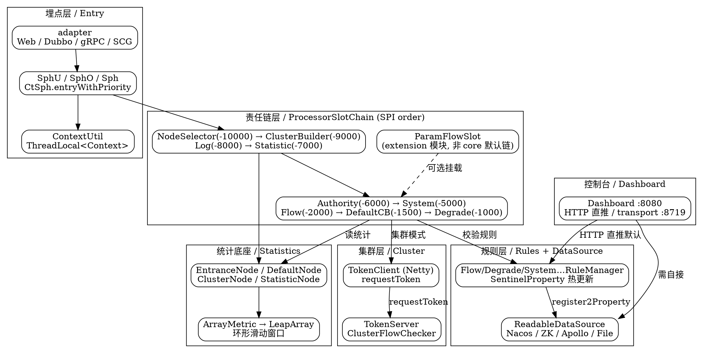

# Sentinel

## Introduction

Sentinel 是面向分布式、多语言异构服务架构的**流量治理**组件，以「流量」为切入点，从流量路由、流量控制、流量整形、熔断降级、系统自适应过载保护、热点参数防护等维度保障微服务稳定性。它承接了阿里近 15 年双十一大促的核心场景（秒杀、冷启动、消息削峰填谷、集群流控、实时熔断下游）。

> 版本基线：Sentinel 1.8.10（tag 1.8.10，commit cf97bba，2026-05 发布，1.8 分支最新稳定版；2.0 仍停留 alpha）。本家族全部源码片段均取自该 tag。1.8.0 是重要分水岭：熔断重构为以 `CircuitBreaker` 为核心的状态机；1.8.10 又在 core 默认 Slot 链里新增了 `DefaultCircuitBreakerSlot`。

三个容易与直觉/旧资料冲突的点，后文逐一用源码纠正：

1. **core 默认 Slot 链里没有 `ParamFlowSlot`**——它在独立的 `sentinel-parameter-flow-control` extension 模块注册；1.8.10 的 core 链末尾新增的是 `DefaultCircuitBreakerSlot`。
2. **规则 `count` 在集群模式下默认是「单机均值」而非集群总 QPS**——`FLOW_THRESHOLD_AVG_LOCAL` 是默认 `thresholdType`。
3. **控制台默认走 HTTP 直推客户端，而不是「控制台 → 配置中心 → 数据源」**——要经 Nacos 中转必须自己替换 dashboard 的 Bean。

## Architecture

### Layered Architecture

Sentinel 把「资源埋点 / 责任链拦截 / 实时统计 / 规则决策 / 控制台与数据源」分层解耦：最上层是 `SphU`/`SphO` 门面与各类框架 adapter，把一次调用包装成 `Entry`；中间是由 SPI 排序加载的 `ProcessorSlotChain`，前四个 Slot 建调用树与统计、后五个 Slot 做决策；统计底座是滑动窗口 `LeapArray`；规则经 `SentinelProperty` 热更新，可挂 Nacos/ZK/Apollo 数据源；集群模式下决策权交给 Token Server。



### The Entry Pipeline

一切从 `SphU.entry(resource)` 开始。`CtSph.entryWithPriority()` 做四件事：从 `ThreadLocal` 取 Context（无则用默认）；全局开关 `Constants.ON` 关闭时退化放行；按资源取（或建）Slot 链；穿链，任一 Slot 抛 `BlockException` 就回收 Entry 再上抛。

```java
private Entry entryWithPriority(ResourceWrapper resourceWrapper, int count, boolean prioritized, Object... args)
    throws BlockException {
    Context context = ContextUtil.getContext();
    if (context instanceof NullContext) {
        // NullContext 表示 Context 数量已超阈值，只初始化 entry，不做规则校验
        return new CtEntry(resourceWrapper, null, context);
    }
    if (context == null) {
        context = InternalContextUtil.internalEnter(Constants.CONTEXT_DEFAULT_NAME);
    }
    if (!Constants.ON) {
        return new CtEntry(resourceWrapper, null, context);
    }
    ProcessorSlot<Object> chain = lookProcessChain(resourceWrapper);
    if (chain == null) {
        // 资源（Slot 链）数量超 MAX_SLOT_CHAIN_SIZE，退化放行
        return new CtEntry(resourceWrapper, null, context);
    }
    Entry e = new CtEntry(resourceWrapper, chain, context, count, args);
    try {
        chain.entry(context, resourceWrapper, null, count, prioritized, args);
    } catch (BlockException e1) {
        e.exit(count, args);
        throw e1;
    } catch (Throwable e1) {
        RecordLog.info("Sentinel unexpected exception", e1);
    }
    return e;
}
```

注意 1.8.10 的 `CtEntry(resourceWrapper, chain, context, count, args)` 比旧版多了 `count, args`——`exit()` 回滚统计要用。三个「退化放行」分支（NullContext / 全局关 / 链超限）都返回一条 `chain == null` 的 Entry，这是 Sentinel 的**失败放行**设计：内部资源耗尽时宁可放开也不阻断业务。

### Context: ThreadLocal Invocation Context

`Context` 保存一次调用链的元数据：根入口 `EntranceNode`、当前 Entry、当前 Node、调用来源 `origin`。`ContextUtil.enter(name, origin)` 把它绑到 `ThreadLocal`；同一 context name 全局共享一个 `EntranceNode`。`trueEnter()` 用「读时无锁 + 写时 `ReentrantLock` 复制整张 Map 再 volatile 替换」的 copy-on-write 手法：

```java
    protected static Context trueEnter(String name, String origin) {
        Context context = contextHolder.get();
        if (context == null) {
            Map<String, DefaultNode> localCacheNameMap = contextNameNodeMap;
            DefaultNode node = localCacheNameMap.get(name);
            if (node == null) {
                if (localCacheNameMap.size() > Constants.MAX_CONTEXT_NAME_SIZE) {
                    setNullContext();
                    return NULL_CONTEXT;
                } else {
                    LOCK.lock();
                    try {
                        node = contextNameNodeMap.get(name);
                        if (node == null) {
                            if (contextNameNodeMap.size() > Constants.MAX_CONTEXT_NAME_SIZE) {
                                setNullContext();
                                return NULL_CONTEXT;
                            } else {
                                node = new EntranceNode(new StringResourceWrapper(name, EntryType.IN), null);
                                Constants.ROOT.addChild(node);
                                Map<String, DefaultNode> newMap = new HashMap<>(contextNameNodeMap.size() + 1);
                                newMap.putAll(contextNameNodeMap);
                                newMap.put(name, node);
                                contextNameNodeMap = newMap;
                            }
                        }
                    } finally {
                        LOCK.unlock();
                    }
                }
            }
            context = new Context(node, name);
            context.setOrigin(origin);
            contextHolder.set(context);
        }
        return context;
    }
```

> origin 粒度决定内存放大倍数：统计节点总数约等于「distinct 资源名 × distinct origin」，若按调用方 IP 作 origin 会显著膨胀，应谨慎选择粒度。

### Slot Chain Loading

同一资源（`ResourceWrapper.equals()` 相等）全局共享一条 `ProcessorSlotChain`，与 Context 无关；链数量超过 `Constants.MAX_SLOT_CHAIN_SIZE` 时 `lookProcessChain()` 返回 `null`（退化放行）。链由 `SlotChainProvider` 经 SPI 解析 `SlotChainBuilder`，默认 `DefaultSlotChainBuilder` 把全部 `@Spi` 的 `ProcessorSlot` 按 order 排序后 `addLast`：

```java
public ProcessorSlotChain build() {
    ProcessorSlotChain chain = new DefaultProcessorSlotChain();
    List<ProcessorSlot> sortedSlotList = SpiLoader.of(ProcessorSlot.class).loadInstanceListSorted();
    for (ProcessorSlot slot : sortedSlotList) {
        if (!(slot instanceof AbstractLinkedProcessorSlot)) {
            RecordLog.warn("The ProcessorSlot(" + slot.getClass().getCanonicalName()
                + ") is not an instance of AbstractLinkedProcessorSlot, can't be added into ProcessorSlotChain");
            continue;
        }
        chain.addLast((AbstractLinkedProcessorSlot<?>) slot);
    }
    return chain;
}
```

core 的 `META-INF/services/com.alibaba.csp.sentinel.slotchain.ProcessorSlot` 在 1.8.10 注册了 9 个 Slot，按 order 升序执行：

```
NodeSelectorSlot(-10000) → ClusterBuilderSlot(-9000) → LogSlot(-8000)
→ StatisticSlot(-7000) → AuthoritySlot(-6000) → SystemSlot(-5000)
→ FlowSlot(-2000) → DefaultCircuitBreakerSlot(-1500) → DegradeSlot(-1000)
```

这里有两处纠偏：**其一**，旧资料常把 `ParamFlowSlot` 列进这条链，但 1.8.10 的 core SPI 文件里没有它——它由 `sentinel-parameter-flow-control` 模块自己的 SPI 文件注册，只有在引入该依赖时才加入链。**其二**，1.8.10 新增了 `DefaultCircuitBreakerSlot`（`@since 2.0`，通用默认熔断器），排在 `DegradeSlot` 之前；它用 `DefaultCircuitBreakerRuleManager`，且当用户给该资源配了 `DegradeRule`（`DegradeRuleManager.hasConfig`）时主动让位、不启用默认熔断（详见 [熔断降级](/docs/CS/Framework/Sentinel/CircuitBreaker.md)）。

### Why This Shape

这套分层由三个约束共同塑造：**低侵入**要求埋点只是 `SphU.entry/exit` 一对调用，于是把复杂度全压进 SPI 链，业务无感；**决策依赖统计**要求建树/统计 Slot 必须排在规则 Slot 之前（`StatisticSlot` 的 order 小于所有决策 Slot），否则 `FlowSlot` 无数据可读；**可扩展**要求链能插拔，于是用 `@Spi(order)` + `loadInstanceListSorted()` 而非硬编码，`ParamFlowSlot` 作为 extension 挂载正是这一设计的体现。代价是顺序成了隐含契约——自定义 Slot 的 order 一旦放错，就会出现「读了还没产生的统计」。

## Modules

- **core**：Slot 链、资源管理、规则匹配、滑动窗口统计与全部内置 Slot（本家族主体）。
- **dashboard**：可视化控制台，规则下发、实时监控、机器发现（transport 默认客户端起 8719 HTTP Server 接收规则）。
- **adapter**：把 Web、Dubbo、gRPC、Spring Cloud Gateway 等框架自动埋点接入。
- **cluster**：集群流控，Token Server / Token Client（见 [集群流控](/docs/CS/Framework/Sentinel/ClusterFlow.md)）。
- **extension**：扩展点——数据源（Nacos/ZK/Apollo，见 [规则与数据源](/docs/CS/Framework/Sentinel/RuleDataSource.md)）、热点参数限流等。

## Five Protection Capabilities

防护能力按 Slot 落在链上不同位置：

- **流量控制**：基于 QPS 或并发线程数，三种流控模式（直接/关联/链路）+ 四种整形效果（快速失败/预热/排队/预热+排队），由 `FlowSlot` 执行，见 [流量控制](/docs/CS/Framework/Sentinel/FlowControl.md)。
- **熔断降级**：慢调用比例/异常比例/异常数三策略，CLOSED/OPEN/HALF_OPEN 状态机，由 `DegradeSlot`（及新增的 `DefaultCircuitBreakerSlot`）执行，见 [熔断降级](/docs/CS/Framework/Sentinel/CircuitBreaker.md)。
- **系统自适应保护**：从 load1/CPU/入口 QPS/平均 RT/最大并发整体保护，借鉴 TCP BBR，仅对 `EntryType.IN` 生效，由 `SystemSlot` 执行，见 [系统自适应](/docs/CS/Framework/Sentinel/SystemAdaptive.md)。
- **授权控制**：按 origin 配黑白名单，由 `AuthoritySlot` 执行，见 [授权控制](/docs/CS/Framework/Sentinel/Authority.md)。
- **热点参数限流**：对资源的热点参数（如商品 ID）精细化限流，由 extension 的 `ParamFlowSlot` 执行，见 [流量控制](/docs/CS/Framework/Sentinel/FlowControl.md)。

Slot 的通用机制与四个基础设施 Slot 见 [Slot 机制](/docs/CS/Framework/Sentinel/Slot.md)，统计节点与滑动窗口见 [统计节点 Node](/docs/CS/Framework/Sentinel/Node.md)。

## Quick Start

引入 starter（版本随 Spring Cloud Alibaba 父依赖对齐，不写死 x.y.z）：

```xml
<dependency>
    <groupId>com.alibaba.cloud</groupId>
    <artifactId>spring-cloud-starter-alibaba-sentinel</artifactId>
</dependency>
```

配置 dashboard 地址（8719 是应用侧 HTTP Server，用于接收控制台下发的规则）：

```properties
spring.cloud.sentinel.transport.dashboard = localhost:8080
```

对接口加 `@SentinelResource` 或依赖 starter 自动埋点，用 `SphU.entry()/exit()` 成对包裹受保护资源；规则既可从控制台推到内存，也可托管到 Nacos 等数据源持久化（默认 HTTP 直推，经 Nacos 中转需自接，见 [规则与数据源](/docs/CS/Framework/Sentinel/RuleDataSource.md)）。

## Links

- [Slot 机制](/docs/CS/Framework/Sentinel/Slot.md)
- [统计节点 Node](/docs/CS/Framework/Sentinel/Node.md)
- [流量控制 FlowControl](/docs/CS/Framework/Sentinel/FlowControl.md)
- [熔断降级 CircuitBreaker](/docs/CS/Framework/Sentinel/CircuitBreaker.md)
- [集群流控 ClusterFlow](/docs/CS/Framework/Sentinel/ClusterFlow.md)
- [规则与数据源 RuleDataSource](/docs/CS/Framework/Sentinel/RuleDataSource.md)

## References

1. [Sentinel 官网](https://sentinelguard.io/)
2. [Sentinel GitHub（1.8.10 tag）](https://github.com/alibaba/Sentinel/tree/1.8.10)
3. [How it works (官方 Wiki)](https://github.com/alibaba/Sentinel/wiki/How-it-works)
4. [Dashboard 文档](https://sentinelguard.io/en-us/docs/dashboard.html)
5. [Quick Start](https://sentinelguard.io/en-us/docs/quick-start.html)
