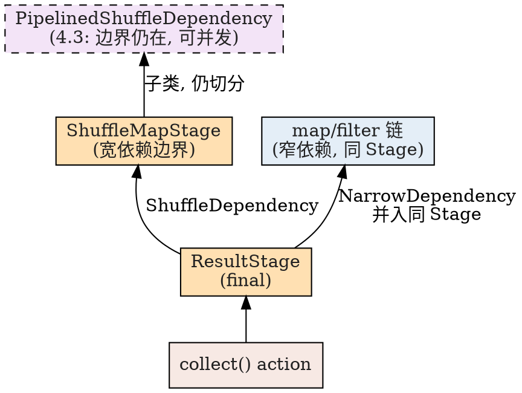

## Introduction

> [!NOTE]
> 本页源码基线：**Spark 4.3.0**（tag `v4.3.0`，commit `98bc0212`，2026-10-27）。以下片段均取自该 tag，不混用其它版本。

Spark 的调度是把"一段用户代码"变成"成百上千个跑在 executor 上的 task"的全过程。理解它的关键是四层结构：

```
Application（一个 SparkContext）
  └── Job（每个 action 触发一个 Job）
        └── Stage（在宽依赖处切分；最后一个是 ResultStage，其余是 ShuffleMapStage）
              └── TaskSet → Task（一个分区一个 Task）
```

上游的图怎么来、怎么分层，见 [RDD](/docs/CS/Framework/Spark/RDD.md) 的依赖与 lineage；shuffle 边界为何成为 Stage 分界，见 [Shuffle](/docs/CS/Framework/Spark/Shuffle.md)。

## 核心组件

| 组件 | 位置 | 职责 |
| ---- | ---- | ---- |
| `DAGScheduler` | driver | 按 RDD 依赖图划分 Stage，提交 TaskSet；处理 shuffle 输出丢失、Stage 重试 |
| `TaskScheduler` | driver | 接收 TaskSet，按调度策略把 task 分给可用资源（含本地性、推测执行） |
| `SchedulerBackend` | driver | 与底层集群管理器打交道，申请/回收 executor（YARN / K8s / Standalone） |
| `MapOutputTracker` | driver + executor | 记录 shuffle map 输出的位置，供 reduce task 拉取 |
| `BlockManagerMaster` | driver | 维护数据块（RDD 缓存、广播、shuffle）的位置与状态 |

## Stage 怎么切

DAGScheduler 从触发 action 的 RDD **倒着**遍历依赖图：

- 遇到**窄依赖**就并入当前 Stage（可以流水线执行，不用落盘）；
- 遇到**宽依赖**（需要 shuffle）就断开：上游因此成为 `ShuffleMapStage`，下游开启新 Stage；
- 最终结果的那个 Stage 是 `ResultStage`。

因此一个 Job 的 Stage 数 = 宽依赖个数 + 1。这也解释了为什么 shuffle 越多、Stage 越多、落盘与网络开销越大。

### Source: How DAGScheduler Cuts Stages

"遇宽依赖断开"在 4.3.0 源码里就是 `getMissingParentStages` 对依赖类型的模式匹配：遍历当前 Stage 的 RDD 图，只有 `ShuffleDependency` 会生成父 `ShuffleMapStage`，`NarrowDependency` 则继续沿 `enqueue` 向上追溯、并入同一 Stage。

```scala
  private def getMissingParentStages(stage: Stage): List[Stage] = {
    val missing = new HashSet[Stage]
    traverseRDDGraph(stage.rdd) { (rdd, enqueue) =>
      val rddHasUncachedPartitions = try {
        getCacheLocs(rdd).contains(Nil)
      } catch {
        case e: RpcTimeoutException =>
          logWarning(log"Failed to get cache locations for RDD ${MDC(RDD_ID, rdd.id)} due " +
            log"to rpc timeout, assuming not fully cached.", e)
          true
      }
      if (rddHasUncachedPartitions) {
        for (dep <- rdd.dependencies) {
          dep match {
            case shufDep: ShuffleDependency[_, _, _] =>
              val mapStage = getOrCreateShuffleMapStage(shufDep, stage.firstJobId)
              if (!mapStage.isAvailable || !mapStage.shuffleDep.shuffleMergeFinalized) {
                missing += mapStage
              } else {
                mapStage.increaseAttemptIdOnFirstSkip()
              }
            case narrowDep: NarrowDependency[_] =>
              enqueue(narrowDep.rdd)
          }
        }
      }
    }
    missing.toList
  }
```

两个容易被教材略过的细节：一是 `PipelinedShuffleDependency` 是 `ShuffleDependency` 的子类，所以上面 `case shufDep: ShuffleDependency` 同样会匹配它——**Stage 边界在 4.3.0 依然存在**；二是 push-based shuffle 的 merge 未 finalize 时（`!shuffleMergeFinalized`），即使 map output 已就绪，父 Stage 仍被算作 missing，避免后续 Stage 读到不完整的 merge 结果。



图里那条虚线是 4.3.0 的新东西：依赖类型改变的不是"切不切 Stage"，而是"切出来的两个 Stage 何时运行"。

## Pipelined Stage Groups (4.3.0)

这是 4.3.0 对调度模型最重要的扩展。经典模型里，父 Stage 全部完成后子 Stage 才被提交；pipelined shuffle 让 producer 与 consumer 可以**并发运行**——consumer 边读 producer 还在产出的 shuffle 数据。但这不是随处可用的开关，DAGScheduler 在提交任何 Stage **之前**就把不合格的作业挡在门外。

### Source: Fail-Fast Admission Before Stage Creation

`handleJobSubmitted` 在 Stage 创建之前连做四道检查，源码注释明确其目的是 "no partial scheduler state is left behind"（拒绝时不留半成品调度状态）。

```scala
    val shuffleKinds =
      classifyJobShuffleKindsAndCheckFeatures(jobId, finalRDD, listener) match {
        case Some(kinds) => kinds
        case None => return
      }

    val (hasPipelined, hasRegular) = shuffleKinds
    if (hasPipelined && hasRegular) {
      logWarning(log"Rejecting job ${MDC(JOB_ID, jobId)}: a job mixing a pipelined shuffle with " +
        log"a regular shuffle is not supported")
      listener.jobFailed(new SparkException(
        "A job that mixes a pipelined shuffle dependency with a regular shuffle dependency is " +
          "not supported: a job must be either all-regular or all-pipelined."))
      return
    }

    if (hasPipelined && rejectUnadmittablePipelinedGroup(jobId, finalRDD, partitions, listener)) {
      return
    }
    var finalStage: ResultStage = null
    try {
      if (hasPipelined) {
        checkPipelinedGroupsSupportedInRDDGraph(finalRDD)
      }
      finalStage = createResultStage(finalRDD, func, partitions, jobId, callSite)
```

`classifyJobShuffleKinds` 把整个依赖图上的 shuffle 边界按类型归类，规则是**作业必须全普通或全 pipelined，不许混用**：

```scala
  private def classifyJobShuffleKinds(finalRDD: RDD[_]): (Boolean, Boolean) = {
    var hasPipelined = false
    var hasRegular = false
    traverseRDDGraph(finalRDD) { (rdd, enqueue) =>
      rdd.dependencies.foreach { dep =>
        dep match {
          case _: PipelinedShuffleDependency[_, _, _] => hasPipelined = true
          case _: ShuffleDependency[_, _, _] => hasRegular = true
          case _ => // narrow dependency: not a boundary
        }
        enqueue(dep.rdd)
      }
    }
    (hasPipelined, hasRegular)
  }
```

### Source: Why Speculation and Dynamic Allocation Are Rejected

`classifyJobShuffleKindsAndCheckFeatures` 的注释直接解释了两个拒绝理由，这是理解"为什么不能全局开启 pipelined"的关键：

```scala
    val speculationOn = sc.conf.get(config.SPECULATION_ENABLED)
    val dynAllocOn = Utils.isDynamicAllocationEnabled(sc.conf)
    if ((speculationOn || dynAllocOn) && rddGraphHasPipelinedDependency(finalRDD)) {
      if (speculationOn) {
        logWarning(log"Rejecting job ${MDC(JOB_ID, jobId)}: speculation is incompatible with " +
          log"pipelined shuffle dependencies")
        listener.jobFailed(new SparkException(
          "Speculative execution is not supported for a job that uses a pipelined shuffle " +
            s"dependency. Disable ${config.SPECULATION_ENABLED.key} for such jobs."))
        return None
      }
      // dynAllocOn
      logWarning(log"Rejecting job ${MDC(JOB_ID, jobId)}: dynamic allocation is incompatible " +
        log"with pipelined shuffle dependencies")
      listener.jobFailed(new SparkException(
        "Dynamic allocation is not supported for a job that uses a pipelined shuffle dependency: " +
          "a pipelined stage group must be co-scheduled against a known cluster size. Disable " +
          s"${config.DYN_ALLOCATION_ENABLED.key} for such jobs."))
      return None
    }
```

原因拆开看很清楚：

- **推测执行**被拒，是因为推测的 producer 副本会与"已经在读 producer 部分输出"的 consumer 竞争，而两阶段并发读之间**没有 commit barrier 保护**；
- **动态资源分配**被拒，是因为 pipelined group 是 gang-scheduled（整组成员必须同时在场），准入检查以"当前活跃 executor 的空闲 slot"为准；动态分配下作业可能在 executor 还没起来时启动，会撞上一个临时的 0-slot 快照而被误判失败。

除了这两项，源码注释还列出另外三类被拒的 idiom：一个 producer 喂多个 consumer 的 fan-out（1:N 需要向 N 个活跃读者组播，尚未实现）、组成员 Stage 内的可靠 checkpoint（截断的血统与"瞬时边不可跨时间复用"冲突）、以及成员使用非默认 resource profile（gang slot 检查按默认 profile 算容量）。

### Source: Producer-Side Fail-Fast

即便作业整体准入通过，pipelined producer Stage 创建时还要过一遍生产者侧的检查，拒绝 barrier、动态分配与静态不确定 producer：

```scala
  private def checkPipelinedProducerSupported(shuffleDep: ShuffleDependency[_, _, _]): Unit = {
    if (!shuffleDep.isInstanceOf[PipelinedShuffleDependency[_, _, _]]) {
      return
    }
    val rdd: RDD[_] = shuffleDep.rdd
    if (rdd.isBarrier()) {
      throw pipelinedUnsupportedError("barrier execution in a pipelined-group member stage")
    }
    if (Utils.isDynamicAllocationEnabled(sc.conf)) {
      throw pipelinedUnsupportedError("dynamic resource allocation with a pipelined shuffle")
    }
    if (rdd.outputDeterministicLevel == DeterministicLevel.INDETERMINATE) {
      throw pipelinedUnsupportedError("a statically-indeterminate pipelined producer")
    }
```

根因是 pipelined group 跑在一条**瞬时、一次性**的流上，任何失败都整组重跑、从不单独回滚某个 Stage——因此"失败后重算单 Stage"的机制（barrier 的全局同步、checksum 不匹配重试、query-level rollback）在这里要么语义无意义、要么与已消费部分输出的 consumer 冲突。

### Source: Independent Output Tracker

pipelined shuffle 不复用普通 shuffle 的 `MapOutputTrackerMaster`，而是走独立的 `StreamingShuffleOutputTracker`；未配置则直接抛异常——这是"与 MapOutputTracker 解耦"的落地点。

```scala
  private def outputTrackerMaster(
      shuffleDep: ShuffleDependency[_, _, _]): ShuffleOutputTrackerMaster = {
    if (shuffleDep.isInstanceOf[PipelinedShuffleDependency[_, _, _]]) {
      sc.env.streamingShuffleOutputTracker
        .getOrElse(throw new IllegalStateException(
          s"A pipelined shuffle (id ${shuffleDep.shuffleId}) requires a " +
            "StreamingShuffleOutputTracker, but none is configured"))
        .asInstanceOf[StreamingShuffleOutputTrackerMaster]
    } else {
      mapOutputTracker
    }
  }
```

### Falsification: What Changed and What Did Not

把经典结论逐条校准，避免用旧模型误判 4.3.0 的行为：

| 经典说法 | 4.3.0 实际 |
| :--- | :--- |
| 宽依赖必然切分 Stage | **仍成立**。`PipelinedShuffleDependency` 是 `ShuffleDependency` 子类，`getMissingParentStages` 照样把它切成 map stage |
| 父 Stage 完成后子 Stage 才提交 | **仅对普通 shuffle 成立**。pipelined group 的 producer / consumer 并发调度、边产边读 |
| 失败重算单个 Stage | pipelined group **整组失败、整组重跑**，从不单独回滚成员 Stage |
| 推测执行 / 动态分配是通用加速器 | 对 pipelined 作业**直接拒绝**，作业提交期即 fail-fast |
| 全作业的 shuffle 由单一 MapOutputTracker 管理 | pipelined shuffle 走**独立** `StreamingShuffleOutputTracker` |

### Why This Shape

- 用**类型**（`PipelinedShuffleDependency` 子类）而非配置开关来表达"可增量读"，让 driver 与 executor 对同一个序列化依赖做模式匹配即可一致路由，无需共享可变的 `shuffleId → 行为` 状态。
- 把拒绝检查全部放在 Stage 创建**之前**，是为了保证 fail-fast 不留下半成品调度状态——一个被拒的作业不会让某些 Stage 已经跑起来、另一些在等 slot。
- 选择"整组原子失败"而非"单 Stage 回滚"，是因为 consumer 可能已经读走了 producer 的部分输出，此时回滚 producer 无法让时间倒流；既然无法局部恢复，就干脆禁止所有依赖局部恢复的 idiom（checkpoint、speculation、barrier），用一致性换简单性。
- 代价是适用范围窄：一个作业不能混用两种 shuffle，且必须关闭推测执行与动态分配——这就是为什么它首先落在 Real-Time Mode 这种**受控、短延迟**的场景，而非通用批处理（见 [Streaming](/docs/CS/Framework/Spark/Streaming.md)）。

## Task 调度与本地性

每个 Stage 生成一个 TaskSet（task 数 = 分区数），TaskScheduler 按**数据本地性**优先级投递：

| 级别 | 含义 | 理想程度 |
| ---- | ---- | ---- |
| PROCESS_LOCAL | 数据就在同一个 executor 的 JVM 里（如已缓存的 RDD 分区） | 最好 |
| NODE_LOCAL | 数据在同节点（本地磁盘 / 同节点其他 executor） | 次好 |
| RACK_LOCAL | 同机架 | 可接受 |
| ANY | 跨机架 | 最差 |

Spark 用**延迟调度（delay scheduling）**：优先等一小段时间看有没有更近的 slot，等不到才降级。这也是论文里 `getPreferredLocations` 的用途。

调度策略（同一 Application 内多个并行 Job 之间）：

- **FIFO**（默认）：先进先出；
- **FAIR**：按配置的 pool 公平共享资源，`spark.scheduler.mode=FAIR` + fairscheduler.xml。

## 容错

三层重试，粒度从细到粗：

1. **Task 失败重试**：默认最多 4 次（`spark.task.maxFailures`）。失败原因可能是代码异常、OOM、executor 丢失等；
2. **Stage 重算**：`FetchFailedException`（shuffle 数据拿不到，通常是 map 端 executor 挂了）会被上报给 DAGScheduler，触发**上游 ShuffleMapStage 重新计算**，而不是重算整个 Job——这正是 lineage 的价值；
3. **Application 失败**：重试次数用尽则作业失败。

配合机制：

- **排除机制**（老版本叫黑名单，4.x 起术语改为 exclude）：反复失败的 executor / 节点会被短期排除，避免坏节点拖垮作业；
- **推测执行（speculation）**：同一 task 跑得特别慢时另起一份，谁先完成用谁。Spark 4.0 起参数更保守（`spark.speculation.multiplier=3`、`spark.speculation.quantile=0.9`），减少无谓的重复计算；
- **动态资源分配**：按需申请与释放 executor，配合 external shuffle service 使用（否则 executor 被回收会丢 shuffle 数据）。

## 一次 action 的完整流程

```
rdd.collect()
  → SparkContext.runJob()
  → DAGScheduler: 建 ResultStage + 依赖的 ShuffleMapStage
  → 提交最上游 Stage 的 TaskSet
  → TaskScheduler 按本地性把 task 发给 executor
  → executor 反序列化 task，执行 compute(split, context)
  → ShuffleMapTask 写 data/index 文件并向 driver 汇报 map 输出位置
  → 后续 Stage 拉取数据 → 直到 ResultStage 完成
  → 结果返回 driver（collect）或写入外部系统
```

## 常见调度问题

| 症状 | 原因 | 方向 |
| ---- | ---- | ---- |
| Stage 里 task 数远超预期 | 分区数过多 | 调 `spark.sql.shuffle.partitions` / `spark.default.parallelism`，或交给 AQE 合并 |
| 少数 task 远超其他时长 | 数据倾斜或慢节点 | 倾斜见 [Shuffle](/docs/CS/Framework/Spark/Shuffle.md)；慢节点开推测执行 |
| 本地性全是 ANY | 资源紧张或数据与计算不在一处 | 增大 executor 数、检查 HDFS 与计算节点是否同置 |
| 反复 FetchFailed | executor 频繁回收 / 磁盘或网络问题 | 开 external shuffle service，关动态分配或调小释放速度 |

## Links

- [RDD](/docs/CS/Framework/Spark/RDD.md)
- [Shuffle](/docs/CS/Framework/Spark/Shuffle.md)
- [Memory](/docs/CS/Framework/Spark/Memory.md)
- [Deploy](/docs/CS/Framework/Spark/Deploy.md)
- [Spark](/docs/CS/Framework/Spark/Spark.md)

## References

1. [Spark Docs - Job Scheduling](https://spark.apache.org/docs/latest/job-scheduling.html)
2. [Spark Docs - Configuration: Scheduling](https://spark.apache.org/docs/latest/configuration.html#scheduling)
3. [Spark Docs - Migration Guide: Spark Core 4.0（推测执行参数变化）](https://spark.apache.org/docs/4.0.0/core-migration-guide.html)
4. [Spark Release 4.3.0（SPARK-58263 并发调度 pipelined stage group、SPARK-58398 gang admission）](https://spark.apache.org/releases/spark-release-4-3-0.html)
5. [DAGScheduler.scala @ v4.3.0](https://github.com/apache/spark/blob/v4.3.0/core/src/main/scala/org/apache/spark/scheduler/DAGScheduler.scala)
