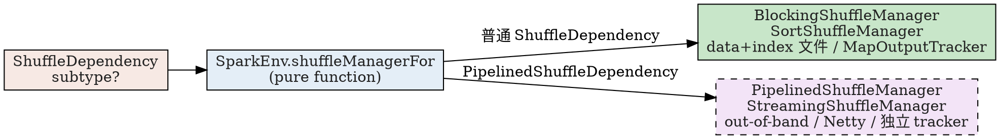

## Introduction

> [!NOTE]
> 本页源码基线：**Spark 4.3.0**（tag `v4.3.0`，commit `98bc0212`，2026-10-27）。以下片段均取自该 tag，不混用其它版本。

Shuffle 是 Spark 里**跨 Stage 重新分布数据**的过程：宽依赖算子（`groupByKey`、`join`、`repartition` 等）要求同 key 的数据落到同一分区，于是每个 map task 必须把自己产出的数据按目标分区切分、落盘，再由下游 task 跨网络拉取。它同时涉及磁盘 I/O、网络传输、序列化与排序，是 Spark 作业最主要的性能瓶颈来源。

与之配套的 Stage 划分逻辑见 [Scheduler](/docs/CS/Framework/Spark/Scheduler.md)，内存侧的缓冲与记账见 [Memory](/docs/CS/Framework/Spark/Memory.md)。

## 演进：三代 Shuffle

| 阶段 | 做法 | 问题 / 改进 |
| ---- | ---- | ---- |
| Hash Shuffle（1.1 之前） | 每个 map task 为每个 reduce task 各写一个文件，共 $M \times R$ 个 | 文件数爆炸、随机 I/O 与内存开销大；0.8.1 引入文件合并（consolidate）缓解 |
| Sort Shuffle（1.1 引入，1.2 起默认） | 每个 map task 只写**一个 data 文件 + 一个 index 文件**，共 $2M$ 个 | 文件数可控；代价是引入排序开销 |
| Tungsten / Unsafe Sort Shuffle（1.4 引入，1.6 并入 SortShuffleManager） | 用堆外内存 + 二进制行格式，按分区排序后 spill | 降低 GC 压力、减少内存占用；成为事实标准 |
| —— | Spark 2.0 起 hash shuffle 被移除 | 只剩一条路径 |

现在的 `SortShuffleManager` 会根据情况选择 writer：

- `BypassMergeSortShuffleWriter`：分区数较少且**不需要 map 端聚合**时，绕过排序直接按分区写再合并，省掉排序成本；
- `SortShuffleWriter`：通用路径，需要排序或 map 端聚合；
- `UnsafeShuffleWriter`：Tungsten 序列化路径，堆外内存管理。

### Source: The Three-Way Writer Choice

选择分两步：`registerShuffle` 在 driver 端定 handle 类型，`getWriter` 在 executor 端按 handle 实例化 writer。判定条件都是源码里的真实谓词，而非经验规则。

```scala
  override def registerShuffle[K, V, C](
      shuffleId: Int,
      dependency: ShuffleDependency[K, V, C]): ShuffleHandle = {
    if (SortShuffleWriter.shouldBypassMergeSort(conf, dependency)) {
      new BypassMergeSortShuffleHandle[K, V](
        shuffleId, dependency.asInstanceOf[ShuffleDependency[K, V, V]])
    } else if (SortShuffleManager.canUseSerializedShuffle(dependency)) {
      new SerializedShuffleHandle[K, V](
        shuffleId, dependency.asInstanceOf[ShuffleDependency[K, V, V]])
    } else {
      new BaseShuffleHandle(shuffleId, dependency)
    }
  }
```

两个谓词把口述里的"分区数较少"、"需要序列化支持"落到实处：

```scala
  def shouldBypassMergeSort(conf: SparkConf, dep: ShuffleDependency[_, _, _]): Boolean = {
    // We cannot bypass sorting if we need to do map-side aggregation.
    if (dep.mapSideCombine) {
      false
    } else {
      val bypassMergeThreshold: Int = conf.get(config.SHUFFLE_SORT_BYPASS_MERGE_THRESHOLD)
      dep.partitioner.numPartitions <= bypassMergeThreshold
    }
  }
```

```scala
  def canUseSerializedShuffle(dependency: ShuffleDependency[_, _, _]): Boolean = {
    val shufId = dependency.shuffleId
    val numPartitions = dependency.partitioner.numPartitions
    if (!dependency.serializer.supportsRelocationOfSerializedObjects) {
      false
    } else if (dependency.mapSideCombine) {
      false
    } else if (numPartitions > MAX_SHUFFLE_OUTPUT_PARTITIONS_FOR_SERIALIZED_MODE) {
      false
    } else {
      true
    }
  }
```

优先级是 Bypass（无 map-side combine 且分区数 ≤ `bypassMergeThreshold`）→ Serialized/Unsafe（序列化器支持对象重定位、无 map-side combine、分区数未超上限）→ 普通 Sort。注意两个能走 Unsafe 的前提都要求 `mapSideCombine == false`——这正是 `reduceByKey` 虽省网络却失去序列化 shuffle 优化的部位。

> [!TIP]
> 4.3.0 的差异：`getWriter` 三个分支的构造参数都新增了 `shuffleExecutorComponents`，这是可插拔 shuffle 后端（本地 / 远程）的注入点；经典实现里 data/index 文件由 `IndexShuffleBlockResolver.writeIndexFileAndCommit` 直接落盘，4.3.0 则封装进 `createMapOutputWriter` / `commitAllPartitions`，为远程 shuffle 让路。同时 `MapStatus` 新增了 checksum 字段。

## Map 端发生了什么

```
ShuffleMapTask 执行
  → 每条记录经 partitioner 计算目标分区
  → 写入内存缓冲区（AppendOnlyMap / ExternalAppendOnlyMap，走 Tungsten 内存页）
  → 需要 map 端聚合时（reduceByKey / aggregateByKey）先本地 combine
  → 缓冲区达到阈值 → 按 (partitionId, key) 排序 → spill 到磁盘
  → task 结束时把所有 spill 文件 + 内存残留 merge 成一个 data 文件 + index 文件
```

要点：

- **有 map 端聚合（combine）的算子会大幅减少落盘与网络数据量**，这就是 `reduceByKey` 优于 `groupByKey` 的根本原因；
- spill 次数过多说明 shuffle 内存不足或分区数不合理；
- map 端输出**保留在本地磁盘**，由 BlockManager 管理，因此 executor 挂掉会丢失 shuffle 数据——这是外部 shuffle service 存在的理由。

### Source: SortShuffleWriter Delegates to ExternalSorter

`SortShuffleWriter.write` 本身不含 spill / merge 代码，全部委托 `ExternalSorter`；写出阶段用的是 4.3.0 的可插拔 `ShuffleMapOutputWriter`。

```scala
  override def write(records: Iterator[Product2[K, V]]): Unit = {
    sorter = if (dep.mapSideCombine) {
      new ExternalSorter[K, V, C](
        context, dep.aggregator, Some(dep.partitioner), dep.keyOrdering,
        dep.serializer, dep.rowBasedChecksums)
    } else {
      new ExternalSorter[K, V, V](
        context, aggregator = None, Some(dep.partitioner), ordering = None,
        dep.serializer, dep.rowBasedChecksums)
    }
    sorter.insertAll(records)
    val mapOutputWriter = shuffleExecutorComponents.createMapOutputWriter(
      dep.shuffleId, mapId, dep.partitioner.numPartitions)
    sorter.writePartitionedMapOutput(dep.shuffleId, mapId, mapOutputWriter, writeMetrics)
    partitionLengths = mapOutputWriter.commitAllPartitions(sorter.getChecksums).getPartitionLengths
    mapStatus =
      MapStatus(blockManager.shuffleServerId, partitionLengths, mapId, getAggregatedChecksumValue)
  }
```

`insertAll` 里可以看到 map 端聚合的实际位置：有 aggregator 时用 `map.changeValue((partitionId, kv._1), update)` 在内存里就地合并，没有时直接 `buffer.insert`；每条记录插入后都调 `maybeSpillCollection`，内存估算超限就 spill。

```scala
      while (records.hasNext) {
        addElementsRead()
        kv = records.next()
        val partitionId = actualPartitioner.getPartition(kv._1)
        map.changeValue((partitionId, kv._1), update)
        maybeSpillCollection(usingMap = true)
        if (rowBasedChecksums.nonEmpty) {
          rowBasedChecksums(partitionId).update(kv._1, kv._2)
        }
      }
```

写文件时分两条路：`spills.isEmpty` 时直接按分区顺序遍历内存集合写出；有 spill 文件时走 `partitionedIterator` 做多路归并。

```scala
    if (spills.isEmpty) {
      val collection = if (aggregator.isDefined) map else buffer
      val it = collection.destructiveSortedWritablePartitionedIterator(comparator)
      while (it.hasNext) {
        val partitionId = it.nextPartition()
        // ... write this partition via mapOutputWriter.getPartitionWriter(partitionId)
      }
    } else {
      for ((id, elements) <- this.partitionedIterator) {
        // ... merge-sort spilled + in-memory, write via getPartitionWriter(id)
      }
    }
```

这里的"有 map 端聚合就先本地 combine"就是 `reduceByKey` 优于 `groupByKey` 的全部机制——数据在 map 端就被压小，落盘与网络传输量同步下降。这段源码里也解释了为什么"spill 次数是最好的健康指标"：每次 spill 都是一次 `spillMemoryIteratorToDisk` 落盘 + 后续归并。

## Reduce 端发生了什么

```
ShuffleMapStage 结束 → 下游 Stage 启动
  → 每个 reduce task 向各节点的 BlockManager / ExternalShuffleService 拉取属于自己的分区
  → 边拉边聚合（或先落盘再归并排序）
  → 交给下游算子计算
```

- 拉取失败（`FetchFailedException`）会触发 **Stage 重算**：DAGScheduler 把对应 map stage 重新调度，这也是 Spark 容错的典型路径；
- 拉取端的 `spark.reducer.maxSizeInFlight` 控制并发拉取量，`spark.shuffle.io.*` 控制超时与重试；
- 启用 **External Shuffle Service** 后，shuffle 数据的生命周期与 executor 解耦，配合动态资源伸缩（executor 被回收仍能提供数据）。Spark 4.0 起默认让 shuffle service 在不再需要时删除 shuffle block（`spark.shuffle.service.removeShuffle`）。

## 分区数：最常被调错的旋钮

- `spark.sql.shuffle.partitions` 默认 **200**（SQL / DataFrame 侧），RDD 侧由 `spark.default.parallelism` 或算子参数决定；
- 太少 → 单分区数据量大、容易 OOM 与倾斜；太多 → 小文件与小任务过多，调度与 I/O 开销暴增；
- 有了 **AQE（Adaptive Query Execution，Spark 3.2 起默认开启）** 后，Spark 会按 map 输出的真实统计**合并相邻小分区**（`spark.sql.adaptive.coalescePartitions.enabled`），因此可以把初始分区数设得偏大一些，交给运行时收缩（见 [SQL](/docs/CS/Framework/Spark/SQL.md)）。

## Two Shuffle Managers (4.3.0)

经典 Spark 里全局只有一个 ShuffleManager（由 `spark.shuffle.manager` 指定，默认 `sort`）。**4.3.0 打破了这个前提**：`ShuffleManager` 被拆成两个 trait，同一个 JVM 里两个实现共存，每个 shuffle 按依赖类型路由。这是理解 [Streaming](/docs/CS/Framework/Spark/Streaming.md) Real-Time Mode 毫秒级延迟的底层机制。

### Source: Routing by Dependency Type

`SparkEnv.shuffleManagerFor` 是唯一切换点，注释明确它是一个**纯函数**——driver 在 `registerShuffle`、executor 在 `getWriter` / `getReader` 各自独立得出一致结果，无需共享路由状态。

```scala
  private[spark] def shuffleManagerFor(dependency: ShuffleDependency[_, _, _]): ShuffleManager =
    dependency match {
      case _: PipelinedShuffleDependency[_, _, _] =>
        _pipelinedShuffleManager
      case _ => _blockingShuffleManager
    }
```

旧的 `SparkEnv.shuffleManager` getter 已标 `@deprecated(..., "4.3.0")`，仅为二进制兼容保留。两个 manager 的分工写在新 trait 的注释里：

```scala
/**
 * A [[ShuffleManager]] whose output is read incrementally: a consumer stage may begin reading while
 * the producer is still running. Such a manager serves its output out-of-band and does not produce
 * block-manager-addressed blocks, so it has no [[ShuffleBlockResolver]].
 */
private[spark] trait PipelinedShuffleManager extends ShuffleManager
```

内置实现是 `StreamingShuffleManager`（基于 Netty 线协议），由新配置 `spark.shuffle.manager.incremental` 选择，默认短别名 `streaming`；普通 shuffle 仍走 `spark.shuffle.manager`。注入点也体现在 SQL 层：`ShuffleExchangeExec` 根据 `pipelined` 布尔位决定构造哪一种依赖。

```scala
    val dependency =
      if (pipelined) {
        new PipelinedShuffleDependency[Int, InternalRow, InternalRow](
          rddWithPartitionIds,
          new PartitionIdPassthrough(part.numPartitions),
          serializer,
          shuffleWriterProcessor = createShuffleWriteProcessor(writeMetrics),
          rowBasedChecksums = UnsafeRowChecksum.createUnsafeRowChecksums(checksumSize))
      } else {
        new ShuffleDependency[Int, InternalRow, InternalRow](
          rddWithPartitionIds,
          new PartitionIdPassthrough(part.numPartitions),
          serializer,
          shuffleWriterProcessor = createShuffleWriteProcessor(writeMetrics),
          rowBasedChecksums = UnsafeRowChecksum.createUnsafeRowChecksums(checksumSize),
          _checksumMismatchFullRetryEnabled = SQLConf.get.shuffleChecksumMismatchFullRetryEnabled,
          checksumMismatchQueryLevelRollbackEnabled =
            SQLConf.get.shuffleChecksumMismatchQueryLevelRollbackEnabled)
      }
```

注意 `pipelined` 分支刻意**不传**两个 checksum 重试参数——pipelined shuffle 是瞬时的、从不重算，这两个回滚机制在语义上不可达。



### Why This Shape

- 把"是否增量可读"做成依赖的**类型**而非全局配置，才能让同一个作业、同一个 JVM 里两种 shuffle 并存，且 driver 与 executor 不靠任何共享状态就达成一致。
- 增量式 manager 直接放弃 `ShuffleBlockResolver`（out-of-band 服务输出），是因为经典 shuffle 的 data/index 文件模型天然假设"先全部写完、再被读取"，与边产边读冲突。
- 代价是 pipelined 一侧的功能面更窄：push-based merge 被禁用、checksum 重试不暴露、必须 gang-scheduling 且关闭推测执行与动态分配（见 [Scheduler](/docs/CS/Framework/Spark/Scheduler.md)）。这是用功能完整性换延迟。

## Push-based Shuffle

Spark 3.2 引入（SPARK-30602）：map task 写完数据后**主动把分区数据推送**到外部 shuffle service 做合并（shuffle merge），reduce 端只需拉合并后的大块数据。收益是减少小文件与随机 I/O、提高大 shuffle 的稳定性；代价是需要部署外部 shuffle service，且更适配 YARN 这类形态。

## 常见问题与定位

| 症状 | 常见原因 | 方向 |
| ---- | ---- | ---- |
| 某个 task 特别慢 / OOM | **数据倾斜**：热点 key 集中到一个分区 | AQE 倾斜 join 处理、加盐打散、改 join 策略 |
| spill 次数巨大 | shuffle 内存不足或分区过多 | 调 `spark.memory.fraction`、分区数、开启 map 端聚合 |
| `FetchFailedException` 频发 | executor 被回收 / 网络超时 / 磁盘故障 | 开 external shuffle service、调超时、查节点健康 |
| 磁盘写满 | shuffle 数据未清理 | 检查 shuffle service 清理配置与 executor 生命周期 |
| 上游数据量远大于输出 | 缺 map 端聚合 | 用 `reduceByKey` / `aggregateByKey` 替代 `groupByKey` |

看 UI 的关键指标：Shuffle Read / Write 量、spill（memory/disk）、task 时长分布（是否长尾）。

## Links

- [RDD](/docs/CS/Framework/Spark/RDD.md)
- [Scheduler](/docs/CS/Framework/Spark/Scheduler.md)
- [Memory](/docs/CS/Framework/Spark/Memory.md)
- [SQL](/docs/CS/Framework/Spark/SQL.md)
- [Spark](/docs/CS/Framework/Spark/Spark.md)

## References

1. [Spark Docs - Shuffle Behavior / Configuration](https://spark.apache.org/docs/latest/configuration.html#shuffle-behavior)
2. [Spark Release 3.2.0（push-based shuffle SPARK-30602）](https://spark.apache.org/releases/spark-release-3-2-0.html)
3. [Spark Docs - Migration Guide: Spark Core 4.0（shuffle service 相关默认值变化）](https://spark.apache.org/docs/4.0.0/core-migration-guide.html)
4. [Spark Release 4.3.0（SPARK-58185 PipelinedShuffleDependency、SPARK-57141 StreamingShuffleManager）](https://spark.apache.org/releases/spark-release-4-3-0.html)
5. [SortShuffleManager.scala @ v4.3.0](https://github.com/apache/spark/blob/v4.3.0/core/src/main/scala/org/apache/spark/shuffle/sort/SortShuffleManager.scala)
6. [ShuffleManager.scala @ v4.3.0](https://github.com/apache/spark/blob/v4.3.0/core/src/main/scala/org/apache/spark/shuffle/ShuffleManager.scala)
