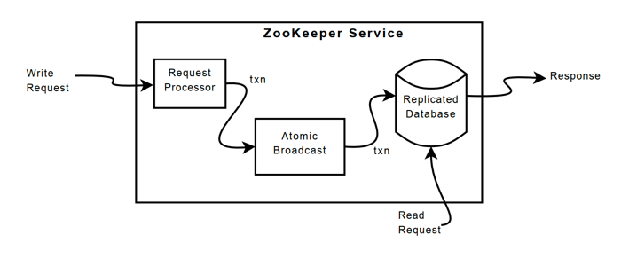

## Introduction

ZooKeeper is a centralized service for maintaining configuration information, naming, providing distributed synchronization, and providing group services.

All of these kinds of services are used in some form or another by distributed applications.
Each time they are implemented there is a lot of work that goes into fixing the bugs and race conditions that are inevitable.
Because of the difficulty of implementing these kinds of services, applications initially usually skimp on them, which make them brittle in the presence of change and difficult to manage.
Even when done correctly, different implementations of these services lead to management complexity when the applications are deployed.

ZooKeeper 是基于 Google Chubby 论文实现的一款解决分布式数据一致性问题的协调服务，方便依赖它的应用实现 数据发布/订阅、负载均衡、服务注册与发现、分布式协调、事件通知、集群管理、Leader 选举、分布式锁和队列 等功能。

ZooKeeper aims at distilling the essence of these different services into a very simple interface to a centralized coordination service.
The service itself is distributed and highly reliable.
Consensus, group management, and presence protocols are implemented by the service so that the applications do not need to implement them on their own.

**ZooKeeper provides a per client guarantee of FIFO execution of requests and linearizability for all requests that change the ZooKeeper state.**
To guarantee that update operations satisfy linearizability, Zookeeper implements a leader-based atomic broadcast protocol, called [Zab](/docs/CS/Framework/ZooKeeper/Zab.md).

In ZooKeeper, servers process read operations locally, and we do not use Zab to totally order them.
Caching data on the client side is an important technique to increase the performance of reads — ZooKeeper uses a [watch](/docs/CS/Framework/ZooKeeper/Watches.md) mechanism to enable clients to cache data without managing the client cache directly.

ZooKeeper provides to its clients the abstraction of a set of data nodes (znodes), organized according to a hierarchical name space.

ZooKeeper also has the following two liveness and durability guarantees: if a majority of ZooKeeper servers are active and communicating the service will be available; and if the ZooKeeper service responds successfully to a change request, that change persists across any number of failures as long as a quorum of servers is eventually able to recover.

> [!TIP]
> 部署与集群搭建见 [start](/docs/CS/Framework/ZooKeeper/start.md)；本页是**概念枢纽**，深潜请沿各节链接下钻。

### Consistency Guarantees

ZooKeeper is a high performance, scalable service. Both reads and write operations are designed to be fast, though reads are faster than writes. The reason for this is that in the case of reads, ZooKeeper can serve older data, which in turn is due to ZooKeeper's consistency guarantees:

- **Sequential Consistency** — Updates from a client will be applied in the order that they were sent.
- **Atomicity** — Updates either succeed or fail -- there are no partial results.
- **Single System Image** — A client will see the same view of the service regardless of the server that it connects to.
- **Reliability** — Once an update has been applied, it will persist from that time forward until a client overwrites the update.
- **Timeliness** — The clients view of the system is guaranteed to be up-to-date within a certain time bound (on the order of tens of seconds).

> [!NOTE]
> ZooKeeper 的一致性落在 sequential consistency 与 linearizability 之间：**写操作是线性一致的**（appear to take effect atomically between issue and response），**读操作不是线性一致的**（本地读可能返回陈旧值，需显式 `sync()` 才保最新）。详见下方"共识"一节。

## Architecture（架构全景）

ZooKeeper 的服务端由一组协作组件构成（单机 `ZooKeeperServer`；集群各角色 Leader / Follower / Observer 是其子类）：

1. **请求入口**：`ServerCnxnFactory`（NIO 或 Netty）接受连接，封装为 `ServerCnxn`。
2. **请求处理链 RequestProcessor**：预处理 → 提案 → 提交 → 落地，各角色链不同（见 [pipeline](/docs/CS/Framework/ZooKeeper/pipeline.md)）。
3. **共识 Zab**：仅 Leader 写，Follower 经 Leader 广播提交（见 [Zab](/docs/CS/Framework/ZooKeeper/Zab.md)）。
4. **存储与内存**：`ZKDatabase` / `DataTree` 在内存维护 znode 树，`FileTxnLog`(WAL) + `FileSnap`(快照) 持久化（见 [storage](/docs/CS/Framework/ZooKeeper/storage.md)）。
5. **会话与监听**：`SessionTracker` 追踪会话，`WatchManager` 管理 [watch](/docs/CS/Framework/ZooKeeper/Watches.md)。
6. **序列化**：`Jute` 负责线格式（见 [Jute](/docs/CS/Framework/ZooKeeper/Jute.md)）。

一次写请求的主链路：**客户端 → PrepRequestProcessor（校验/触发 watch 前处理）→ ProposalRequestProcessor（经 Zab 广播）→ CommitProcessor（等 quorum 提交）→ FinalRequestProcessor（应用内存树 + 回包）**；读请求在 Follower/Observer 本地直接处理，无需 Zab。虚线为启动恢复：快照 + 日志 replay 回填内存。

## Data Model

ZooKeeper has a hierarchical name space, much like a distributed file system. The only difference is that each node in the namespace can have data associated with it as well as children — like a file system that allows a file to also be a directory. Paths are canonical, absolute, slash-separated; there are no relative references.

Zookeeper 的这种层次模型称作 **DataTree**（`ZKDatabase` 持有 `DataTree` + `sessionsWithTimeouts` + `FileTxnSnapLog`）。DataTree 的所有 path 保存在哈希表中（`NodeHashMapImpl` 内部 `ConcurrentHashMap<String, DataNode>`），可在 $O(1)$ 找到对应 `DataNode`，保证快速查询。

> [!NOTE]
> ZooKeeper 的"内存数据库"可看作一个简化版 Redis：只支持基数树这种 KV 结构，用 WAL + 快照保证持久化。**所有数据在内存中**，因此数据上限受内存约束、只能支撑 GB 级别，且过多数据会加大 GC 压力与哈希查询延迟——这是 ZK 在超大规模集群中的结构性瓶颈（[storage](/docs/CS/Framework/ZooKeeper/storage.md) 详述）。

### ZNodes

Unlike files, znodes are not designed for general data storage — they map to client-application abstractions (status, config, location). Each znode maintains a `stat` with version counters (data change / ACL change / timestamp) to allow cache validation and conditional updates.

Znodes maintain **three version numbers** in `Stat`：`version`（数据内容版本）、`cversion`（子节点版本）、`aversion`（ACL 变更版本）。写入支持 CAS：借助 `Versionable#withVersion` 指定版本，版本不符抛 `KeeperException.BadVersionException`，避免并发覆盖（RocketMQ 的 `DateVersion` 等框架也用同类思路）。

ZNode 由五部分组成：**path、data、stat、acl、children**。其中 path 是以 `/` 开始的全路径，其余四部分存于独立 `DataNode`（`byte[] data`、`Long acl`、`StatPersisted stat`、`Set<String> children`，含 `getChildren`/`getData`/`setData` 等辅助方法）。

ZNode 类型：

- **persistent**：默认，会话结束不删。
- **ephemeral**：随创建会话存活，会话结束即删；因依赖会话故**不能有子节点**（`ephemeralOwner` 存创建者 `sessionId`）。选主即"抢注临时节点"，宕机后节点被删、其余节点 watch 到删除事件再抢主（见 [Recipes](/docs/CS/Framework/ZooKeeper/Recipes.md) 与 Curator `LeaderSelector`）。
- **container**（3.5+）：容器节点，其子节点全删后会被服务端（延迟）清理，用于 leader/lock 等"父目录"场景。
- **TTL**（3.5+）：带生存时间的节点，指定毫秒内无修改则过期删除。
- **sequential**：上述类型 + 顺序号后缀，用于公平锁 / 选主排队。

### createNode（概念级）

`DataTree.createNode(path, data, acl, ephemeralOwner, parentCVersion, zxid, time, stat)` 的核心约束：

- **父节点必须存在**（`parent == null` 抛 `NoNodeException`），这是 znode 树"父须存在"语义的来源；
- 创建后 `parent.stat.cversion/pzxid` 递增；`ephemeralOwner != 0` 时登记到 `ephemerals`（按 sessionId 聚合），container / TTL 分别登记到 `containers` / `ttls`；
- 末尾触发 `dataWatches.triggerWatch(path, NodeCreated)` 与 `childWatches.triggerWatch(parent, NodeChildrenChanged)`——即 watch 的触发点（[Watches](/docs/CS/Framework/ZooKeeper/Watches.md)）。

> 删除节点（`deleteNode`）对称：移除 `ephemerals/containers/ttls` 登记，并触发 `NodeDeleted`（data + child watch）与父节点的 `NodeChildrenChanged`。更深的源码级流程见 [pipeline](/docs/CS/Framework/ZooKeeper/pipeline.md) 与 [storage](/docs/CS/Framework/ZooKeeper/storage.md)。

### Watches

Clients can set watches on znodes; changes trigger the watch and then **clear** it (one-shot). ZooKeeper sends a notification upon update. **3.6.0+ 支持持久 watch（persistent / persistent_recursive）**。

watch 与服务端 `WatchManager`（`dataWatches` / `childWatches`）、客户端 `ZKWatchManager`（`ClientCnxn` 的 `SendThread` / `EventThread`）协同；由于一次性语义，存在"错过窗口"，只能保证最终一致。完整服务端实现、EventType、惊群与 etcd 对照见 [Watches](/docs/CS/Framework/ZooKeeper/Watches.md)；客户端注册 / 用法见 [客户端 client](/docs/CS/Framework/ZooKeeper/client.md)。

### Session

Session 即客户端与服务端的 TCP 长连接，生命周期从首次建连开始；`sessionTimeout` 控制超时，超时外重连得 `SESSION_EXPIRED`。服务端由 `SessionTrackerImpl` + `ExpiryQueue` 追踪与会话批量过期，且**会话创建本身也是一条经 Zab 提交的事务**。Session 是 ephemeral 节点与 watch 的存在前提。深度实现与 `SessionMovedException` 历史坑见 [Session](/docs/CS/Framework/ZooKeeper/Session.md)；客户端生命周期见 [客户端 client](/docs/CS/Framework/ZooKeeper/client.md)。

### ZooKeeper guarantees

ZooKeeper has two basic ordering guarantees:

- **Linearizable writes:** all requests that update the state of ZooKeeper are serializable and respect precedence.
- **FIFO client order:** all requests from a given client are executed in the order that they were sent by the client.

Combined with the five points under *Consistency Guarantees* above (Sequential Consistency, Atomicity, Single System Image, Reliability, Timeliness), this yields the practical guarantee: **writes are linearizable, reads are not** (local read may be stale; call `sync()` then read for the latest). Reads scale linearly because they are served in-memory without the agreement protocol.

### Simple API

One of the design goals of ZooKeeper is a very simple programming interface. It supports only:

- *create* : creates a node at a location in the tree
- *delete* : deletes a node
- *exists* : tests if a node exists at a location
- *get data* : reads the data from a node
- *set data* : writes data to a node
- *get children* : retrieves a list of children of a node
- *sync* : waits for data to be propagated (→ linearizable read)

### ACL

ACL 控制 znode 权限，采用 **`scheme : id : permission`** 三段式（不同于 Linux 的 owner/group/other）。权限位为 `CREATE / READ / WRITE / DELETE / ADMIN`，预定义集 `OPEN_ACL_UNSAFE` / `CREATOR_ALL_ACL` / `READ_ACL_UNSAFE`；`setACL` 带 `aversion` 支持 CAS，`PrepRequestProcessor.checkAcl()` 在请求链前段校验。ACL 的**数据模型与版本语义**见 [ACL](/docs/CS/Framework/ZooKeeper/ACL.md)；认证源（digest / ip / sasl / x509 / super）与 TLS 配置见 [安全 security](/docs/CS/Framework/ZooKeeper/security.md)；客户端 `addAuth` 用法见 [客户端 client](/docs/CS/Framework/ZooKeeper/client.md)。

## 共识：为何只有 Leader 能写

At the heart of ZooKeeper is the atomic broadcast protocol **[Zab](/docs/CS/Framework/ZooKeeper/Zab.md)**. **All requests that update ZooKeeper state are forwarded to the leader**; the leader executes and broadcasts the change via Zab (default simple-majority quorum: with $2f+1$ servers we tolerate $f$ failures). Read requests are handled locally.

The FIFO order guarantee plus `sync()` enables a read to reflect any change before the sync: a client calls `sync` followed by the read to guarantee the latest value. `zxid` (64-bit = epoch + counter) stamps every proposal and defines the total order; a new leader gets a new epoch, so every proposal id is unique.

> Zab 与 Paxos / Multi-Paxos / Raft 的差异、Leader 选举（phase 0/1/2）、恢复与同步、quorum 数学，全部在 [Zab](/docs/CS/Framework/ZooKeeper/Zab.md) 深潜，本页不展开。

## 服务端请求处理（角色与链路）

各角色有独立的 RequestProcessor 链：Leader 走 Prep → Proposal → Commit → Final；Follower / Observer 走 Follower 链，最终也交 FinalRequestProcessor 应用内存树。**读本地、写经 Leader**；Observer 参与读但不参与投票，常用于跨 DC 只读扩展。链路细节、`sync()` 如何实现线性读、只读模式见 [pipeline](/docs/CS/Framework/ZooKeeper/pipeline.md)；Observer 跨 DC 与 ensemble 规模见 [cluster](/docs/CS/Framework/ZooKeeper/cluster.md)。命令行工具 `zkCli.sh`（ZooKeeperMain）的用法见 [客户端 client](/docs/CS/Framework/ZooKeeper/client.md)。

## 存储：WAL + 快照 + 内存树

ZooKeeper 持久化由 `FileTxnLog`(WAL) + `FileSnap`(快照) 组成，二者由 `FileTxnSnapLog` 统一管理；运行时数据在 `ZKDatabase` / `DataTree` / `DataNode` 内存中。`shouldSnapshot` 控制快照触发（事务数或大小超过 `snapCount`/`snapSizeLimitInKb` 相关的随机阈值）；启动恢复 = 加载快照 + 日志 replay。完整文件格式、`zxid` 结构、启动恢复流程与调优参数见 [storage](/docs/CS/Framework/ZooKeeper/storage.md)；线格式见 [Jute](/docs/CS/Framework/ZooKeeper/Jute.md)。

## 动态重配置 / 监控 / 日志

- **动态重配置（3.5+，默认关闭需 `reconfigEnabled`）**：无需滚动重启即可变更 ensemble 成员，见 [cluster](/docs/CS/Framework/ZooKeeper/cluster.md)。
- **监控**：四字命令、`mntr`、JMX、Prometheus / AdminServer，告警规则见 [monitoring](/docs/CS/Framework/ZooKeeper/monitoring.md)。
- **日志**：基于 slf4j；ZK 写事务日志前需 `forceSync`（默认 yes）刷盘，直接决定吞吐。

## compare with Chubby

|          | Chubby  | Zookeeper |
| -------- | ------- | --------- |
| Lock     | has api | 无独立 lock api（用 ephemeral 顺序节点实现） |
| protocol | Paxos   | Zab       |
| cache    | 服务端直接管理客户端缓存 | 客户端自行缓存 + watch 通知 |

## 运维与调优（要点）

- **磁盘爆满**：高频写入下 `autopurge.purgeInterval` 最小 1 小时无法避免两次清理间写满；缓解靠 `dataDir` / `dataLogDir` 分离、调大 `snapCount`/`snapSizeLimitInKb`（但过大拖慢重启恢复），详见 [troubleshooting](/docs/CS/Framework/ZooKeeper/troubleshooting.md) 与 [storage](/docs/CS/Framework/ZooKeeper/storage.md)。
- **只读模式 / Quorum 丢失**：Leader 选举未完成或多数派不可达时 Follower 转只读，见 [troubleshooting](/docs/CS/Framework/ZooKeeper/troubleshooting.md)。
- **会话过期 / watch 泄漏**：见 [troubleshooting](/docs/CS/Framework/ZooKeeper/troubleshooting.md)；ensemble 规模与超时参数见 [cluster](/docs/CS/Framework/ZooKeeper/cluster.md)。

## Comparison with etcd

etcd 是 ZooKeeper 在现代云原生时代最常被拿来比较的对象（完整维度矩阵见 [etcd 横向对照](/docs/CS/Framework/etcd/compare.md)）。两者都提供"一致性的分布式键值 + 协调"，但底层取舍差异很大：

| 维度 | ZooKeeper | etcd |
| :--- | :--- | :--- |
| 共识算法 | **Zab**（原子广播，仅 Leader 写） | **Raft**（etcd-raft，Leader 经 ReadIndex 提供线性读） |
| 数据模型 | **znode 树**（`/a/b/c`，父须存在，类型 persistent / ephemeral / container / sequential） | **扁平 key + 前缀范围**（无父约束，`get --prefix`） |
| 读模型 | 本地读 + 客户端 watch 缓存，需 `sync()` 才保最新 | 默认线性一致（ReadIndex），可显式 serializable |
| Watch | **一次性触发**，需重新注册（惊群来源） | gRPC 双向流，可续接且**按 revision 回溯** |
| 临时 / 自动删除 | **ephemeral 节点**（会话结束删） | **lease**（TTL 过期删） |
| 锁 / 选主 | ephemeral 顺序节点 + watch 前驱 | lease + CAS / Txn |
| 历史版本 | 无（仅当前状态） | **MVCC 多版本可回溯** |
| 权限 | digest / IP ACL | RBAC + mTLS |
| 客户端协议 | Jute 序列化 + 私有 ZTP/RPC（难用 curl 调试） | gRPC + protobuf（通用工具可调试） |
| 语言 / 依赖 | Java，JVM 内存开销大（数据受内存上限约束，GB 级） | Go，单二进制零外部依赖 |

**核心差异在共识与读模型。** Zab 是"只写 Leader"的原子广播，Follower 不能脱离 Leader 直接服务写；etcd 的 Raft 让 Leader 通过 no-op + ReadIndex 实现线性一致读，代价是一次网络往返。ZooKeeper 因此靠客户端缓存 + watch 来扛读，但需要显式 `sync()` 才保证最新——这正是它读性能高、但一致性弱于 etcd 的原因。

**数据模型决定上层写法。** znode 树让父子关系成为结构的一部分（创建子节点前父须存在），etcd 用扁平 key + 前缀模拟层级，`/` 只是 key 的一部分，写入更自由但"目录"不是一等概念。两者都能实现锁与选主，机制对应：ZK 的 ephemeral 节点 ≈ etcd 的 lease 过期删除。

**选型分水岭**：ZooKeeper 是 HBase / Kafka / Hadoop 等传统大数据的历史内置依赖，Java 生态协调成熟；etcd 是 Kubernetes 后端事实标准，云原生通用协调（多租户、RBAC、Txn 事务、gRPC）一应俱全。需要"开箱注册中心"时，Nacos / Consul 比两者都更省心（见 [etcd 横向对照](/docs/CS/Framework/etcd/compare.md) 的选型表）。

## 下一步去哪

- **概念枢纽（本页）** → 数据模型 / znode / watch / session / ACL / 一致性
- **共识**：[Zab](/docs/CS/Framework/ZooKeeper/Zab.md)（协议）· [Election](/docs/CS/Framework/ZooKeeper/Election.md)（选主源码深潜）
- **请求处理链**：[pipeline](/docs/CS/Framework/ZooKeeper/pipeline.md)
- **网络层**：[IO](/docs/CS/Framework/ZooKeeper/IO.md)（汇总与对比）· [NIO](/docs/CS/Framework/ZooKeeper/NIO.md)（默认实现深潜）
- **存储与内存**：[storage](/docs/CS/Framework/ZooKeeper/storage.md) · [Jute](/docs/CS/Framework/ZooKeeper/Jute.md)
- **客户端与协议**：[client](/docs/CS/Framework/ZooKeeper/client.md) · [Watches](/docs/CS/Framework/ZooKeeper/Watches.md) · [Session](/docs/CS/Framework/ZooKeeper/Session.md) · [ACL](/docs/CS/Framework/ZooKeeper/ACL.md)
- **协调原语**：[Recipes](/docs/CS/Framework/ZooKeeper/Recipes.md) · [Curator](/docs/CS/Framework/ZooKeeper/Curator.md)
- **安全**：[security](/docs/CS/Framework/ZooKeeper/security.md)
- **部署引导**：[Bootstrap](/docs/CS/Framework/ZooKeeper/Bootstrap.md) · [start](/docs/CS/Framework/ZooKeeper/start.md)
- **生产运维**：[cluster](/docs/CS/Framework/ZooKeeper/cluster.md) · [monitoring](/docs/CS/Framework/ZooKeeper/monitoring.md) · [troubleshooting](/docs/CS/Framework/ZooKeeper/troubleshooting.md)
- **横向对照**：[etcd 横向对照](/docs/CS/Framework/etcd/compare.md) · [Chubby](/docs/CS/Distributed/Chubby.md) · [Nacos](/docs/CS/Framework/nacos/Nacos.md) · [Consul](/docs/CS/Framework/consul/Consul.md)

## Links

- [ZooKeeper 目录索引（按层导航）](/docs/CS/Framework/ZooKeeper/README.md)
- [Zab（共识协议）](/docs/CS/Framework/ZooKeeper/Zab.md)
- [Election（选主源码深潜）](/docs/CS/Framework/ZooKeeper/Election.md)
- [请求处理链 pipeline](/docs/CS/Framework/ZooKeeper/pipeline.md)
- [存储层 storage](/docs/CS/Framework/ZooKeeper/storage.md)
- [网络层 IO](/docs/CS/Framework/ZooKeeper/IO.md)
- [NIO 默认实现深潜](/docs/CS/Framework/ZooKeeper/NIO.md)
- [序列化 Jute](/docs/CS/Framework/ZooKeeper/Jute.md)
- [客户端 client](/docs/CS/Framework/ZooKeeper/client.md)
- [Watches（监听机制）](/docs/CS/Framework/ZooKeeper/Watches.md)
- [Session（会话）](/docs/CS/Framework/ZooKeeper/Session.md)
- [ACL（权限模型）](/docs/CS/Framework/ZooKeeper/ACL.md)
- [安全 security](/docs/CS/Framework/ZooKeeper/security.md)
- [Bootstrap（启动引导）](/docs/CS/Framework/ZooKeeper/Bootstrap.md)
- [start（部署运维与 zxid 溢出）](/docs/CS/Framework/ZooKeeper/start.md)
- [集群运维 cluster](/docs/CS/Framework/ZooKeeper/cluster.md)
- [监控 monitoring](/docs/CS/Framework/ZooKeeper/monitoring.md)
- [故障排查](/docs/CS/Framework/ZooKeeper/troubleshooting.md)
- [Recipes（协调原语）](/docs/CS/Framework/ZooKeeper/Recipes.md)
- [Curator](/docs/CS/Framework/ZooKeeper/Curator.md)
- [Chubby](/docs/CS/Distributed/Chubby.md)
- [etcd 横向对照](/docs/CS/Framework/etcd/compare.md)
- [etcd](/docs/CS/Framework/etcd/etcd.md)
- [Nacos](/docs/CS/Framework/nacos/Nacos.md)
- [Eureka](/docs/CS/Framework/eureka/Eureka.md)
- [BookKeeper](/docs/CS/Framework/BookKeeper/BookKeeper.md)

## References

1. [ZooKeeper: Wait-free coordination for Internet-scale systems](https://www.usenix.org/legacy/event/atc10/tech/full_papers/Hunt.pdf)
2. [How to do distributed locking](https://martin.kleppmann.com/2016/02/08/how-to-do-distributed-locking.html)
3. [Distributed Locks are Dead; Long Live Distributed Locks!](https://hazelcast.com/blog/long-live-distributed-locks/)
4. [ZooKeeper Programmer's Guide](https://zookeeper.apache.org/doc/current/zookeeperProgrammers.html)
5. [Dynamic Reconfiguration of Primary/Backup Clusters](https://www.usenix.org/system/files/conference/atc12/atc12-final74.pdf)
6. [深入了解Zookeeper核心原理](https://segmentfault.com/a/1190000040297172)
7. [ZooKeeper 原理与优化](https://yuzhouwan.com/posts/31915/#ZooKeeper-%E6%98%AF%E4%BB%80%E4%B9%88%EF%BC%9F)
8. [谈谈 ZooKeeper 的局限性](https://wingsxdu.com/posts/database/zookeeper-limitations/)
