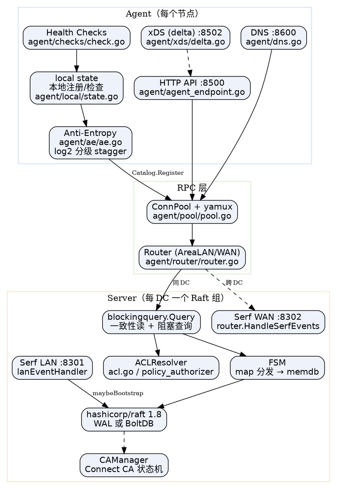

## Introduction

Consul 是 HashiCorp 出品的**服务网络平台（service networking）**：把服务发现、配置（KV）、服务网格（mTLS + 流量授权）与多数据中心联邦打包在一起。它的定位比 etcd / ZooKeeper 更"上层"——后两者是通用的强一致键值协调底座，需要业务自己封装上层；Consul 直接把"注册发现 + 安全通信 + 跨机房"做成开箱能力。完整的横向维度矩阵见 [etcd 横向对照](/docs/CS/Framework/etcd/compare.md)。

本页是 Consul 专题的**枢纽页**：只给全局心智、架构总览（含真实源码片段）与分层导航；每个主题的深入机制都拆到了独立分册（见下方「Layered Navigation」与 [目录索引 README](/docs/CS/Framework/consul/README.md)）。

> [!NOTE]
> 版本与许可（详述见 [版本与许可](/docs/CS/Framework/consul/license.md)）：本文所有源码片段核自 **v2.1.0**（2026 年 2.x 主线最新稳定 tag，commit 881572b）。1.22.x 为维护线（安全支持至 2026-10-31），1.21.x LTS 至 2027-04-30。**自 1.17.0（2023-11-03）起改为 BSL 1.1**，最后全 MPL 版本是 1.16.3；2025-02-27 IBM 收购 HashiCorp 交割后，v2.x 源码版权头已改为 `Copyright IBM Corp.`，LICENSE 的 Licensor 亦改为 **IBM**。2.x 相对 1.x 的重大实现变化（WAL 日志后端、Autopilot 外置库、delta xDS、nftables 透明代理等）在各分册中标注。

## Architecture

### Topology: One Binary, Two Modes

每个 Consul 节点跑一个 `agent` 进程。同一个二进制通过运行时配置切换两种模式，装配分支在 `agent/agent.go`：

```go
	// Setup either the client or the server.
	var consulServer *consul.Server
	if c.ServerMode {
		...
		consulServer, err = consul.NewServer(consulCfg, a.baseDeps.Deps, a.externalGRPCServer, incomingRPCLimiter, serverLogger)
		if err != nil {
			return fmt.Errorf("Failed to start Consul server: %v", err)
		}
		incomingRPCLimiter.Register(consulServer)
		a.delegate = consulServer
	} else {
		// the conn is used to connect to the consul server agent
		conn, err := a.baseDeps.GRPCConnPool.ClientConn(a.baseDeps.RuntimeConfig.Datacenter)
		...
		client, err = consul.NewClient(consulCfg, a.baseDeps.Deps)
		...
		a.delegate = client
	}
```

`agent/agent.go`

关键设计：上层 Agent 对两种模式只依赖 **`delegate` 接口**（`consul.Server` / `consul.Client` 实现同一接口），注册、检查、DNS、KV 转发全部经 `a.delegate.RPC(...)` 走同一入口——client 模式下 RPC 会转发到 server，server 模式下本地直接处理。

- **Server**：参与 Raft、持有全量目录状态、响应 RPC 与查询；生产建议 3 或 5 个（奇数）。
- **Client**：轻量代理，只维护本节点注册与健康检查的**本地状态**（`agent/local/state.go`），通过反熵同步上报 server；自身不参与 Raft。

装配顺序在 `agent/consul/server.go` 的 `NewServer` 里是固定的：**RPC 层先于 Raft 建立**，然后是 WAN Serf → 网络分段 → LAN Serf → 路由注册：

```go
	// Initialize the RPC layer.
	if err := s.setupRPC(); err != nil {
	...
	// Initialize the Raft server.
	if err := s.setupRaft(); err != nil {
	...
	// Initialize the WAN Serf if enabled
	if config.SerfWANConfig != nil {
		s.serfWAN, s.serfWANConfig, err = s.setupSerf(setupSerfOptions{
			Config:       config.SerfWANConfig,
			EventCh:      s.eventChWAN,
			SnapshotPath: serfWANSnapshot,
			WAN:          true,
	...
	// Initialize the LAN Serf for the default network segment.
	if err := s.setupSerfLAN(config); err != nil {
	...
	if err := s.router.AddArea(types.AreaLAN, s.serfLAN, s.connPool); err != nil {
	...
	go s.lanEventHandler()
```

`agent/consul/server.go`

> [!WARNING]
> 2.x 纠偏：1.x 资料里的 `region` 概念、`router.FindRegionServer`、独立 `wanPool` 在 v2.1.0 中均已不存在。跨区域抽象统一为 **area**（`types.AreaLAN` / `types.AreaWAN`，`router.AddArea(areaID, serf, connPool)`），跨 DC RPC **复用同一个 `s.connPool`**，由 `router.FindRoute(dc)` 选路。

### Layered Stack



### Write Path: Local State → Anti-Entropy → Raft

以服务注册为例，写路径分四段：

**① 本地注册**。`agent` 把服务/检查写进 `agent/local/state.go` 的内存状态并标 `InSync=false`，通过注入的回调异步触发同步（刻意不用 channel，避免锁与假唤醒）：

```go
	// TriggerSyncChanges is used to notify the state syncer that a
	// change has been made to the local state.
	//
	// This is an injected function and it's defined this way to avoid
	// having to hold a lock to make the call, or use channels which
	// can introduce spurious wakeups.
	TriggerSyncChanges func()
```

`agent/local/state.go`

```go
	a.State.Delegate = a.delegate
	a.State.TriggerSyncChanges = a.sync.SyncChanges.Trigger
```

`agent/agent.go`

**② 反熵同步**。`agent/ae/ae.go` 维护一个状态机：启动先 `SyncFull`（拉远端 catalog 做全量 diff），之后周期性 `SyncChanges`（增量推送脏数据）。2.x 移除了旧的批量限流器，改为**按集群规模 log2 分级的 stagger** 防惊群——集群规模翻倍，全量同步间隔也翻倍：

```go
const scaleThreshold = 128

// scaleFactor returns a factor by which the next sync run should be delayed to
// avoid saturation of the cluster. The larger the cluster grows the farther
// the sync runs should be spread apart.
//
// The current implementation uses a log2 scale which doubles the delay between
// runs every time the cluster doubles in size.
func scaleFactor(nodes int) int {
	if nodes <= scaleThreshold {
		return 1.0
	}
	return int(math.Ceil(math.Log2(float64(nodes))-math.Log2(float64(scaleThreshold))) + 1.0)
}
```

`agent/ae/ae.go`

**③ RPC 到 leader**。`syncService` 构造 `RegisterRequest` 经 `Agent.RPC` → client 的 `router.FindLANRoute` + `connPool`（yamux 多路复用）发给 server；server 端 `Catalog.Register` handler 先 `ForwardRPC` 把写请求转给 leader（等价于旧版的 VerifyLeader 语义），再 `raftApply`：

```go
	_, err = c.srv.raftApply(structs.RegisterRequestType, args)
	return err
```

`agent/consul/catalog_endpoint.go`

> [!NOTE]
> 2.x 新增 `nodeWriteLocks`：Register 在 ACL 授权与 raft apply 之间持有节点级写锁，防止并发写同一节点时"检查/服务在授权后被改写"的竞态。

**④ FSM 落入 memdb**。Raft 日志首字节是 `structs.MessageType`，其余为 MessagePack 编码请求。2.x 的 FSM `Apply` 不再是 switch-case，改为**命令注册表 map 分发**，未知类型按 `IgnoreUnknownTypeFlag` 决定忽略还是 panic（防止状态分叉）：

```go
func (c *FSM) Apply(log *raft.Log) interface{} {
	buf := log.Data
	msgType := structs.MessageType(buf[0])
	...
	// Apply based on the dispatch table, if possible.
	if fn := c.apply[msgType]; fn != nil {
		return fn(buf[1:], log.Index)
	}

	// Otherwise, see if it's safe to ignore. If not, we have to panic so
	// that we crash and our state doesn't diverge.
	if ignoreUnknown {
		c.logger.Warn("ignoring unknown message type, upgrade to newer version", "type", msgType)
		return nil
	}
	...
	panic(fmt.Errorf("failed to apply request: %#v", buf))
}
```

`agent/consul/fsm/fsm.go`

state store 是**纯内存 memdb**（`agent/consul/state/state_store.go`，旧版 `store.go` 已改名），没有独立写锁——"single writer" 由 Raft 层保证（`FSM.Apply` 只被 Raft 单 goroutine 调用）；FSM 仅用 `stateLock` 保护外部 `State()` 读与 `Restore()` 换库的竞态，换库后 `stateOld.Abandon()` 唤醒所有挂在旧库上的阻塞查询。

### Read Path: Three Consistency Modes

读一致性由 `structs.QueryOptions` 三档控制（`agent/structs/structs.go`）：

| 模式 | 触发条件 | 实现 |
| :--- | :--- | :--- |
| stale | `?stale` | 本机 raft 有 `LastContact` 即本地服务（`canServeReadRequest`） |
| default（leader） | 默认 | 转发到 leader 读，无额外校验 |
| consistent | `?consistent` | `raft.VerifyLeader()` + `isReadyForConsistentReads()` 轮询 |

consistent 模式的实现（2.x 已无 `inconsistentLeaderCheck`，统一收进 `agent/blockingquery` 包）：

```go
func (s *Server) consistentReadWithContext(ctx context.Context) error {
	defer metrics.MeasureSince([]string{"rpc", "consistentRead"}, time.Now())
	future := s.raft.VerifyLeader()
	if err := future.Error(); err != nil {
		return err // fail fast if leader verification fails
	}

	if s.isReadyForConsistentReads() {
		return nil
	}
	// Poll until the context reaches its deadline ...
}
```

`agent/consul/rpc.go`

阻塞查询（长轮询）同样统一到 `agent/blockingquery.Query`：先做一次非阻塞查询拿 index，若 `index > minQueryIndex` 直接返回，否则挂到 memdb 的 `WatchSet` 上等待状态变化或超时。默认等待 `DefaultQueryTime = 300s`，硬上限 `MaxQueryTime = 600s`（`agent/consul/config.go`）。agent 侧还有一层 **agent cache**（`agent/cache`），支持后台 refresh + 指数退避，服务发现类查询可完全不穿透到 server——细节见 [Discovery](/docs/CS/Framework/consul/discovery.md)。

### Gossip: LAN and WAN Pools

server 同时跑两套 serf（SWIM gossip）：

- **LAN 池（:8301）**：同 DC 全体节点（server + client），驱动成员发现与 `serfHealth` 检查；事件由 `lanEventHandler` 处理，server 加入会触发 `maybeBootstrap` 自动引导。
- **WAN 池（:8302）**：只有 server 参与（merge delegate 强制校验"必须是 server"），节点名为 `<node>.<dc>`；事件不经 serf 内部 handler，而是交给 `router.HandleSerfEvents` 映射成跨 DC 路由表更新。

```go
		case serf.EventMemberJoin:
			handleMemberEvent(logger, router.AddServer, areaID, e)
			notifyMembershipPossibleChange(membershipNotifyCh)

		case serf.EventMemberLeave, serf.EventMemberReap:
			handleMemberEvent(logger, router.RemoveServer, areaID, e)
			notifyMembershipPossibleChange(membershipNotifyCh)
```

`agent/router/serf_adapter.go`

LAN 与 WAN 之间由 **flooder**（`agent/consul/flood.go` + `agent/router/serf_flooder.go`）周期互相同步 server 成员，保证每个 server 都认识全部 DC 的 server。细节见 [Serf](/docs/CS/Framework/consul/serf.md)。

### Port Table

| 端口 | 用途 | 定义 |
| :--- | :--- | :--- |
| 8300 | Server RPC（TCP，yamux 多路复用） | `DefaultRPCPort` |
| 8301 | Serf LAN（TCP+UDP gossip） | `DefaultLANSerfPort` |
| 8302 | Serf WAN（TCP+UDP gossip） | `DefaultWANSerfPort` |
| 8500 | HTTP API | `ports.http` |
| 8501 | HTTPS API（默认禁用 `-1`） | `ports.https` |
| 8502 | gRPC（xDS/流式；dev 模式默认开） | `ports.grpc` |
| 8503 | gRPC TLS（server 模式默认） | `ports.grpc_tls` |
| 8600 | DNS | `ports.dns` |

```go
		ports = {
			dns = 8600
			http = 8500
			https = -1
			grpc = -1
			serf_lan = ` + strconv.Itoa(consul.DefaultLANSerfPort) + `
			serf_wan = ` + strconv.Itoa(consul.DefaultWANSerfPort) + `
			server = ` + strconv.Itoa(consul.DefaultRPCPort) + `
```

`agent/config/default.go`

## Comparison with etcd / ZooKeeper / Nacos

Consul 和 etcd / ZooKeeper / Nacos 都提供"一致性的分布式键值 + 协调能力"，但定位分野明显（完整矩阵见 [etcd 横向对照](/docs/CS/Framework/etcd/compare.md)）：

| 维度 | Consul | etcd | ZooKeeper | Nacos |
| :--- | :--- | :--- | :--- | :--- |
| 定位 | 服务发现 + 配置 + **服务网格** + 多 DC | 通用 CP KV 协调 | 通用协调（大数据依赖） | 配置 + 注册中心 |
| 共识 | Raft（server） | etcd-raft | Zab | JRaft / Distro |
| 服务网格 | **原生（Envoy mTLS + intentions）** | 需自拼 | 无 | 无 |
| 多数据中心 | **原生 WAN gossip + 就近 failover** | 需外部复制 | 无 | 弱 |
| 发现接入 | **DNS + HTTP + gRPC** | gRPC | 私有 ZTP | HTTP / gRPC |
| KV 一致性 | CP（Raft） | CP | 无历史 | CP / AP 混合 |
| 许可 | BSL 1.1（1.17+） | Apache-2.0 | Apache-2.0 | Apache-2.0 |

**Consul 的不可替代点**是服务网格与多数据中心：要"注册发现 + mTLS 零信任 + 跨机房"一条龙，它比 etcd（K8s 后端）、ZooKeeper（HBase/Kafka 历史依赖）、Nacos（Java 配置/注册中心）都更省心。代价是 KV 不是它的主战场、跨 DC 不保证全局强一致、且 BSL 许可对特定商业使用有约束（详见 [版本与许可](/docs/CS/Framework/consul/license.md)）。

## Links

- [Consul 目录索引（按层导航）](/docs/CS/Framework/consul/README.md)
- [数据模型](/docs/CS/Framework/consul/data_model.md)
- [配置参考](/docs/CS/Framework/consul/config.md)
- [版本与许可](/docs/CS/Framework/consul/license.md)
- [Raft（共识）](/docs/CS/Framework/consul/raft.md)
- [Serf（成员发现）](/docs/CS/Framework/consul/serf.md)
- [KV（存储）](/docs/CS/Framework/consul/kv.md)
- [Session 与锁](/docs/CS/Framework/consul/Session.md)
- [Discovery（服务发现）](/docs/CS/Framework/consul/discovery.md)
- [Mesh（服务网格）](/docs/CS/Framework/consul/mesh.md)
- [Gateway（网关与联邦）](/docs/CS/Framework/consul/gateway.md)
- [Security（安全）](/docs/CS/Framework/consul/security.md)
- [Client（客户端与 Agent RPC）](/docs/CS/Framework/consul/client.md)
- [etcd 横向对照](/docs/CS/Framework/etcd/compare.md)
- [Nacos](/docs/CS/Framework/nacos/Nacos.md)

## References

1. [Consul Architecture](https://developer.hashicorp.com/consul/docs/architecture)
2. [Consul Consensus Protocol (Raft)](https://developer.hashicorp.com/consul/docs/concept/consul-internals/consensus)
3. [Consul Gossip Protocol](https://developer.hashicorp.com/consul/docs/concept/gossip)
4. [Consul Service Mesh](https://developer.hashicorp.com/consul/docs/connect)
5. [hashicorp/consul v2.1.0 source](https://github.com/hashicorp/consul/tree/v2.1.0)
6. [HashiCorp Business Source License](https://www.hashicorp.com/license-faq)
