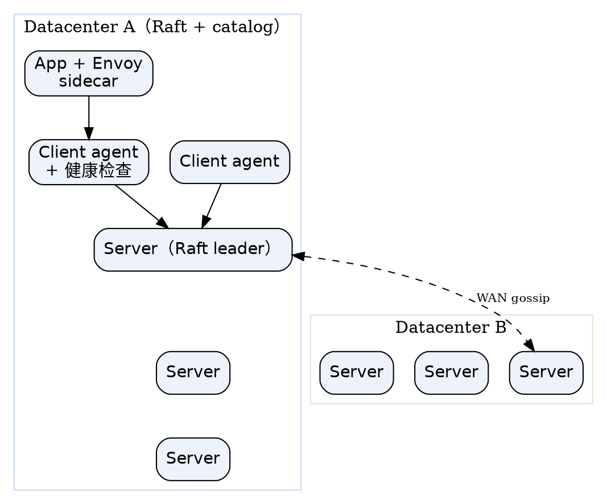

## Introduction

Consul 是 HashiCorp 出品的**服务网络平台（service networking）**：把服务发现、配置（KV）、服务网格（mTLS + 流量授权）与多数据中心联邦打包在一起。它的定位比 etcd / ZooKeeper 更"上层"——后两者是通用的强一致键值协调底座，需要业务自己封装上层；Consul 直接把"注册发现 + 安全通信 + 跨机房"做成开箱能力。完整的横向维度矩阵见 [etcd 横向对照](/docs/CS/Framework/etcd/compare.md)。

本页是 Consul 专题的**枢纽页**：只给全局心智、版本许可摘要、架构总览与分层导航；每个主题的深入机制都拆到了独立分册（见下方「分层导航」与 [目录索引 README](/docs/CS/Framework/consul/README.md)）。

> [!NOTE]
> 版本与许可（详述见 [版本与许可](/docs/CS/Framework/consul/license.md)）：当前主线 **2.0.4**（2026-09-09 发布；2.0 分支 2026-05-24 GA，支持至 2028-04-30），维护线 1.22.x（安全支持至 2026-10-31）/ 1.21.x（LTS，至 2027-04-30）；1.20 已于 2026-05-24 EOL。**自 1.17.0（2023-11-03）起改为 Business Source License（BSL）1.1**，最后一个全 MPL 版本是 1.16.3；2026-03-18 起 LICENSE 的 Licensor 由 HashiCorp 改为 **IBM**（2025-02-27 收购交割）。BSL 对纯内部生产使用免费，仅在"以竞争为目的向第三方托管/嵌入"时受限。

## Architecture Overview

每个 Consul 节点跑一个 **agent**，agent 有两种模式：

- **Server**：参与 Raft、持有注册表状态、响应 RPC 与查询；生产建议 **3 或 5 个**（奇数，容忍 `(n-1)/2` 故障）。
- **Client**：轻量代理，把本节点服务的注册 / 健康检查 / 查询转发给 server，自身不参与 Raft；业务机器上通常跑 client。

控制面由若干 server 组成 Raft 组，维护全局目录（catalog）；数据面在开启服务网格时由 sidecar 代理（Envoy）承载加密流量。agent 内部子系统、写路径与读路径、端口全表、引导流程等深潜见 [架构深潜](/docs/CS/Framework/consul/architecture.md)。

## Layered Navigation

Consul 的能力按"共识 → 成员 → 存储 → 发现 → 网格 → 网关 → 安全 → 配置 → 客户端 → 运维"逐层组织，每层的机制与参数都拆到了独立分册：

| 层 | 分册 | 一句话 |
| :--- | :--- | :--- |
| 共识 | [Raft](/docs/CS/Framework/consul/raft.md) | server 间 Raft + Autopilot 自动运维 |
| 成员发现 | [Serf](/docs/CS/Framework/consul/serf.md) | LAN/WAN 两套 SWIM gossip + 网络坐标 |
| 存储 | [KV](/docs/CS/Framework/consul/kv.md) / [数据模型](/docs/CS/Framework/consul/data_model.md) | 强一致 KV、catalog 三要素、session、反熵 |
| 服务发现 | [Discovery](/docs/CS/Framework/consul/discovery.md) | DNS/HTTP API、健康检查、prepared query、阻塞查询 |
| 服务网格 | [Mesh](/docs/CS/Framework/consul/mesh.md) | Envoy sidecar、mTLS、intentions、透明代理 |
| 网关与联邦 | [Gateway](/docs/CS/Framework/consul/gateway.md) | mesh gateway、WAN federation、ingress/terminating |
| 安全 | [Security](/docs/CS/Framework/consul/security.md) | ACL（默认 deny）、传输 TLS、connect CA |
| 配置 | [Config](/docs/CS/Framework/consul/config.md) | HCL 关键参数分组与常见组合 |
| 客户端 | [Client](/docs/CS/Framework/consul/client.md) | go-client、DNS/HTTP 调试、SDK 阻塞查询 |
| 运维 | [Monitoring](/docs/CS/Framework/consul/monitoring.md) / [Troubleshooting](/docs/CS/Framework/consul/troubleshooting.md) / [Cluster](/docs/CS/Framework/consul/cluster.md) / [Tuning](/docs/CS/Framework/consul/tuning.md) | 监控告警、排障、集群引导备份、调优 |

## Comparison with etcd / ZooKeeper / Nacos

Consul 和 etcd / ZooKeeper / Nacos 都提供"一致性的分布式键值 + 协调能力"，但定位分野明显（完整矩阵见 [etcd 横向对照](/docs/CS/Framework/etcd/compare.md)）：

| 维度 | Consul | etcd | ZooKeeper | Nacos |
| :--- | :--- | :--- | :--- | :--- |
| 定位 | 服务发现 + 配置 + **服务网格** + 多 DC | 通用 CP KV 协调 | 通用协调（大数据依赖） | 配置 + 注册中心 |
| 共识 | Raft（server） | etcd-raft | Zab | JRaft / Distro |
| 服务网格 | **原生（Envoy mTLS + intentions）** | 需自拼 | 无 | 无 |
| 多数据中心 | **原生 WAN gossip + 就近 failover** | 需外部复制 | 无 | 弱 |
| 发现接入 | **DNS + HTTP + gRPC** | gRPC | 私有 ZTP | HTTP / gRPC |
| KV 一致性 | CP（Raft） | CP | 无历史 | CP / AP 混合 |
| 许可 | BSL 1.1（1.17+） | Apache-2.0 | Apache-2.0 | Apache-2.0 |

**Consul 的不可替代点**是服务网格与多数据中心：要"注册发现 + mTLS 零信任 + 跨机房"一条龙，它比 etcd（K8s 后端）、ZooKeeper（HBase/Kafka 历史依赖）、Nacos（Java 配置/注册中心）都更省心。代价是 KV 不是它的主战场、跨 DC 不保证全局强一致、且 BSL 许可对特定商业使用有约束（详见 [版本与许可](/docs/CS/Framework/consul/license.md)）。

## Links

- [Consul 目录索引（按层导航）](/docs/CS/Framework/consul/README.md)
- [架构深潜](/docs/CS/Framework/consul/architecture.md)
- [数据模型](/docs/CS/Framework/consul/data_model.md)
- [配置参考](/docs/CS/Framework/consul/config.md)
- [版本与许可](/docs/CS/Framework/consul/license.md)
- [Raft（共识）](/docs/CS/Framework/consul/raft.md)
- [Serf（成员发现）](/docs/CS/Framework/consul/serf.md)
- [KV（存储）](/docs/CS/Framework/consul/kv.md)
- [Discovery（服务发现）](/docs/CS/Framework/consul/discovery.md)
- [Mesh（服务网格）](/docs/CS/Framework/consul/mesh.md)
- [Gateway（网关与联邦）](/docs/CS/Framework/consul/gateway.md)
- [Security（安全）](/docs/CS/Framework/consul/security.md)
- [Monitoring（监控）](/docs/CS/Framework/consul/monitoring.md)
- [Troubleshooting（故障排查）](/docs/CS/Framework/consul/troubleshooting.md)
- [Client（客户端）](/docs/CS/Framework/consul/client.md)
- [Cluster（集群运维）](/docs/CS/Framework/consul/cluster.md)
- [Tuning（调优）](/docs/CS/Framework/consul/tuning.md)
- [etcd 横向对照](/docs/CS/Framework/etcd/compare.md)
- [etcd](/docs/CS/Framework/etcd/etcd.md)
- [ZooKeeper](/docs/CS/Framework/ZooKeeper/ZooKeeper.md)
- [Nacos](/docs/CS/Framework/nacos/Nacos.md)
- [Spring Cloud Consul](/docs/CS/Framework/Spring_Cloud/Consul.md)
- [Higress Service Discovery](/docs/CS/Framework/Higress/Service_Discovery.md)

## References

1. [Consul Architecture](https://developer.hashicorp.com/consul/docs/architecture)
2. [Consul Consensus Protocol (Raft)](https://developer.hashicorp.com/consul/docs/concept/consul-internals/consensus)
3. [Consul Gossip Protocol](https://developer.hashicorp.com/consul/docs/concept/gossip)
4. [Consul Service Mesh](https://developer.hashicorp.com/consul/docs/connect)
5. [HashiCorp Consul End-of-life](https://endoflife.date/consul)
6. [HashiCorp Business Source License](https://www.hashicorp.com/license-faq)
