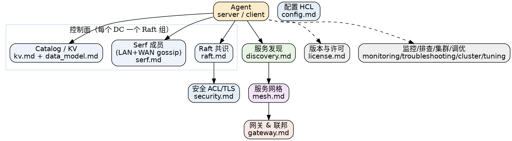

## Introduction

本目录是 Consul 的专题索引。Consul 是 HashiCorp 出品的**服务网络平台**：把服务发现、KV 配置、服务网格（mTLS + 意图授权）与多数据中心联邦打包进单个二进制。与 etcd / ZooKeeper / Nacos 这类"通用强一致键值底座"不同，Consul 直接把**注册发现 + 安全通信 + 跨机房**做成开箱能力，业务无需自己拼上层。

建议阅读路线：先读 [Consul（枢纽）](/docs/CS/Framework/consul/Consul.md) 建立全局心智（枢纽含 `## Architecture`：分层 dot 图 + 真实源码片段，源码核自 v2.1.0），再按"共识 Raft → 成员 Serf → 存储 KV/Session → 服务发现 → 服务网格 → 网关联邦 → 安全 → 配置 → 运维"逐层下钻。版本与许可专篇见 [版本与许可](/docs/CS/Framework/consul/license.md)；横向取舍见 [etcd 横向对照](/docs/CS/Framework/etcd/compare.md)。

## Overview and Startup

- [Consul（枢纽）](/docs/CS/Framework/consul/Consul.md)：agent 双模式（server / client）、`## Architecture` 章节（分层 cluster dot 图、写路径 local→反熵→Raft→FSM、三档读一致性、LAN/WAN gossip、端口全表、2.x 纠偏）。

## Consensus Layer: Raft (Server Only)

- [Raft](/docs/CS/Framework/consul/raft.md)：WAL/BoltDB 双日志后端（2.x 新增 WAL）、snapshot 阈值与 `raft_multiplier` 缩放、写提交（ForwardRPC → raftApply → FSM map 分发）、三档一致性读、Autopilot（2.x 外置 `hashicorp/raft-autopilot` 库）。

## Member Discovery Layer: Serf gossip

- [Serf](/docs/CS/Framework/consul/serf.md)：SWIM 风格的故障检测、LAN 与 WAN 两套 gossip 池、网络坐标（network coordinates）估算 RTT、对称密钥环加密；etcd / ZooKeeper 无原生成员发现的对照。

## Storage Layer: KV

- [KV](/docs/CS/Framework/consul/kv.md)：KV 语义（无历史版本）、写路径 `KVS.Apply` → `kvsSetTxn` 索引维护、CAS（0 = set-if-not-exists）、lock/unlock 的 `LockIndex` 三态、阻塞查询（300s/600s）。
- [Session 与锁](/docs/CS/Framework/consul/Session.md)：session 字段校验、TTL invalidator（`sessionTimers` + multiplier）、release/delete 行为、lock-delay（leader 内存 map、commit 前预判）、acquire 失败返回 false 非 409、信号量与选主模式。
- [数据模型](/docs/CS/Framework/consul/data_model.md)：memdb state store（纯内存、Raft 重放）、FSM 快照/Restore 换库与 Abandon、catalog 三要素与 `HealthFilterType` 过滤、agent 本地状态与反熵同步、blockingquery 包。

## Service Discovery

- [Discovery](/docs/CS/Framework/consul/discovery.md)：DNS（`agent/dns.go` 单文件、weights、SOA）、HTTP API（catalog/health 分工）、健康检查（checks 包、TTL、最小间隔 1s、HTTP 超时 10s）、agent cache（refresh + 退避）、prepared query。

## Service Mesh (Differentiation Ace)

- [Mesh](/docs/CS/Framework/consul/mesh.md)：delta xDS（SOTW 已废弃）、Connect CA（`CAManager` 状态机、leaf 72h）、intentions 默认 deny、transparent proxy 的 nftables 重定向（2.x 弃 iptables）、config entry 家族。

## Gateway and Multi-Data Center Federation

- [Gateway](/docs/CS/Framework/consul/gateway.md)：mesh gateway（`GatewayLocator`、wanfed:1 meta）、ingress / terminating / api gateway（2.x config entry 合并）、WAN federation 与 cluster peering（establishment secret 握手）。

## Security

- [Security](/docs/CS/Framework/consul/security.md)：ACL（默认不启用、default_policy 出厂 allow、`ACLResolver` 三层解析、down_policy、2.x 移除 TokenResolve）、传输 TLS（`Configurator` 三域）、auto-encrypt、gossip keyring。

## Configuration

- [Config](/docs/CS/Framework/consul/config.md)：HCL 配置基础（`-config-file` / `-config-dir` 合并）、按子系统罗列关键参数（agent / server / raft / serf / acl / connect / 加密 / 遥测），以及三类常见组合：单 DC 3 server、ACL deny 默认 + TLS、WAN 联邦。

## Monitoring, Troubleshooting and Cluster Operations

- [Monitoring](/docs/CS/Framework/consul/monitoring.md)：telemetry（statsd / prometheus）、`/v1/agent/metrics`、关键指标表、健康检查端点、agent 缓存、告警项。
- [Troubleshooting](/docs/CS/Framework/consul/troubleshooting.md)：quorum 丢失只读、gossip 分区、ACL token 问题、mesh / xDS 连接、snapshot 恢复失败、时钟偏移、KV 值过大、leader flapping。
- [Cluster](/docs/CS/Framework/consul/cluster.md)：server / client 规模、bootstrap_expect、retry_join、参考架构（3/5 server、gossip RTT 约束）、备份恢复、滚动升级、ACL 复制、namespaces / partitions。
- [Tuning](/docs/CS/Framework/consul/tuning.md)：raft_multiplier、snapshot 阈值、Serf 重传、ACL 缓存 TTL、资源 sizing、2.0 起的 HTTP 超时调整。

## Client

- [Client](/docs/CS/Framework/consul/client.md)：go-client（api 包）、agent 内部 RPC 层（`FindLANRoute`、yamux conn pool、限流、失败换 server）、本地注册状态与 ServiceManager。

## Version and License

- [版本与许可](/docs/CS/Framework/consul/license.md)：MPL→BSL 1.1 时间线（1.17.0 起、最后 MPL 为 1.16.3）、BSL 本质与附加使用授权、IBM 2025-02-27 收购与 2026-03-18 Licensor 变更、4 年 Change Date 转 MPL、与 Apache-2.0（etcd）对照、选型建议。

## Links

- [etcd 横向对照](/docs/CS/Framework/etcd/compare.md)
- [etcd](/docs/CS/Framework/etcd/etcd.md)
- [ZooKeeper](/docs/CS/Framework/ZooKeeper/ZooKeeper.md)
- [Nacos](/docs/CS/Framework/nacos/Nacos.md)
- [Spring Cloud Consul](/docs/CS/Framework/Spring_Cloud/Consul.md)

## References

1. [Consul Architecture](https://developer.hashicorp.com/consul/docs/architecture)
2. [Consul Consensus (Raft)](https://developer.hashicorp.com/consul/docs/concept/consul-internals/consensus)
3. [Consul Gossip Protocol](https://developer.hashicorp.com/consul/docs/concept/gossip)
4. [Consul Service Mesh](https://developer.hashicorp.com/consul/docs/connect)
5. [HashiCorp Consul End-of-life](https://endoflife.date/consul)
