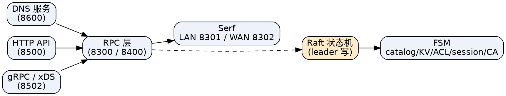

## Introduction

本篇是 Consul 架构的**深潜页**：拆开单个 agent 的内部子系统、一次写请求与读请求在集群里的完整流转、端口全表、引导启动流程，以及控制面 / 数据面的边界。宏观心智与分层导航见 [Consul（枢纽）](/docs/CS/Framework/consul/Consul.md)，共识与成员发现细节分别见 [Raft](/docs/CS/Framework/consul/raft.md) 与 [Serf](/docs/CS/Framework/consul/serf.md)。

> [!NOTE]
> 版本事实：2.0.x 当前主线（2.0.4，2026-09-09），维护线 1.22.x / 1.21.x。下文架构描述对 1.17+ / 2.0 通用；端口与启动参数长期稳定。

## Agent Internal Subsystems

每个 agent 进程内并发跑若干子系统，client 与 server 共享大部分，只有 Raft 状态机是 server 专属：

- **RPC 层**：agent 间通信主通道（server 端口 `8300`，legacy CLI RPC `8400`）。client 的所有写都经 RPC 转发给 server。
- **Raft 状态机（仅 server）**：leader 接收写，follower 复制日志；提交的日志经 **FSM（有限状态机）** 应用到内存状态，状态分五大块——catalog、KV、ACL、session、Connect CA。
- **Serf**：成员发现。LAN 池（同 DC，`8301`）与 WAN 池（跨 DC，`8302`）两套 gossip，负责节点加入/离开、故障检测、事件广播、网络坐标。
- **DNS / HTTP API / gRPC**：三种对外的接入面，分别对应 `8600` / `8500` / `8502`（xDS 推送 sidecar 配置）。
- **反熵（anti-entropy）**：client agent 周期性把本地注册的服务 / 检查同步到 server 的 catalog，并对账修正漂移（详见 [数据模型](/docs/CS/Framework/consul/data_model.md)）。

## Write Path

一次服务注册（或 KV 写、ACL 变更）的完整流转：

1. **入口**：client agent 通过配置文件、`PUT /v1/agent/service/register` 或 DNS 收到注册请求。
2. **转发**：client 经 RPC 把写请求发给某个 server（通常转发到 leader，或任意 server 再重定向到 leader）。
3. **Raft 提交**：leader 把操作 append 到 Raft 日志；复制到多数 follower 并 ack 后**提交**。
4. **FSM 应用**：leader 把已提交日志项应用到 FSM，更新 catalog / KV / ACL 等内存状态。
5. **复制应用**：follower 在收到提交后同样应用该日志项，保持状态一致。
6. **扩散**：catalog 变更通过反熵 / 阻塞查询传播到各 client 缓存；成员变更经 gossip 扩散。

要点：所有写都收敛到 leader 的 Raft 日志，因此 Consul 的写是**强一致（CP）**的；但发现读默认走 client 本地缓存（见下），所以"发现"在默认路径上是 AP 式可用。

## Read Path

| 读类型 | 行为 | 一致性 |
| :--- | :--- | :--- |
| client 本地缓存读（默认） | 直接返回 agent 缓存的 catalog 结果，不查 leader | 可能短暂陈旧（stale） |
| catalog 一致性读 | 带 `?consistent` 强制走 leader | 强一致 |
| KV 读 | 经 Raft（默认走 leader 读） | 强一致 |
| 阻塞查询 | 带 `index` + `wait` 长轮询，状态变更或超时前挂起 | 最终一致通知 |

对比 etcd 的 `linearizable` / `serializable` 双读模型——Consul 把"默认 AP 式可用"作为发现主路径、把强一致作为可选项，定位更偏"发现优先于严格一致"（详见 [Discovery](/docs/CS/Framework/consul/discovery.md)）。

## Ports

| 端口 | 协议 | 用途 | 范围 |
| :--- | :--- | :--- | :--- |
| `8300` | TCP | server RPC（agent ↔ server、server ↔ server） | 同 DC |
| `8301` | TCP/UDP | Serf LAN gossip（成员发现） | 同 DC |
| `8302` | TCP/UDP | Serf WAN gossip（跨 DC 联邦） | 跨 DC |
| `8500` | TCP | HTTP API | 同 DC |
| `8501` | TCP | HTTPS（ACL/TLS 启用后） | 同 DC |
| `8502` | TCP | gRPC / xDS（sidecar 配置推送） | 同 DC |
| `8503` | TCP | gRPC TLS（auto_encrypt 后） | 同 DC |
| `8600` | TCP/UDP | 内置 DNS 服务 | 同 DC |
| `8400` | TCP | legacy CLI RPC | 同 DC |
| `21000–21255` | TCP | Envoy sidecar 入站/出站（mesh 开启时） | 同 DC |

防火墙规则：同 DC 放行 `8300/8301/8500/8501/8502/8503/8600/8400`；跨 DC 额外放行 `8302`；sidecar 需放开 `21000–21255`（详见 [Consul 端口](https://developer.hashicorp.com/consul/docs/install/ports)）。

## Bootstrap and Startup

- **自动引导**：`-bootstrap-expect=<N>` 让 server 等齐 N 个成员进入 Raft peer 集后再自动引导选主，**不要**再叠加旧式 `-bootstrap`（多个 `-bootstrap` 会脑裂）。`N` 取 3（小）或 5（生产）。
- **自动加入**：`-retry-join=<addr>` 启动即尝试加入集群并失败重试；支持云自动发现 `provider=aws|gce|azure|k8s` 按 tag/metadata 发现 peer，免去硬编码 IP。
- **数据持久化**：`-data-dir` 存放 Raft 日志（`raft/`）、快照、agent 状态；务必放低延迟磁盘，且备份/迁移时整体带走（见 [Cluster](/docs/CS/Framework/consul/cluster.md)）。
- **多 DC**：server 经 `-retry-join-wan` 加入 WAN gossip 池，各 DC 独立 Raft 组、独立 catalog（见 [Gateway](/docs/CS/Framework/consul/gateway.md)）。

## Control Plane vs Data Plane

- **控制面**：server（Raft / catalog / KV / ACL / Connect CA）+ client agent（注册、反熵、缓存）。负责"谁在哪、是否健康、证书怎么发"。
- **数据面**：默认情况下 Consul 进程**不**承载业务流量；只有开启 Connect / 服务网格时，每个服务旁部署 **Envoy sidecar**，由 sidecar 接管服务间的 L4/L7 加密流量（见 [Mesh](/docs/CS/Framework/consul/mesh.md)）。

这也是 Consul 与纯 KV 底座（etcd 连数据面都要自己拼 Envoy）的核心差异：控制面与数据面的边界在 Consul 里是原生定义好的。

## Comparison with etcd

| 维度 | Consul | etcd |
| :--- | :--- | :--- |
| 进程形态 | 单二进制 `consul`，client/server 同二进制异模式 | 单二进制 `etcd`，全 peer 无轻量 client |
| peer 发现 | Serf gossip（动态） | 静态 `-initial-cluster` |
| 写路径 | client→RPC→leader Raft→FSM | client→leader Raft→apply |
| 读路径 | 本地缓存（默认 stale）/ leader 一致读 | linearizable / serializable |
| 数据面 | 原生 Envoy sidecar（mesh） | 无（需自拼） |

Consul 的 client/server 分离 + gossip 动态成员，让扩缩 server、跨 DC 联邦都比 etcd 静态 peer 更平滑，代价是运维面更宽（要同时看护 Raft 与 gossip 两套通道）。

## Links

- [Consul（枢纽）](/docs/CS/Framework/consul/Consul.md)
- [Raft（共识）](/docs/CS/Framework/consul/raft.md)
- [Serf（成员发现）](/docs/CS/Framework/consul/serf.md)
- [数据模型](/docs/CS/Framework/consul/data_model.md)
- [Discovery（服务发现）](/docs/CS/Framework/consul/discovery.md)
- [Cluster（集群运维）](/docs/CS/Framework/consul/cluster.md)
- [Troubleshooting（故障排查）](/docs/CS/Framework/consul/troubleshooting.md)
- [etcd 集群](/docs/CS/Framework/etcd/cluster.md)

## References

1. [Consul Architecture](https://developer.hashicorp.com/consul/docs/architecture)
2. [Consul Agent Configuration (ports)](https://developer.hashicorp.com/consul/docs/install/ports)
3. [Consul Internals: Consensus](https://developer.hashicorp.com/consul/docs/concept/consul-internals/consensus)
4. [Consul Anti-entropy](https://developer.hashicorp.com/consul/docs/architecture/anti-entropy)
