## Introduction

Consul 的**许可**是选型时最常被低估、也最容易踩坑的维度：它从 2023 年起不再是 OSI 认可的开源协议，而是 HashiCorp 的 **Business Source License（BSL）1.1**；2025 年 IBM 收购后，Licensor 与后续支持模型又发生了变化。本篇梳理时间线、BSL 本质、附加使用授权、Change Date 转开源机制，以及与 etcd（Apache-2.0）的对照。版本/支持窗口的摘要见 [Consul（枢纽）](/docs/CS/Framework/consul/Consul.md)，安全与合规操作见 [Security](/docs/CS/Framework/consul/security.md)。

> [!WARNING]
> 常见误写：**"Consul 自 1.18.0（2023-08）起改为 BSL"是错的。** 正确的是——Consul 从 **1.17.0（2023-11-03 发布）** 起转 BSL；最后一个全 MPL 版本是 **1.16.3**（1.16.4+ 与 1.15.8+ 也都已是 BSL）。许可证以**部署标签内 `LICENSE` 文件为准**，补丁版本不一定延续旧许可。

## Timeline

```dot
digraph license_timeline {
  rankdir=LR;
  node [shape=box, style="rounded,filled", fontname="Helvetica"];
  edge [color="#555", fontsize=10];

  mpl [label="MPL 2.0 时代\n(≤ 1.16.3)", fillcolor="#d6ead0"];
  ann [label="2023-08-10\nHashiCorp 宣布转 BSL", fillcolor="#fdeccb"];
  bsl [label="1.17.0 起 BSL 1.1\n(2023-11-03)", fillcolor="#f7e9e4"];
  ibm [label="2025-02-27\nIBM 收购交割", fillcolor="#e4eef7"];
  lic [label="2026-03-18\nLicensor 改 IBM", fillcolor="#e4eef7"];
  v2 [label="2.0\n2026-05-24 GA", fillcolor="#eef3fb"];

  mpl -> ann -> bsl -> ibm -> lic -> v2;
}
```

| 时间 | 事件 |
| :--- | :--- |
| 2023-08-10 | HashiCorp 宣布全线产品（含 Consul）从 MPL 2.0 转 BSL 1.1；次日 `LICENSE` 文件变更 |
| 2023-11-03 | **Consul 1.17.0** 成为首个 BSL 版本；1.16.3 及更早为 MPL |
| 2024-02-26 / 2025-05-06 | 1.18（LTS）、1.21（LTS）在 BSL 下发布 |
| 2025-02-27 | **IBM 完成对 HashiCorp 的收购**（2024-04-24 宣布，64 亿美元） |
| 2026-03-18 | Consul `LICENSE` 的 **Licensor 由 HashiCorp, Inc. 改为 International Business Machines Corporation（IBM）**；协议仍为 BSL 1.1、Change Date 规则不变 |
| 2026-05-24 | **Consul 2.0** GA（首个 IBM 版本化方案下的主版本）；2.0 的 LICENSE 即以 IBM 为 Licensor |

## What BSL 1.1 Is

BSL 是 MariaDB 提供的**源代码可见（source-available）**许可模板，**不符合 OSI 对"开源"的定义**——HashiCorp 也不再称这些产品为"open source"。它与 MPL/Apache-2.0 的区别：

- 源码可见、可自部署、可修改、可再分发；
- 但**生产使用权来自"附加使用授权（Additional Use Grant）"**，而非无条件的开源许可；
- 每个版本带一个 **Change Date**：发布满 **4 年**后自动转为 **MPL 2.0**（即真正的开源）。例如 1.17.0（2023-11-03 发布）→ 2027-11 变 MPL 2.0。

## Additional Use Grant（关键）

BSL 本身允许复制、修改、再分发与非生产使用；**生产使用**由附加授权放开，条件是：

> 你的生产使用**不得**"以与 IBM 付费版本竞争为目的，向第三方以托管或嵌入方式提供本软件"。

落到实操：

- **纯内部使用（含生产）免费**：在自有组织及共同控制的关联公司内部跑 Consul，不属于"竞争性提供"，绝大多数自托管团队不受影响。
- **受限场景**：把 Consul 作为托管服务 / 嵌入到你向客户售卖的产品里、且与 IBM 付费版本显著重叠 → 需要商业许可。
- **违反即终止**：任何违反 BSL 的使用会终止你对该版本及所有版本的权利。
- 解释以 HashiCorp/IBM 的许可 FAQ 为绑定依据；正式选型前建议法务介入。

## IBM Impact

- **Licensor 变更**：2026-03-18 起 LICENSE 写 IBM 为 Licensor，许可文本与 4 年 Change Date 不变。
- **支持模型（从 2.0 / 2026-04 起）**：Consul Enterprise 转入 IBM **Support Cycle-2（SC2）**——"2 + 1 + 3"：2 年基础支持 + 1 年关键扩展支持 + 3 年持续支持（无新修复）。社区版无合同支持，补丁只随仍在维护的分支取。
- **版本化方案**：从 2.0 起采用 IBM 的 **V.M.F** 节奏（每年 4 月 Version、10 月 Modification、每月 Fix），与旧 semantic versioning 不同。

## Comparison

| 许可 | Consul（1.17+） | etcd | ZooKeeper | Nacos |
| :--- | :--- | :--- | :--- | :--- |
| 类型 | BSL 1.1（4 年后转 MPL） | Apache-2.0 | Apache-2.0 | Apache-2.0 |
| OSI 开源 | 否 | 是 | 是 | 是 |
| 内部生产 | 免费 | 免费 | 免费 | 免费 |
| 商业托管/嵌入 | 需商业许可（竞争场景） | 自由 | 自由 | 自由 |

## Selection Guidance

- **自托管、内部使用**：Consul 的 BSL 基本不构成障碍，可放心用于生产；只需留意版本支持窗口（见枢纽页版本表），别停在 EOL 线（如 1.20 已于 2026-05-24 EOL）。
- **做云厂商/竞品产品**：若要把 Consul 包装成对第三方提供的托管或嵌入能力，务必先评估 BSL 的附加授权，必要时采购商业许可，或考虑 fork 的 MPL 旧版本 / 开源替代（如 etcd + 自拼网格）。
- **合规留痕**：记录所部署确切标签的 LICENSE 许可（MPL 还是 BSL）、Change Date，避免"补丁版本悄悄变许可"的陷阱。

## Links

- [Consul（枢纽）](/docs/CS/Framework/consul/Consul.md)
- [Security（安全）](/docs/CS/Framework/consul/security.md)
- [etcd 横向对照](/docs/CS/Framework/etcd/compare.md)
- [etcd](/docs/CS/Framework/etcd/etcd.md)
- [HashiCorp 收购（IBM）](/docs/CS/Framework/consul/Consul.md)

## References

1. [HashiCorp Business Source License FAQ](https://www.hashicorp.com/license-faq)
2. [Consul End-of-Life (EOL) Dates](https://endoflife.date/consul)
3. [Consul on an EOL Version: Upgrade, Patch or Migrate](https://www.osseva.io/blog/consul-end-of-life-bsl-ibm)
4. [IBM Completes Acquisition of HashiCorp (2025-02-27)](https://newsroom.ibm.com/2025-02-27-ibm-completes-acquisition-of-hashicorp)
