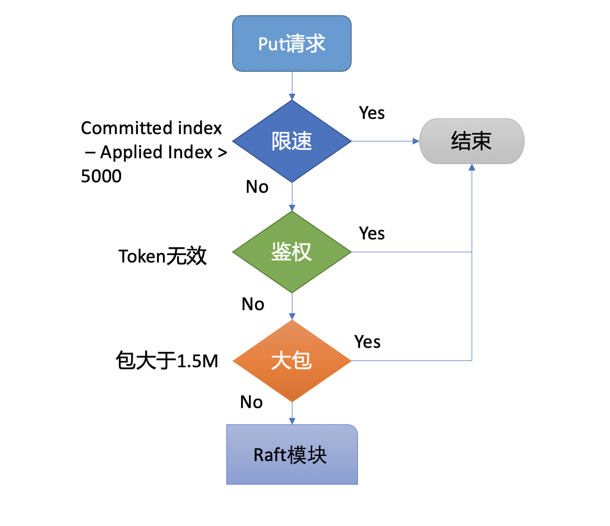

## Introduction

etcd v3 不是“把全部数据加载进内存”的内存数据库。它把**用户 key 的 revision 代际索引**放在内存，把**每个 revision 的完整 `mvccpb.KeyValue`** 持久化在 backend 的 bbolt 文件中；尚未提交的 backend 写缓冲还会叠加在 bbolt 视图之上。内存占用主要由 key、revision 链表、索引和缓冲决定，而不是全部历史 value。

etcd v2 则是内存数据库：整个 store 由大锁保护，持久化主要依赖把内存状态序列化为快照。它的读写锁竞争明显，watch 又只保留固定长度的历史事件窗口；写请求较多或网络抖动时，窗口淘汰会迫使客户端重新全量拉取。v3 用 MVCC 同时解决了历史版本、多 key 事务和 watch 回放问题。

> [!NOTE]
> 本篇以 **etcd v3.7.2** 为源码基线。跨模块的 `Propose → Raft → Apply → MVCC` 顺序见 [Core_Mechanisms](/docs/CS/Framework/etcd/Core_Mechanisms.md)；这里只展开状态机内部的数据模型、事务与可见性边界。

## Components

MVCC 把一次键空间变更拆成四种职责：

| 组件 | 保存什么 | 不负责什么 |
| :--- | :--- | :--- |
| `store` | `currentRev`、`compactMainRev`、事务生命周期与 revision 分配 | Raft 日志复制、客户端等待 |
| `treeIndex` | 用户 key 到 revision 代际的 B-tree 索引，以及每个 key 的 generation / revision 链表 | 不保存完整历史 value，也不是磁盘指针表 |
| `backend` | bbolt 中的 revision → 完整 `mvccpb.KeyValue`，以及尚未提交的写缓冲 | 不替 Raft 决定提交顺序 |
| `watchableStore` | watcher 分组、最新事件发布、历史回放与 victim 重试 | 不改变 MVCC 的原子提交边界 |

用户数据位于 backend 的 `key` bucket：**磁盘 key 是 revision，磁盘 value 是完整的 `mvccpb.KeyValue`**。`meta` bucket 保存 compact、consistent index 等元数据；lease、alarm、member、auth 等模块也写入同一个 bbolt 文件，但使用各自的 bucket。

## Revision Model

一次原子事务只推进一次 main revision；同一事务中的多个变更使用 sub 排序：

```text
Raft entry  ──apply──>  MVCC write txn  ──>  main = currentRev + 1
                                          sub = 0, 1, 2, ...
```

- `revision` 在 **apply 阶段**分配，不在 API 或 Propose 阶段分配。
- 空 store 恢复后 `currentRev = 1`、`compactMainRev = -1`，因此第一次写得到 `(2, 0)`。
- 一个 Txn 修改 3 个 key，它们共享 main，sub 依次为 `0/1/2`；没有实际变更的 Txn 不推进 `currentRev`。
- `sub` 是存储层事务内顺序，不直接暴露在 `KeyValue.ModRevision` 中；后者只表示 main revision。

正常 revision 编码为 `main(8, big-endian) + '_' + sub(8, big-endian)`，共 17 字节；tombstone 在尾部追加 `'t'`，共 18 字节。编码细节见 [boltdb](/docs/CS/Framework/etcd/boltdb.md)。

```go
// server/storage/mvcc/kvstore_txn.go:174-184, 204-207
func (s *store) Write(trace *traceutil.Trace) TxnWrite {
    s.mu.RLock()
    tx := s.b.BatchTx()
    tx.LockInsideApply()
    tw := &storeTxnWrite{
        storeTxnCommon: storeTxnCommon{s, tx, 0, 0, trace},
        tx:             tx,
        beginRev:       s.currentRev,
        changes:        make([]*mvccpb.KeyValue, 0, 4),
    }
    return newMetricsTxnWrite(tw)
}

func (tw *storeTxnWrite) Put(key, value []byte, lease lease.LeaseID) int64 {
    tw.put(key, value, lease)
    return tw.beginRev + 1
}
```

## Response Metadata

`ResponseHeader.Revision` 是请求执行时 KV store 的 revision，不等于返回 key 自身的 `ModRevision`。普通读响应的 header 表示读取快照；watch progress 响应的 header 表示进度，后续事件 revision 更高。

```go
type ResponseHeader struct {
	// cluster_id is the ID of the cluster which sent the response.
	ClusterId uint64 `protobuf:"varint,1,opt,name=cluster_id,json=clusterId,proto3" json:"cluster_id,omitempty"`
	// member_id is the ID of the member which sent the response.
	MemberId uint64 `protobuf:"varint,2,opt,name=member_id,json=memberId,proto3" json:"member_id,omitempty"`
	// revision is the key-value store revision when the request was applied.
	// For watch progress responses, the header.revision indicates progress. All future events
	// recieved in this stream are guaranteed to have a higher revision number than the
	// header.revision number.
	Revision int64 `protobuf:"varint,3,opt,name=revision,proto3" json:"revision,omitempty"`
	// raft_term is the raft term when the request was applied.
	RaftTerm             uint64   `protobuf:"varint,4,opt,name=raft_term,json=raftTerm,proto3" json:"raft_term,omitempty"`
	XXX_NoUnkeyedLiteral struct{} `json:"-"`
	XXX_unrecognized     []byte   `json:"-"`
	XXX_sizecache        int32    `json:"-"`
}
```

`KeyValue` 同时携带业务值与版本元数据：

```go

type KeyValue struct {
	// key is the key in bytes. An empty key is not allowed.
	Key []byte `protobuf:"bytes,1,opt,name=key,proto3" json:"key,omitempty"`
	// create_revision is the revision of last creation on this key.
	CreateRevision int64 `protobuf:"varint,2,opt,name=create_revision,json=createRevision,proto3" json:"create_revision,omitempty"`
	// mod_revision is the revision of last modification on this key.
	ModRevision int64 `protobuf:"varint,3,opt,name=mod_revision,json=modRevision,proto3" json:"mod_revision,omitempty"`
	// version is the version of the key. A deletion resets
	// the version to zero and any modification of the key
	// increases its version.
	Version int64 `protobuf:"varint,4,opt,name=version,proto3" json:"version,omitempty"`
	// value is the value held by the key, in bytes.
	Value []byte `protobuf:"bytes,5,opt,name=value,proto3" json:"value,omitempty"`
	// lease is the ID of the lease that attached to key.
	// When the attached lease expires, the key will be deleted.
	// If lease is 0, then no lease is attached to the key.
	Lease                int64    `protobuf:"varint,6,opt,name=lease,proto3" json:"lease,omitempty"`
	XXX_NoUnkeyedLiteral struct{} `json:"-"`
	XXX_unrecognized     []byte   `json:"-"`
	XXX_sizecache        int32    `json:"-"`
}
```

- `CreateRevision` 在当前 generation 首次创建时确定，后续更新沿用。
- `ModRevision` 是最后一次修改的 main revision。
- `Version` 在同一 generation 内逐次递增；delete 后重新创建会从 1 开始。
- delete 事件的 `KeyValue` 只带 key 与修改 revision，不保留原 value；`PrevKv` 是否返回由请求选项决定。

## Read Path

`ReadTx` 在一次读取开始时固定 `compactMainRev` 与 `currentRev`。只读请求使用 `ConcurrentReadTx()` 复制读缓冲，减少与正在提交的 backend 写事务之间的阻塞。

1. 请求 revision 大于快照 `currentRev` 时返回 `ErrFutureRev`；`rev <= 0` 先归一为 `currentRev`，归一后小于 `compactMainRev` 才返回 `ErrCompacted`。
2. `treeIndex` 按用户 key 范围和目标 revision 选出每个 key 对应的 revision。
3. backend 的 `UnsafeRange` 先查写缓冲，未命中再查 bbolt，并合并结果；单 key 查询强制 `limit = 1`，避免缓冲与磁盘中的同一记录重复。
4. 将完整 value 反序列化为 `mvccpb.KeyValue`，返回时 header 携带读取快照的 revision。

```go
// server/storage/mvcc/kvstore_txn.go:108-150（节选）
revpairs, total := tr.s.kvindex.Revisions(key, end, rev, int(ro.Limit), ro.WithTotalCount)
// ...
for i, revpair := range revpairs[:len(kvs)] {
    revBytes = RevToBytes(revpair, revBytes)
    _, vs := tr.tx.UnsafeRange(schema.Key, revBytes, nil, 0)
    // ...
    kv := &mvccpb.KeyValue{}
    if err := proto.Unmarshal(vs[0], kv); err != nil {
        tr.s.lg.Fatal("failed to unmarshal mvccpb.KeyValue", zap.Error(err))
    }
    kvs[i] = kv
}
```

这里有两个容易混淆的“范围扫描”：**用户 key / 前缀查询**由 treeIndex 定位；**watch 历史回放**按 backend 的 revision 区间扫描。后者不是因为 revision 排序就能直接回答任意用户前缀查询。

## Write Path

写事务固定 `beginRev = currentRev`，每次 put / delete 都使用 `beginRev + 1` 作为 main，以 `len(changes)` 作为 sub：

```go
// server/storage/mvcc/kvstore_txn.go:223-261（节选）
rev := tw.beginRev + 1
// ...
idxRev := Revision{Main: rev, Sub: int64(len(tw.changes))}
ibytes = RevToBytes(idxRev, ibytes)

kv := &mvccpb.KeyValue{
    Key:            key,
    Value:          value,
    CreateRevision: c,
    ModRevision:    rev,
    Version:        ver,
    Lease:          int64(leaseID),
}

d, err := proto.Marshal(kv)
// ...
tw.tx.UnsafeSeqPut(schema.Key, ibytes, d)
tw.s.kvindex.Put(key, idxRev)
tw.changes = append(tw.changes, kv)
```

delete 使用带 tombstone 标记的 revision key，value 只序列化 `Key`；随后调用 `kvindex.Tombstone` 开启新的 generation。整个事务的变更先累积在 `changes`，供 watch 在提交边界发布事件。

## Commit Boundary

“提交”在 etcd 中至少有三层，不能混用：

| 边界 | 含义 | 保证 |
| :--- | :--- | :--- |
| Raft commit | entry 已被多数派复制，获得全局顺序 | 尚不代表本地状态机已应用 |
| MVCC `TxnWrite.End` | 推进 `currentRev` 并发布本次事务的可见状态 | 同事务变更对外原子可见 |
| backend commit / WAL sync | bbolt 事务或 WAL 真正落盘 | 决定 crash 后的持久状态 |

普通 put 只进入 backend 写缓冲，不必每次都立即提交 bbolt；达到 batch limit 才提交。**只要本批存在 delete，就必须在解锁时提交**，否则后续请求可能从 bbolt 读到 stale value，破坏线性一致性。put 有覆盖在 bbolt 之上的读缓冲，delete 没有等价的安全读取路径。

```go
// server/storage/mvcc/kvstore_txn.go:209-220
func (tw *storeTxnWrite) End() {
    if len(tw.changes) != 0 {
        tw.s.revMu.Lock()
        tw.s.currentRev++
    }
    tw.tx.Unlock()
    if len(tw.changes) != 0 {
        tw.s.revMu.RUnlock()
    }
    tw.s.mu.RUnlock()
}
```

watchable store 在底层 `TxnWrite.End()` **之前**调用 `notify`，并在整个过程中持有 watchable store 锁，避免异步发布方看到 revision 已推进但 watcher 状态尚未准备好的半完成状态：

```go
// server/storage/mvcc/watchable_store_txn.go（节选）
tw.s.mu.Lock()
tw.s.notify(rev, evs)
tw.TxnWrite.End()
tw.s.mu.Unlock()
```

因此，watch 事件的产生与 MVCC 可见性属于同一个原子边界，但网络发送可以滞后；发送阻塞由 victim 机制处理，不回滚写事务。

## Restore

启动或恢复 backend 时，etcd 从 `key` bucket 按 revision 顺序扫描，解析完整 `mvccpb.KeyValue` 重建 treeIndex，并恢复 key 与 lease 的关联。历史 value 不是“相对上一版本的增量”，每个 revision 都保存独立完整的值。

恢复同时读取 finished / scheduled compact revision：

- `finishedCompact` 恢复逻辑压缩水位；若扫描到的最大 revision 更小，`currentRev` 不能低于它。
- 若上次在删除最新 tombstone 后、写入 finished 水位前崩溃，`scheduledCompact` 防止 revision 回退。
- `scheduledCompact > finishedCompact` 时重新调度压缩，继续完成上次未完成的工作。

## Put Example

<div style="text-align: center;">



</div>

<p style="text-align: center;">Fig.1. put</p>

一次 `put hello world` 的顺序是：

1. gRPC `KVServer` 完成鉴权、请求大小与配额检查，注册 request ID 对应的 waiter，然后向 Raft Propose。
2. Raft 将 entry 复制到多数派并提交；本节点按日志顺序 apply。
3. MVCC 此时才分配 `(main, sub)`，更新 backend 缓冲与 treeIndex，记录 `changes`。
4. watchable `End` 在锁内先 `notify`，再调用底层 `End` 推进 `currentRev`；随后返回 apply 路径并唤醒 waiter。
5. backend 按批处理策略提交；WAL / Raft 持久化与 snapshot 安全边界由上层协调。

NOSPACE 的一个关键细节是：quota applier 先执行 Put，再根据入口空间预算返回 `ErrNoSpace`，所以触发配额的写可能已经生效；NOSPACE Alarm 本身也要经 Raft apply，成员才进入拒绝后续写入的状态。请求超时同样只清理 waiter，不撤回已提交 entry。详细入口、限流和告警顺序见 [request](/docs/CS/Framework/etcd/request.md) 与 [troubleshooting](/docs/CS/Framework/etcd/troubleshooting.md)。

## Links

- [treeIndex（用户 key 与 revision 代际索引）](/docs/CS/Framework/etcd/treeIndex.md)
- [read（线性读如何等待 apply）](/docs/CS/Framework/etcd/read.md)
- [watch（事件发布、历史回放与 victim）](/docs/CS/Framework/etcd/watch.md)
- [concurrency（STM 的 readSet 依赖 revision）](/docs/CS/Framework/etcd/concurrency.md)

## References

- [etcd v3.7.2 - MVCC transaction implementation](https://github.com/etcd-io/etcd/blob/v3.7.2/server/storage/mvcc/kvstore_txn.go)
- [etcd v3.7.2 - revision encoding](https://github.com/etcd-io/etcd/blob/v3.7.2/server/storage/mvcc/revision.go)
- [etcd v3.7.2 - key index](https://github.com/etcd-io/etcd/blob/v3.7.2/server/storage/mvcc/key_index.go)
- [etcd v3.7.2 - backend read transaction](https://github.com/etcd-io/etcd/blob/v3.7.2/server/storage/backend/read_tx.go)
- [etcd v3.7.2 - backend batch transaction](https://github.com/etcd-io/etcd/blob/v3.7.2/server/storage/backend/batch_tx.go)
- [etcd v3.7.2 - watch transaction publication](https://github.com/etcd-io/etcd/blob/v3.7.2/server/storage/mvcc/watchable_store_txn.go)
- [etcd v3.7.2 - MVCC restore and compaction metadata](https://github.com/etcd-io/etcd/blob/v3.7.2/server/storage/mvcc/kvstore.go)
