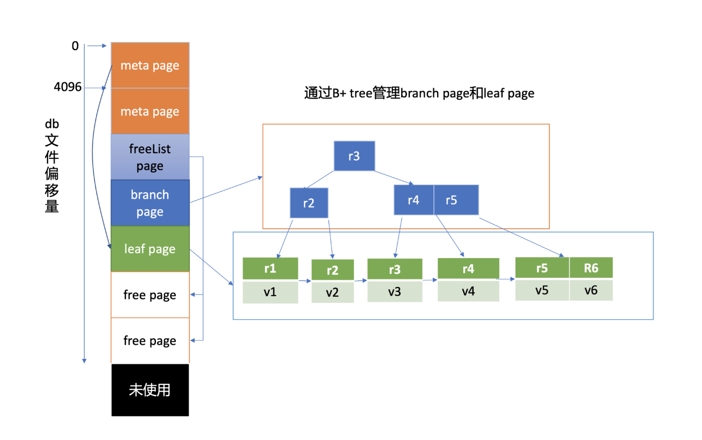

# BoltDB

## Introduction

boltdb 指 etcd 数据目录下的 `member/snap/db` 文件——etcd 的 key-value、lease、meta、member、cluster、auth 等**所有**数据都在这一个文件里。它不是 etcd 自己实现的，而是 bbolt（etcd 贡献回社区的 Bolt 分支，3.7.4 依赖 `go.etcd.io/bbolt v1.5.0`）。etcd 启动时用 mmap 把 db 映射到内存，读直接从内存走，写通过文件操作 + `fdatasync` 落盘；核心数据结构是一棵 B+ tree。

etcd 启动时通过 **mmap** 映射 db 文件，bbolt 在读写事务中访问 page；MVCC 读还会先检查 backend read buffer。写操作先进入 backend 的批量事务缓冲，提交时由 bbolt 写入并按配置执行 `fdatasync`，并不是每个 Put 返回前都单独提交一次磁盘事务。
> 版本基线：etcd 3.7.4（commit 2e8a5c99，Go 1.26）。以下片段均取自该 tag。

3.7.4 相对旧资料（v3.4.9 时代）的几个反直觉点：

> [!NOTE]
> 本篇保留的 key 编码、bucket、tombstone 与 keyIndex 代码片段来自 etcd **v3.4.9**，作为历史实现标本；布局结论已用 **v3.7.2** 源码复核。3.7.2 将 `revision` 导出为 `Revision`、增加 `BucketKey`，并在 `keyIndex.compact` 与 `keep` 之间区分 tombstone 策略，差异见文末。
- **revision 编码已重构**：旧 `revision{main,sub}` / `revToBytes` / `bytesToRev` 变为导出的 `Revision{Main,Sub}` / `RevToBytes` / `BytesToRev`，并引入 `BucketKey{Revision, tombstone}` 把墓碑标记收进结构体。字节布局本身未变。
- **bucket 常量统一到 schema 包**：3.7 里 `key` / `meta` / `lease` / `alarm` / `cluster` / `members` / `auth*` 的常量集中在 `server/storage/schema/bucket.go`，由各模块共用同一份 db，不再是"只有 key/meta 在 mvcc"。
- **磁盘 key 不含用户 key**：`put hello world` 写进 bbolt 的 key 是 17 字节 revision，value 才是 `mvccpb.KeyValue{Key:"hello",...}`。

## Page Structure

文件内容由若干 **page** 组成，page size 固定 **4KB**，按功能分五类：

| 类型 | 职责 |
| :--- | :--- |
| meta page | 记录事务的元信息 |
| branch page | B+ tree 的内部节点，保存索引 key |
| leaf page | B+ tree 的叶子节点，保存实际 key-value 与 bucket |
| freelist page | 记录哪些页是空闲可复用的 |
| free page | 空闲页本体 |

<div style="text-align: center;">



</div>

<p style="text-align: center;">
Fig.1. boltdb 文件结构
</p>

文件最开头两个 page 固定是 meta page；freelist page 记录空闲可复用的页；branch/leaf page 构成 B+ tree 的内部节点与叶子节点。逻辑上 boltdb 通过 B+ tree 管理 branch/leaf page，实现快速查找与有序写入。

## Bucket

boltdb 的 API 只有一个 bucket 概念，本质是一棵独立的 B+ tree，上层用它做命名空间隔离。3.7.4 的所有 bucket 常量集中在 `server/storage/schema/bucket.go`：

```go
var (
	keyBucketName   = []byte("key")
	metaBucketName  = []byte("meta")
	leaseBucketName = []byte("lease")
	alarmBucketName = []byte("alarm")

	clusterBucketName = []byte("cluster")

	membersBucketName        = []byte("members")
	membersRemovedBucketName = []byte("members_removed")

	authBucketName      = []byte("auth")
	authUsersBucketName = []byte("authUsers")
	authRolesBucketName = []byte("authRoles")
)
```

并统一封装成带 id 与 `safeRangeBucket` 标记的 `backend.Bucket`：

```go
var (
	Key     = backend.Bucket(bucket{id: 1, name: keyBucketName, safeRangeBucket: true})
	Meta    = backend.Bucket(bucket{id: 2, name: metaBucketName, safeRangeBucket: false})
	Lease   = backend.Bucket(bucket{id: 3, name: leaseBucketName, safeRangeBucket: false})
	Alarm   = backend.Bucket(bucket{id: 4, name: alarmBucketName, safeRangeBucket: false})
	Cluster = backend.Bucket(bucket{id: 5, name: clusterBucketName, safeRangeBucket: false})
	// ... 省略：Members / MembersRemoved / Auth / AuthUsers / AuthRoles
)
```

| Bucket | 内容 |
| :--- | :--- |
| `Key` | **用户数据**。key 是序列化后的 revision，value 是序列化后的 `mvccpb.KeyValue` |
| `Meta` | MVCC 运行期元数据：已 compact 的 revision、consistentIndex、confState、term 等 |
| `Lease` | [lease](/docs/CS/Framework/etcd/lease.md) 及其关联的 key 列表 |
| `Cluster` / `Members` | 集群成员信息、集群版本 |
| `Auth*` | [鉴权](/docs/CS/Framework/etcd/security.md) 的用户、角色、权限关系 |
| `Alarm` | NOSPACE 等集群告警记录 |

> [!NOTE]
> 这些 bucket 由**各自模块**（mvcc、lessor、membership、auth）写入同一份 db 文件，但常量统一定义在 schema 包。理解这点很重要：`db` 文件里的数据是多模块共同写入的，不都属于 MVCC 体系。`safeRangeBucket=true` 的 `Key` 支持安全范围扫描。

## Key Encoding

执行 `put hello world` 时，**boltdb 实际写入的 key 是版本号（revision），value 是 `mvccpb.KeyValue` 结构体**。这里有个反直觉的事实：磁盘 key 里**并不包含用户的 `hello`**——用户 key 存在 value 内部。

revision 本身由 main 与 sub 两部分组成（`mvcc/revision.go`）：

```go
// revBytesLen is the byte length of a normal revision.
// First 8 bytes is the revision.main in big-endian format. The 9th byte
// is a '_'. The last 8 bytes is the revision.sub in big-endian format.
const revBytesLen = 8 + 1 + 8

// A revision indicates modification of the key-value space.
// The set of changes that share same main revision changes the key-value space atomically.
type revision struct {
	// main is the main revision of a set of changes that happen atomically.
	main int64

	// sub is the sub revision of a change in a set of changes that happen
	// atomically. Each change has different increasing sub revision in that
	// set.
	sub int64
}
```

编码函数：

```go
func revToBytes(rev revision, bytes []byte) {
	binary.BigEndian.PutUint64(bytes, uint64(rev.main))
	bytes[8] = '_'
	binary.BigEndian.PutUint64(bytes[9:], uint64(rev.sub))
}

func bytesToRev(bytes []byte) revision {
	return revision{
		main: int64(binary.BigEndian.Uint64(bytes[0:8])),
		sub:  int64(binary.BigEndian.Uint64(bytes[9:])),
	}
}
```

所以正常 revision 是 **17 字节**：`main(8, big-endian) + '_' + sub(8, big-endian)`。

`main` 是一次原子变更的版本号，`sub` 用于区分**同一次 Raft 日志提交内的多个 key**——一个 Txn 里改 3 个 key，这 3 个 key 共享同一个 `main`，但 `sub` 依次递增。所以磁盘上实际是：

```text
磁盘 key:  [ main(8) ][ '_' ][ sub(8) ]        ← 共 17 字节
           └────────────── 磁盘排序依据 ──────────┘
磁盘 value: mvccpb.KeyValue{ Key, Value, CreateRevision, ModRevision, Version, Lease }
```

> [!TIP]
> **为什么把 revision 放在 key 里？** B+ tree 按字节序排列，单调递增的 revision 使 `[startRev, endRev)` 历史扫描和 watch 回放成为顺序扫描，这对 compaction 与落后 watcher 的追赶很重要。用户 key 位于 value 内，所以**同一 key 的历史版本并不会因此物理相邻**；任意用户前缀查询仍由内存 treeIndex 先定位 revision，再点查 backend。`--prefix` 高效的直接原因是 treeIndex 的有序 B-tree 与区间匹配，而不是磁盘 revision 排序。

### Tombstone Marker

删除 key 时，etcd 不做物理擦除，而是写一条**只有 key、没有 value** 的记录，并加上墓碑标记（`mvcc/kvstore.go`）：
执行 `put hello world` 时，boltdb 实际写入的 key 是版本号（revision），value 是 `mvccpb.KeyValue`。revision 由 main 与 sub 两部分组成（`server/storage/mvcc/revision.go`）：

```go
const (
	// revBytesLen is the byte length of a normal revision.
	// First 8 bytes is the revision.main in big-endian format. The 9th byte
	// is a '_'. The last 8 bytes is the revision.sub in big-endian format.
	revBytesLen = 8 + 1 + 8
	// markedRevBytesLen is the byte length of marked revision.
	// The first `revBytesLen` bytes represents a normal revision. The last
	// one byte is the mark.
	markedRevBytesLen      = revBytesLen + 1
	markBytePosition       = markedRevBytesLen - 1
	markTombstone     byte = 't'
)

type Revision struct {
	// Main is the main revision of a set of changes that happen atomically.
	Main int64
	// Sub is the sub revision of a change in a set of changes that happen
	// atomically. Each change has different increasing sub revision in that set.
	Sub int64
}
```

`RevToBytes` / `BytesToRev` 是对外入口，内部走 `BucketKeyToBytes` / `BytesToBucketKey`——tombstone 作为 `BucketKey` 的字段参与编解码：

```go
func RevToBytes(rev Revision, bytes []byte) []byte {
	return BucketKeyToBytes(newBucketKey(rev.Main, rev.Sub, false), bytes)
}

func BucketKeyToBytes(rev BucketKey, bytes []byte) []byte {
	binary.BigEndian.PutUint64(bytes, uint64(rev.Main))
	bytes[8] = '_'
	binary.BigEndian.PutUint64(bytes[9:], uint64(rev.Sub))
	if rev.tombstone {
		switch len(bytes) {
		case revBytesLen:
			bytes = append(bytes, markTombstone)
		case markedRevBytesLen:
			bytes[markBytePosition] = markTombstone
		}
	}
	return bytes
}
```

所以正常 revision 是 **17 字节**：`Main(8, big-endian) + '_' + Sub(8, big-endian)`，磁盘上：

```text
磁盘 key:  [ Main(8) ][ '_' ][ Sub(8) ]        ← 共 17 字节
           └────────────── 磁盘排序依据 ──────────┘
磁盘 value: mvccpb.KeyValue{ Key, Value, CreateRevision, ModRevision, Version, Lease }
```

`Main` 是一次原子变更的版本号，`Sub` 区分同一次 Raft 提交内的多个 key——一个 Txn 改 3 个 key，共享 `Main`，`Sub` 依次递增。

> [!TIP]
> **为什么把 revision 放在 key 里？** B+ tree 按 key 有序，把单调递增的 revision 编进 key，天然保证"同一 key 的所有版本在磁盘上物理相邻"。范围查询 `[start,end)` 退化成一次顺序扫描——这正是 `--prefix` 查询高效的底层原因。用户 key 放 value 里，反而让 key 保持定长（17 或 18 字节），节点更紧凑。

### Tombstone Marker

删除 key 不做物理擦除，而是写一条带墓碑标记的记录。墓碑字节是**追加在尾部**的 `'t'`（`0x74`），由 `isTombstone` 判断：

```go
// isTombstone checks whether the revision bytes is a tombstone.
func isTombstone(b []byte) bool {
	return len(b) == markedRevBytesLen && b[markBytePosition] == markTombstone
}
```

| 类型 | 长度 | 末字节 |
| :--- | :--- | :--- |
| 正常 revision | 17 | Sub 的高位字节 |
| tombstone | **18** | `'t'`（`0x74`） |

> [!NOTE]
> 网上流传的"8 字节 main + 1 字节 tombstone 标记 + 用户 key"是错的。真实布局是 `Main(8) + '_' + Sub(8)`，标记追加在尾部，用户 key 根本不在磁盘 key 里。

## Read/Write Path

写路径是 `storeTxnWrite.put`（`server/storage/mvcc/kvstore_txn.go`）。注意 `Sub: int64(len(tw.changes))` 用已变更条数当 sub，`CreateRevision` 只在首次创建时取当前 rev，并用 `schema.Key` 写 bbolt：

```go
func (tw *storeTxnWrite) put(key, value []byte, leaseID lease.LeaseID) {
	rev := tw.beginRev + 1
	c := rev
	oldLease := lease.NoLease

	_, created, ver, err := tw.s.kvindex.Get(key, rev)
	if err == nil {
		c = created.Main
		oldLease = tw.s.le.GetLease(lease.LeaseItem{Key: string(key)})
	}
	ibytes := NewRevBytes()
	idxRev := Revision{Main: rev, Sub: int64(len(tw.changes))}
	ibytes = RevToBytes(idxRev, ibytes)

	ver = ver + 1
	kv := &mvccpb.KeyValue{
		Key:            key,
		Value:          value,
		CreateRevision: c,
		ModRevision:    rev,
		Version:        ver,
		Lease:          int64(leaseID),
	}
	d, err := proto.Marshal(kv)
	// ... 省略：错误处理
	tw.tx.UnsafeSeqPut(schema.Key, ibytes, d)
	tw.s.kvindex.Put(key, idxRev)
	tw.changes = append(tw.changes, kv)
}
```

值得注意的几点：

- `CreateRevision` 只在 key **首次创建**时取当前 rev，后续更新沿用旧值；`Version` 每次 put 递增。
- `sub: int64(len(tw.changes))` —— 用已变更条数当 sub，这就是同一次 Txn 内多个 key 共享 main 的实现方式。
- 写 backend 缓冲与更新内存索引 `kvindex` 在同一函数内完成；二者在事务 `End` 的可见性边界前保持一致。
- put 序列化的是**完整** `mvccpb.KeyValue`，不是相对上一 revision 的增量；delete 的 value 只包含 key，并通过 18 字节 tombstone revision 标识。
- lease 的 `Detach`/`Attach` 也在此处理：换了 lease 要先摘旧挂新。

读路径 `rangeKeys` 是"先查内存 [treeIndex](/docs/CS/Framework/etcd/treeIndex.md) 拿 revision 列表，再逐个点查 bbolt"：

```go
revpairs, total := tr.s.kvindex.Revisions(key, end, rev, int(ro.Limit), ro.WithTotalCount)
// ... 省略
kvs := make([]*mvccpb.KeyValue, cappedEntriesCount)
revBytes := NewRevBytes()
for i, revpair := range revpairs[:len(kvs)] {
	revBytes = RevToBytes(revpair, revBytes)
	_, vs := tr.tx.UnsafeRange(schema.Key, revBytes, nil, 0)
	// ... 省略：Unmarshal vs[0] 到 kvs[i]
}
```

> [!NOTE]
> 读路径**没有直接扫 bbolt**，而是先走内存索引拿候选 revision 再点查。这印证了 treeIndex 的定位：内存索引，bbolt 是持久层，二者严格分工。

## keyIndex Generations

`keyIndex` 是内存索引节点，一个用户 key 对应一个 `keyIndex`。generation 的划分是理解 etcd 删除语义的关键——一个 generation = key 从创建到删除的完整生命周期，tombstone 在当前代末尾追加一条版本并新建空代：

```go
// keyIndex stores the revisions of a key in the backend.
// Each keyIndex has at least one key generation.
// Each generation might have several key versions.
type keyIndex struct {
	key         []byte
	modified    Revision // the main rev of the last modification
	generations []generation
}
```

`generation.walk` 按**降序**遍历（从最新往回走），[compact](/docs/CS/Framework/etcd/compact.md) 正是靠它实现的：

```go
// walk walks through the revisions in the generation in descending order.
func (g *generation) walk(f func(rev Revision) bool) int {
	l := len(g.revs)
	for i := range g.revs {
		ok := f(g.revs[l-i-1])
		if !ok {
			return l - i - 1
		}
	}
	return -1
}
```

删除后再创建同名 key 进入新 generation，`version` 按新代内的 `g.ver` 重新从 1 开始。

## Freelist

`freelist` 是 bbolt 的空闲页管理器，记录哪些 page 当前空闲可复用。**bbolt 不会自动缩小文件**：MVCC 与 [compact](/docs/CS/Framework/etcd/compact.md) 只能删除 key-value 条目，删除后的 page 进 freelist 等待复用，但磁盘文件大小保持不变——这就是"compact 之后 db 还是很大"的原因。

	// remove the previous generations.
	ki.generations = ki.generations[genIdx:]
}


## v3.7.2 Differences

v3.4.9 的片段有助于理解布局，但直接照搬类型与压缩行为会得到过时结论：

| 主题 | v3.4.9 | v3.7.2 |
| :--- | :--- | :--- |
| revision 类型 | 未导出的 `revision{main, sub}` | 导出的 `Revision{Main, Sub}`，并提供 `RevToBytes` / `BytesToRev` |
| backend key 类型 | 普通 revision 与 tombstone 两套编码函数 | `BucketKey` 统一封装 `Revision` 与 tombstone 标记 |
| `keyIndex.modified` | `revision` | `Revision` |
| `keyIndex.compact` | 对单个 tombstone 做额外删除并跳过 generation | 只调用 `doCompact` 并裁剪 generation / revs |
| tombstone 保留策略 | 混在 `compact` 中 | `keep` 为物理删除计算 keep set 时跳过特定 tombstone；`compact` 保持原行为以兼容既有 hash |

```go
// server/storage/mvcc/key_index.go:212-235（v3.7.2）
func (ki *keyIndex) compact(lg *zap.Logger, atRev int64, available map[Revision]struct{}) {
    if ki.isEmpty() {
        lg.Panic("'compact' got an unexpected empty keyIndex")
    }
    genIdx, revIndex := ki.doCompact(atRev, available)

    g := &ki.generations[genIdx]
    if !g.isEmpty() {
        if revIndex != -1 {
            g.revs = g.revs[revIndex:]
        }
    }
    ki.generations = ki.generations[genIdx:]
}
```

## freelist

`freelist` 是 boltdb 的**空闲页管理器**——记录哪些 page 当前是空闲可复用的，位于 db 文件开头的 meta page 之后。

理解 freelist 的关键前提是：**bbolt 不会自动缩小文件**。

MVCC 与 [compact](/docs/CS/Framework/etcd/compact.md) 只能删除 key-value 条目，删除后这些 page 变成空闲，被**记录进 freelist 等待复用**，但**磁盘文件大小保持不变**。这就是为什么"compact 之后 db 文件还是很大"——被删掉的空间只进了 freelist，没有还给文件系统。

> [!NOTE]
> freelist 存在 O(N) 的问题：一个频繁删除大 value 的 key 会把大量 page 释放进 freelist。空闲页越多，扫描与维护成本越高，可能放大 compaction / commit 延迟。NOSPACE 的触发顺序、compact 与 defrag 的处置见 [troubleshooting](/docs/CS/Framework/etcd/troubleshooting.md)。

唯一的回收方式是 **defrag**：重建一个紧凑的 db 文件并原子替换，把空闲页彻底丢弃。`etcdctl defrag` 正是干这个。它是**阻塞操作**（期间该节点不响应请求），所以生产上要逐台执行。完整的处置流程见 [troubleshooting](/docs/CS/Framework/etcd/troubleshooting.md) 的 NOSPACE 章节。

## Links

- [Core_Mechanisms（backend 提交与恢复边界）](/docs/CS/Framework/etcd/Core_Mechanisms.md)
- [MVCC（多版本并发控制）](/docs/CS/Framework/etcd/MVCC.md)
- [cluster（磁盘数据布局）](/docs/CS/Framework/etcd/cluster.md)
- [tuning（--backend-batch-interval / --backend-batch-limit）](/docs/CS/Framework/etcd/tuning.md)

## References

1. [etcd mvcc/revision.go (v3.4.9)](https://github.com/etcd-io/etcd/blob/v3.4.9/mvcc/revision.go)
2. [etcd mvcc/kvstore.go (v3.4.9)](https://github.com/etcd-io/etcd/blob/v3.4.9/mvcc/kvstore.go)
3. [etcd mvcc/kvstore_txn.go (v3.4.9)](https://github.com/etcd-io/etcd/blob/v3.4.9/mvcc/kvstore_txn.go)
4. [etcd mvcc/key_index.go (v3.4.9)](https://github.com/etcd-io/etcd/blob/v3.4.9/mvcc/key_index.go)
5. [bbolt (Bolt 的派生分支)](https://github.com/etcd-io/bbolt)
6. [etcd Documentation - Maintenance](https://etcd.io/docs/v3.7/op-guide/maintenance/)
7. [etcd 3.5.9 源代码分析](https://www.cnblogs.com/janeysj/p/17401891.html)
8. [etcd v3.7.2 - Revision and backend key encoding](https://github.com/etcd-io/etcd/blob/v3.7.2/server/storage/mvcc/revision.go)
9. [etcd v3.7.2 - Backend read transaction](https://github.com/etcd-io/etcd/blob/v3.7.2/server/storage/backend/read_tx.go)
10. [etcd v3.7.2 - Backend batch transaction](https://github.com/etcd-io/etcd/blob/v3.7.2/server/storage/backend/batch_tx.go)
11. [etcd v3.7.2 - MVCC key index](https://github.com/etcd-io/etcd/blob/v3.7.2/server/storage/mvcc/key_index.go)
唯一的回收方式是 **defrag**：重建紧凑 db 并原子替换，丢弃空闲页。`etcdctl defrag` 正是干这个，它是**阻塞操作**（期间该节点不响应请求），生产上要逐台执行。完整处置流程见 [troubleshooting](/docs/CS/Framework/etcd/troubleshooting.md) 的 NOSPACE 章节。

> [!NOTE]
> freelist 有 O(N) 问题：频繁删除大 value 的 key 会把大量 page 释放进 freelist，扫描成本随空闲页数线性增长，碎片过多时 compaction 本身会变慢。这也是 [monitoring](/docs/CS/Framework/etcd/monitoring.md) 里 `etcdDatabaseHighFragmentationRatio` 告警要提前发现的原因。

## Links

- [treeIndex](/docs/CS/Framework/etcd/treeIndex.md)
- [MVCC](/docs/CS/Framework/etcd/MVCC.md)
- [compact](/docs/CS/Framework/etcd/compact.md)
- [troubleshooting](/docs/CS/Framework/etcd/troubleshooting.md)
- [cluster](/docs/CS/Framework/etcd/cluster.md)
- [tuning](/docs/CS/Framework/etcd/tuning.md)

## References

1. [etcd v3.7.4 源码（server/storage/mvcc/revision.go）](https://github.com/etcd-io/etcd/blob/v3.7.4/server/storage/mvcc/revision.go)
2. [etcd v3.7.4 源码（server/storage/schema/bucket.go）](https://github.com/etcd-io/etcd/blob/v3.7.4/server/storage/schema/bucket.go)
3. [etcd v3.7.4 源码（server/storage/mvcc/kvstore_txn.go）](https://github.com/etcd-io/etcd/blob/v3.7.4/server/storage/mvcc/kvstore_txn.go)
4. [etcd v3.7.4 源码（server/storage/mvcc/key_index.go）](https://github.com/etcd-io/etcd/blob/v3.7.4/server/storage/mvcc/key_index.go)
5. [bbolt（Bolt 的派生分支）](https://github.com/etcd-io/bbolt)
