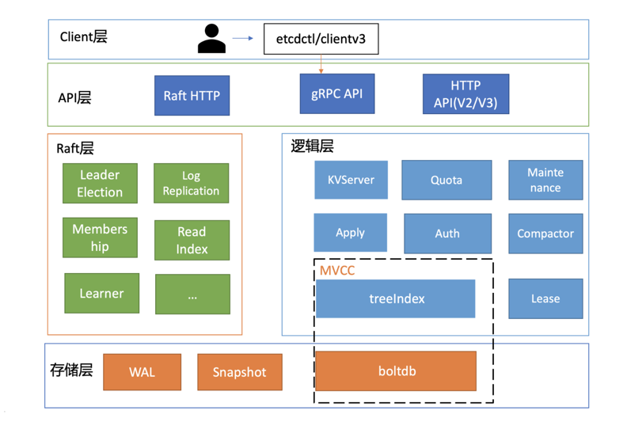
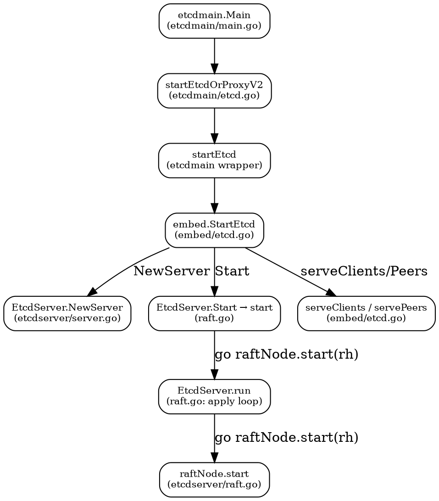

## Introduction

[etcd](/docs/CS/Framework/etcd/etcd.md) 的**启动与生命周期**深潜：从 `make build`、静态 / DNS 发现部署，到整体架构与 v2/v3 数据模型，再到进程启动链 `start → startEtcd → NewServer → serveClients → run` 的完整调用关系，以及启动时如何把外置化后的 Raft（`go.etcd.io/raft/v3`）接线进来。Raft 事件循环与 `Ready` 五步消费见 [raft](/docs/CS/Framework/etcd/raft.md)；客户端请求在 server 侧的处理路径见 [request](/docs/CS/Framework/etcd/request.md)。

> [!NOTE]
> 版本基线同 [etcd](/docs/CS/Framework/etcd/etcd.md)：**3.7.2**（raft 已外置 `go.etcd.io/raft/v3` v3.7.0）。
## Build

为了保证etcd可运行，我们先在根目录上运行go mod tidy，保证依赖库没有问题。
接着，我们阅读Makefile文件，发现其提供了make build指令。运行后，在bin目录下生成了etcd/etcdctl/etcdutl三个可执行文件，并且打印出了版本信息

### Deployment

静态启动

查看Profile文件 如下命令可以快速启动一个3节点的本地集群

```shell
goreman -f Procfile start
```

动态发现

DNS发现

## Architecture

etcd 整体架构如下图所示：

<div style="text-align: center;">



</div>

<p style="text-align: center;">
Fig.1. Architecture
</p>

从大体上可以将其划分为以下几个模块：

- client: 包括v2和v3两个版本 实现负载均衡和故障转移等特性
- network：负责对外提供 http 访问接口
- raft 状态机：根据接受的 raft 消息进行状态转移，调用各状态下的动作。
- **功能逻辑层**：etcd核心特性实现层，如典型的KVServer模块、MVCC模块、Auth鉴权模块、Lease租约模块、Compactor压缩模块等，其中MVCC模块主要由treeIndex模块和boltdb模块组成
- storage：存储层包含预写日志(WAL)模块、快照(Snapshot)模块、boltdb模块。其中WAL可保障etcd crash后数据不丢失，boltdb则保存了集群元数据和用户写入的数据

etcd v2的问题

首先是功能局限性问题。它主要是指etcd v2不支持范围和分页查询、不支持多key事务。
第一，etcd v2不支持范围查询和分页。分页对于数据较多的场景是必不可少的。在Kubernetes中，在集群规模增大后，Pod、Event等资源可能会出现数千个以上，但是etcd v2不支持分页，不支持范围查询，大包等expensive request会导致严重的性能乃至雪崩问题。
第二，etcd v2不支持多key事务。在实际转账等业务场景中，往往我们需要在一个事务中同时更新多个key。
然后是Watch机制可靠性问题。Kubernetes项目严重依赖etcd Watch机制，然而etcd v2是内存型、不支持保存key历史版本的数据库，只在内存中使用滑动窗口保存了最近的1000条变更事件，当etcd server写请求较多、网络波动时等场景，很容易出现事件丢失问题，进而又触发client数据全量拉取，产生大量expensive request，甚至导致etcd雪崩。
其次是性能瓶颈问题。etcd v2早期使用了简单、易调试的HTTP/1.x API，但是随着Kubernetes支撑的集群规模越来越大，HTTP/1.x协议的瓶颈逐渐暴露出来。比如集群规模大时，由于HTTP/1.x协议没有压缩机制，批量拉取较多Pod时容易导致APIServer和etcd出现CPU高负载、OOM、丢包等问题。
另一方面，etcd v2 client会通过HTTP长连接轮询Watch事件，当watcher较多的时候，因HTTP/1.x不支持多路复用，会创建大量的连接，消耗server端过多的socket和内存资源。
同时etcd v2支持为每个key设置TTL过期时间，client为了防止key的TTL过期后被删除，需要周期性刷新key的TTL。
实际业务中很有可能若干key拥有相同的TTL，可是在etcd v2中，即使大量key TTL一样，你也需要分别为每个key发起续期操作，当key较多的时候，这会显著增加集群负载、导致集群性能显著下降。
最后是内存开销问题。etcd v2在内存维护了一颗树来保存所有节点key及value。在数据量场景略大的场景，如配置项较多、存储了大量Kubernetes Events， 它会导致较大的内存开销，同时etcd需要定时把全量内存树持久化到磁盘。这会消耗大量的CPU和磁盘 I/O资源，对系统的稳定性造成一定影响

etcd v3就是为了解决以上稳定性、扩展性、性能问题而诞生的。
在内存开销、Watch事件可靠性、功能局限上，它通过引入B-tree、boltdb实现一个MVCC数据库，数据模型从层次型目录结构改成扁平的key-value，提供稳定可靠的事件通知，实现了事务，支持多key原子更新，同时基于boltdb的持久化存储，显著降低了etcd的内存占用、避免了etcd v2定期生成快照时的昂贵的资源开销。
性能上，首先etcd v3使用了gRPC API，使用protobuf定义消息，消息编解码性能相比JSON超过2倍以上，并通过HTTP/2.0多路复用机制，减少了大量watcher等场景下的连接数。
其次使用Lease优化TTL机制，每个Lease具有一个TTL，相同的TTL的key关联一个Lease，Lease过期的时候自动删除相关联的所有key，不再需要为每个key单独续期。
最后是etcd v3支持范围、分页查询，可避免大包等expensive request

相对于 v2，v3 的主要改动点为：

1. 使用 grpc 进行 peer 之间和与客户端之间通信；
2. v2 的 store 是在内存中的一棵树，v3 采用抽象了一个 kvstore，支持不同的后端存储数据库。增强了事务能力。
3. 去除单元测试代码，etcd v2 的代码行数约 40k，v3 的代码行数约 70k。
4. 2.3 典型内部处理流程
5. 我们将上面架构图的各个部分进行编号，以便下文的处理流程介绍中，对应找到每个流程处理的组件位置。

在 Etcd v2 与 v3 两个版本中，使用的存储方式完全不同，所以两个版本的数据并不兼容，对外提供的接口也是不一样的，不同版本的数据是相互隔离的，只能使用对应的版本去存储与获取

在v3中，store的实现分为两部分

- backend store：可以使用不同的存储，默认使用BoltDB(单机的支持事务的键值对存储)
- 内存索引，基于 http://github.com/google/btree 的b树索引实现

etcd 在 BoltDB 中存储的 key是 revision，value 是 etcd 自定义的键值对组合，etcd 会将键值对的每个版本都保存到 BoltDB 中，所以 etcd 能实现多版本的机制
每次查询键值对需要通过 revision 来查找，所以会在内存中维护一份 B树索引，关联了一个 keyIndex 实例用来映射 key 与 revision，并维护了多个版本的 revision，客户端只会根据 key 去获取数据而不是 revision

v3版本的存储废弃了树形的存储结构但是可以通过前缀的方式来模拟 更接近ZooKeeper的实现

EtcdServer:是整个 etcd 节点的功能的入口，包含 etcd 节点运行过程中需要的大部分成员。

raftNode 是 Raft 节点，维护 Raft 状态机的步进和状态迁移

### Data Model

数据模型参考了ZooKeeper，使用的是基于目录的层次模式。API相比ZooKeeper来说，使用了简单、易用的REST API，提供了常用的Get/Set/Delete/Watch等API，实现对key-value数据的查询、更新、删除、监听等操作。
key-value存储引擎上，ZooKeeper使用的是Concurrent HashMap，而etcd使用的是则是简单内存树，它的节点数据结构精简后如下，含节点路径、值、孩子节点信息。这是一个典型的低容量设计，数据全放在内存，无需考虑数据分片，只能保存key的最新版本，简单易实现

```go
type node struct {
    Path string

    CreatedIndex  uint64
    ModifiedIndex uint64

    Parent *node `json:"-"` // should not encode this field! avoid circular dependency.

    ExpireTime time.Time
    Value      string           // for key-value pair
    Children   map[string]*node // for directory

    // A reference to the store this node is attached to.
    store *store
}
```

## start

```go
// Etcd contains a running etcd server and its listeners.
type Etcd struct {
	Peers   []*peerListener
	Clients []net.Listener
	// a map of contexts for the servers that serves client requests.
	sctxs            map[string]*serveCtx
	metricsListeners []net.Listener

	tracingExporterShutdown func()

	Server *etcdserver.EtcdServer

	cfg   Config
	stopc chan struct{}
	errc  chan error

	closeOnce sync.Once
}
```

启动调用链过程

```
main()                                etcdmain/main.go
 |-checkSupportArch()
 |-startEtcdOrProxyV2()               etcdmain/etcd.go
   |-newConfig()
   |-setupLogging()
   |-startEtcd()
     // 为客户端/服务器通信启动etcd服务器和HTTP处理程序。
   | |-embed.StartEtcd()              embed/etcd.go 
   |   |-configurePeerListeners()    
   |   |-configureClientListeners()
   |   |-EtcdServer.ServerConfig()    生成新的配置
   |   |-EtcdServer.NewServer()       etcdserver/server.go 启动Raft服务
   |   |-EtcdServer.Start()           开始启动服务
   |   | |-EtcdServer.start()           执行服务器开始服务请求所需的任何初始化
   |   |   |-wait.New()               新建WaitGroup组以及一些管道服务
   |   |   |-EtcdServer.run()         etcdserver/raft.go 启动应用层的处理协程
   |   |   | |-raftNode.start(rh)       启动处理协程（rh 为 raftReadyHandler）
   |   |-Etcd.servePeers()            启动集群内部通讯
   |   | |-etcdhttp.NewPeerHandler()  新建http.Handler来处理etcd中其他成员请求
   |   | |-srv.Serve()                配置http服务
   |   | |-e.errHandler(l.serve())       启动集群间http协程，开始多路传输监听
   |   |-Etcd.serveClients()           启动协程处理客户请求
   |   | |-http.NewServeMux()        启动监听客户端的协程
   |   | |-sctxs.serve()               启动服务器
   |   |   |-v3rpc.Server()             启动gRPC服务 /etcdserver/api/v3rpc/grpc.go
   |   |   | |-grpc.NewServer()         调用gRPC的接口创建
   |   |   | |-pb.RegisterKVServer()    注册各种的服务，这里包含了多个
   |   |   | |-pb.RegisterWatchServer()
   |   |-Etcd.serveMetrics()
   |-notifySystemd()
   |-select()                         等待stopped
   |-osutil.Exit()
 
```

下面用一张调用关系图把上面的文字树收成图：



主入口函数 etcdmain.Main

```go
func Main(args []string) {
    checkSupportArch()

    if len(args) > 1 {
        cmd := args[1]
        switch cmd {
        case "gateway", "grpc-proxy":
            if err := rootCmd.Execute(); err != nil {
                fmt.Fprint(os.Stderr, err)
                os.Exit(1)
            }
            return
        }
    }

    startEtcdOrProxyV2(args)
}
```

startEtcdOrProxyV2

```go
func startEtcdOrProxyV2(args []string) {
    grpc.EnableTracing = false

    cfg := newConfig()
    defaultInitialCluster := cfg.ec.InitialCluster

    err := cfg.parse(args[1:])
    lg := cfg.ec.GetLogger()
    // If we failed to parse the whole configuration, print the error using
    // preferably the resolved logger from the config,
    // but if does not exists, create a new temporary logger.
    if lg == nil {
        var zapError error
        // use this logger
        lg, zapError = logutil.CreateDefaultZapLogger(zap.InfoLevel)
        if zapError != nil {
            fmt.Printf("error creating zap logger %v", zapError)
            os.Exit(1)
        }
    }

    cfg.ec.SetupGlobalLoggers()

    defer func() {
        logger := cfg.ec.GetLogger()
        if logger != nil {
            logger.Sync()
        }
    }()

    defaultHost, dhErr := (&cfg.ec).UpdateDefaultClusterFromName(defaultInitialCluster)
    if defaultHost != "" {
        lg.Info(
            "detected default host for advertise",
            zap.String("host", defaultHost),
        )
    }
    if dhErr != nil {
        lg.Info("failed to detect default host", zap.Error(dhErr))
    }

    if cfg.ec.Dir == "" {
        cfg.ec.Dir = fmt.Sprintf("%v.etcd", cfg.ec.Name)
        lg.Warn(
            "'data-dir' was empty; using default",
            zap.String("data-dir", cfg.ec.Dir),
        )
    }

    var stopped <-chan struct{}
    var errc <-chan error

    which := identifyDataDirOrDie(cfg.ec.GetLogger(), cfg.ec.Dir)
    if which != dirEmpty {
        switch which {
            // start etcd
        case dirMember:
            stopped, errc, err = startEtcd(&cfg.ec)
        case dirProxy:
            err = startProxy(cfg)
        default:
            lg.Panic(
                "unknown directory type",
                zap.String("dir-type", string(which)),
            )
        }
    } else {
        shouldProxy := cfg.isProxy()
        if !shouldProxy {
            stopped, errc, err = startEtcd(&cfg.ec)
            if derr, ok := err.(*etcdserver.DiscoveryError); ok && derr.Err == v2discovery.ErrFullCluster {
                if cfg.shouldFallbackToProxy() {
                    lg.Warn(
                        "discovery cluster is full, falling back to proxy",
                        zap.String("fallback-proxy", fallbackFlagProxy),
                        zap.Error(err),
                    )
                    shouldProxy = true
                }
            } else if err != nil {
                lg.Warn("failed to start etcd", zap.Error(err))
            }
        }
        if shouldProxy {
            err = startProxy(cfg)
        }
    }

    if err != nil {
        if derr, ok := err.(*etcdserver.DiscoveryError); ok {
            switch derr.Err {
            case v2discovery.ErrDuplicateID:
                lg.Warn(
                    "member has been registered with discovery service",
                    zap.String("name", cfg.ec.Name),
                    zap.String("discovery-token", cfg.ec.Durl),
                    zap.Error(derr.Err),
                )
                lg.Warn(
                    "but could not find valid cluster configuration",
                    zap.String("data-dir", cfg.ec.Dir),
                )
                lg.Warn("check data dir if previous bootstrap succeeded")
                lg.Warn("or use a new discovery token if previous bootstrap failed")

            case v2discovery.ErrDuplicateName:
                lg.Warn(
                    "member with duplicated name has already been registered",
                    zap.String("discovery-token", cfg.ec.Durl),
                    zap.Error(derr.Err),
                )
                lg.Warn("cURL the discovery token URL for details")
                lg.Warn("do not reuse discovery token; generate a new one to bootstrap a cluster")

            default:
                lg.Warn(
                    "failed to bootstrap; discovery token was already used",
                    zap.String("discovery-token", cfg.ec.Durl),
                    zap.Error(err),
                )
                lg.Warn("do not reuse discovery token; generate a new one to bootstrap a cluster")
            }
            os.Exit(1)
        }

        if strings.Contains(err.Error(), "include") && strings.Contains(err.Error(), "--initial-cluster") {
            lg.Warn("failed to start", zap.Error(err))
            if cfg.ec.InitialCluster == cfg.ec.InitialClusterFromName(cfg.ec.Name) {
                lg.Warn("forgot to set --initial-cluster?")
            }
            if types.URLs(cfg.ec.AdvertisePeerUrls).String() == embed.DefaultInitialAdvertisePeerURLs {
                lg.Warn("forgot to set --initial-advertise-peer-urls?")
            }
            if cfg.ec.InitialCluster == cfg.ec.InitialClusterFromName(cfg.ec.Name) && len(cfg.ec.Durl) == 0 {
                lg.Warn("--discovery flag is not set")
            }
            os.Exit(1)
        }
        lg.Fatal("discovery failed", zap.Error(err))
    }

    osutil.HandleInterrupts(lg)

    // At this point, the initialization of etcd is done.
    // The listeners are listening on the TCP ports and ready
    // for accepting connections. The etcd instance should be
    // joined with the cluster and ready to serve incoming
    // connections.
    notifySystemd(lg)

    select {
    case lerr := <-errc:
        // fatal out on listener errors
        lg.Fatal("listener failed", zap.Error(lerr))
    case <-stopped:
    }

    osutil.Exit(0)
}
```

### startEtcd

这个函数的功能：

1. 启动etcd，如果失败则通过error返回；
2. 启动etcd后，本节点会加入到整个集群中，就绪后则通过channele.Server.ReadyNotify()收到消息；
3. 启动etcd后，如果遇到异常，则会通过channele.Server.StopNotify()收到消息；

```go
// startEtcd runs StartEtcd in addition to hooks needed for standalone etcd.
func startEtcd(cfg *embed.Config) (<-chan struct{}, <-chan error, error) {
    e, err := embed.StartEtcd(cfg)
    if err != nil {
        return nil, nil, err
    }
    osutil.RegisterInterruptHandler(e.Close)
    select {
    case <-e.Server.ReadyNotify(): // wait for e.Server to join the cluster
    case <-e.Server.StopNotify(): // publish aborted from 'ErrStopped'
    }
    return e.Server.StopNotify(), e.Err(), nil
}
```

StartEtcd launches the etcd server and HTTP handlers for client/server communication.
The returned Etcd.Server is not guaranteed to have joined the cluster. Wait on the Etcd.Server.ReadyNotify() channel to know when it completes and is ready for use.

```go
func StartEtcd(inCfg *Config) (e *Etcd, err error) {
    if err = inCfg.Validate(); err != nil {
        return nil, err
    }
    serving := false
    e = &Etcd{cfg: *inCfg, stopc: make(chan struct{})}
    cfg := &e.cfg
    defer func() {
        if e == nil || err == nil {
            return
        }
        if !serving {
            // errored before starting gRPC server for serveCtx.serversC
            for _, sctx := range e.sctxs {
                close(sctx.serversC)
            }
        }
        e.Close()
        e = nil
    }()

    if e.Peers, err = configurePeerListeners(cfg); err != nil {
        return e, err
    }

    e.cfg.logger.Info(
        "configuring client listeners",
        zap.Strings("listen-client-urls", e.cfg.getListenClientUrls()),
    )
    if e.sctxs, err = configureClientListeners(cfg); err != nil {
        return e, err
    }

    for _, sctx := range e.sctxs {
        e.Clients = append(e.Clients, sctx.l)
    }

    var (
        urlsmap types.URLsMap
        token   string
    )
    memberInitialized := true
    if !isMemberInitialized(cfg) {
        memberInitialized = false
        urlsmap, token, err = cfg.PeerURLsMapAndToken("etcd")
        if err != nil {
            return e, fmt.Errorf("error setting up initial cluster: %v", err)
        }
    }

    // AutoCompactionRetention defaults to "0" if not set.
    if len(cfg.AutoCompactionRetention) == 0 {
        cfg.AutoCompactionRetention = "0"
    }
    autoCompactionRetention, err := parseCompactionRetention(cfg.AutoCompactionMode, cfg.AutoCompactionRetention)
    if err != nil {
        return e, err
    }

    backendFreelistType := parseBackendFreelistType(cfg.BackendFreelistType)
    // ...
    }
```

```go
func StartEtcd(inCfg *Config) (e *Etcd, err error) {
    // ...
    srvcfg := config.ServerConfig{
        Name:                                     cfg.Name,
        ClientURLs:                               cfg.AdvertiseClientUrls,
        PeerURLs:                                 cfg.AdvertisePeerUrls,
        DataDir:                                  cfg.Dir,
        DedicatedWALDir:                          cfg.WalDir,
        SnapshotCount:                            cfg.SnapshotCount,
        SnapshotCatchUpEntries:                   cfg.SnapshotCatchUpEntries,
        MaxSnapFiles:                             cfg.MaxSnapFiles,
        MaxWALFiles:                              cfg.MaxWalFiles,
        InitialPeerURLsMap:                       urlsmap,
        InitialClusterToken:                      token,
        DiscoveryURL:                             cfg.Durl,
        DiscoveryProxy:                           cfg.Dproxy,
        NewCluster:                               cfg.IsNewCluster(),
        PeerTLSInfo:                              cfg.PeerTLSInfo,
        TickMs:                                   cfg.TickMs,
        ElectionTicks:                            cfg.ElectionTicks(),
        InitialElectionTickAdvance:               cfg.InitialElectionTickAdvance,
        AutoCompactionRetention:                  autoCompactionRetention,
        AutoCompactionMode:                       cfg.AutoCompactionMode,
        QuotaBackendBytes:                        cfg.QuotaBackendBytes,
        BackendBatchLimit:                        cfg.BackendBatchLimit,
        BackendFreelistType:                      backendFreelistType,
        BackendBatchInterval:                     cfg.BackendBatchInterval,
        MaxTxnOps:                                cfg.MaxTxnOps,
        MaxRequestBytes:                          cfg.MaxRequestBytes,
        MaxConcurrentStreams:                     cfg.MaxConcurrentStreams,
        SocketOpts:                               cfg.SocketOpts,
        StrictReconfigCheck:                      cfg.StrictReconfigCheck,
        ClientCertAuthEnabled:                    cfg.ClientTLSInfo.ClientCertAuth,
        AuthToken:                                cfg.AuthToken,
        BcryptCost:                               cfg.BcryptCost,
        TokenTTL:                                 cfg.AuthTokenTTL,
        CORS:                                     cfg.CORS,
        HostWhitelist:                            cfg.HostWhitelist,
        InitialCorruptCheck:                      cfg.ExperimentalInitialCorruptCheck,
        CorruptCheckTime:                         cfg.ExperimentalCorruptCheckTime,
        CompactHashCheckEnabled:                  cfg.ExperimentalCompactHashCheckEnabled,
        CompactHashCheckTime:                     cfg.ExperimentalCompactHashCheckTime,
        PreVote:                                  cfg.PreVote,
        Logger:                                   cfg.logger,
        ForceNewCluster:                          cfg.ForceNewCluster,
        EnableGRPCGateway:                        cfg.EnableGRPCGateway,
        ExperimentalEnableDistributedTracing:     cfg.ExperimentalEnableDistributedTracing,
        UnsafeNoFsync:                            cfg.UnsafeNoFsync,
        EnableLeaseCheckpoint:                    cfg.ExperimentalEnableLeaseCheckpoint,
        LeaseCheckpointPersist:                   cfg.ExperimentalEnableLeaseCheckpointPersist,
        CompactionBatchLimit:                     cfg.ExperimentalCompactionBatchLimit,
        WatchProgressNotifyInterval:              cfg.ExperimentalWatchProgressNotifyInterval,
        DowngradeCheckTime:                       cfg.ExperimentalDowngradeCheckTime,
        WarningApplyDuration:                     cfg.ExperimentalWarningApplyDuration,
        ExperimentalMemoryMlock:                  cfg.ExperimentalMemoryMlock,
        ExperimentalTxnModeWriteWithSharedBuffer: cfg.ExperimentalTxnModeWriteWithSharedBuffer,
        ExperimentalStopGRPCServiceOnDefrag:      cfg.ExperimentalStopGRPCServiceOnDefrag,
        ExperimentalBootstrapDefragThresholdMegabytes: cfg.ExperimentalBootstrapDefragThresholdMegabytes,
        V2Deprecation: cfg.V2DeprecationEffective(),
    }

    if srvcfg.ExperimentalEnableDistributedTracing {
        tctx := context.Background()
        tracingExporter, err := newTracingExporter(tctx, cfg)
        if err != nil {
            return e, err
        }
        e.tracingExporterShutdown = func() {
            tracingExporter.Close(tctx)
        }
        srvcfg.ExperimentalTracerOptions = tracingExporter.opts

        e.cfg.logger.Info("distributed tracing setup enabled")
    }

    print(e.cfg.logger, *cfg, srvcfg, memberInitialized)

    if e.Server, err = etcdserver.NewServer(srvcfg); err != nil {
        return e, err
    }

    // buffer channel so goroutines on closed connections won't wait forever
    e.errc = make(chan error, len(e.Peers)+len(e.Clients)+2*len(e.sctxs))

    // newly started member ("memberInitialized==false")
    // does not need corruption check
    if memberInitialized && srvcfg.InitialCorruptCheck {
        if err = e.Server.CorruptionChecker().InitialCheck(); err != nil {
            // set "EtcdServer" to nil, so that it does not block on "EtcdServer.Close()"
            // (nothing to close since rafthttp transports have not been started)

            e.cfg.logger.Error("checkInitialHashKV failed", zap.Error(err))
            e.Server.Cleanup()
            e.Server = nil
            return e, err
        }
    }
    e.Server.Start()

    if err = e.servePeers(); err != nil {
        return e, err
    }
    if err = e.serveClients(); err != nil {
        return e, err
    }
    if err = e.serveMetrics(); err != nil {
        return e, err
    }

    e.cfg.logger.Info(
        "now serving peer/client/metrics",
        zap.String("local-member-id", e.Server.ID().String()),
        zap.Strings("initial-advertise-peer-urls", e.cfg.getAdvertisePeerUrls()),
        zap.Strings("listen-peer-urls", e.cfg.getListenPeerUrls()),
        zap.Strings("advertise-client-urls", e.cfg.getAdvertiseClientUrls()),
        zap.Strings("listen-client-urls", e.cfg.getListenClientUrls()),
        zap.Strings("listen-metrics-urls", e.cfg.getMetricsURLs()),
    )
    serving = true
    return e, nil
}
```

> 下面两张表抽出 `EtcdServer` 与 `raftNode` 的核心字段（均来自上文 `run()` 与 `NewServer` 调用链中直接出现的成员），定义位置见对应源码文件。

**`EtcdServer` 核心字段**（定义于 `server/etcdserver/server.go`）：

| 字段 | 类型 | 作用 |
|---|---|---|
| `id` / `name` | `types.ID` / `string` | 本节点 ID 与名称 |
| `r` | `RaftKV`（实现为 `raftNode`） | Raft 接入层，包装外置 `raft.Node` |
| `kv` | `mvcc.ConsistentWatchableKV` | MVCC 存储（treeIndex + boltdb） |
| `lessor` | `lease.Lessor` | 租约管理（过期驱逐、keepalive） |
| `compactor` | `compaction.Compactor` | 历史版本压缩调度 |
| `w` | `wait.Wait` | 请求等待队列（Propose 后阻塞等 apply 结果） |
| `stopping` / `done` / `stop` | `chan` | 生命周期控制通道 |
| `applyWait` | 通知机制 | apply 完成后的客户端唤醒 |

**`raftNode` 核心字段**（定义于 `server/etcdserver/raft.go`）：

| 字段 | 作用 |
|---|---|
| `node` | 外置 `raft.Node`（`RestartNode` / `StartNode` 产出） |
| `raftStorage` | 基于 WAL 的 raft 存储 |
| `transport` | rafthttp 传输（peer 间消息收发） |
| `readyc` / `advancec` | `Ready` 的收发通道 |
| `applyc` | apply 包通道，接到 `run()` 的 apply 循环 |

### EtcdServer::NewServer

函数调用关系链

```
NewServer()  etcdserver/server.go 通过配置创建一个新的EtcdServer对象，不同场景不同
 |-bootstrap(cfg)
 | |-bootstrapSnapshot(cfg)  新建snap对象，等待存储或恢复
 | |-wal.Exist()
 | |-v2store.New()                  初始化内存B+树
 | |-bootstrapBackend()             初始化操作treeIndex以及BoltDB持久化的对象
 |   |-recoverSnapshot()            从快照中恢复
 | |-bootstrapWALFromSnapshot()    已有WAL，在原有数据中恢复未提交数据
 | |-bootstrapCluster()               对于每一个集群成员进行存储配置
 | |-bootstrapStorage()               对于没有WAL情况，进行统一分配存储
 | |-cluster.Finalize()                 对于每一个集群成员进行最后配置
 | |-bootstrapRaft()                   为当前服务器配置raft 对象
 |-stats.NewServerStats()              配置server状态
 |-stats.NewLeaderStats()             成为Leader状态
 |-srv=&EtcdServer{raft.newRaftNode() …}新建etcdserver对象，并初始化raft对象运行
 | |-bootstrappedRaft.newRaftNode()   bootstrap.go 构造 raftNode 包装器
 |   |-raft.RestartNode()            若无其他成员则重启节点（外置 go.etcd.io/raft/v3）
 |   |-raft.StartNode(cfg, peers)    若有则新启节点（外置 go.etcd.io/raft/v3）
 |   |-newRaftNode(cfg)              etcdserver/raft.go 把 raft.Node 包成 raftNode
 |-go raftNode.start(rh)              etcdserver/raft.go 启动 Ready 处理协程
|-lease.NewLessor()                 恢复Lessor状态 mvcc.New
 |- mvcc.New()                      新建mvcc存储管理对象
 |-auth.NewAuthStore()             

```

> [!NOTE]
> **3.7 的 raft 已外置**：旧版这里的 `rn = NewRawNode()`（`raft/node.go`）、`raft.becomeFollower()`、`n := newNode(rn)`、`go node.run()` 在 3.7.2 的**主仓库里已全部不存在**——算法实现搬到了独立 module `go.etcd.io/raft/v3`（v3.7.0）。全仓库 grep `raft.RawNode` / `NewRawNode` **零命中**（含测试），也没有 `server/etcdserver/api/raft/` 目录。主仓库的角色退化为**调用侧**：`server/etcdserver/bootstrap.go` 的 `bootstrappedRaft.newRaftNode` 调外置的 `raft.RestartNode` / `raft.StartNode` 拿到一个 `raft.Node`，再交给 `server/etcdserver/raft.go` 的 `newRaftNode(cfg raftNodeConfig) *raftNode`（`:123`）包成 `raftNode`，最后由 `raftNode.start(rh *raftReadyHandler)`（`:174`）把外置 raft 的 `Ready` 事件接到 etcdserver 的 apply 管线。想读 `becomeFollower`、`node.run()` 这类状态机函数要去外置仓库找。

> **3.5 内联 vs 3.7 外置** 速查表（细节见上方 NOTE）：

| 维度 | 3.5 及更早（内联） | 3.7（外置 module） |
|---|---|---|
| raft 实现位置 | 主仓库 `server/etcdserver/api/raft/` | 独立 module `go.etcd.io/raft/v3` |
| 节点构造 | `newNode(rn)` + `n := newNode(rn)` | `raft.RestartNode` / `raft.StartNode` |
| 状态机步进 | `node.run()`、`becomeFollower` 在主仓 | 状态机函数迁到外置仓库 |
| 主仓角色 | 算法 + 调用一体 | 仅调用侧：包成 `raftNode` 接 `Ready` |


serveCtx:serve

```go
// serve accepts incoming connections on the listener l,
// creating a new service goroutine for each. The service goroutines
// read requests and then call handler to reply to them.
func (sctx *serveCtx) serve(
    s *etcdserver.EtcdServer,
    tlsinfo *transport.TLSInfo,
    handler http.Handler,
    errHandler func(error),
    grpcDialForRestGatewayBackends func(ctx context.Context) (*grpc.ClientConn, error),
    splitHttp bool,
    gopts ...grpc.ServerOption) (err error) {
    logger := defaultLog.New(ioutil.Discard, "etcdhttp", 0)
    <-s.ReadyNotify()

    sctx.lg.Info("ready to serve client requests")

    m := cmux.New(sctx.l)
    var server func() error
    onlyGRPC := splitHttp && !sctx.httpOnly
    onlyHttp := splitHttp && sctx.httpOnly
    grpcEnabled := !onlyHttp
    httpEnabled := !onlyGRPC

    v3c := v3client.New(s)
    servElection := v3election.NewElectionServer(v3c)
    servLock := v3lock.NewLockServer(v3c)

    // Make sure serversC is closed even if we prematurely exit the function.
    defer close(sctx.serversC)
    var gwmux *gw.ServeMux
    if s.Cfg.EnableGRPCGateway {
        // GRPC gateway connects to grpc server via connection provided by grpc dial.
        gwmux, err = sctx.registerGateway(grpcDialForRestGatewayBackends)
        if err != nil {
            sctx.lg.Error("registerGateway failed", zap.Error(err))
            return err
        }
    }
    var traffic string
    switch {
    case onlyGRPC:
        traffic = "grpc"
    case onlyHttp:
        traffic = "http"
    default:
        traffic = "grpc+http"
    }

    if sctx.insecure {
        var gs *grpc.Server
        var srv *http.Server
        if httpEnabled {
            httpmux := sctx.createMux(gwmux, handler)
            srv = &http.Server{
                Handler:  createAccessController(sctx.lg, s, httpmux),
                ErrorLog: logger, // do not log user error
            }
            if err := configureHttpServer(srv, s.Cfg); err != nil {
                sctx.lg.Error("Configure http server failed", zap.Error(err))
                return err
            }
        }
        if grpcEnabled {
            gs = v3rpc.Server(s, nil, nil, gopts...)
            v3electionpb.RegisterElectionServer(gs, servElection)
            v3lockpb.RegisterLockServer(gs, servLock)
            if sctx.serviceRegister != nil {
                sctx.serviceRegister(gs)
            }
            defer func(gs *grpc.Server) {
                if err != nil {
                    sctx.lg.Warn("stopping insecure grpc server due to error", zap.Error(err))
                    gs.Stop()
                    sctx.lg.Warn("stopped insecure grpc server due to error", zap.Error(err))
                }
            }(gs)
        }
        if onlyGRPC {
            server = func() error {
                return gs.Serve(sctx.l)
            }
        } else {
            server = m.Serve

            httpl := m.Match(cmux.HTTP1())
            go func(srvhttp *http.Server, tlsLis net.Listener) {
                errHandler(srvhttp.Serve(tlsLis))
            }(srv, httpl)

            if grpcEnabled {
                grpcl := m.Match(cmux.HTTP2())
                go func(gs *grpc.Server, l net.Listener) {
                    errHandler(gs.Serve(l))
                }(gs, grpcl)
            }
        }

        sctx.serversC <- &servers{grpc: gs, http: srv}
        sctx.lg.Info(
            "serving client traffic insecurely; this is strongly discouraged!",
            zap.String("traffic", traffic),
            zap.String("address", sctx.l.Addr().String()),
        )
    }

    if sctx.secure {
        var gs *grpc.Server
        var srv *http.Server

        tlscfg, tlsErr := tlsinfo.ServerConfig()
        if tlsErr != nil {
            return tlsErr
        }

        if grpcEnabled {
            gs = v3rpc.Server(s, tlscfg, nil, gopts...)
            v3electionpb.RegisterElectionServer(gs, servElection)
            v3lockpb.RegisterLockServer(gs, servLock)
            if sctx.serviceRegister != nil {
                sctx.serviceRegister(gs)
            }
            defer func(gs *grpc.Server) {
                if err != nil {
                    sctx.lg.Warn("stopping secure grpc server due to error", zap.Error(err))
                    gs.Stop()
                    sctx.lg.Warn("stopped secure grpc server due to error", zap.Error(err))
                }
            }(gs)
        }
        if httpEnabled {
            if grpcEnabled {
                handler = grpcHandlerFunc(gs, handler)
            }
            httpmux := sctx.createMux(gwmux, handler)

            srv = &http.Server{
                Handler:   createAccessController(sctx.lg, s, httpmux),
                TLSConfig: tlscfg,
                ErrorLog:  logger, // do not log user error
            }
            if err := configureHttpServer(srv, s.Cfg); err != nil {
                sctx.lg.Error("Configure https server failed", zap.Error(err))
                return err
            }
        }

        if onlyGRPC {
            server = func() error { return gs.Serve(sctx.l) }
        } else {
            server = m.Serve

            tlsl, err := transport.NewTLSListener(m.Match(cmux.Any()), tlsinfo)
            if err != nil {
                return err
            }
            go func(srvhttp *http.Server, tlsl net.Listener) {
                errHandler(srvhttp.Serve(tlsl))
            }(srv, tlsl)
        }

        sctx.serversC <- &servers{secure: true, grpc: gs, http: srv}
    }

    return server()
}
```

### serveClients

serve accepts incoming connections on the listener l, creating a new service goroutine for each. The service goroutines read requests and then call handler to reply to them.

```go
func (e *Etcd) serveClients() (err error) {
    if !e.cfg.ClientTLSInfo.Empty() {
        e.cfg.logger.Info(
            "starting with client TLS",
            zap.String("tls-info", fmt.Sprintf("%+v", e.cfg.ClientTLSInfo)),
            zap.Strings("cipher-suites", e.cfg.CipherSuites),
        )
    }

    // Start a client server goroutine for each listen address
    var h http.Handler
    if e.Config().EnableV2 {
        if e.Config().V2DeprecationEffective().IsAtLeast(config.V2_DEPR_1_WRITE_ONLY) {
            return fmt.Errorf("--enable-v2 and --v2-deprecation=%s are mutually exclusive", e.Config().V2DeprecationEffective())
        }
        e.cfg.logger.Warn("Flag `enable-v2` is deprecated and will get removed in etcd 3.6.")
        if len(e.Config().ExperimentalEnableV2V3) > 0 {
            e.cfg.logger.Warn("Flag `experimental-enable-v2v3` is deprecated and will get removed in etcd 3.6.")
            srv := v2v3.NewServer(e.cfg.logger, v3client.New(e.Server), e.cfg.ExperimentalEnableV2V3)
            h = v2http.NewClientHandler(e.GetLogger(), srv, e.Server.Cfg.ReqTimeout())
        } else {
            h = v2http.NewClientHandler(e.GetLogger(), e.Server, e.Server.Cfg.ReqTimeout())
        }
    } else {
        mux := http.NewServeMux()
        etcdhttp.HandleBasic(e.cfg.logger, mux, e.Server)
        etcdhttp.HandleMetrics(mux)
        etcdhttp.HandleHealth(e.cfg.logger, mux, e.Server)
        h = mux
    }

    gopts := []grpc.ServerOption{}
    if e.cfg.GRPCKeepAliveMinTime > time.Duration(0) {
        gopts = append(gopts, grpc.KeepaliveEnforcementPolicy(keepalive.EnforcementPolicy{
            MinTime:             e.cfg.GRPCKeepAliveMinTime,
            PermitWithoutStream: false,
        }))
    }
    if e.cfg.GRPCKeepAliveInterval > time.Duration(0) &&
        e.cfg.GRPCKeepAliveTimeout > time.Duration(0) {
        gopts = append(gopts, grpc.KeepaliveParams(keepalive.ServerParameters{
            Time:    e.cfg.GRPCKeepAliveInterval,
            Timeout: e.cfg.GRPCKeepAliveTimeout,
        }))
    }

    splitHttp := false
    for _, sctx := range e.sctxs {
        if sctx.httpOnly {
            splitHttp = true
        }
    }

    // start client servers in each goroutine
    for _, sctx := range e.sctxs {
        go func(s *serveCtx) {
            e.errHandler(s.serve(e.Server, &e.cfg.ClientTLSInfo, h, e.errHandler, e.grpcGatewayDial(splitHttp), splitHttp, gopts...))
        }(sctx)
    }
    return nil
}
```

EtcdServer::Start -> EtcdServer::start -> EtcdServer::run

```go
func (s *EtcdServer) run() {
    lg := s.Logger()

    sn, err := s.r.raftStorage.Snapshot()
    if err != nil {
        lg.Panic("failed to get snapshot from Raft storage", zap.Error(err))
    }

    // asynchronously accept apply packets, dispatch progress in-order
    sched := schedule.NewFIFOScheduler()

    var (
        smu   sync.RWMutex
        syncC <-chan time.Time
    )
    setSyncC := func(ch <-chan time.Time) {
        smu.Lock()
        syncC = ch
        smu.Unlock()
    }
    getSyncC := func() (ch <-chan time.Time) {
        smu.RLock()
        ch = syncC
        smu.RUnlock()
        return
    }
    rh := &raftReadyHandler{
        getLead:    func() (lead uint64) { return s.getLead() },
        updateLead: func(lead uint64) { s.setLead(lead) },
        updateLeadership: func(newLeader bool) {
            if !s.isLeader() {
                if s.lessor != nil {
                    s.lessor.Demote()
                }
                if s.compactor != nil {
                    s.compactor.Pause()
                }
                setSyncC(nil)
            } else {
                if newLeader {
                    t := time.Now()
                    s.leadTimeMu.Lock()
                    s.leadElectedTime = t
                    s.leadTimeMu.Unlock()
                }
                setSyncC(s.SyncTicker.C)
                if s.compactor != nil {
                    s.compactor.Resume()
                }
            }
            if newLeader {
                s.leaderChangedMu.Lock()
                lc := s.leaderChanged
                s.leaderChanged = make(chan struct{})
                close(lc)
                s.leaderChangedMu.Unlock()
            }
            // TODO: remove the nil checking
            // current test utility does not provide the stats
            if s.stats != nil {
                s.stats.BecomeLeader()
            }
        },
        updateCommittedIndex: func(ci uint64) {
            cci := s.getCommittedIndex()
            if ci > cci {
                s.setCommittedIndex(ci)
            }
        },
    }
    s.r.start(rh)

    ep := etcdProgress{
        confState: sn.Metadata.ConfState,
        snapi:     sn.Metadata.Index,
        appliedt:  sn.Metadata.Term,
        appliedi:  sn.Metadata.Index,
    }

    defer func() {
        s.wgMu.Lock() // block concurrent waitgroup adds in GoAttach while stopping
        close(s.stopping)
        s.wgMu.Unlock()
        s.cancel()
        sched.Stop()

        // wait for gouroutines before closing raft so wal stays open
        s.wg.Wait()

        s.SyncTicker.Stop()

        // must stop raft after scheduler-- etcdserver can leak rafthttp pipelines
        // by adding a peer after raft stops the transport
        s.r.stop()

        s.Cleanup()

        close(s.done)
    }()

    var expiredLeaseC <-chan []*lease.Lease
    if s.lessor != nil {
        expiredLeaseC = s.lessor.ExpiredLeasesC()
    }

    for {
        select {
        case ap := <-s.r.apply():
            f := func(context.Context) { s.applyAll(&ep, &ap) }
            sched.Schedule(f)
        case leases := <-expiredLeaseC:
            s.revokeExpiredLeases(leases)
        case err := <-s.errorc:
            lg.Warn("server error", zap.Error(err))
            lg.Warn("data-dir used by this member must be removed")
            return
        case <-getSyncC():
            if s.v2store.HasTTLKeys() {
                s.sync(s.Cfg.ReqTimeout())
            }
        case <-s.stop:
            return
        }
    }
}
```

> `run()` 主循环 `select` 的事件源与对应处理：

| 事件源（channel） | 处理 |
|---|---|
| `s.r.apply()` | 取出 apply 包，由 `FIFOScheduler` 按序 `applyAll` |
| `expiredLeaseC` | `revokeExpiredLeases` 撤销过期租约 |
| `s.errorc` | 打 warn 并标记数据目录需清理后返回（致命） |
| `getSyncC()`（SyncTicker） | 若有 TTL key，触发 `s.sync` 同步 v2 store |
| `s.stop` | 退出循环，进入 defer 清理（停 raft / 清 WAL / 关 done） |

## Links

- [request（请求处理路径）](/docs/CS/Framework/etcd/request.md)
- [features（服务发现 / 事务）](/docs/CS/Framework/etcd/features.md)
- [raft（Raft 接线与 Ready 消费）](/docs/CS/Framework/etcd/raft.md)
- [MVCC（多版本并发控制）](/docs/CS/Framework/etcd/MVCC.md)
- [boltdb（底层存储引擎）](/docs/CS/Framework/etcd/boltdb.md)
- [cluster（集群运维与备份恢复）](/docs/CS/Framework/etcd/cluster.md)
- [ZooKeeper](/docs/CS/Framework/ZooKeeper/ZooKeeper.md)
