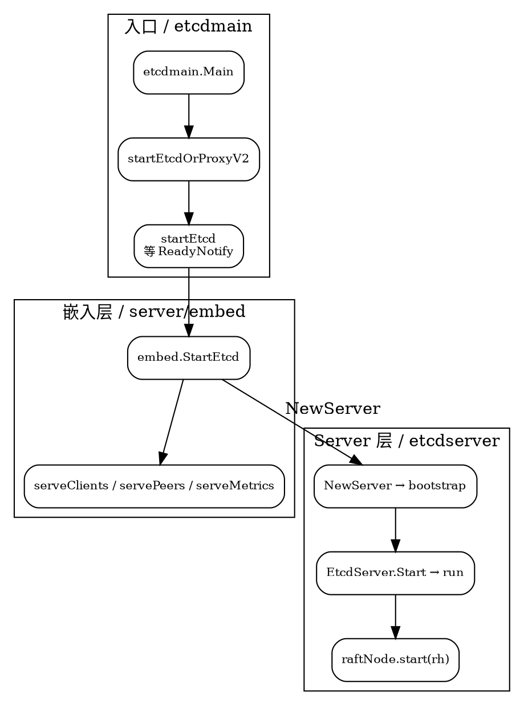

# Boot and Lifecycle

## Introduction

本篇深潜 etcd 的**启动与生命周期**：从 `make build`、静态 / DNS 发现部署，到进程启动链 `Main → startEtcdOrProxyV2 → startEtcd → embed.StartEtcd → NewServer → serveClients → run`，再到外置化后的 raft（`go.etcd.io/raft/v3`）如何接线进来。raft 事件循环与 `Ready` 五步消费见 [raft](/docs/CS/Framework/etcd/raft.md)；客户端请求在 server 侧的处理路径见 [request](/docs/CS/Framework/etcd/request.md)。

> 版本基线：etcd 3.7.4（commit 2e8a5c99，Go 1.26）。以下片段均取自该 tag。

3.7.4 相对旧资料的几个反直觉点：

- **启动不再是扁平的 `NewServer` 直接建对象**：`NewServer` 第一跳是 `bootstrap(cfg)`——一个把 backend / WAL / cluster / storage / raft 依次装配的阶段机；且完全从 v3store 启动，`buildConfStateFromV3store` 从 backend 成员表重建 `ConfState`，v2store 已从启动链移除。
- **raft 已外置**：旧版的 `raft.RawNode` / `NewRawNode` / `node.run()` / `becomeFollower` 在主仓库零命中，算法搬到独立 module `go.etcd.io/raft/v3` v3.7.0；主仓库角色退化为"调用侧"——包成 `raftNode` 消费外置 raft 的 `Ready`。
- **`run()` 主循环已无 v2store 的 TTL 同步逻辑**：旧的 `getSyncC()` / `s.v2store.HasTTLKeys()` / `s.sync()` 分支在 3.7.4 的 `run()` 里不存在。

## Build and Deployment

根目录 `go mod tidy` 保证依赖无误后，`make build` 在 `bin/` 产出 `etcd` / `etcdctl` / `etcdutl` 三个可执行文件。快速起一个三节点本地集群用 `goreman -f Procfile start`（Profile 见源码根 `Procfile`）；生产部署还支持静态配置与 DNS 动态发现。

etcd 整体架构可分为几层：client（v2/v3 SDK）、network（HTTP/gRPC 接入）、raft 状态机、功能逻辑层（KVServer / MVCC / Auth / Lease / Compactor）、storage（WAL / Snapshot / boltdb）。v3 相对 v2 的核心改进是引入 B-tree + boltdb 实现 MVCC、数据模型从层次目录改为扁平 key-value、用 gRPC + protobuf + HTTP/2 多路复用、用 Lease 优化 TTL、支持范围/分页查询。这一演进的完整对比见 [v2](/docs/CS/Framework/etcd/v2.md) 与 [etcd](/docs/CS/Framework/etcd/etcd.md)。

## The Entry Chain

进程入口 `etcdmain.Main` 只在 `gateway` / `grpc-proxy` 子命令时走 cobra rootCmd，否则直接 `startEtcdOrProxyV2`：

```go
func Main(args []string) {
	checkSupportArch()
	if len(args) > 1 {
		cmd := args[1]
		switch cmd {
		case "gateway", "grpc-proxy":
			if err := rootCmd.Execute(); err != nil {
				fmt.Fprint(os.Stderr, err)
				os.Exit(1)
			}
			return
		}
	}
	startEtcdOrProxyV2(args)
}
```

`startEtcdOrProxyV2` 解析配置、探测默认 host、按数据目录类型决定 start etcd 还是 proxy；它返回时初始化已完成，但**不保证已加入集群**——真正的就绪在 `startEtcd` 里等 `ReadyNotify()`：

```go
func startEtcd(cfg *embed.Config) (<-chan struct{}, <-chan error, error) {
	e, err := embed.StartEtcd(cfg)
	if err != nil {
		return nil, nil, err
	}
	osutil.RegisterInterruptHandler(e.Close)
	select {
	case <-e.Server.ReadyNotify(): // wait for e.Server to join the cluster
	case <-e.Server.StopNotify():  // publish aborted from 'ErrStopped'
	}
	return e.Server.StopNotify(), e.Err(), nil
}
```

整条启动调用链：



## The Bootstrap Chain

`embed.StartEtcd` 校验配置、建 peer / client listener、装配 `ServerConfig`（字段名一一对应 embed flag，见 [embed](/docs/CS/Framework/etcd/embed.md)），最后 `etcdserver.NewServer(srvcfg)`。后者第一跳是 `bootstrap`——阶段机依次建 backend / WAL / cluster / storage / raft：

```go
func bootstrap(cfg config.ServerConfig) (b *bootstrappedServer, err error) {
	if terr := fileutil.TouchDirAll(cfg.Logger, cfg.DataDir); terr != nil {
		return nil, fmt.Errorf("cannot access data directory: %w", terr)
	}
	ss := bootstrapSnapshot(cfg)
	prt, err := rafthttp.NewRoundTripper(cfg.PeerTLSInfo, cfg.PeerDialTimeout())
	if err != nil {
		return nil, err
	}

	haveWAL := wal.Exist(cfg.WALDir())
	backend, err := bootstrapBackend(cfg, haveWAL)
	if err != nil {
		return nil, err
	}
	var bwal *bootstrappedWAL
	if haveWAL {
		bwal, err = bootstrapWALFromSnapshot(cfg, backend.snapshot, backend.ci)
		if err != nil {
			backend.Close()
			return nil, err
		}
	}

	cfg.Logger.Info("bootstrapping cluster")
	cluster, err := bootstrapCluster(cfg, bwal, prt)
	if err != nil {
		backend.Close()
		return nil, err
	}
	s := bootstrapStorage(cfg, backend, bwal, cluster)
	if err = cluster.Finalize(cfg, s); err != nil {
		backend.Close()
		return nil, err
	}

	cfg.Logger.Info("bootstrapping raft")
	raft := bootstrapRaft(cfg, cluster, s.wal)
	return &bootstrappedServer{
		prt: prt, ss: ss, storage: s, cluster: cluster, raft: raft,
	}, nil
}
```

3.7 的关键变化是 `ConfState` 不再从 v2store 读，而是用 backend 里的成员重建，并写回 raft 快照的 metadata——这就是"从 v3store 引导"：

```go
func buildConfStateFromV3store(lg *zap.Logger, be backend.Backend) raftpb.ConfState {
	members, _ := schema.NewMembershipBackend(lg, be).MustReadMembersFromBackend()
	var (
		voters   []uint64
		learners []uint64
	)
	for _, m := range members {
		if m.IsLearner {
			learners = append(learners, uint64(m.ID))
		} else {
			voters = append(voters, uint64(m.ID))
		}
	}
	return raftpb.ConfState{Voters: voters, Learners: learners}
}
```

> [!NOTE]
> 磁盘数据布局（`.snap` / `.wal` / `db`）与备份恢复见 [cluster](/docs/CS/Framework/etcd/cluster.md)。

## Raft as an External Module

3.7 里 `bootstrapRaft` 调外置的 `raft.RestartNode` / `raft.StartNode` 拿到 `raft.Node`，再交给主仓库的 `newRaftNode(cfg)` 包成 `raftNode`。`raftNode` 是 etcd 与外置 raft 的边界，用一组 channel 把 raft 输出接到 server——`applyc` 送待 apply 条目、`readStateC` 送 ReadIndex 结果、`msgSnapC` 送快照消息：

```go
type raftNode struct {
	tickMu *sync.RWMutex
	// timestamp of the latest tick
	latestTickTs time.Time
	raftNodeConfig

	// a chan to send/receive snapshot
	msgSnapC chan *raftpb.Message
	// a chan to send out apply
	applyc chan toApply
	// a chan to send out readState
	readStateC chan raft.ReadState

	ticker *time.Ticker
	td     *contention.TimeoutDetector
	stopped chan struct{}
	done    chan struct{}
}

type raftNodeConfig struct {
	lg *zap.Logger
	isIDRemoved func(id uint64) bool
	raft.Node
	raftStorage *raft.MemoryStorage
	storage     serverstorage.Storage
	heartbeat   time.Duration // for logging
	transport   rafthttp.Transporter
}
```

`raftNode.start(rh *raftReadyHandler)` 消费外置 raft 的 `Ready`，`rh` 回调把 leadership / commit index 变化反馈给 server。共识算法本身（选主、日志复制）在 `go.etcd.io/raft/v3` v3.7.0，主仓库只有调用侧——细节见 [raft](/docs/CS/Framework/etcd/raft.md) 与 [Raft 共识算法](/docs/CS/Distributed/Consensus/Raft.md)。

## serveClients and cmux

`StartEtcd` 依次起 `servePeers` / `serveClients` / `serveMetrics`。`serveClients` 为每个监听地址起一个 goroutine 调 `serveCtx.serve`，并用 cmux 在同一端口上按 HTTP/1 与 HTTP/2 分流（gRPC 走 HTTP/2，REST/gateway 走 HTTP/1）：

```go
func (e *Etcd) serveClients() (err error) {
	// ... 省略：TLS 日志、构造 http.Handler（v2 或 basic+metrics+health）、gRPC keepalive 参数
	splitHttp := false
	for _, sctx := range e.sctxs {
		if sctx.httpOnly {
			splitHttp = true
		}
	}
	for _, sctx := range e.sctxs {
		go func(s *serveCtx) {
			e.errHandler(s.serve(e.Server, &e.cfg.ClientTLSInfo, h, e.errHandler, e.grpcGatewayDial(splitHttp), splitHttp, gopts...))
		}(sctx)
	}
	return nil
}
```

`serveCtx.serve` 先 `<-s.ReadyNotify()` 等到可服务，再按 insecure / secure、grpc / http 组合注册服务：v3rpc.Server 注册 KV / Watch / Lease / Auth / Election / Lock 等 gRPC 服务，HTTP mux 挂 basic handler、metrics、health。gRPC gateway 在此注册（见 [gateway](/docs/CS/Framework/etcd/gateway.md)）。

> [!WARNING]
> `--listen-metrics-urls` 地址上的 `/metrics` 与 `/health` 不受 RBAC 保护（见 [monitoring](/docs/CS/Framework/etcd/monitoring.md)）。

## The Run Loop

`EtcdServer.Start()` 做初始化后，`run()` 驱动主循环。它先建 `raftReadyHandler` 回调闭包（ leadership 变化时 Demote lessor / Pause compactor、更新 committed index），调 `s.r.start(rh)` 启动 raft，然后进入 `select` 主循环：

```go
func (s *EtcdServer) run() {
	lg := s.Logger()
	sn, err := s.r.raftStorage.Snapshot()
	if err != nil {
		lg.Panic("failed to get snapshot from Raft storage", zap.Error(err))
	}

	// asynchronously accept toApply packets, dispatch progress in-order
	sched := schedule.NewFIFOScheduler(lg)

	rh := &raftReadyHandler{
		getLead:    func() (lead uint64) { return s.getLead() },
		updateLead: func(lead uint64) { s.setLead(lead) },
		updateLeadership: func(newLeader bool) {
			if !s.isLeader() {
				if s.lessor != nil { s.lessor.Demote() }
				if s.compactor != nil { s.compactor.Pause() }
			} else {
				if s.compactor != nil { s.compactor.Resume() }
			}
			if newLeader { s.leaderChanged.Notify() }
			// ... 省略：stats.BecomeLeader
		},
		updateCommittedIndex: func(ci uint64) {
			if ci > s.getCommittedIndex() { s.setCommittedIndex(ci) }
		},
	}
	s.r.start(rh)
	// ... 省略：etcdProgress 初始化、defer 清理
}
```

主循环的事件源与处理：

```go
	for {
		select {
		case ap := <-s.r.apply():
			f := schedule.NewJob("server_applyAll", func(context.Context) { s.applyAll(&ep, &ap) })
			sched.Schedule(f)
		case leases := <-expiredLeaseC:
			s.revokeExpiredLeases(leases)
		case err := <-s.errorc:
			lg.Warn("server error", zap.Error(err))
			lg.Warn("data-dir used by this member must be removed")
			return
		case <-s.stop:
			return
		}
	}
```

| 事件源 | 处理 |
| :--- | :--- |
| `s.r.apply()` | 取出 apply 包，由 `FIFOScheduler` 按序 `applyAll`（见 [request](/docs/CS/Framework/etcd/request.md)） |
| `expiredLeaseC` | `revokeExpiredLeases` 撤销过期租约（见 [lease](/docs/CS/Framework/etcd/lease.md)） |
| `s.errorc` | 打 warn、标记数据目录需清理后返回（致命） |
| `s.stop` | 退出循环，进入 defer 清理（停 raft → Cleanup → 关 done） |

> [!NOTE]
> 对比旧版：`run()` 里曾有 `case <-getSyncC(): if s.v2store.HasTTLKeys() { s.sync(...) }` 分支，3.7.4 已删除——这也印证了启动从 v3store 引导、v2store 不再参与运行期逻辑（见 [v2](/docs/CS/Framework/etcd/v2.md)）。

## Links

- [etcd](/docs/CS/Framework/etcd/etcd.md)
- [request](/docs/CS/Framework/etcd/request.md)
- [raft](/docs/CS/Framework/etcd/raft.md)
- [embed](/docs/CS/Framework/etcd/embed.md)
- [cluster](/docs/CS/Framework/etcd/cluster.md)
- [v2](/docs/CS/Framework/etcd/v2.md)

## References

1. [etcd v3.7.4 源码（server/etcdserver/bootstrap.go）](https://github.com/etcd-io/etcd/blob/v3.7.4/server/etcdserver/bootstrap.go)
2. [etcd v3.7.4 源码（server/etcdserver/server.go — run）](https://github.com/etcd-io/etcd/blob/v3.7.4/server/etcdserver/server.go)
3. [etcd v3.7.4 源码（server/embed/etcd.go — StartEtcd / serveClients）](https://github.com/etcd-io/etcd/blob/v3.7.4/server/embed/etcd.go)
4. [etcd v3.7.4 源码（etcdmain/etcd.go）](https://github.com/etcd-io/etcd/blob/v3.7.4/etcdmain/etcd.go)
