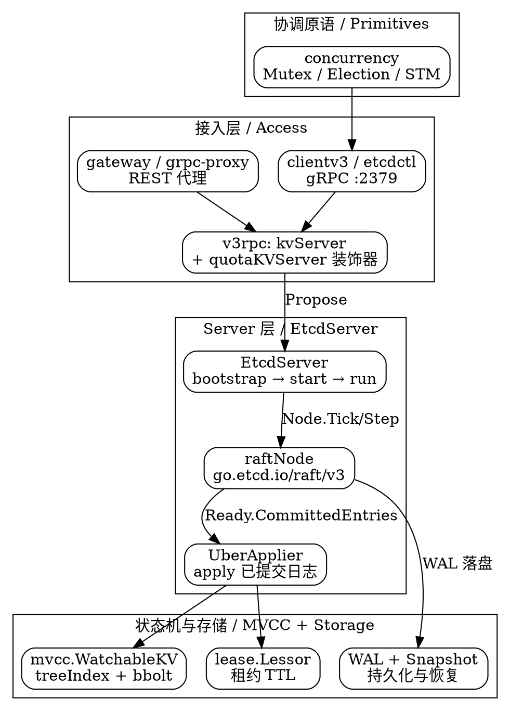

# etcd

## Introduction

etcd 是 Kubernetes 的默认后端存储，也是一个通用的强一致键值仓库：用 Raft 复制日志、用 MVCC + bbolt 落地状态机，对外暴露 gRPC API，并可选 TLS / RBAC。理解 etcd 的钥匙是把它拆成「接入 → 共识 → 状态机 → 存储」四层，顺着一次写请求自上而下看：gRPC 入口做完参数校验与配额检查后打包成提案，Raft 达成多数派提交，apply 模块把日志应用到 MVCC，最终落入 bbolt。

> 版本基线：etcd 3.7.4（commit 2e8a5c99，Go 1.26）。Raft 自 3.7 起外置为独立 module `go.etcd.io/raft/v3` v3.7.0，主仓库只有调用侧（见 `server/etcdserver/raft.go`）。以下片段均取自该 tag。

3.7.4 相对旧资料的几个反直觉点：

- **启动不再是扁平的 `NewServer` 直接建对象**：3.7 引入 `bootstrap(cfg)` 阶段机，先建 backend / WAL / cluster / storage，最后才 `bootstrapRaft`；且完全从 v3store 启动，`buildConfStateFromV3store` 从 backend 读成员重建 `ConfState`——v2store 已被移除。
- **quota 检查不在 `kvServer.Put` 里**：它被包成 `quotaKVServer` 装饰器，`Put` / `Txn` 先过 `qa.check` 再委派给真正的 KVServer；超限不是简单报错，而是发 `NOSPACE` alarm 并置集群只读。
- **`alarmStore` 不是 map + 锁**：3.7.4 改为 `atomic.Pointer[v3alarm.AlarmStore]`，配合 patch 修复并发访问告警存储的竞态。

## Architecture

四层架构如下。实线是一次写请求自上而下的主链路；Raft 通过 `Ready` 五步与 apply 模块交互；协调原语（锁 / 选举 / STM）建立在客户端之上，安全横切传输层。



下面四段源码是这条主链路的骨架。

### The Bootstrap Chain

进程入口 `startEtcdOrProxyV2` 调 `server/embed` 的 `StartEtcd`：先做配置校验、建 peer / client listener，再构造 `ServerConfig`。注意它返回时**不保证已加入集群**，调用方要等 `ReadyNotify()`：

```go
func StartEtcd(inCfg *Config) (e *Etcd, err error) {
	if err = inCfg.Validate(); err != nil {
		return nil, err
	}
	serving := false
	e = &Etcd{cfg: *inCfg, stopc: make(chan struct{})}
	cfg := &e.cfg
	defer func() {
		if e == nil || err == nil {
			return
		}
		if !serving {
			// errored before starting gRPC server for serveCtx.serversC
			for _, sctx := range e.sctxs {
				sctx.close()
			}
		}
		e.Close()
		e = nil
	}()

	if e.Peers, err = configurePeerListeners(cfg); err != nil {
		return e, err
	}
	if e.sctxs, err = configureClientListeners(cfg); err != nil {
		return e, err
	}
	// ... 省略 ServerConfig 装配
	if e.Server, err = etcdserver.NewServer(srvcfg); err != nil {
		return e, err
	}
```

`NewServer` 第一跳不是建对象，而是 `bootstrap(cfg)`——一个把 backend / WAL / cluster / storage / raft 依次装配的阶段机：

```go
func bootstrap(cfg config.ServerConfig) (b *bootstrappedServer, err error) {
	if terr := fileutil.TouchDirAll(cfg.Logger, cfg.DataDir); terr != nil {
		return nil, fmt.Errorf("cannot access data directory: %w", terr)
	}
	ss := bootstrapSnapshot(cfg)
	prt, err := rafthttp.NewRoundTripper(cfg.PeerTLSInfo, cfg.PeerDialTimeout())
	if err != nil {
		return nil, err
	}

	haveWAL := wal.Exist(cfg.WALDir())
	backend, err := bootstrapBackend(cfg, haveWAL)
	if err != nil {
		return nil, err
	}
	var bwal *bootstrappedWAL
	if haveWAL {
		bwal, err = bootstrapWALFromSnapshot(cfg, backend.snapshot, backend.ci)
		if err != nil {
			backend.Close()
			return nil, err
		}
	}

	cfg.Logger.Info("bootstrapping cluster")
	cluster, err := bootstrapCluster(cfg, bwal, prt)
	if err != nil {
		backend.Close()
		return nil, err
	}
	s := bootstrapStorage(cfg, backend, bwal, cluster)
	if err = cluster.Finalize(cfg, s); err != nil {
		backend.Close()
		return nil, err
	}

	cfg.Logger.Info("bootstrapping raft")
	raft := bootstrapRaft(cfg, cluster, s.wal)
	return &bootstrappedServer{
		prt: prt, ss: ss, storage: s, cluster: cluster, raft: raft,
	}, nil
}
```

3.7 的关键变化是 `ConfState` 不再从 v2store 读，而是从 backend 的成员表重建：

```go
func buildConfStateFromV3store(lg *zap.Logger, be backend.Backend) raftpb.ConfState {
	members, _ := schema.NewMembershipBackend(lg, be).MustReadMembersFromBackend()
	var (
		voters   []uint64
		learners []uint64
	)
	for _, m := range members {
		if m.IsLearner {
			learners = append(learners, uint64(m.ID))
		} else {
			voters = append(voters, uint64(m.ID))
		}
	}
	return raftpb.ConfState{Voters: voters, Learners: learners}
}
```

### The Server Core

`EtcdServer` 是所有核心组件的聚合点。注意几个 3.7 的特征：`appliedIndex` / `committedIndex` / `term` / `lead` 用原子类型且刻意保持 64 位对齐（`r raftNode` 紧随其后并注明 keep 64-bit aligned）；`alarmStore` 是 `atomic.Pointer`；apply 路径统一为 `uberApply apply.UberApplier`：

```go
type EtcdServer struct {
	// inflightSnapshots holds count the number of snapshots currently inflight.
	inflightSnapshots atomic.Int64
	appliedIndex      atomic.Uint64
	committedIndex    atomic.Uint64
	term              atomic.Uint64
	lead              atomic.Uint64

	consistIndex cindex.ConsistentIndexer // consistIndex is used to get/set/save consistentIndex
	r            raftNode                 // uses 64-bit atomics; keep 64-bit aligned.

	readych chan struct{}
	Cfg     config.ServerConfig

	read *read.Read

	cluster *membership.RaftCluster
	snapshotter *snap.Snapshotter

	uberApply apply.UberApplier
	applyWait wait.WaitTime

	kv         mvcc.WatchableKV
	lessor     lease.Lessor
	be         backend.Backend
	authStore  auth.AuthStore
	alarmStore atomic.Pointer[v3alarm.AlarmStore]
	// ... 省略 stats / compactor / wg 等字段
}
```

`Start()` 把 `start()` 之后的一批后台循环挂到 `GoAttach`：`adjustTicks`、`publishV3`、`LinearizableReadLoop`、`monitorKVHash`、`monitorCompactHash` 等，服务器主体在 `run()` 里驱动。

### Write Path and Quota

写请求进入 `server/etcdserver/api/v3rpc` 时，真正注册到 gRPC 的不是裸 `kvServer`，而是 `NewQuotaKVServer` 返回的装饰器。`Put` / `Txn` 先做配额检查，通过后才委派：

```go
type quotaKVServer struct {
	pb.KVServer
	qa quotaAlarmer
}

func (qa *quotaAlarmer) check(ctx context.Context, r any) error {
	if qa.q.Available(r) {
		return nil
	}
	req := &pb.AlarmRequest{
		MemberID: uint64(qa.id),
		Action:   pb.AlarmRequest_ACTIVATE,
		Alarm:    pb.AlarmType_NOSPACE,
	}
	qa.a.Alarm(ctx, req)
	return rpctypes.ErrGRPCNoSpace
}

func NewQuotaKVServer(s *etcdserver.EtcdServer) pb.KVServer {
	return &quotaKVServer{
		NewKVServer(s),
		quotaAlarmer{newBackendQuota(s, "kv"), s, s.MemberID()},
	}
}

func (s *quotaKVServer) Put(ctx context.Context, r *pb.PutRequest) (*pb.PutResponse, error) {
	if err := s.qa.check(ctx, r); err != nil {
		return nil, err
	}
	return s.KVServer.Put(ctx, r)
}
```

被装饰的 `kvServer.Put` 本身只做参数校验，然后调内部 `s.kv.Put`，最后 `hdr.fill` 填响应头：

```go
func (s *kvServer) Put(ctx context.Context, r *pb.PutRequest) (*pb.PutResponse, error) {
	if err := checkPutRequest(r); err != nil {
		return nil, err
	}
	resp, err := s.kv.Put(ctx, r)
	if err != nil {
		return nil, togRPCError(err)
	}
	s.hdr.fill(resp.Header)
	return resp, nil
}
```

> [!WARNING]
> 把「超限后调大 `quota-backend-bytes` 就能恢复写入」当成结论是错的。`check` 触发的是一条经 Raft 同步并持久化的 `NOSPACE` alarm，apply 路径会持续检查告警并拒绝写入；必须 `etcdctl alarm disarm` 消除告警后集群才恢复可写。详见 [troubleshooting](/docs/CS/Framework/etcd/troubleshooting.md)。

### Raft as an External Module

`raftNode` 是 etcd 与外置 raft 库的边界：它内嵌 `raftNodeConfig`（含 `raft.Node`、`raftStorage *raft.MemoryStorage`、`storage`、`transport`），并用一组 channel 把 raft 的输出接到 server——`applyc` 送待 apply 的条目、`readStateC` 送 ReadIndex 结果、`msgSnapC` 送快照消息：

```go
type raftNode struct {
	lg *zap.Logger

	tickMu *sync.RWMutex
	// timestamp of the latest tick
	latestTickTs time.Time
	raftNodeConfig

	// a chan to send/receive snapshot
	msgSnapC chan *raftpb.Message
	// a chan to send out apply
	applyc chan toApply
	// a chan to send out readState
	readStateC chan raft.ReadState

	ticker *time.Ticker
	td     *contention.TimeoutDetector
	stopped chan struct{}
	done    chan struct{}
}

type raftNodeConfig struct {
	lg *zap.Logger
	isIDRemoved func(id uint64) bool
	raft.Node
	raftStorage *raft.MemoryStorage
	storage     serverstorage.Storage
	heartbeat   time.Duration // for logging
	transport   rafthttp.Transporter
}
```

> [!NOTE]
> 主仓库对 raft 的调用侧在 `server/etcdserver/raft.go`，共识算法本身已迁到 `go.etcd.io/raft/v3` v3.7.0。本目录的 [raft](/docs/CS/Framework/etcd/raft.md) 讲的是 etcd 侧如何消费 `Ready`、落盘与做线性读；算法细节见 [Raft 共识算法](/docs/CS/Distributed/Consensus/Raft.md)。

## Links

- [boot（启动与生命周期）](/docs/CS/Framework/etcd/boot.md)
- [request（请求处理路径）](/docs/CS/Framework/etcd/request.md)
- [raft（共识模块调用侧）](/docs/CS/Framework/etcd/raft.md)
- [MVCC（多版本状态机）](/docs/CS/Framework/etcd/MVCC.md)
- [read（线性读与 ReadIndex）](/docs/CS/Framework/etcd/read.md)
- [cluster（成员、快照与恢复）](/docs/CS/Framework/etcd/cluster.md)
- [Raft 共识算法](/docs/CS/Distributed/Consensus/Raft.md)

## References

1. [etcd v3.7.4 源码（server/embed/etcd.go）](https://github.com/etcd-io/etcd/blob/v3.7.4/server/embed/etcd.go)
2. [etcd v3.7.4 源码（server/etcdserver/bootstrap.go）](https://github.com/etcd-io/etcd/blob/v3.7.4/server/etcdserver/bootstrap.go)
3. [etcd v3.7.4 源码（server/etcdserver/api/v3rpc/quota.go）](https://github.com/etcd-io/etcd/blob/v3.7.4/server/etcdserver/api/v3rpc/quota.go)
4. [Announcing etcd v3.7.0](https://etcd.io/blog/2026/announcing-etcd-3.7/)
5. [etcd 官方文档](https://etcd.io/docs/)
