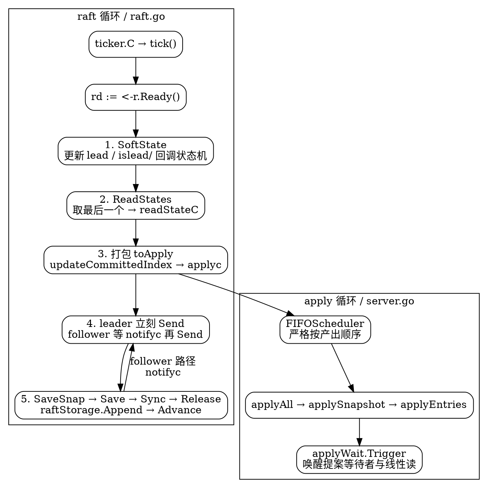

# Raft on the EtcdServer Side

## Introduction

「在 etcd 源码里读 Raft 实现」在 3.7 已经不成立：共识算法外置为 `go.etcd.io/raft/v3` v3.7.0，主仓库里既没有 `raft/` 目录，也没有 `raft_node.go`。本文讲的是**调用侧**——`server/etcdserver/raft.go` 的一个事件循环，加上 `EtcdServer` 里消费 `Ready` 的状态机。

> 版本基线：etcd 3.7.4（commit 2e8a5c99，Go 1.26）。Raft 自 3.7 起外置为独立 module `go.etcd.io/raft/v3` v3.7.0，主仓库只有调用侧。以下片段均取自该 tag。

四个先要扭转的直觉：

- **`raftNode` 定义在 `server/etcdserver/raft.go`**，不在 `raft_node.go`；`raftNodeConfig` 用**内嵌 `raft.Node`** 而非具名字段，所以 `r.Tick()` / `r.Ready()` / `r.Advance()` / `r.Step()` 都是接口方法的直接转发。
- **`Ready` 的消费顺序被 etcd 改了一处**：先投 `applyc`，leader 随即发消息，之后才落盘——这是 Raft 论文 10.2.1 的并行优化；follower 反而必须等 `notifyc`（落盘完成）才发。
- **两个 `Storage` 同名不同物**：raft 包的 `Storage` 已随算法外置；`server/storage` 里还有一个 etcd 自己的 `Storage`，服务的是 WAL / snapshot，方法集是 `Save` / `SaveSnap` / `Close` / `Release` / `Sync` / `MinimalEtcdVersion`。
- **`notifyc` 与 `raftAdvancedC` 容量都是 1**，且后者只在 `Ready` 含 `EntryConfChange` 时才写——整个「raft 循环 ↔ apply 循环」的同步都建立在这个一次性信号上。

## The Boundary: What Lives Where

「外置」意味着主仓库里既没有定义、也没有直接引用其内部字段，只能通过接口与 `raftpb` 数据契约交互。

| 符号 | 归属 | 主仓库接触点 |
| :--- | :--- | :--- |
| `raft`（状态机本体）、`StateType` / `StateLeader` | 外置 | 只用常量 `raft.StateLeader`、`raft.None` |
| `Node` 接口、`node` 实现、`RawNode`、`Config`、`Status` | 外置 | `raftNodeConfig` 内嵌 `raft.Node`，直接调方法 |
| `Ready`、`MemoryStorage`、`ReadState` | 外置 | `rd := <-r.Ready()`、`raftStorage *raft.MemoryStorage` |
| `readOnly`（`addRequest` / `advance` / `recvAck`）、`log` / `unstable` / `tracker.*` | 外置 | **零引用**，只经 `rd.ReadStates` 间接使用 |
| `raftpb.Message` / `Entry` / `HardState` / `Snapshot` / `ConfChange` | 外置 | 大量使用，是两侧的数据契约 |
| `raftNode`、`raftNodeConfig`、`toApply`、`raftReadyHandler` | **主仓库** | `server/etcdserver/raft.go`、`server.go` |
| `WAL`、`Snapshotter`、`serverstorage.Storage` | **主仓库** | `server/storage/`、`server/etcdserver/api/snap/` |
| `contrib/raftexample` | **主仓库** | `package main`，无独立 `go.mod` |
| `Mutex`（客户端选主锁） | **主仓库** | `client/v3/concurrency/mutex.go`，与 raft 无关 |

> [!WARNING]
> 最容易导致整篇分析跑偏的是 `Storage` 接口。raft 包的 `Storage`（`InitialState` / `Entries` / `Term` / `LastIndex`）已随算法外置；etcd 自己的 `serverstorage.Storage` 是另一个同名接口，服务于 WAL 恢复。两者不要混谈。

## raftNode, raftNodeConfig and toApply

`toApply` 是跨两个 goroutine 的数据包，两个 channel 各管一件事：

```go
// toApply contains entries, snapshot to be applied. Once
// an toApply is consumed, the entries will be persisted to
// raft storage concurrently; the application must read
// notifyc before assuming the raft messages are stable.
type toApply struct {
	entries  []*raftpb.Entry
	snapshot *raftpb.Snapshot
	// notifyc synchronizes etcd server applies with the raft node
	notifyc chan struct{}
	// raftAdvancedC notifies EtcdServer.apply that
	// 'raftLog.applied' has advanced by r.Advance
	// it should be used only when entries contain raftpb.EntryConfChange
	raftAdvancedC <-chan struct{}
}
```

- `notifyc`：**落盘完成信号**。`applyAll` 在 `<-apply.notifyc` 之后才敢触发快照，否则 applied index 可能超过 raft storage 的 last index。
- `raftAdvancedC`：**只在含 `EntryConfChange` 时使用**，保证回应客户端前 raft 层已确认 `applied` 推进（对应 issue #15528）。

`raftNodeConfig` 内嵌 `raft.Node`；`raftNode` 本体只加了三类东西：apply / readState / msgSnap 三个信道、`tickMu` 保护的 tick 时间戳、心跳超时检测器 `td`：

```go
type raftNodeConfig struct {
	lg *zap.Logger

	// to check if msg receiver is removed from cluster
	isIDRemoved func(id uint64) bool
	raft.Node
	raftStorage *raft.MemoryStorage
	storage     serverstorage.Storage
	heartbeat   time.Duration // for logging
	// transport specifies the transport to send and receive msgs to members.
	// Sending messages MUST NOT block. It is okay to drop messages, since
	// clients should timeout and reissue their messages.
	// If transport is nil, server will panic.
	transport rafthttp.Transporter
}

type raftNode struct {
	lg *zap.Logger

	tickMu *sync.RWMutex
	// timestamp of the latest tick
	latestTickTs time.Time
	raftNodeConfig

	// a chan to send/receive snapshot
	msgSnapC chan *raftpb.Message

	// a chan to send out apply
	applyc chan toApply

	// a chan to send out read state
	readStateC chan raft.ReadState

	// utility
	ticker *time.Ticker
	// contention detectors for raft heartbeat message
	td *contention.TimeoutDetector

	stopped chan struct{}
	done    chan struct{}
}
```

`newRaftNode` 里有一个隐蔽分支：`heartbeat` 为 0 时建零值 `time.Ticker{}`，其 `C` 是 nil channel，于是 tick 分支永不触发。`tick()` 用独立锁保护，因为外置库内部不加锁：

```go
// raft.Node does not have locks in Raft package
func (r *raftNode) tick() {
	r.tickMu.Lock()
	r.Tick()
	r.latestTickTs = time.Now()
	r.tickMu.Unlock()
}
```

## Decoupling via raftReadyHandler

raft 循环需要回调状态机，但不该知道状态机的存在。`raftReadyHandler` 是这层薄接口，5 个字段全部在 `EtcdServer.run()` 里用闭包实现：

```go
type raftReadyHandler struct {
	getLead              func() (lead uint64)
	updateLead           func(lead uint64)
	updateLeadership     func(newLeader bool)
	updateCommittedIndex func(uint64)
}
```

```go
	rh := &raftReadyHandler{
		getLead:    func() (lead uint64) { return s.getLead() },
		updateLead: func(lead uint64) { s.setLead(lead) },
		updateLeadership: func(newLeader bool) {
			if !s.isLeader() {
				if s.lessor != nil {
					s.lessor.Demote()
				}
				if s.compactor != nil {
					s.compactor.Pause()
				}
			} else {
				if newLeader {
					t := time.Now()
					s.leadTimeMu.Lock()
					s.leadElectedTime = t
					s.leadTimeMu.Unlock()
				}
				if s.compactor != nil {
					s.compactor.Resume()
				}
			}
			if newLeader {
				s.leaderChanged.Notify()
			}
			// TODO: remove the nil checking
			// current test utility does not provide the stats
			if s.stats != nil {
				s.stats.BecomeLeader()
			}
		},
		updateCommittedIndex: func(ci uint64) {
			cci := s.getCommittedIndex()
			if ci > cci {
				s.setCommittedIndex(ci)
			}
		},
	}
	s.r.start(rh)
```

注意 `updateLeadership` **不负责 `lessor.Promote()`**——`Promote` 是在 apply 到 leader 的 noop entry 时才调用，细节见 [lease](/docs/CS/Framework/etcd/lease.md)。`EtcdServer.Start()` 则把线性读循环挂到后台：

```go
func (s *EtcdServer) Start() {
	s.start()
	s.GoAttach(func() { s.adjustTicks() })
	s.GoAttach(func() { s.publishV3(s.Cfg.ReqTimeout()) })
	s.GoAttach(s.purgeFile)
	s.GoAttach(func() { monitorFileDescriptor(s.Logger(), s.stopping) })
	s.GoAttach(s.monitorClusterVersions)
	s.GoAttach(s.monitorStorageVersion)
	s.GoAttach(s.read.LinearizableReadLoop)
	s.GoAttach(s.monitorKVHash)
	s.GoAttach(s.monitorCompactHash)
	s.GoAttach(s.monitorDowngrade)
}
```

## The Ready Loop: Five Steps

`Ready` 的字段全部只读，且处理顺序有强约束（先落盘、再发消息、最后 apply）。etcd 把顺序改了一处：**先投 `applyc`**。下面五步都在 `raftNode.start(rh)` 的 goroutine 里。



### Step 1: SoftState —— Acknowledge Leadership

`islead` 是本轮循环的局部变量，第 4 步的「leader 先发消息」完全依赖它；`newLeader` 的判定是「有 leader 且与上次不同」：

```go
		case rd := <-r.Ready():
			if rd.SoftState != nil {
				newLeader := rd.SoftState.Lead != raft.None && rh.getLead() != rd.SoftState.Lead
				if newLeader {
					leaderChanges.Inc()
				}

				if rd.SoftState.Lead == raft.None {
					hasLeader.Set(0)
				} else {
					hasLeader.Set(1)
				}

				rh.updateLead(rd.SoftState.Lead)
				islead = rd.RaftState == raft.StateLeader
				if islead {
					isLeader.Set(1)
				} else {
					isLeader.Set(0)
				}
				rh.updateLeadership(newLeader)
				r.td.Reset()
			}
```

### Step 2: ReadStates —— Feed Linearizable Read

`internalTimeout` 是 `time.Second`。只取**最后一个** `ReadState`：`readStateC` 容量为 1，前面的要么已被消费、要么被覆盖——线性读要的是「当前已确认的最新 read index」。

```go
			if len(rd.ReadStates) != 0 {
				select {
				case r.readStateC <- rd.ReadStates[len(rd.ReadStates)-1]:
				case <-time.After(internalTimeout):
					r.lg.Warn("timed out sending read state", zap.Duration("timeout", internalTimeout))
				case <-r.stopped:
					return
				}
			}
```

消费方是 `read` 包，见 [read](/docs/CS/Framework/etcd/read.md)。

### Step 3: Package toApply and Submit

两次 `proto.Clone`：一份给本循环落盘，一份跨 goroutine 活到 `applyAll` 执行完。`updateCommittedIndex` 取末条 entry 与 snapshot index 的较大者，只在非 0 时回调：

```go
			committedEntries := rd.CommittedEntries
			notifyc := make(chan struct{}, 1)
			raftAdvancedC := make(chan struct{}, 1)
			raftSnap := proto.Clone(rd.Snapshot).(*raftpb.Snapshot)
			ap := toApply{
				entries:       committedEntries,
				snapshot:      proto.Clone(rd.Snapshot).(*raftpb.Snapshot),
				notifyc:       notifyc,
				raftAdvancedC: raftAdvancedC,
			}

			updateCommittedIndex(&ap, rh)

			select {
			case r.applyc <- ap:
			case <-r.stopped:
				return
			}
```

`applyc` 是**无缓冲**信道，会阻塞直到 `EtcdServer.run()` 的调度器接走；FIFO 调度保证 apply 严格按 raft 产出顺序执行：

```go
		case ap := <-s.r.apply():
			f := schedule.NewJob("server_applyAll", func(context.Context) { s.applyAll(&ep, &ap) })
			sched.Schedule(f)
```

`applyAll` 的第一行是 `applySnapshot`，第二行 `applyEntries`，之后还有 3.7 新增的一致性校验与 `<-apply.notifyc` 等待：

```go
func (s *EtcdServer) applyAll(ep *etcdProgress, apply *toApply) {
	s.applySnapshot(ep, apply)
	s.applyEntries(ep, apply)
	backend.VerifyBackendConsistency(s.Backend(), s.Logger(), true, schema.AllBuckets...)

	proposalsApplied.Set(float64(ep.appliedi))
	s.applyWait.Trigger(ep.appliedi)

	// wait for the raft routine to finish the disk writes before triggering a
	// snapshot. or applied index might be greater than the last index in raft
	// storage, since the raft routine might be slower than toApply routine.
	<-apply.notifyc

	s.snapshotIfNeededAndCompactRaftLog(ep)
	select {
	// snapshot requested via send()
	case m := <-s.r.msgSnapC:
		merged := s.createMergedSnapshotMessage(m, ep.appliedt, ep.appliedi, ep.confState)
		s.sendMergedSnap(merged)
	default:
	}
}
```

> [!NOTE]
> `applyAll` / `applySnapshot` 的参数类型是 `*toApply`，`apply` 只是形参名，不要和 `EtcdServer.apply()` 方法混淆。

### Step 4: Persist to Disk

顺序被注释严格约束：`SaveSnap` 必须早于 `Save`。快照分支里的 `Sync()` 早于 `Release()`，否则会触发 issue #10219 的 `tocommit is out of range` panic。

```go
			// Must save the snapshot file and WAL snapshot entry before saving any other entries or hardstate to
			// ensure that recovery after a snapshot restore is possible.
			if !raft.IsEmptySnap(raftSnap) {
				// gofail: var raftBeforeSaveSnap struct{}
				if err := r.storage.SaveSnap(raftSnap); err != nil {
					r.lg.Fatal("failed to save Raft snapshot", zap.Error(err))
				}
				// gofail: var raftAfterSaveSnap struct{}
			}

			// gofail: var raftBeforeSave struct{}
			if err := r.storage.Save(rd.HardState, rd.Entries); err != nil {
				r.lg.Fatal("failed to save Raft hard state and entries", zap.Error(err))
			}
			if !raft.IsEmptyHardState(rd.HardState) {
				proposalsCommitted.Set(float64(rd.HardState.GetCommit()))
			}
			// gofail: var raftAfterSave struct{}

			if !raft.IsEmptySnap(raftSnap) {
				// Force WAL to fsync its hard state before Release() releases
				// old data from the WAL. Otherwise could get an error like:
				// panic: tocommit(107) is out of range [lastIndex(84)]. Was the raft log corrupted, truncated, or lost?
				// See https://github.com/etcd-io/etcd/issues/10219 for more details.
				if err := r.storage.Sync(); err != nil {
					r.lg.Fatal("failed to sync Raft snapshot", zap.Error(err))
				}

				// etcdserver now claim the snapshot has been persisted onto the disk
				notifyc <- struct{}{}

				// gofail: var raftBeforeApplySnap struct{}
				r.raftStorage.ApplySnapshot(raftSnap)
				r.lg.Info("applied incoming Raft snapshot", zap.Uint64("snapshot-index", raftSnap.Metadata.GetIndex()))
				// gofail: var raftAfterApplySnap struct{}

				if err := r.storage.Release(raftSnap); err != nil {
					r.lg.Fatal("failed to release Raft wal", zap.Error(err))
				}
				// gofail: var raftAfterWALRelease struct{}
			}

			r.raftStorage.Append(rd.Entries)
```

### Step 5: Send Message + Advance

leader 在**投完 `applyc` 之后立刻发**（不等落盘），这是论文 10.2.1 的并行优化。follower 路径必须等落盘，且若本批含 `EntryConfChange` 还要再等一次 apply：

```go
			// the leader can write to its disk in parallel with replicating to the followers and then
			// writing to their disks.
			// For more details, check raft thesis 10.2.1
			if islead {
				// gofail: var raftBeforeLeaderSend struct{}
				r.transport.Send(r.processMessages(rd.Messages))
			}
```

```go
			confChanged := false
			for _, ent := range rd.CommittedEntries {
				if ent.GetType() == raftpb.EntryConfChange {
					confChanged = true
					break
				}
			}

			if !islead {
				// finish processing incoming messages before we signal notifyc chan
				msgs := r.processMessages(rd.Messages)

				// now unblocks 'applyAll' that waits on Raft log disk writes before triggering snapshots
				notifyc <- struct{}{}

				// Candidate or follower needs to wait for all pending configuration
				// changes to be applied before sending messages.
				// Otherwise we might incorrectly count votes (e.g. votes from removed members).
				// Also slow machine's follower raft-layer could proceed to become the leader
				// on its own single-node cluster, before toApply-layer applies the config change.
				// We simply wait for ALL pending entries to be applied for now.
				// We might improve this later on if it causes unnecessary long blocking issues.

				if confChanged {
					// blocks until 'applyAll' calls 'applyWait.Trigger'
					// to be in sync with scheduled config-change job
					// (assume notifyc has cap of 1)
					select {
					case notifyc <- struct{}{}:
					case <-r.stopped:
						return
					}
				}

				// gofail: var raftBeforeFollowerSend struct{}
				r.transport.Send(msgs)
			} else {
				// leader already processed 'MsgSnap' and signaled
				notifyc <- struct{}{}
			}

			// gofail: var raftBeforeAdvance struct{}
			r.Advance()

			if confChanged {
				// notify etcdserver that raft has already been notified or advanced.
				raftAdvancedC <- struct{}{}
			}
```

## Message Filtering

发出去之前每条消息过一遍筛，规则在 `processMessages`：

| 规则 | 动作 | 理由 |
| :--- | :--- | :--- |
| `r.isIDRemoved(m.GetTo())` | 丢弃 | 收件人已被移出集群 |
| 多个 `MsgAppResp` | 只留最后一个（`sentAppResp` 标记） | 同一批里的多个 ack 冗余 |
| `MsgSnap` | 转投 `r.msgSnapC`（容量 16，满则丢） | 需与 v3 KV 快照合并，不能由 raft 层直接处理 |
| `MsgHeartbeat` | `r.td.Observe(m.GetTo())`，超时则计数并 WARN | 检测 leader 磁盘过慢 |

```go
func (r *raftNode) processMessages(ms []*raftpb.Message) []*raftpb.Message {
	sentAppResp := false
	keep := make([]bool, len(ms))
	count := 0
	for i := len(ms) - 1; i >= 0; i-- {
		m := ms[i]
		if r.isIDRemoved(m.GetTo()) {
			continue
		}

		if m.GetType() == raftpb.MsgAppResp {
			if sentAppResp {
				continue
			}
			sentAppResp = true
		}

		if m.GetType() == raftpb.MsgSnap {
			// There are two separate data store: the store for v2, and the KV for v3.
			// The msgSnap only contains the most recent snapshot of store without KV.
			// So we need to redirect the msgSnap to etcd server main loop for merging in the
			// current store snapshot and KV snapshot.
			select {
			case r.msgSnapC <- m:
			default:
				// drop msgSnap if the inflight chan if full.
			}
			continue
		}
		if m.GetType() == raftpb.MsgHeartbeat {
			ok, exceed := r.td.Observe(m.GetTo())
			if !ok {
				// TODO: limit request rate.
				r.lg.Warn(
					"leader failed to send out heartbeat on time; took too long, leader is overloaded likely from slow disk",
					zap.String("to", fmt.Sprintf("%x", m.GetTo())),
					zap.Duration("heartbeat-interval", r.heartbeat),
					zap.Duration("expected-duration", 2*r.heartbeat),
					zap.Duration("exceeded-duration", exceed),
				)
				heartbeatSendFailures.Inc()
			}
		}
		keep[i] = true
		count++
	}
	// ... 省略按 keep 重建 messages ...
	return messages
}
```

> [!TIP]
> `maxInFlightMsgSnap = 16` 是背压设计：`select` + `default` 意味着**满了就丢快照消息**而不是阻塞 raft 循环。快照可由后续 `MsgApp` 重新触发，阻塞 raft 循环的代价更高。

## WAL: The Stable Storage That Stays

raft 算法外置了，但**持久化全在主仓库**。etcd 的稳定存储是两层：`WAL`（追加日志）+ `Snapshotter`（快照文件）。`server/storage` 的 `Storage` 接口服务的是 WAL 而非 raft 状态机：

```go
type Storage interface {
	// Save function saves ents and state to the underlying stable storage.
	// Save MUST block until st and ents are on stable storage.
	Save(st *raftpb.HardState, ents []*raftpb.Entry) error
	// SaveSnap function saves snapshot to the underlying stable storage.
	SaveSnap(snap *raftpb.Snapshot) error
	// Close closes the Storage and performs finalization.
	Close() error
	// Release releases the locked wal files older than the provided snapshot.
	Release(snap *raftpb.Snapshot) error
	// Sync WAL
	Sync() error
	// MinimalEtcdVersion returns minimal etcd storage able to interpret WAL log.
	MinimalEtcdVersion() *semver.Version
}
```

`SaveSnap` 先把快照文件写盘、再写 WAL 快照记录——宁可留下孤儿快照文件，也不能让 WAL 记录指向不存在的快照：

```go
func (st *storage) SaveSnap(snap *raftpb.Snapshot) error {
	st.mux.RLock()
	defer st.mux.RUnlock()
	walsnap := walpb.Snapshot{
		Index:     snap.Metadata.Index,
		Term:      snap.Metadata.Term,
		ConfState: snap.Metadata.GetConfState(),
	}
	// save the snapshot file before writing the snapshot to the wal.
	// This makes it possible for the snapshot file to become orphaned, but prevents
	// a WAL snapshot entry from having no corresponding snapshot file.
	err := st.s.SaveSnap(snap)
	if err != nil {
		return err
	}
	// gofail: var raftBeforeWALSaveSnaphot struct{}

	return st.w.SaveSnapshot(&walsnap)
}
```

> [!WARNING]
> 接口签名里的 `*raftpb.HardState` / `[]*raftpb.Entry` 看起来像 raft 包类型——它们**确实来自外置库**。所以「raft 的 `Storage` 接口已外置」与「etcd 的 WAL 还在主仓库」同时成立：主仓库通过 `raftpb` 数据契约而非 `raft.Storage` 算法接口与 raft 相连。

## Shutdown Order

`EtcdServer.run()` 的 defer 块注释写明了先后约束：

```go
	defer func() {
		s.wgMu.Lock() // block concurrent waitgroup adds in GoAttach while stopping
		close(s.stopping)
		s.wgMu.Unlock()
		s.cancel()
		sched.Stop()

		// wait for goroutines before closing raft so wal stays open
		s.wg.Wait()

		// must stop raft after scheduler-- etcdserver can leak rafthttp pipelines
		// by adding a peer after raft stops the transport
		s.r.stop()

		s.Cleanup()

		close(s.done)
	}()
```

`raftNode.stop()` 是双向握手——发信号后必须等 `onStop()` 关 `done`；`onStop()` 里 `transport.Stop()` 必须在 `storage.Close()` 之前，否则 rafthttp 可能还在写已关闭的 WAL：

```go
func (r *raftNode) stop() {
	select {
	case r.stopped <- struct{}{}:
		// Not already stopped, so trigger it
	case <-r.done:
		// Has already been stopped - no need to do anything
		return
	}
	// Block until the stop has been acknowledged by start()
	<-r.done
}

func (r *raftNode) onStop() {
	r.Stop()
	r.ticker.Stop()
	r.transport.Stop()
	if err := r.storage.Close(); err != nil {
		r.lg.Panic("failed to close Raft storage", zap.Error(err))
	}
	close(r.done)
}
```

## Log Adapter and Status

外置库要求 `raft.Logger` 接口，`zap_raft.go` 做适配。三个构造器都带 `AddCallerSkip(1)`，因为调用方多跳了一层 `logutil` 包装层：

```go
// NewRaftLogger builds "raft.Logger" from "*zap.Config".
func NewRaftLogger(lcfg *zap.Config) (raft.Logger, error) {
	if lcfg == nil {
		return nil, errors.New("nil zap.Config")
	}
	lg, err := lcfg.Build(zap.AddCallerSkip(1)) // to annotate caller outside of "logutil"
	if err != nil {
		return nil, err
	}
	return &zapRaftLogger{lg: lg, sugar: lg.Sugar()}, nil
}

// NewRaftLoggerZap converts "*zap.Logger" to "raft.Logger".
func NewRaftLoggerZap(lg *zap.Logger) raft.Logger {
	skipCallerLg := lg.WithOptions(zap.AddCallerSkip(1))
	return &zapRaftLogger{lg: skipCallerLg, sugar: skipCallerLg.Sugar()}
}
```

`raft.status` 这个 expvar 用函数间接层：expvar 发布后不能删除、重复发布同名会 panic，所以注册一个固定 func，内部转调可替换的 `raftStatus` 变量（在 `bootstrap.go` 里赋为 `n.Status`）。

```go
var (
	// protects raftStatus
	raftStatusMu sync.Mutex
	// indirection for expvar func interface
	// expvar panics when publishing duplicate name
	// expvar does not support remove a registered name
	// so only register a func that calls raftStatus
	// and change raftStatus as we need.
	raftStatus func() raft.Status
)

func init() {
	expvar.Publish("raft.status", expvar.Func(func() any {
		raftStatusMu.Lock()
		defer raftStatusMu.Unlock()
		if raftStatus == nil {
			return nil
		}
		return raftStatus()
	}))
}
```

## ReadIndex Handoff and Client Mutex

`raftNode` 只把 `ReadState` 转交给 `read` 包，算法细节不在主仓库：

```go
func (r *raftNode) ReadState() <-chan raft.ReadState {
	return r.readStateC
}
```

`client/v3/concurrency/mutex.go` 则是纯客户端代码，用一条 Txn 的比较-写入实现分布式锁，靠 `CreateRevision` 判所有权；「获取失败也要删 key」是在清理自己上一轮的残留：

```go
func (m *Mutex) TryLock(ctx context.Context) error {
	resp, err := m.tryAcquire(ctx)
	if err != nil {
		return err
	}
	// if no key on prefix / the minimum rev is key, already hold the lock
	ownerKey := resp.Responses[1].GetResponseRange().Kvs
	if len(ownerKey) == 0 || ownerKey[0].CreateRevision == m.myRev {
		m.hdr = resp.Header
		return nil
	}
	client := m.s.Client()
	// Cannot lock, so delete the key
	if _, err := client.Delete(ctx, m.myKey); err != nil {
		return err
	}
	m.myKey = "\x00"
	m.myRev = -1
	return ErrLocked
}
```

## Common Pitfalls

- **API 签名照抄老笔记必错**：`applyAll` / `applySnapshot` 的参数是 `*toApply` 而非 `*apply`；`Message` / `Snapshot` 等 protobuf 字段是指针，枚举要 `.Enum()`，字段走 getter（`snap.Metadata.GetIndex()`）。
- **raftexample 的入口是包级 `newRaftNode()`**，不是 `raftNode.start()` 方法；它内部 `go rc.startRaft()`，`startRaft` 里才分叉 `StartNode` / `RestartNode`。
- **raftexample 不调用 `becomeLeader` / `becomeFollower`**（全树零命中），角色切换由外置库内部触发；主仓库 `campaign` 也零命中，靠 `MsgHup` 触发。
- **时序写反是高频错误**：leader 投完 `applyc` 就发消息、不等落盘；follower 必须等落盘，含 `ConfChange` 时还要再等 apply。
- **停机顺序不能反**：`sched.Stop()` / `s.wg.Wait()` 在 `s.r.stop()` 之前，`transport.Stop()` 在 `storage.Close()` 之前。
- **raft 3.6.5 即完成外置**：3.7.4 的 `go.mod` 与 `server/go.mod` 都声明 `go.etcd.io/raft/v3 v3.7.0`，主仓库无 `raft/` 目录、无 `raft_node.go`、无 `tracker` 字符串（含 metrics 层）。

## Links

- [etcd（总览与架构）](/docs/CS/Framework/etcd/etcd.md)
- [request（请求进入提案的路径）](/docs/CS/Framework/etcd/request.md)
- [tracker（ProgressTracker 与流控）](/docs/CS/Framework/etcd/tracker.md)
- [net（网络层与 Pipeline / Stream）](/docs/CS/Framework/etcd/net.md)
- [Raft 共识算法](/docs/CS/Distributed/Consensus/Raft.md)

## References

1. [etcd v3.7.4 源码（server/etcdserver/raft.go）](https://github.com/etcd-io/etcd/blob/v3.7.4/server/etcdserver/raft.go)
2. [etcd v3.7.4 源码（server/etcdserver/server.go）](https://github.com/etcd-io/etcd/blob/v3.7.4/server/etcdserver/server.go)
3. [etcd v3.7.4 源码（server/storage/storage.go）](https://github.com/etcd-io/etcd/blob/v3.7.4/server/storage/storage.go)
4. [etcd v3.7.4 源码（server/etcdserver/zap_raft.go）](https://github.com/etcd-io/etcd/blob/v3.7.4/server/etcdserver/zap_raft.go)
5. [etcd v3.7.4 源码（server/etcdserver/bootstrap.go）](https://github.com/etcd-io/etcd/blob/v3.7.4/server/etcdserver/bootstrap.go)
6. [etcd v3.7.4 源码（contrib/raftexample/raft.go）](https://github.com/etcd-io/etcd/blob/v3.7.4/contrib/raftexample/raft.go)
