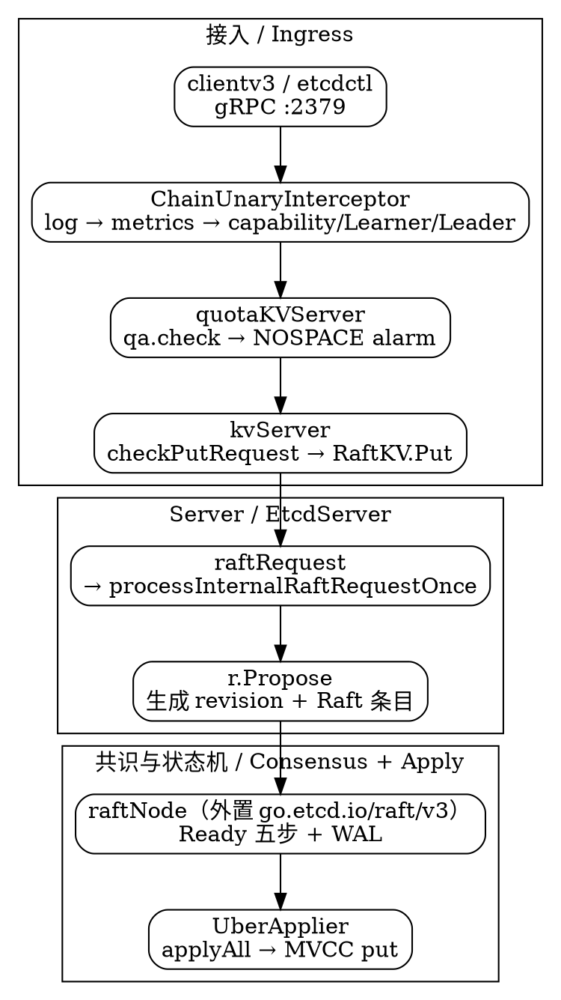

# Request Processing Path

## Introduction

[etcd](/docs/CS/Framework/etcd/etcd.md) 的**请求处理路径**深潜：客户端请求如何经 gRPC 拦截器进入 `KVServer`，quota 模块如何做请求限流（`ErrTooManyRequests` / `ErrRequestTooLarge` / 7s 超时），以及 `get` / `put` 一次读写请求在 etcd server 侧从「进入」到「apply 后返回结果」的全链路。跨模块的提交、apply 与 revision 边界见 [Core_Mechanisms](/docs/CS/Framework/etcd/Core_Mechanisms.md)；启动链见 [boot](/docs/CS/Framework/etcd/boot.md)；Raft 复制、Ready 消费见 [raft](/docs/CS/Framework/etcd/raft.md)；线性读（ReadIndex）机制见 [read](/docs/CS/Framework/etcd/read.md)。
etcd 的请求处理路径，是把一次客户端调用从 gRPC 入口逐层交给共识与状态机的管道：拦截器链做能力与 Leader 前置检查，quota 装饰器挡住空间不足的写，`kvServer` 做参数校验，`EtcdServer` 打包提案交给 Raft。提案之后的复制、落盘与 apply 见 [raft](/docs/CS/Framework/etcd/raft.md)，读一致性见 [read](/docs/CS/Framework/etcd/read.md)。

> 版本基线：etcd 3.7.4（commit 2e8a5c99，Go 1.26）。以下片段均取自该 tag。

三个和旧资料容易对不上的点：

- **gRPC 入口不是单个拦截器**：3.7.4 用 `grpc.ChainUnaryInterceptor` 串起日志、metrics、能力 / Learner / Leader 检查三段；「必须有 Leader」只在客户端带 `RequireLeader` metadata 时才检查，不是所有请求的硬门槛。
- **注册的不是裸 `kvServer`**：gRPC 上挂的是 `NewQuotaKVServer` 返回的装饰器；3.7 还多了 `quotaLeaseServer`，`LeaseGrant` 同样先过配额。超限不是简单报错，而是经 Raft 同步并持久化的 `NOSPACE` alarm。
- **限流不再是单一 5000 间隙**：`exceedsRequestLimit` 同时维护 `maxNormalGap`（5000）与 `maxPriorityGap`（10000）；开启 `PriorityRequest` 时 `LeaseRevoke` 走更宽的间隙。相关错误类型也迁到了 `server/etcdserver/errors` 包。

## The gRPC Service and Interceptor Chain

`KV` service 的 protobuf 定义里，`Range` 负责读，3.7 新增的 `RangeStream` 是**纯 gRPC** 的分块读 RPC（不映射 REST），`Put` / `DeleteRange` / `Txn` 负责写：

```protobuf
service KV {
  // Range gets the keys in the range from the key-value store.
  rpc Range(RangeRequest) returns (RangeResponse) {
      option (google.api.http) = {
        post: "/v3/kv/range"
        body: "*"
    };
  }

  // RangeStream gets the keys in the range from the key-value store.
  //
  // This RPC is intentionally gRPC-only and does not provide a
  // grpc-gateway REST mapping, because streaming chunked responses
  // are not a good fit for standard JSON/REST semantics.
  rpc RangeStream(RangeRequest) returns (stream RangeStreamResponse) {
  }

  // Put puts the given key into the key-value store.
  // A put request increments the revision of the key-value store
  // and generates one event in the event history.
  rpc Put(PutRequest) returns (PutResponse) {
      option (google.api.http) = {
        post: "/v3/kv/put"
        body: "*"
    };
  }
```

`v3rpc.Server` 把拦截器组装成一条链，最后才把 `NewQuotaKVServer(s)` 注册为真正的 `KVServer`：

```go
func Server(s *etcdserver.EtcdServer, tls *tls.Config, interceptor grpc.UnaryServerInterceptor, gopts ...grpc.ServerOption) *grpc.Server {
	var opts []grpc.ServerOption
	opts = append(opts, grpc.CustomCodec(&codec{})) //nolint:staticcheck // TODO: remove for a supported version
	if tls != nil {
		opts = append(opts, grpc.Creds(credentials.NewTransportCredential(tls)))
	}

	serverMetrics := getServerMetrics(s.Cfg.Metrics, s.Cfg.Logger)

	chainUnaryInterceptors := []grpc.UnaryServerInterceptor{
		newLogUnaryInterceptor(s),
		serverMetrics.UnaryServerInterceptor(),
		newUnaryInterceptor(s),
	}
	if interceptor != nil {
		chainUnaryInterceptors = append(chainUnaryInterceptors, interceptor)
	}
	// ... 省略 stream 拦截器、tracing 与 msg size 配置 ...
	opts = append(opts, grpc.ChainUnaryInterceptor(chainUnaryInterceptors...))
	opts = append(opts, grpc.ChainStreamInterceptor(chainStreamInterceptors...))

	grpcServer := grpc.NewServer(append(opts, gopts...)...)

	pb.RegisterKVServer(grpcServer, NewQuotaKVServer(s))
```

真正做前置检查的是 `newUnaryInterceptor`，Leader 检查是**条件触发**的：

```go
func newUnaryInterceptor(s *etcdserver.EtcdServer) grpc.UnaryServerInterceptor {
	return func(ctx context.Context, req any, info *grpc.UnaryServerInfo, handler grpc.UnaryHandler) (any, error) {
		if !api.IsCapabilityEnabled(api.V3rpcCapability) {
			return nil, rpctypes.ErrGRPCNotCapable
		}

		if s.IsMemberExist(s.MemberID()) && s.IsLearner() && !isRPCSupportedForLearner(req) {
			return nil, rpctypes.ErrGRPCNotSupportedForLearner
		}

		md, ok := metadata.FromIncomingContext(ctx)
		if ok {
			ver, vs := "unknown", md.Get(rpctypes.MetadataClientAPIVersionKey)
			if len(vs) > 0 {
				ver = vs[0]
			}
			if !utf8.ValidString(ver) {
				return nil, rpctypes.ErrGRPCInvalidClientAPIVersion
			}
			clientRequests.WithLabelValues("unary", ver).Inc()

			if ks := md[rpctypes.MetadataRequireLeaderKey]; len(ks) > 0 && ks[0] == rpctypes.MetadataHasLeader {
				if s.Leader() == types.ID(raft.None) {
					return nil, rpctypes.ErrGRPCNoLeader
				}
			}
		}

		return handler(ctx, req)
	}
}
```

| 拦截器 / 能力 | 作用 |
| :--- | :--- |
| `newLogUnaryInterceptor` | 记录请求细节，延时超过 `WarningUnaryRequestDuration` 时输出慢查询日志（含来源 IP） |
| `serverMetrics.UnaryServerInterceptor` | 请求计数与延时分布暴露到 Prometheus |
| `newUnaryInterceptor` | capability 校验、Learner 限制、客户端版本合法性、按需 Leader 检查 |
| 可选外部 interceptor | 由调用方注入，追加在链尾 |

## Quota Decorator

写入请求在提案前先过配额检查。`quotaKVServer` 把 `pb.KVServer` 内嵌进来，`Put` / `Txn` 先 `qa.check` 再委派；`quotaLeaseServer` 对 `LeaseGrant` 做同样的事：

```go
type quotaKVServer struct {
	pb.KVServer
	qa quotaAlarmer
}

type quotaAlarmer struct {
	q  storage.Quota
	a  Alarmer
	id types.ID
}

// check whether request satisfies the quota. If there is not enough space,
// ignore request and raise the free space alarm.
func (qa *quotaAlarmer) check(ctx context.Context, r any) error {
	if qa.q.Available(r) {
		return nil
	}
	req := &pb.AlarmRequest{
		MemberID: uint64(qa.id),
		Action:   pb.AlarmRequest_ACTIVATE,
		Alarm:    pb.AlarmType_NOSPACE,
	}
	qa.a.Alarm(ctx, req)
	return rpctypes.ErrGRPCNoSpace
}

func NewQuotaKVServer(s *etcdserver.EtcdServer) pb.KVServer {
	return &quotaKVServer{
		NewKVServer(s),
		quotaAlarmer{newBackendQuota(s, "kv"), s, s.MemberID()},
	}
}

func (s *quotaKVServer) Put(ctx context.Context, r *pb.PutRequest) (*pb.PutResponse, error) {
	if err := s.qa.check(ctx, r); err != nil {
		return nil, err
	}
	return s.KVServer.Put(ctx, r)
}

func (s *quotaKVServer) Txn(ctx context.Context, r *pb.TxnRequest) (*pb.TxnResponse, error) {
	if err := s.qa.check(ctx, r); err != nil {
		return nil, err
	}
	return s.KVServer.Txn(ctx, r)
}
```

> [!WARNING]
> 把「超限后调大 `quota-backend-bytes` 就能恢复写入」当成结论是错的。`check` 触发的是一条经 Raft 同步并持久化的 `NOSPACE` alarm，apply 路径会持续检查告警并拒绝写入；必须 `etcdctl alarm disarm` 消除告警后集群才恢复可写。详见 [troubleshooting](/docs/CS/Framework/etcd/troubleshooting.md)。

配额常量在 `server/storage/quota.go`：`DefaultQuotaBytes` 为 2GB，`MaxQuotaBytes` 为 8GB。不建议超过 8G 的原因是 etcd 不做分片，所有 key-value 落在 bbolt 单 bucket；启动重建 `treeIndex`、提交时 freelist 遍历、查询触发的主缺页中断都会被放大。

## KVServer: Validation and Delegation

被装饰的 `kvServer` 本身只做参数校验，然后委派给 `RaftKV`（即 `*EtcdServer`），最后 `hdr.fill` 填响应头：

```go
type kvServer struct {
	hdr header
	kv  etcdserver.RaftKV
	aa  *AuthAdmin
	// maxTxnOps is the max operations per txn.
	// e.g suppose maxTxnOps = 128.
	// Txn.Success can have at most 128 operations,
	// and Txn.Failure can have at most 128 operations.
	maxTxnOps uint
	// we want compile errors if new methods are added
	pb.UnsafeKVServer
}

func NewKVServer(s *etcdserver.EtcdServer) pb.KVServer {
	return &kvServer{hdr: newHeader(s), kv: s, aa: &AuthAdmin{s}, maxTxnOps: s.Cfg.MaxTxnOps}
}

func (s *kvServer) Range(ctx context.Context, r *pb.RangeRequest) (*pb.RangeResponse, error) {
	if err := checkRangeRequest(r); err != nil {
		return nil, err
	}

	resp, err := s.kv.Range(ctx, r)
	if err != nil {
		return nil, togRPCError(err)
	}

	s.hdr.fill(resp.Header)
	return resp, nil
}

func (s *kvServer) Put(ctx context.Context, r *pb.PutRequest) (*pb.PutResponse, error) {
	if err := checkPutRequest(r); err != nil {
		return nil, err
	}

	resp, err := s.kv.Put(ctx, r)
	if err != nil {
		return nil, togRPCError(err)
	}

	s.hdr.fill(resp.Header)
	return resp, nil
}
```

`checkPutRequest` 现在还校验 `IgnoreValue` / `IgnoreLease` 与显式值的冲突：

```go
func checkPutRequest(r *pb.PutRequest) error {
	if len(r.Key) == 0 {
		return rpctypes.ErrGRPCEmptyKey
	}
	if r.IgnoreValue && len(r.Value) != 0 {
		return rpctypes.ErrGRPCValueProvided
	}
	if r.IgnoreLease && r.Lease != 0 {
		return rpctypes.ErrGRPCLeaseProvided
	}
	return nil
}
```

客户端方法到 `EtcdServer` 实现的映射保持不变：

| KVClient 方法 | 对应 RPC | EtcdServer 实现 |
| :--- | :--- | :--- |
| `Range` / `RangeStream` | `KV/Range`、`KV/RangeStream` | `EtcdServer.Range` / `EtcdServer.RangeStream` |
| `Put` | `KV/Put` | `EtcdServer.Put` |
| `DeleteRange` | `KV/DeleteRange` | `EtcdServer.DeleteRange` |
| `Txn` | `KV/Txn` | `EtcdServer.Txn` |
| `Compact` | `KV/Compact` | `EtcdServer.Compact` |

## Proposal Path and Flow Control

`Put` 不直接碰提案函数，中间隔一层 `raftRequest`：它负责解包 `apply2.Result`、透传 `result.Err`，并修正 trace 的起始时间。

```go
func (s *EtcdServer) Put(ctx context.Context, r *pb.PutRequest) (*pb.PutResponse, error) {
	var span trace.Span
	ctx, span = traceutil.Tracer.Start(ctx, "put", trace.WithAttributes(
		attribute.String("key", string(r.GetKey())),
	))
	defer span.End()

	ctx = context.WithValue(ctx, traceutil.StartTimeKey{}, time.Now())
	resp, err := s.raftRequest(ctx, &pb.InternalRaftRequest{Put: r})
	if err != nil {
		return nil, err
	}
	return resp.(*pb.PutResponse), nil
}

func (s *EtcdServer) raftRequest(ctx context.Context, r *pb.InternalRaftRequest) (proto.Message, error) {
	result, err := s.processInternalRaftRequestOnce(ctx, r)
	if err != nil {
		trace.SpanFromContext(ctx).RecordError(err)
		return nil, err
	}
	if result.Err != nil {
		return nil, result.Err
	}
	// ... 省略 trace 起止时间修正 ...
	return result.Resp, nil
}
```

真正的限流、marshal 与等待都收在 `processInternalRaftRequestOnce`：

```go
func (s *EtcdServer) processInternalRaftRequestOnce(ctx context.Context, r *pb.InternalRaftRequest) (*apply2.Result, error) {
	ai := s.getAppliedIndex()
	ci := s.getCommittedIndex()

	if exceedsRequestLimit(ai, ci, r, s.FeatureEnabled(features.PriorityRequest)) {
		return nil, errors.ErrTooManyRequests
	}

	r.Header = &pb.RequestHeader{
		ID: s.reqIDGen.Next(),
	}

	// check authinfo if it is not InternalAuthenticateRequest
	if r.Authenticate == nil {
		authInfo, err := s.AuthInfoFromCtx(ctx)
		if err != nil {
			return nil, err
		}
		if authInfo != nil {
			r.Header.Username = authInfo.Username
			r.Header.AuthRevision = authInfo.Revision
		}
	}

	var (
		data    []byte
		err     error
		start   = time.Now()
		reqType = getRequestType(r)
	)
	defer func() {
		success := err == nil
		requestDurationSec.WithLabelValues(reqType, strconv.FormatBool(success)).Observe(time.Since(start).Seconds())
	}()

	data, err = proto.Marshal(r)
	if err != nil {
		return nil, err
	}

	if len(data) > int(s.Cfg.MaxRequestBytes) {
		return nil, errors.ErrRequestTooLarge
	}

	id := r.ID
	if id == 0 {
		id = r.Header.ID
	}
	ch := s.w.Register(id)

	cctx, cancel := context.WithTimeout(ctx, s.Cfg.ReqTimeout())
	defer cancel()

	span := trace.SpanFromContext(ctx)
	span.AddEvent("Send raft proposal")
	err = s.r.Propose(cctx, data)
	if err != nil {
		proposalsFailed.Inc()
		s.w.Trigger(id, nil) // GC wait
		return nil, err
	}
	proposalsPending.Inc()
	defer proposalsPending.Dec()

	select {
	case x := <-ch:
		span.AddEvent("Receive raft result")
		return x.(*apply2.Result), nil
	case <-cctx.Done():
		proposalsFailed.Inc()
		s.w.Trigger(id, nil) // GC wait
		return nil, s.parseProposeCtxErr(cctx.Err(), start)
	case <-s.done:
		return nil, errors.ErrStopped
	}
}
```

间隙阈值与空闲判定被抽成了 `exceedsRequestLimit`，`LeaseRevoke` 在 `PriorityRequest` 开启时可用两倍间隙：

```go
const (
	maxGapBetweenApplyAndCommitIndex = 5000
	maxNormalGap                     = maxGapBetweenApplyAndCommitIndex
	maxPriorityGap                   = 2 * maxGapBetweenApplyAndCommitIndex
	traceThreshold                   = 100 * time.Millisecond

	// The timeout for the node to catch up its applied index, and is used in
	// lease related operations, such as LeaseRenew and LeaseTimeToLive.
	applyTimeout = time.Second
)

func exceedsRequestLimit(appliedIndex, committedIndex uint64, r *pb.InternalRaftRequest, enablePriority bool) bool {
	if committedIndex <= appliedIndex+maxNormalGap {
		return false
	}
	if enablePriority && isPriorityRequest(r) {
		if committedIndex <= appliedIndex+maxPriorityGap {
			return false
		}
	}
	return true
}

限流的核心判定在 `EtcdServer.processInternalRaftRequestOnce`：先比 committed / applied 间隙，再生成 request ID、检查包大小，最后才 `Propose`：

```go
// etcdserver/v3_server.go:1058-1133（节选）
func (s *EtcdServer) processInternalRaftRequestOnce(ctx context.Context, r *pb.InternalRaftRequest) (*apply.Result, error) {
    ai := s.getAppliedIndex()
    ci := s.getCommittedIndex()
    if exceedsRequestLimit(ai, ci, r, s.FeatureEnabled(features.PriorityRequest)) {
        return nil, errors.ErrTooManyRequests          // ① 已提交但还未 apply 的日志过多
    }

    r.Header = &pb.RequestHeader{ID: s.reqIDGen.Next()}
    // 认证信息写入 Header 后序列化 data
    if len(data) > int(s.Cfg.MaxRequestBytes) {
        return nil, errors.ErrRequestTooLarge          // ② 包大小超 --max-request-bytes（默认 1.5M）
    }

    ch := s.w.Register(id)
    err = s.r.Propose(cctx, data)
    select {
    case x := <-ch:
        return x.(*apply.Result), nil
    case <-cctx.Done():
        proposalsFailed.Inc()
        s.w.Trigger(id, nil) // 只清理 waiter，不撤回已提交日志
        return nil, s.parseProposeCtxErr(cctx.Err(), start)  // ③ 等待 apply 结果超时（默认 7s）
    case <-s.done:
        return nil, errors.ErrStopped
    }
}
```

| 判定 | 返回错误 | 触发条件 | 默认值 / 出处 |
|---|---|---|---|
| ① apply lag | `ErrTooManyRequests`（"etcdserver: too many requests"） | `committed - applied > maxNormalGap` | 普通请求 5000 |
| ① priority apply lag | 同上 | 仅 feature gate 开启后的 `LeaseRevoke` 可使用 `maxPriorityGap` | `PriorityRequest` 默认 false / Alpha，阈值 10000 |
| ② 包过大 | `ErrRequestTooLarge`（"etcdserver: request is too large"） | `len(data) > MaxRequestBytes` | `--max-request-bytes` 默认 1.5M（1572864） |
| ③ 提案超时 | `ErrTimeout`（"etcdserver: request timed out"） | Propose 或等待 apply 通知超过 ctx 超时（5s 磁盘 IO + 2×1s 竞选超时 ≈ 7s） | 默认 7s |
func isPriorityRequest(r *pb.InternalRaftRequest) bool {
	return r != nil && r.LeaseRevoke != nil
}
```

| 判定 | 返回错误 | 触发条件 | 默认值 |
| :--- | :--- | :--- | :--- |
| apply 落后 | `ErrTooManyRequests` | `committed > applied + maxNormalGap`，priority 请求用 `maxPriorityGap` | 5000 / 10000 |
| 包过大 | `ErrRequestTooLarge` | `len(data) > MaxRequestBytes` | `--max-request-bytes` 默认 1.5M |
| 提案超时 | `ErrTimeout` | 等待 apply 通知超过 ctx 超时 | `5s + 2 × ElectionTimeout`，默认约 7s |

> 限流只挡在写路径入口；读路径（含线性读）不受 quota 约束，其一致性由 [read](/docs/CS/Framework/etcd/read.md) 的 ReadIndex 机制保证。

## Read Path and Message Entry

### 消息入口

一个 v3.7.2 etcd 节点运行后，主要有 3 类消息入口：

1. **client 的 gRPC 调用**：启动时把 quota 增强后的 `KVServer` 注册到 gRPC server；消息解析完后调用 `Range`/`Put`/`DeleteRange`/`Txn`/`Compact`，最终落到 `EtcdServer` 的实现。
2. **peer 的 Raft 消息**：每个 member 通过 `rafthttp.Transport` 与其它成员通信，使用 HTTP/2 流与 POST，而不是 gRPC；`streamReader` 的 `recvc`/`propc` 队列收到消息后交给 `raftNode.Process`。
3. **内部异步事件**：例如 lessor 的过期 lease 批次、apply 调度、snapshot 请求与 compaction barrier。它们不是新的客户端 API，但会驱动写路径与后台状态转换。

v2 的 HTTP `/v2/keys` 入口在 v3.6 已移除，不能再把 v2 handler 当作 3.7.2 的第三条客户端入口。

clientv3 库基于 gRPC 封装了 KVServer / Cluster / Auth / Lease / Watch 等 API，并自带负载均衡与健康探测。其负载均衡算法为 **Round-robin**（每个请求轮询选 endpoint 建长连接）。

> 1. client 版本 ≤ 3.3 时，配多个 endpoint 只会 **Pinned endpoint**（选一个 IP 建一条连接），heavy usage 下可能 server 负载不均。
> 2. client 3.4 之前的负载均衡有严重 Bug：首节点异常可能让 client 访问异常（K8s 场景导致 APIServer 不可用），已在 Kubernetes 1.16 后修复。

### get

```shell
etcdctl get hello --endpoints http://127.0.0.1:2379
```

`get` 对应 `KVClient.Range`：client 经 gRPC 调用 `/etcdserverpb.KV/Range`，server 路由到 handler，先过拦截器链，再进 `KVServer.Range` 取数。
`Range` 在 `Serializable=false`（默认）时先同步一次 ReadIndex，再在 `doSerialize` 里做鉴权并读 MVCC 快照：

```go
	if !r.Serializable {
		err = s.read.LinearizableReadNotify(ctx)
		trace.Step("agreement among raft nodes before linearized reading")
		if err != nil {
			return nil, err
		}
	}
	chk := func(ai *auth.AuthInfo) error {
		return s.authStore.IsRangePermitted(ai, r.Key, r.RangeEnd)
	}

	get := func() { resp, _, err = txn.Range(ctx, s.Logger(), s.KV(), r, true) }
	if serr := s.doSerialize(ctx, chk, get); serr != nil {
		err = serr
		return nil, err
	}
```

节点收到 peer 消息时走 `EtcdServer.Process`，它先把已移出集群的成员和错投消息挡掉，再经内嵌的 `raft.Node.Step` 进入共识层：

```go
func (s *EtcdServer) Process(ctx context.Context, m *raftpb.Message) error {
	lg := s.Logger()
	if s.cluster.IsIDRemoved(types.ID(m.GetFrom())) {
		lg.Warn("rejected Raft message from removed member",
			zap.String("local-member-id", s.MemberID().String()),
			zap.String("removed-member-id", types.ID(m.GetFrom()).String()),
		)
		return httptypes.NewHTTPError(http.StatusForbidden, "cannot process message from removed member")
	}
	if s.MemberID() != types.ID(m.GetTo()) {
		lg.Warn(
			"rejected Raft message to mismatch member",
			zap.String("local-member-id", s.MemberID().String()),
			zap.String("mismatch-member-id", types.ID(m.GetTo()).String()),
		)
		return httptypes.NewHTTPError(http.StatusForbidden, "cannot process message to mismatch member")
	}
	if m.GetType() == raftpb.MsgApp {
		s.stats.RecvAppendReq(types.ID(m.GetFrom()).String(), proto.Size(m))
	}
	return s.r.Step(ctx, m)
}
```

> [!WARNING]
> 旧资料里「client 经 HTTP `keysHandler.ServeHTTP` 调 `EtcdServer.Do`」这条入口在 3.7.4 已不存在：`api/etcdhttp` 只剩 health / metrics / version / debug / peer handler，`keysHandler` 与 `EtcdServer.Do` 全树零命中。客户端读写走 gRPC，节点间消息走上面的 `Process`。

一次写请求因此是两段异步管道，序号不是严格时间序：



写流程相比读额外经过 **Proposal + Raft + Apply + MVCC**：

1. client 经负载均衡选节点，发起 gRPC 调用；
2. 请求过 gRPC 拦截器（认证、Learner 限制、慢查询等），写请求进入 `raftRequest`；
3. `processInternalRaftRequestOnce` 检查 apply gap 与 `MaxRequestBytes`，生成 request ID 并注册 waiter；
4. follower 把 proposal 交给 Raft 转发给 leader；leader 复制到多数派后形成 committed entry；
5. `Ready` 把 committed entries 投递到 apply 队列，`applyAll` 按日志顺序执行；
6. apply 阶段经过 Auth / Quota / Backend / MVCC，**此时才分配 `(main, sub)` revision**并更新 treeIndex 与 backend buffer；
7. apply 返回后按 request ID 触发 waiter，调用者收到 Put / Txn 结果；超时只清理 waiter，不撤回已提交日志。

> 写路径上许多步骤是异步/并发的（如 WAL 落盘与向副本发 AppendEntries 并行），序号表示逻辑依赖而非严格时间序。`applyAll` 甚至先 apply、先 trigger applyWait，再等待 Raft 持久化 `notifyc`；该等待主要保护 snapshot 与 Raft log compaction。

## Links

- [etcd（总览与架构）](/docs/CS/Framework/etcd/etcd.md)
- [boot（启动与生命周期）](/docs/CS/Framework/etcd/boot.md)
- [net（gRPC 传输与 Peer）](/docs/CS/Framework/etcd/net.md)
- [troubleshooting（NOSPACE / slow apply）](/docs/CS/Framework/etcd/troubleshooting.md)

## References

1. [etcd v3.7.2 - gRPC KV service](https://github.com/etcd-io/etcd/blob/v3.7.2/server/etcdserver/api/v3rpc/key.go)
2. [etcd v3.7.2 - gRPC interceptors](https://github.com/etcd-io/etcd/blob/v3.7.2/server/etcdserver/api/v3rpc/interceptor.go)
3. [etcd v3.7.2 - EtcdServer request processing](https://github.com/etcd-io/etcd/blob/v3.7.2/server/etcdserver/v3_server.go)
4. [etcd v3.7.2 - apply dispatcher](https://github.com/etcd-io/etcd/blob/v3.7.2/server/etcdserver/apply/apply.go)
5. [etcd v3.7.2 - quota applier](https://github.com/etcd-io/etcd/blob/v3.7.2/server/etcdserver/apply/quota.go)
- [MVCC（revision 与 apply 落库）](/docs/CS/Framework/etcd/MVCC.md)
- [tuning（quota 与 expensive request 调优）](/docs/CS/Framework/etcd/tuning.md)

## References

1. [etcd v3.7.4 源码（api/etcdserverpb/rpc.proto）](https://github.com/etcd-io/etcd/blob/v3.7.4/api/etcdserverpb/rpc.proto)
2. [etcd v3.7.4 源码（server/etcdserver/api/v3rpc/grpc.go）](https://github.com/etcd-io/etcd/blob/v3.7.4/server/etcdserver/api/v3rpc/grpc.go)
3. [etcd v3.7.4 源码（server/etcdserver/api/v3rpc/interceptor.go）](https://github.com/etcd-io/etcd/blob/v3.7.4/server/etcdserver/api/v3rpc/interceptor.go)
4. [etcd v3.7.4 源码（server/etcdserver/api/v3rpc/quota.go）](https://github.com/etcd-io/etcd/blob/v3.7.4/server/etcdserver/api/v3rpc/quota.go)
5. [etcd v3.7.4 源码（server/etcdserver/v3_server.go）](https://github.com/etcd-io/etcd/blob/v3.7.4/server/etcdserver/v3_server.go)
6. [etcd v3.7.4 源码（server/etcdserver/util.go）](https://github.com/etcd-io/etcd/blob/v3.7.4/server/etcdserver/util.go)
