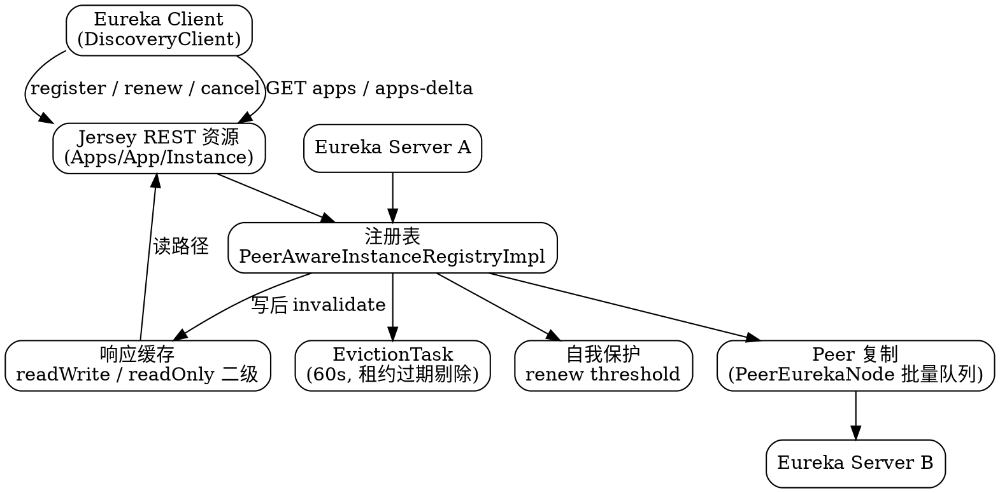

# Eureka Index

## Introduction

Eureka 是 Netflix 开源的**服务注册与发现（service registry / discovery）**组件，也是 Spring Cloud 第一代微服务体系里默认的注册中心。它刻意选择了 **AP + 去中心化对等**的设计：服务端节点之间地位对等（peer-to-peer）、注册信息只需最终一致、客户端自己持有注册表缓存并定时增量拉取，因此在网络分区时宁可返回过期数据也不愿意拒绝服务。

本子树按「**两端（Server / Client）+ 服务端四条主线（注册表写路径 / 缓存 / 自我保护 / 集群复制）+ 对外契约（REST API / 传输层）+ 运维面（配置 / 调优 / 排障）+ 生态（Spring Cloud / 迁移）**」组织。

> [!NOTE]
> **版本基线**：本子树所有源码事实以 Netflix/eureka **v1.10.19**（tag `v1.10.19`，2026-08-24 发布，`com.netflix.eureka:eureka-client` 的 1.x 线最新版）为准；Spring Cloud 侧事实以 **spring-cloud-netflix 5.0.3**（2026-10-22 GA，对应 Spring Boot 4.0.8）为准。需要注意的是**两个 2.0 完全不同**：`2.0.x`（2022-12 起）是把 Eureka 1 移植到 jakarta + Jersey 3 的版本，而 2015 年宣传的「Eureka 2.0 重写」早已废弃并归档为 `2.x-archive` 分支——旧文里「2.0 改 push / 读写分离」的说法指的是后者，**从未交付**，详见 [Eureka](/docs/CS/Framework/eureka/Eureka.md?id=版本线与两个-20)。

建议阅读顺序：**[Eureka](/docs/CS/Framework/eureka/Eureka.md) 总览 → [Server](/docs/CS/Framework/eureka/Server.md) 与 [Client](/docs/CS/Framework/eureka/Client.md) 两端启动链路 → [registry](/docs/CS/Framework/eureka/registry.md) 理解写路径 → [cache](/docs/CS/Framework/eureka/cache.md) 理解为什么下线要几分钟才被感知 → [self_preservation](/docs/CS/Framework/eureka/self_preservation.md) → [replication](/docs/CS/Framework/eureka/replication.md) → 生产面 [config](/docs/CS/Framework/eureka/config.md) / [tuning](/docs/CS/Framework/eureka/tuning.md) / [troubleshooting](/docs/CS/Framework/eureka/troubleshooting.md)**。

## Overview and Startup

- [Eureka](/docs/CS/Framework/eureka/Eureka.md)：总纲。定位与 CAP 取舍、两方角色、核心时序（注册 / 续约 / 拉增量 / 下线）、默认时间常数、版本线、与 Nacos / ZooKeeper / Consul / etcd 的横向对照、迁移去向。
- [Server](/docs/CS/Framework/eureka/Server.md)：服务端启动与装配。`EurekaBootStrap`（war / ServletContextListener）与 Spring Cloud 的 `EurekaServerBootstrap` 两条初始化路径、`DefaultEurekaServerContext`、`PeerEurekaNodes` 动态刷新、`syncUp()` + `openForTraffic()`。
- [Client](/docs/CS/Framework/eureka/Client.md)：客户端启动与生命周期。`DiscoveryClient` 构造、三个线程池、`initScheduledTasks()`、全量拉取与增量拉取、`InstanceInfoReplicator` 按需注册、重注册与优雅下线。

## Server Internals

- [Registry](/docs/CS/Framework/eureka/registry.md)：注册表本体。嵌套 `ConcurrentHashMap` 数据结构、`Lease` 租约、`register` / `renew` / `cancel` / `statusUpdate` / `deleteStatusOverride` 五条写路径、`recentlyChangedQueue` 增量队列、`EvictionTask` 与 Knuth shuffle 随机剔除、`InstanceStatusOverrideRule` 优先级链。
- [Cache](/docs/CS/Framework/eureka/cache.md)：服务端二级响应缓存。`readWriteCacheMap`（Guava，180s）+ `readOnlyCacheMap`（30s 定时回填）、`Key` 的五个维度、`Value` 预压缩 gzip、**三级缓存串起来的 210s 感知时延**与底层脏数据修正 reconcile。
- [Self Preservation](/docs/CS/Framework/eureka/self_preservation.md)：自我保护。`updateRenewsPerMinThreshold()` 阈值公式、`isLeaseExpirationEnabled()`、`MeasuredRate` 一分钟滑动统计、为什么它是 AP 取舍的核心代价、开关与生产建议。
- [Replication](/docs/CS/Framework/eureka/replication.md)：集群复制。`PeerEurekaNode` + `util/batcher` 批处理队列（BATCH_SIZE=250 / 500ms 窗口）、五种 Action、脑裂与自动恢复、`isThisMyUrl` 自环判定、`HEADER_REPLICATION` 毒丸防护、AWS ASG 状态通道。

## Wire Contract

- [REST API](/docs/CS/Framework/eureka/rest_api.md)：对外 HTTP 契约。全部资源类与端点表（注册 / 续约 / 下线 / 全量 / 增量 / VIP / 状态覆盖 / 批量复制）、Jersey Filter 链、JSON/XML codec、`gzip` 强制。
- [Transport](/docs/CS/Framework/eureka/transport.md)：客户端传输层。`EurekaHttpClient` 接口、解析器链（Config → ZoneAffinity → Async）、装饰器链（Sessioned → Retryable → Redirecting → Metrics）、隔离集策略、默认 HealthCheck / TLS 无关的连接治理。

## Client and Ecosystem

- [Spring Cloud](/docs/CS/Framework/eureka/spring_cloud.md)：Spring Cloud Netflix 集成。`@EnableEurekaServer` 的 Marker 条件、`InstanceRegistry` 事件桥接、`EurekaClientAutoConfiguration` 全家桶、健康检查与 TLS、以及向 Nacos / Consul / Kubernetes DNS 迁移的路径。

## Production

- [Config](/docs/CS/Framework/eureka/config.md)：配置项清单。服务端与客户端全部关键参数、**源码默认值**、常见组合。
- [Tuning](/docs/CS/Framework/eureka/tuning.md)：调优。感知时延 vs 心跳开销的取舍、集群规模与复制压力、JVM 与 GC、版本升级路径。
- [Troubleshooting](/docs/CS/Framework/eureka/troubleshooting.md)：排障。自我保护误触发、实例删不掉下线慢、跨区误调用、delta 不一致、Dashboard 显示 `DS Replicas` 空、时区与时钟回拨等。

## Links

- [Spring Cloud Netflix](/docs/CS/Framework/Spring_Cloud/Spring_Cloud.md?id=serviceregistry)
- [Nacos](/docs/CS/Framework/nacos/Nacos.md)
- [ZooKeeper](/docs/CS/Framework/ZooKeeper/ZooKeeper.md)
- [Consul](/docs/CS/Framework/consul/Consul.md)
- [Higress 服务发现](/docs/CS/Framework/Higress/Service_Discovery.md)

## References

- <https://github.com/Netflix/eureka>
- <https://github.com/Netflix/eureka/wiki>
- <https://github.com/spring-cloud/spring-cloud-netflix>
- <https://repo1.maven.org/maven2/com/netflix/eureka/eureka-client/>
