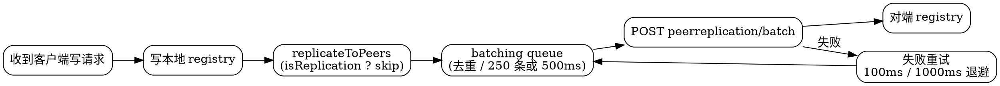

> [!NOTE]
> 源码事实基于 Netflix/eureka **v1.10.19**，主文件为 `eureka-core/src/main/java/com/netflix/eureka/cluster/PeerEurekaNode.java` 与 `eureka-core/src/main/java/com/netflix/eureka/util/batcher/`。

## Introduction

Eureka Server 集群没有 Leader，也没有复制状态机：每个节点收到写请求后，除了写自己的[注册表](/docs/CS/Framework/eureka/registry.md)，还会把这次变更**逐个转发给所有 peer**。转发是异步的、允许失败的——失败只由本节点重试补齐，不影响客户端本次请求的成功返回。这就是它的最终一致模型：**任何一台 Server 都能写，写入后由 fanout 扩散**。

这条链路的两个关键点是：如何避免转发在集群里无限放大（毒丸问题），以及如何把每秒可能上万的转发请求压成有限的几次 HTTP 调用（批处理队列）。

## Peer Discovery

`PeerEurekaNodes`（`cluster/PeerEurekaNodes.java`）负责维护 peer 列表，它不是静态配置：

- 启动时 `resolvePeerUrls()` 从 DNS 或配置解析（AWS 场景下从 EC2/EIP 动态发现）；
- `start()` 起一个名为 `Eureka-PeerNodesUpdater` 的守护线程，按 `peerEurekaNodesUpdateIntervalMs`（**默认 10 分钟**）周期性调用 `updatePeerEurekaNodes(resolvePeerUrls())`，新增/下线节点会被热更新；
- 转发前调用 `isThisMyUrl(node.getServiceUrl())` 跳过自己：优先用 `myUrl` 配置做全等比较，否则用 host 与自己的 `hostname`（或按 `applicationsResolverUseIp` 用 `ipAddr`）比对。

## Fanout Entry

```java
// PeerAwareInstanceRegistryImpl
private void replicateToPeers(Action action, String appName, String id,
                              InstanceInfo info, InstanceStatus newStatus, boolean isReplication) {
    Stopwatch tracer = action.getTimer().start();
    try {
        if (isReplication) {
            numberOfReplicationsLastMin.increment();
        }
        // If it is a replication already, do not replicate again as this will create a poison replication
        if (peerEurekaNodes == Collections.EMPTY_LIST || isReplication) {
            return;
        }
        for (final PeerEurekaNode node : peerEurekaNodes.getPeerEurekaNodes()) {
            if (peerEurekaNodes.isThisMyUrl(node.getServiceUrl())) {
                continue;
            }
            replicateInstanceActionsToPeers(action, appName, id, info, newStatus, node);
        }
    } finally {
        tracer.stop();
    }
}
```

注意 `isReplication` 分支：**来自其它 Server 的复制请求不再二次转发**，否则 A→B→C→A 会无限循环。这个标志通过 HTTP header 传递，常量 `HEADER_REPLICATION = "x-netflix-discovery-replication"`。

五种 Action 与实际调用的关系（`replicateInstanceActionsToPeers`）：

| Action                 | 对 peer 的操作                                                     | 携带数据                                    |
| :--------------------- | :------------------------------------------------------------- | :-------------------------------------- |
| `Register`             | `node.register(info)`                                          | 完整 `InstanceInfo`                       |
| `Heartbeat`            | `node.heartbeat(appName, id, infoFromRegistry, overriddenStatus, false)` | 本端当前持有实例 + override 状态，便于对端补齐 |
| `Cancel`               | `node.cancel(appName, id)`                                     | 仅 id                                     |
| `StatusUpdate`         | `node.statusUpdate(appName, id, newStatus, infoFromRegistry)`    | 新状态                                     |
| `DeleteStatusOverride` | `node.deleteStatusOverride(appName, id, infoFromRegistry)`      | 新状态（**传 null**）                          |

## Batching Dispatcher

每个 peer 节点一个 `PeerEurekaNode` 实例，内含两条任务队列（`com.netflix.eureka.util.batcher`）：

```java
// cluster/PeerEurekaNode.java（构造）
this.maxProcessingDelayMs = config.getMaxTimeForReplication();   // maxTimeForReplication = 30000

this.batchingDispatcher = TaskDispatchers.createBatchingTaskDispatcher(
        batcherName,
        config.getMaxElementsInPeerReplicationPool(),   // 10000
        batchSize,                                      // BATCH_SIZE = 250
        config.getMaxThreadsForPeerReplication(),       // 20
        maxBatchingDelayMs,                             // MAX_BATCHING_DELAY_MS = 500
        serverUnavailableSleepTimeMs,                   // 1000
        retrySleepTimeMs,                               // 100
        taskProcessor
);
this.nonBatchingDispatcher = TaskDispatchers.createNonBatchingTaskDispatcher(
        targetHost,
        config.getMaxElementsInStatusReplicationPool(), // 10000
        config.getMaxThreadsForStatusReplication(),     // 1
        maxBatchingDelayMs, serverUnavailableSleepTimeMs, retrySleepTimeMs, taskProcessor
);
```

批处理队列的语义：**相同 `taskId` 的任务只保留最后一次**（`taskId("register", info)` 由 appName + instanceId 构成），因此一个实例短时间内多次状态变更在队列里会被合并成一次；攒到 250 条、或最长等待 500ms，就由 worker 一次性打包成 `ReplicationList` 发到对端的 `peerreplication/batch/` 端点。

任务的过期时间也参与了取舍：

- `register` / `heartbeat`：`now + getLeaseRenewalOf(info)`，取值来自该实例的 leaseInfo（`renewalIntervalInSecs`，缺省兜底到 duration），即**复制任务最多活一个续约周期**；
- `cancel` / `statusUpdate` / `deleteStatusOverride`：`now + maxProcessingDelayMs`（30s）。

工作线程数固定为 `maxThreadsForPeerReplication`（20），由 `TaskExecutors` 在 `eurekaTaskExecutors` 线程组里启动守护线程；ASG 状态更新走独立的 non-batching 队列，只有 1 个线程，避免被普通写流量淹没。



## Failure Semantics

`ReplicationTaskProcessor` 的失败处理只区分两类：

- 网络异常（连不上/超时）→ worker sleep `SERVER_UNAVAILABLE_SLEEP_TIME_MS`（1s）后重试，任务保留在队列；
- 其它错误 → sleep `RETRY_SLEEP_TIME_MS`（100ms）后重试。

重试是**尽力而为且无上限**的：只要任务没过期（由上一节的 expiryTime 判定）就会一直尝试。这意味着：

- **网络分区期间**：各节点保有本地视角，互相之间的变更会积压在批处理队列里；若积压超过 `maxElementsInPeerReplicationPool`（10000），再 process 时会被拒绝，此时只能靠后续心跳/客户端重注册来补齐。
- **分区恢复后**：不需要额外的一致性修复流程，队列里未过期的任务继续发送即可自动收敛；过期任务对应的实例通常会由客户端的下一轮心跳（`Heartbeat` action）带着完整实例信息重新同步过来。

## Split-Brain Behavior

官方 wiki 明确列出了分区期间可能出现的三种现象：

1. 心跳复制在 peer 之间失败 → 节点进入[自我保护](/docs/CS/Framework/eureka/self_preservation.md)，冻结注册表;
2. 注册可能只落在某个孤立节点上，一部分客户端能看到新实例、另一部分看不到；
3. 网络恢复后自动纠正——重新连上后注册信息会被传送到缺少它的节点上。

因此客户端必须假定「不同 Server 的视图可能短暂不一致」，这正是 Eureka 文档反复强调 Client 端要能容忍拿到不存在实例的原因。集群 HA 部署建议见 [tuning](/docs/CS/Framework/eureka/tuning.md)。

## Links

- [Eureka](/docs/CS/Framework/eureka/Eureka.md)
- [Registry](/docs/CS/Framework/eureka/registry.md)
- [Self Preservation](/docs/CS/Framework/eureka/self_preservation.md)
- [REST API](/docs/CS/Framework/eureka/rest_api.md)
- [Server](/docs/CS/Framework/eureka/Server.md)
- [Config](/docs/CS/Framework/eureka/config.md)

## References

1. [Netflix/eureka · PeerEurekaNode](https://github.com/Netflix/eureka/blob/v1.10.19/eureka-core/src/main/java/com/netflix/eureka/cluster/PeerEurekaNode.java)
2. [Understanding Eureka Peer to Peer Communication](https://github.com/Netflix/eureka/wiki/Understanding-Eureka-Peer-to-Peer-Communication)
