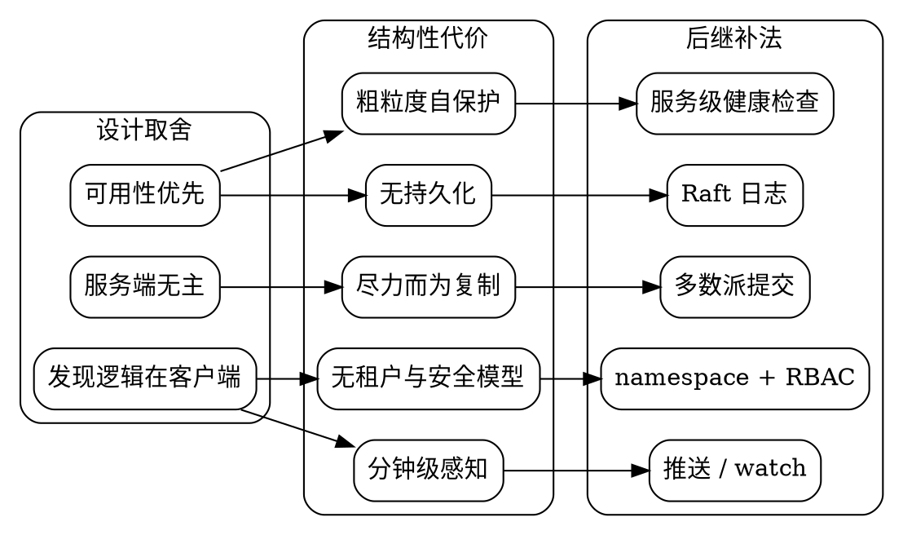

> [!NOTE]
> 版本基线：Netflix/eureka **v2.0.6**（2026-03-27，最新 tag）。1.x 与 2.0.x 在协议与数据模型上行为一致（2.0.x 只是 javax → jakarta + Jersey 3 的移植），本页源码片段在两条线上语义相同。历史事实逐条标注出处。机制细节不在此展开，见各分册链接。

## Introduction

这一页回答两个问题：**Eureka 为什么停在 2.0.6 这个量级上不再演进？它的哪些不足是结构性的——由「AP / 无主 / 纯拉取」这套设计本身决定，而不是缺某个功能？**

先给三个反直觉点，后面逐节展开：

- **Eureka 不是死于「维护模式」**：2018 年 12 月 Spring 官方宣布 Netflix 系模块进入维护模式的公告里，明确写着 "This does not include the Eureka"。真正被放弃的是 **Eureka 2.0 重写**——1.x 一直活到今天。
- **「停止维护」不等于停发版本**：`v1.10.19`（2026-08-24）、`v2.0.6`（2026-03-27）都是近期发的，Netflix 仓库 README 也仍写着 "It plays a critical role in Netflix mid-tier infra"。准确的说法是：**活着，但不再有架构演进**。
- **下面列的不足大多不是 bug**，而是同一套取舍（可用性优先、服务端无主、发现逻辑在客户端）在不同位置的投影。读懂这些代价，才明白 Nacos / Consul / K8s 每一步在补什么。

## Maintenance Timeline

| 时间 | 事件 |
| :--- | :--- |
| 2012 | Netflix 开源 Eureka，服务于 AWS 云上中间层发现 |
| 2015 | 宣布 Eureka 2.0 蓝图：订阅式推送、读写分离集群。**从未交付**，残骸保存在 `2.x-archive` 分支 |
| 2018-06 | Netflix 宣布停止 Eureka 2.0 开源工作 |
| 2018-12 | Spring 官方宣布 Netflix 系模块进入 maintenance mode，公告**明确排除 Eureka** |
| 2022-12 | `2.0.0` 发布：jakarta + Jersey 3 移植，协议与数据模型不变 |
| 2022 起 | `spring-cloud-netflix` main 分支陆续移除非 Eureka 模块，如今目录里只剩 `eureka-client` / `eureka-server` 及其 starter |

wiki 上至今挂着这段官方定性（Netflix/eureka wiki 首页，"Eureka 2.0 (Discontinued)"）：

> The existing open source work on eureka 2.0 is discontinued. The code base and artifacts that were released as part of the existing repository of work on the 2.x branch is considered **use at your own risk**.

2018-12-12 的 Spring 官方公告（[Spring Cloud Greenwich.RC1 available now](https://spring.io/blog/2018/12/12/spring-cloud-greenwich-rc1-available-now)）原文：

> This does not include the **Eureka** or concurrency-limits modules.

也就是说，「停止维护」在两个层面同时成立、但含义不同：**Netflix 侧放弃的是 2.0 的架构演进**（pull 改 push、读写分离的设想全部作废），**社区侧保住的是 1.x 的补丁级维护**。两者叠加的结果就是今天的状态——一个 2012 年的设计被原样移植到 jakarta 命名空间上，继续服务存量用户。

## No Persistence Layer

注册表本体是一个纯内存的两层 Map，落盘、日志、快照一概没有：

```java
// eureka-core/src/main/java/com/netflix/eureka/registry/AbstractInstanceRegistry.java
private final ConcurrentHashMap<String, Map<String, Lease<InstanceInfo>>> registry
        = new ConcurrentHashMap<String, Map<String, Lease<InstanceInfo>>>();
```

重启后的恢复手段只有一个：从邻居全量拉一遍（`syncUp()`），拉不到就带着空表开门：

```java
// eureka-core/src/main/java/com/netflix/eureka/registry/PeerAwareInstanceRegistryImpl.java
public int syncUp() {
    // Copy entire entry from neighboring DS node
    int count = 0;
        for (int i = 0; ((i < serverConfig.getRegistrySyncRetries()) && (count == 0)); i++) {
            if (i > 0) {
                try {
                    Thread.sleep(serverConfig.getRegistrySyncRetryWaitMs());
                } catch (InterruptedException e) {
                    logger.warn("Interrupted during registry transfer..");
                    break;
                }
            }
        Applications apps = eurekaClient.getApplications();
        for (Application app : apps.getRegisteredApplications()) {
            for (InstanceInfo instance : app.getInstances()) {
                if (isRegisterable(instance)) {
                    register(instance, instance.getLeaseInfo().getDurationInSecs(), true);
                    count++;
                }
            }
        }
    }
    return count;
}
```

代价是三重的：**全集群同时重启 = 注册表归零**（只能等各实例重新注册）；没有操作日志，故障复盘无从下手；`waitTimeInMsWhenSyncEmpty` 默认 5 分钟的等待窗口，是拿可用性换一致性的一次软妥协。Nacos 用本地磁盘 + Derby、Consul 用 Raft log，解决的都是同一个问题。

## Pull-Only Propagation

Eureka 没有任何服务端推送通道：Server 内部是「写后 invalidate + 定时回填」的二级缓存，Client 侧是定时拉取。readOnly 缓存的回填逻辑：

```java
// eureka-core/src/main/java/com/netflix/eureka/registry/ResponseCacheImpl.java
private TimerTask getCacheUpdateTask() {
    return new TimerTask() {
        @Override
        public void run() {
            for (Key key : readOnlyCacheMap.keySet()) {
                // debug 日志略
                try {
                    Value cacheValue = readWriteCacheMap.get(key);
                    Value currentCacheValue = readOnlyCacheMap.get(key);
                    if (cacheValue != currentCacheValue) {
                        readOnlyCacheMap.put(key, cacheValue);
                    }
                } catch (Throwable th) {
                    logger.error("Error while updating the client cache from response cache for key {}", key.toStringCompact(), th);
                }
            }
        }
    };
}
```

三级缓存（readOnly 30s 回填 → readWrite 180s TTL → 客户端 30s 拉取）串起来的**最坏约 210 秒感知时延**，在 [cache](/docs/CS/Framework/eureka/cache.md?id=感知时延的完整推导) 里有完整推导。更关键的是增量队列 `recentlyChangedQueue` 只保留 3 分钟——它是一份「错过就没了」的记录，不是事件流，客户端错过增量只能全量重拉。2015 年 2.0 蓝图想做的「订阅式推送」正是冲着这个来的，随 2.0 一起被放弃。Nacos 2.x 起 gRPC 长连接推送、Consul 的 blocking query、K8s 的 watch，补的都是同一块短板。

## Coarse-Grained Self Preservation

自我保护的判定是**全局一维**的：把全集群所有实例的续约量加总，和阈值比较，然后一票决定要不要剔除任何实例：

```java
// eureka-core/src/main/java/com/netflix/eureka/registry/PeerAwareInstanceRegistryImpl.java
public boolean isLeaseExpirationEnabled() {
    if (!isSelfPreservationModeEnabled()) {
        // The self preservation mode is disabled, hence allowing the instances to expire.
        return true;
    }
    return numberOfRenewsPerMinThreshold > 0 && getNumOfRenewsInLastMin() > numberOfRenewsPerMinThreshold;
}
```

阈值本身来自期望续约数的固定折算：

```java
// eureka-core/src/main/java/com/netflix/eureka/registry/AbstractInstanceRegistry.java
protected void updateRenewsPerMinThreshold() {
    this.numberOfRenewsPerMinThreshold = (int) (this.expectedNumberOfClientsSendingRenews
            * (60.0 / serverConfig.getExpectedClientRenewalIntervalSeconds())
            * serverConfig.getRenewalPercentThreshold());
}
```

结构性问题在三个地方：它**无法区分故障域**——一个机柜断电和全网心跳抖动在这个判据里完全等价，要么全不剔、要么全剔；进入保护态后 `evict()` 第一行直接返回，**死实例保留时长没有上界**，期间流量会持续打向尸体（客户端必须自己用快速超时兜底）；`expectedNumberOfClientsSendingRenews` 只在注册 / 取消 / 开门时更新，灰度期实例数骤降的场景下阈值滞后，保护态被反复误触发。机制全景与生产开关见 [Self Preservation](/docs/CS/Framework/eureka/self_preservation.md)。

## Best-Effort Replication

写请求向 peer 的扩散是一条异步批处理队列，不保证送达。两个最能说明问题的分支——队列满时**丢最老任务**，只留一个 metric；过期任务**静默丢弃**：

```java
// eureka-core/src/main/java/com/netflix/eureka/util/batcher/AcceptorExecutor.java
private void appendTaskHolder(TaskHolder<ID, T> taskHolder) {
    if (isFull()) {
        pendingTasks.remove(processingOrder.poll());
        queueOverflows.incrementAndGet();
    }
    TaskHolder<ID, T> previousTask = pendingTasks.put(taskHolder.getId(), taskHolder);
    if (previousTask == null) {
        processingOrder.add(taskHolder.getId());
    } else {
        overriddenTasks.incrementAndGet();
    }
}

void assignSingleItemWork() {
    if (!processingOrder.isEmpty()) {
        if (singleItemWorkRequests.tryAcquire(1)) {
            long now = System.currentTimeMillis();
            while (!processingOrder.isEmpty()) {
                ID id = processingOrder.poll();
                TaskHolder<ID, T> holder = pendingTasks.remove(id);
                if (holder.getExpiryTime() > now) {
                    singleItemWorkQueue.add(holder);
                    return;
                }
                expiredTasks.incrementAndGet();
            }
            singleItemWorkRequests.release();
        }
    }
}
```

没有对账协议、没有写日志、没有版本号协商——节点间的最终一致完全依赖两个兜底：客户端心跳里携带的 `lastDirtyTimestamp`（新覆盖旧的）和全量重拉。长时间分区下队列积压打满、任务被丢，只会在 metric 里留下 `queueOverflows`，**监控不足时这是最隐蔽的一致性问题**。批处理窗口、毒丸防护与脑裂恢复见 [Replication](/docs/CS/Framework/eureka/replication.md)。

## No Tenant Model

数据模型里没有任何租户维度。注册表是 `appName → instanceId` 两层，多环境靠部署多个集群或 URL 前缀硬分；唯一的扩展点是 metadata，而它是弱类型的字符串 map：

```java
// eureka-client/src/main/java/com/netflix/appinfo/InstanceInfo.java
private volatile Map<String, String> metadata;
```

`region` / `zone` 是 AWS 拓扑概念，用于就近拉取与容灾偏好，不是隔离边界——任何客户端拿到合法 Server 地址就能读写全表。对照：Nacos 有 namespace + group 两级，Consul 有 namespace / partition / admin partition，K8s 有 namespace + RBAC。Eureka 要做多租户只能在每层外面再包一层，这是它「内网工具」出身决定的定位上限。

## Weak Security Model

服务端唯一的「认证」过滤器，注释写得非常直白：

```java
// eureka-core/src/main/java/com/netflix/eureka/ServerRequestAuthFilter.java
/**
 * An auth filter for client requests. For now, it only logs supported client identification data from header info
 */
@Singleton
public class ServerRequestAuthFilter implements Filter {
```

它只解析和记录来源标识，不做任何鉴权。TLS 非默认、没有 ACL / token、REST API 无最小权限模型，鉴权都要靠外挂（Servlet 容器 basic auth 或 Spring Security）。在 2012 年的内网语境下这是合理简化，但它是后来与 Consul（内置 ACL）、etcd（RBAC + TLS）拉开差距最明显的一项——注册中心一旦被写入污染，整条调用链都会被劫持。

## Fat Java Client

客户端承担了发现逻辑的全部复杂度（注册 / 续约 / 拉表 / 重注册 / 注销 / 本地缓存查询，见 [Client](/docs/CS/Framework/eureka/Client.md)），这套逻辑内嵌在业务进程里：

- **每个业务进程多了守护线程池和整份注册表缓存**，Client 的故障与业务的故障无法隔离；
- **多语言生态只有 Java 一等公民**，其他语言要么用简陋的第三方实现，要么自己重实现 delta 合并与 `lastDirtyTimestamp` 语义；
- 服务端演进被客户端契约锁死——任何协议升级都要等所有接入方换版本，这本身就是 2.0 重写推进不动的现实原因之一。

Netflix 自己的解法是放弃 fat client：Ribbon README 里明确说团队转向了基于 gRPC 的 RPC 方案，内部中间层最终收敛到 Envoy sidecar + 按需发现。这与其说是 Eureka 的失败，不如说是「客户端发现」这个模式在整个行业被「服务端发现 + sidecar」替代的历史进程。

## How Successors Addressed These

逐条对照——每一条不足都有明确的后继补法：

| 不足 | Eureka 现状 | 后继方案 |
| :--- | :--- | :--- |
| 纯内存注册表 | 重启靠 `syncUp()` 全量拷贝 | Nacos 磁盘存储；Consul / etcd Raft 日志重放 |
| 分钟级感知 | 二级缓存 + 定时拉取，最坏约 210s | Nacos 2.x gRPC 推送；Consul blocking query；K8s watch |
| 全局一维自我保护 | 保护态全表不剔除 | Consul 按服务独立健康检查；Nacos 服务端主动探测持久实例 |
| 尽力而为复制 | 队列满丢任务，靠心跳补偿 | Raft / Zab 日志复制，commit 前有 majority 确认 |
| 无租户模型 | 两层 map + 字符串 metadata | Nacos namespace/group；Consul partition；K8s namespace + RBAC |
| 安全空白 | 仅日志型 auth filter | Consul ACL；etcd RBAC/TLS；K8s ServiceAccount |

横向实现细节的深对比见 [Nacos registry](/docs/CS/Framework/nacos/registry.md)、[Consul](/docs/CS/Framework/consul/Consul.md) 与 [K8s Service](/docs/CS/Container/k8s/Service.md)。



## Summary

把评价收束成三句话：

1. **不足与取舍是一体的**：无持久化、粗粒度自保护、尽力而为复制，都是「任一节点可写、分区不拒服务」这同一个选择在存储、故障判定、复制三个位置的投影。批评 Eureka 的正确姿势不是指责它做错了什么，而是认清这套取舍的适用边界——小规模、内网、Java 单栈、可用性优先。
2. **停更是内外因叠加**：内部 Netflix 转向 sidecar + gRPC，2.0 重写与内部需求脱节；外部没有商业主体接棒驱动演进；两头夹击下，社区选择把 1.x 原样移植进 jakarta 而冻结架构。对照 Nacos / Consul 的持续投入，「没有商业利益的开源难以长期演进」在这里得到了完整验证。
3. **它仍是最好的 AP 教材**：正因为代码没有演进包袱，Eureka 是把「可用性优先」读穿的标本——每一处看似激进的简化（无主、无日志、无对账）都能在 `AbstractInstanceRegistry` 里找到一行对应的注释解释为什么可以这么做。

## Links

- [Self Preservation](/docs/CS/Framework/eureka/self_preservation.md)
- [Cache](/docs/CS/Framework/eureka/cache.md)
- [Replication](/docs/CS/Framework/eureka/replication.md)
- [Client](/docs/CS/Framework/eureka/Client.md)
- [Nacos registry](/docs/CS/Framework/nacos/registry.md)
- [Consul](/docs/CS/Framework/consul/Consul.md)

## References

1. [Netflix/eureka wiki · Eureka 2.0 (Discontinued)](https://github.com/Netflix/eureka/wiki)
2. [Netflix/eureka issue #1129 · Why was Eureka 2.0 discontinued?](https://github.com/Netflix/eureka/issues/1129)
3. [Spring Blog · Spring Cloud Greenwich.RC1 available now（2018-12-12，maintenance mode 公告）](https://spring.io/blog/2018/12/12/spring-cloud-greenwich-rc1-available-now)
4. [Netflix/eureka · AbstractInstanceRegistry @ v2.0.6](https://github.com/Netflix/eureka/blob/v2.0.6/eureka-core/src/main/java/com/netflix/eureka/registry/AbstractInstanceRegistry.java)
5. [Netflix/eureka · PeerAwareInstanceRegistryImpl @ v2.0.6](https://github.com/Netflix/eureka/blob/v2.0.6/eureka-core/src/main/java/com/netflix/eureka/registry/PeerAwareInstanceRegistryImpl.java)
6. [Netflix/eureka · AcceptorExecutor @ v2.0.6](https://github.com/Netflix/eureka/blob/v2.0.6/eureka-core/src/main/java/com/netflix/eureka/util/batcher/AcceptorExecutor.java)
