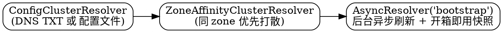

> [!NOTE]
> 源码事实基于 Netflix/eureka **v1.10.19**，代码位于 `eureka-client/src/main/java/com/netflix/discovery/shared/transport/`。它与 [REST API](/docs/CS/Framework/eureka/rest_api.md) 是同一套契约的两侧：后者讲 Server 暴露什么，本篇讲 Client 怎么可靠地把请求发出去。

## Introduction

Eureka Client 不是拿到 URL 就直接请求。它在 HTTP 之上叠了三层：

1. **解析器（ClusterResolver）**：把「一个 region/zone 的名字」解析成若干个可请求的 endpoint，并处理 zone 偏好；
2. **装饰器（EurekaHttpClientDecorator）**：按 Sessioned → Retryable → Redirecting → Metrics 的顺序给裸 HTTP client 套上会话管理、失败转移、限重发与指标；
3. **底层 Jersey client**：实际发包，默认 Jersey 1.19.1，jakarta 生态下有 jersey2 / jersey3 替代实现。

## Cluster Resolver Chain

默认 bootstrap 解析器（`EurekaHttpClients#defaultBootstrapResolver`）：



- `ConfigClusterResolver`：若开了 `useDnsForFetchingServiceUrls`，走 `DnsTxtRecordClusterResolver("txt.{region}.{eurekaServerDNSName}")`；否则走 `EndpointUtils.getServiceUrlsMapFromConfig`，把可用 zone 按「自己所在 zone 起」的偏移顺序排成一个 `LinkedHashMap`——一个 region 下可以有多个 zone，同 zone 优先、然后依次轮到其它 zone，配置为空会直接抛 `IllegalArgumentException("DiscoveryClient: invalid serviceUrl specified!")`；
- `ZoneAffinityClusterResolver`：把同 zone 的 endpoint 放到列表最前面（并做随机化），这样后面的 Retryable 装饰器会天然优先落到本 zone；
- `AsyncResolver`：后台线程异步刷新 resolution，调用方永远拿到上一次成功的结果，避免 DNS/配置刷新阻塞请求。bootstrap 这一个的刷新间隔来自 `getEurekaServiceUrlPollIntervalSeconds()`（默认 **300 秒**），线程池只有 1 个线程。

另外两种模式：

- **composite**（`bootstrapResolverStrategy=composite`）：`EurekaHttpResolver(writeClusterVip)` + `ApplicationsResolver(writeClusterVip)` 组成的复合源（本地 VIP 优先、拿不到则从 Server 侧拉一份），再套 ZoneAffinity 与 AsyncResolver（线程数 `asyncExecutorThreadPoolSize`=5，刷新间隔 `asyncResolverRefreshIntervalMs`=300000ms）；
- **query resolver**：只在 `useBootstrapResolverForQuery=false` 时才单独构建，默认 `true`，即**读写请求共用一个解析器**。

## Decorator Chain

```java
// shared/transport/EurekaHttpClients.java — canonicalClientFactory
new SessionedEurekaHttpClient(
        RetryableEurekaHttpClient.createFactory(
                RedirectingEurekaHttpClient.createFactory(transportClientFactory),
                ...),
        transportConfig.getSessionedClientReconnectIntervalSeconds() * 1000)
```

`MetricsCollectingEurekaHttpClient` 不在 `canonicalClientFactory` 里，而是在最底层由 `Jersey1TransportClientFactories#newTransportClientFactory` 包装 `jerseyFactory`，因此**实际调用顺序**是：

`Sessioned` → `Retryable` → `Redirecting` → `MetricsCollecting` → `Jersey1 客户端`

| 装饰器                       | 关键行为                                                                                                   |
| :------------------------ | :----------------------------------------------------------------------------------------------------- |
| `SessionedEurekaHttpClient` | 每 `sessionedClientReconnectIntervalSeconds`（**1200 s**）关闭并重建底层连接；实际时长在基准值上做 **±50% 随机抖动**（避免所有客户端同时重连造成抖动尖峰）。纯时间驱动，与请求是否空闲无关 |
| `RetryableEurekaHttpClient` | 默认重试 **3** 次；维护 `quarantineSet`（跳过连续失败的 host）；当隔离数 ≥ `候选数 × retryableClientQuarantineRefreshPercentage`（**0.66**）时整体清空重新开始；请求成功后 sticky 到该 client 直到下次 session 重建 |
| `RedirectingEurekaHttpClient` | 只跟随 **302**，最多 10 次；路径匹配 `(.*/v2/)apps(/.*)?$` 时通过 `DnsServiceImpl.resolveIp(host)` 重新解析 IP 后再按 `.../v2/` 前缀重建 client |
| `MetricsCollectingEurekaHttpClient` | 按 `RequestType`（Register / Cancel / SendHeartBeat / GetApplications / GetDelta …）记录 Servo 计数与延迟，`RequestType` 共 12 种 |

判断是否成功的标准由 `ServerStatusEvaluators`（默认 `legacyEvaluator`）给出，它比「看 2xx」复杂，体现了 Eureka 的语义：

- 2xx 或 302 → 成功；
- `Register` 收到 404、`SendHeartBeat` 收到 404 → 也算成功（Server 是在告诉客户端「请重新注册」，属于预期语义）；
- `Cancel` → 一律成功（best effort）；
- `GetDelta` 收到 403 / 404 → 成功（通常意味着该退化为全量拉取）；
- 其余状态码 → 失败，触发下一个候选 endpoint。

## Jersey Implementation

| 模块                    | HTTP 栈                                    | 说明                                                       |
| :--------------------- | :--------------------------------------- | :------------------------------------------------------- |
| `eureka-client`         | Jersey **1.19.1** (`com.sun.jersey.*`)   | `javax.ws.rs` 命名空间，默认实现                                   |
| `eureka-client-jersey2` | Jersey 2.23.1（`org.glassfish.jersey.*`） | 与前者**互斥**：build 里互相 exclude 对方的 api 包                      |
| `eureka-client-jersey3` | Jersey 3（jakarta）                        | 由 Spring Cloud 5.x 使用（见 [Spring Cloud](/docs/CS/Framework/eureka/spring_cloud.md)），配合 `eureka-core-jersey3` |

三者的 URL path 与 query 参数完全一致，差异只在 Client API 与命名空间。客户端还会通过 `EurekaIdentityHeaderFilter` 在每次请求里带上身份头：`DiscoveryIdentity-Name` / `-Version` / `-Id`，其中 `Version` 是 `EurekaClientIdentity` 里硬编码的**协议版本常量 `1.4`**（与制品版本无关，别和 1.10.19 混淆）。

## Transport Config

配置子命名空间 `transport.`（`DefaultEurekaTransportConfig`）：

| 参数                                            | 默认值         |
| :-------------------------------------------- | :---------- |
| `sessionedClientReconnectIntervalSeconds`      | 1200 s      |
| `retryableClientQuarantineRefreshPercentage`   | 0.66        |
| `applicationsResolverDataStalenessThresholdSeconds` | 300 s  |
| `applicationsResolverUseIp`                    | false       |
| `asyncResolverRefreshIntervalMs`               | 300000 ms   |
| `asyncResolverWarmupTimeoutMs`                 | 5000 ms     |
| `asyncExecutorThreadPoolSize`                  | 5           |
| `useBootstrapResolverForQuery`                 | true        |
| `bootstrapResolverStrategy`                    | null（非 composite） |
| `writeClusterVip` / `readClusterVip`           | null        |

## Links

- [Client](/docs/CS/Framework/eureka/Client.md)
- [REST API](/docs/CS/Framework/eureka/rest_api.md)
- [Eureka](/docs/CS/Framework/eureka/Eureka.md)
- [Config](/docs/CS/Framework/eureka/config.md)
- [Troubleshooting](/docs/CS/Framework/eureka/troubleshooting.md)

## References

1. [Netflix/eureka · EurekaHttpClients](https://github.com/Netflix/eureka/blob/v1.10.19/eureka-client/src/main/java/com/netflix/discovery/shared/transport/EurekaHttpClients.java)
2. [Netflix/eureka · AbstractJerseyEurekaHttpClient](https://github.com/Netflix/eureka/blob/v1.10.19/eureka-client/src/main/java/com/netflix/discovery/shared/transport/jersey/AbstractJerseyEurekaHttpClient.java)
