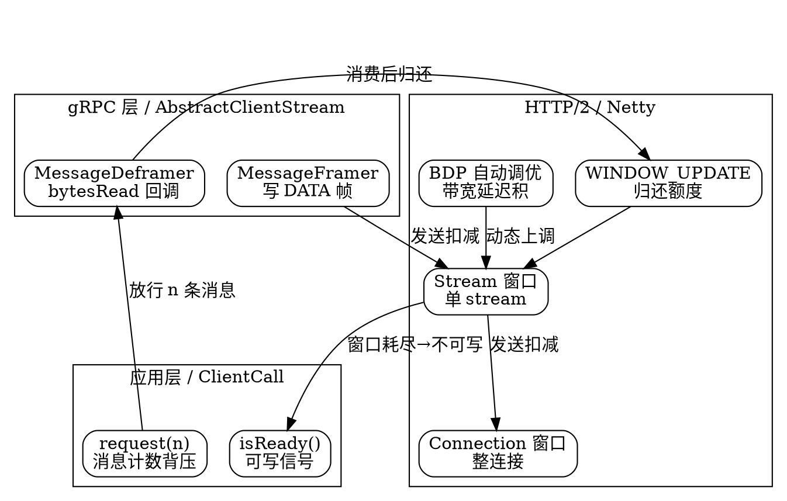

# gRPC Java Flow Control and Backpressure

## Introduction

gRPC 不另造流控，直接复用 HTTP/2 的两级窗口：stream 级（单 RPC）与 connection 级（整条 TCP 连接）。发送方每发一字节扣减窗口，接收方消费后发 `WINDOW_UPDATE` 归还额度；窗口耗尽时发送方必须停等。grpc-java Netty 实现的关键反直觉点在于**默认窗口大小和 BDP 自动调优**——这与"HTTP/2 默认 64 KiB"的直觉及 grpc-go 的行为都不同。

> 版本基线：grpc-java 1.75.0（commit 3abc0e6）。以下片段均取自该 tag。

三个反直觉点：

- **初始窗口 1 MiB，不是 64 KiB**：`NettyChannelBuilder.DEFAULT_FLOW_CONTROL_WINDOW = 1024 * 1024`。
- **默认开启 BDP 自动调优**：调 `flowControlWindow()` 反而**关闭**调优；想保留调优又改起始值要用 `initialFlowControlWindow()`。
- **`request(n)` 是应用层流控闸门**：不调 `request(1)`，服务端发了消息客户端也不会投递——这层流控与 HTTP/2 窗口是两套机制，叠加生效。

## Two-Level Windows



## Netty Defaults: Source of Truth

`NettyChannelBuilder` 定义一个 1 MiB 的初始窗口常量，并把它作为默认值：

```java
// netty/src/main/java/io/grpc/netty/NettyChannelBuilder.java
public static final int DEFAULT_FLOW_CONTROL_WINDOW = 1024 * 1024;
private int flowControlWindow = DEFAULT_FLOW_CONTROL_WINDOW;
```

两个设置入口的语义**恰好相反**——这是最容易踩的坑：

```java
// netty/src/main/java/io/grpc/netty/NettyChannelBuilder.java
/**
 * Sets the initial flow control window in bytes. Setting initial flow control window enables auto
 * flow control tuning using bandwidth-delay product algorithm. To disable auto flow control
 * tuning, use {@link #flowControlWindow(int)}. By default, auto flow control is enabled with
 * initial flow control window size of {@link #DEFAULT_FLOW_CONTROL_WINDOW}.
 */
@CanIgnoreReturnValue
public NettyChannelBuilder initialFlowControlWindow(int initialFlowControlWindow) {
  checkArgument(initialFlowControlWindow > 0, "initialFlowControlWindow must be positive");
  this.flowControlWindow = initialFlowControlWindow;
  this.autoFlowControl = true;
  return this;
}

/**
 * Sets the flow control window in bytes. Setting flowControlWindow disables auto flow control
 * tuning; use {@link #initialFlowControlWindow(int)} to enable auto flow control tuning. If not
 * called, the default value is {@link #DEFAULT_FLOW_CONTROL_WINDOW}) with auto flow control
 * tuning.
 */
@CanIgnoreReturnValue
public NettyChannelBuilder flowControlWindow(int flowControlWindow) {
  checkArgument(flowControlWindow > 0, "flowControlWindow must be positive");
  this.flowControlWindow = flowControlWindow;
  this.autoFlowControl = false;
  return this;
}
```

窗口上限 8 MiB（`AbstractNettyHandler.MAX_WINDOW_SIZE = 8 * 1024 * 1024`），BDP 调优不会无限上调。

## Application-Level Backpressure: request(n)

HTTP/2 窗口管的是**字节**，应用层还需要管**消息条数**——这就是 `ClientCall.request(n)`。它是消息级背压闸门：不 request，deframer 解出的消息就不会投递给应用 listener。

```java
// core/src/main/java/io/grpc/internal/ClientCallImpl.java
@Override
public void request(int numMessages) {
  try (TaskCloseable ignore = PerfMark.traceTask("ClientCall.request")) {
    PerfMark.attachTag(tag);
    checkState(stream != null, "Not started");
    checkArgument(numMessages >= 0, "Number requested must be non-negative");
    stream.request(numMessages);
  }
}
```

`isReady()` 是写侧信号：窗口耗尽时为 false，流式客户端应订阅 `setOnReadyHandler()` 而不是忙等：

```java
// core/src/main/java/io/grpc/internal/ClientCallImpl.java
@Override
public boolean isReady() {
  if (halfCloseCalled) {
    return false;
  }
  return stream.isReady();
}
```

> [!NOTE]
> 阻塞 stub 与生成代码的异步 stub 自动 `request(1)`，业务无感；只有**手写** `ClientCall` 或 `ServerCallStreamObserver` 时才需手动 request。忘记 request 是"服务端明明发了、客户端收不到"的头号原因。

## Deframer Drives Window Updates

接收侧归还额度的触发点在 `MessageDeframer` 的 listener 回调：`bytesRead(numBytes)` 告诉 transport"我消费了多少字节"，transport 据此发 `WINDOW_UPDATE`。这个回调被 `read()` 路径调用，把 HTTP/2 窗口与应用消费速率绑在一起——如果应用不读（不 request），窗口就不会归还，发送方自然停等。这就是两级流控叠加生效的机制。

## Keepalive: Defaults That Surprise

keepalive 与流控相关但独立。grpc-java 的默认值（来自 `GrpcUtil` 常量，被 `NettyChannelBuilder` 引用）：

| 参数 | 常量 | 默认值 | 含义 |
| :--- | :--- | :--- | :--- |
| 客户端 keepalive 间隔 | `KEEPALIVE_TIME_NANOS_DISABLED` | `Long.MAX_VALUE`（关闭） | 默认不 ping |
| 客户端 ping 超时 | `DEFAULT_KEEPALIVE_TIMEOUT_NANOS` | 20s | — |
| 服务端 keepalive 间隔 | `DEFAULT_SERVER_KEEPALIVE_TIME_NANOS` | 2h | 服务端主动 ping |
| 服务端 ping 超时 | `DEFAULT_SERVER_KEEPALIVE_TIMEOUT_NANOS` | 20s | — |

```java
// core/src/main/java/io/grpc/internal/GrpcUtil.java
public static final long DEFAULT_KEEPALIVE_TIMEOUT_NANOS = TimeUnit.SECONDS.toNanos(20L);
public static final long KEEPALIVE_TIME_NANOS_DISABLED = Long.MAX_VALUE;
public static final long DEFAULT_SERVER_KEEPALIVE_TIME_NANOS = TimeUnit.HOURS.toNanos(2L);
```

```java
// netty/src/main/java/io/grpc/netty/NettyChannelBuilder.java
private long keepAliveTimeNanos = KEEPALIVE_TIME_NANOS_DISABLED;
private long keepAliveTimeoutNanos = DEFAULT_KEEPALIVE_TIMEOUT_NANOS;
```

> [!WARNING]
> 客户端 keepalive **默认关闭**——需要维持长连接活性（如穿过会回收空闲连接的 NAT/LB）时必须显式 `keepAliveTime()`。但服务端有强制最小 ping 间隔策略，ping 过于频繁的对端会被判 `GOAWAY`，调参要配合服务端策略。

## Links

- [gRPC](/docs/CS/Framework/gRPC/gRPC.md) — 枢纽：架构与纠偏
- [Framing](/docs/CS/Framework/gRPC/Framing.md) — 帧如何落到 DATA 与窗口
- [ClientCallChain](/docs/CS/Framework/gRPC/ClientCallChain.md) — request(n) 的调用入口
- [Streaming](/docs/CS/Framework/gRPC/Streaming.md) — 流模式下的背压实践
- [HTTP](/docs/CS/CN/HTTP/HTTP.md) — HTTP/2 WINDOW_UPDATE 帧基础
- [ManagedChannel](/docs/CS/Framework/gRPC/ManagedChannel.md) — transport 与 delayed transport

## References

- [grpc-java v1.75.0 NettyChannelBuilder.java](https://github.com/grpc/grpc-java/blob/v1.75.0/netty/src/main/java/io/grpc/netty/NettyChannelBuilder.java)
- [grpc-java v1.75.0 GrpcUtil.java](https://github.com/grpc/grpc-java/blob/v1.75.0/core/src/main/java/io/grpc/internal/GrpcUtil.java)
- [grpc-java v1.75.0 MessageDeframer.java](https://github.com/grpc/grpc-java/blob/v1.75.0/core/src/main/java/io/grpc/internal/MessageDeframer.java)
- [RFC 7540 §6.9 - WINDOW_UPDATE](https://datatracker.ietf.org/doc/rfc7540/)
