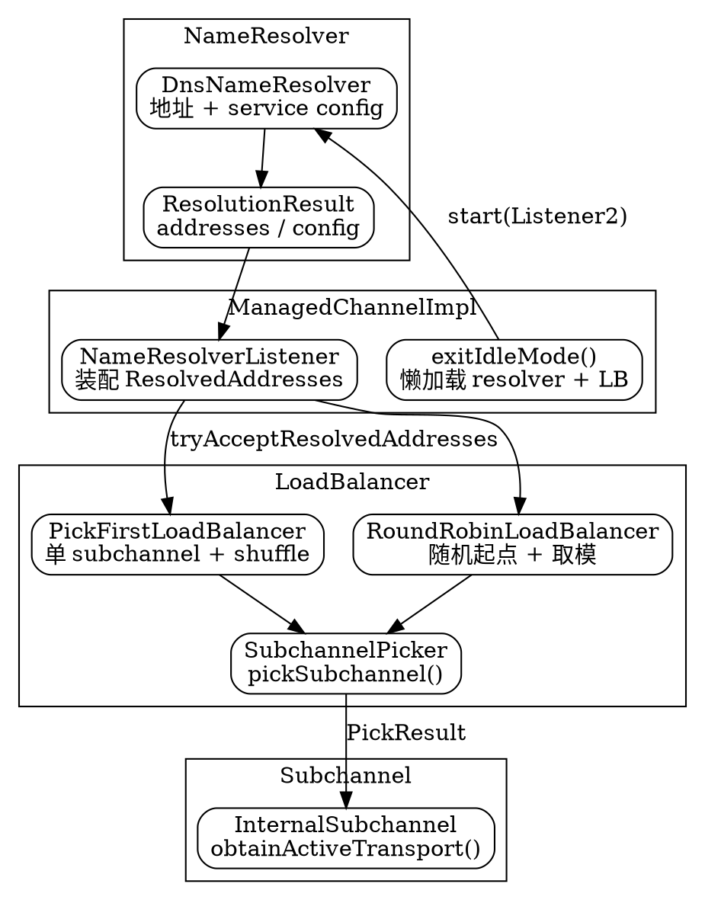

# gRPC Java Name Resolution and Load Balancing

## Introduction

gRPC 的负载均衡默认在**客户端**完成——客户端持有后端列表，自己挑一个建连，而不是靠代理转发。这条链由 `NameResolver`（把 target 字符串解析成地址 + service config）和 `LoadBalancer`（从地址里挑 subchannel）协作完成，两者都挂在 `ManagedChannelImpl` 上，且都是**懒加载**（channel 进入 IDLE 时不创建，第一次 RPC 才初始化）。

> 版本基线：grpc-java 1.75.0（commit 3abc0e6）。以下片段均取自该 tag。

三个反直觉点：

- **pick_first 不是"挑第一个"那么简单**：它把**全部**地址塞进**同一个** `Subchannel`（`createSubchannel().setAddresses(servers)`），后续地址变化走 `updateAddresses`，不是为每个地址建一个连接。
- **RoundRobin 起点是随机的**：`sequence = new AtomicInteger(new Random().nextInt())`，且 pick 时 `getAndIncrement() & Integer.MAX_VALUE` 再取模——先屏蔽符号位防负数。
- **resolver 产出不止地址**：`ResolutionResult` 同时带 service config（LB 策略、重试、超时），`NameResolverListener` 把两者一起喂给 LB，所以自定义 resolver 比想象中复杂。

## The Resolution → Balancing Chain



## Lazy Initialization: exitIdleMode()

Channel 初始处于 IDLE，第一次真正使用前不建 resolver / LB。`exitIdleMode()` 里先建 LB，再 `nameResolver.start(listener)`——顺序很重要：resolver 一启动就可能回调，LB 必须已就位。

```java
// core/src/main/java/io/grpc/internal/ManagedChannelImpl.java
if (lbHelper != null) {
  return;
}
channelLogger.log(ChannelLogLevel.INFO, "Exiting idle mode");
LbHelperImpl lbHelper = new LbHelperImpl();
lbHelper.lb = loadBalancerFactory.newLoadBalancer(lbHelper);
this.lbHelper = lbHelper;

channelStateManager.gotoState(CONNECTING);
NameResolverListener listener = new NameResolverListener(lbHelper, nameResolver);
nameResolver.start(listener);
nameResolverStarted = true;
```

## ResolutionResult → ResolvedAddresses

`NameResolverListener.onResult2` 把解析结果（地址 + service config + attributes）打包成 `ResolvedAddresses` 交给 LB：

```java
// core/src/main/java/io/grpc/internal/ManagedChannelImpl.java
ResolvedAddresses.Builder resolvedAddresses = ResolvedAddresses.newBuilder()
    .setAddresses(serversOrError.getValue())
    .setAttributes(attributes)
    .setLoadBalancingPolicyConfig(effectiveServiceConfig.getLoadBalancingConfig());
Status addressAcceptanceStatus = helper.lb.tryAcceptResolvedAddresses(
    resolvedAddresses.build());
return addressAcceptanceStatus;
```

`LoadBalancer.ResolvedAddresses` 是 resolver 与 LB 之间的契约——它把"地址列表"和"LB 策略配置"绑在一起，这正是 gRFC A24（LB Policy Config）的落地。

## PickFirst: One Subchannel for All Addresses

`PickFirstLoadBalancer` 的默认行为常见误解。它并不是"一个地址一个 subchannel"，而是把所有地址交给**同一个** subchannel：

```java
// core/src/main/java/io/grpc/internal/PickFirstLoadBalancer.java
if (subchannel == null) {
  final Subchannel subchannel = helper.createSubchannel(
      CreateSubchannelArgs.newBuilder()
          .setAddresses(servers)
          .build());
  subchannel.start(new SubchannelStateListener() {
    @Override
    public void onSubchannelState(ConnectivityStateInfo stateInfo) {
      processSubchannelState(subchannel, stateInfo);
    }
  });
  this.subchannel = subchannel;

  // The channel state does not get updated when doing name resolving today, so for the moment
  // let LB report CONNECTION and call subchannel.requestConnection() immediately.
  updateBalancingState(CONNECTING, new Picker(PickResult.withSubchannel(subchannel)));
  subchannel.requestConnection();
} else {
  subchannel.updateAddresses(servers);
}
```

subchannel 内部会依次尝试地址列表，直到连上一个。可选的地址打乱通过 service config 的 `shuffleAddressList` 开启（带可选 `randomSeed`）：

```java
// core/src/main/java/io/grpc/internal/PickFirstLoadBalancer.java
if (config.shuffleAddressList != null && config.shuffleAddressList) {
  servers = new ArrayList<EquivalentAddressGroup>(servers);
  Collections.shuffle(servers,
      config.randomSeed != null ? new Random(config.randomSeed) : new Random());
}
```

> [!NOTE]
> 想真正把请求分摊到多个后端，必须显式配置 `round_robin`。继续用默认的 pick_first，多后端场景只会打满第一个——这是最高频的踩坑点。

## RoundRobin: Random Start + Masked Index

`RoundRobinLoadBalancer` 为每个 READY 的 subchannel 建一个子 picker，用 `ReadyPicker` 做轮询：

```java
// util/src/main/java/io/grpc/util/RoundRobinLoadBalancer.java
final class RoundRobinLoadBalancer extends MultiChildLoadBalancer {
  private final AtomicInteger sequence = new AtomicInteger(new Random().nextInt());
  // ...
  @Override
  public PickResult pickSubchannel(PickSubchannelArgs args) {
    return subchannelPickers.get(nextIndex()).pickSubchannel(args);
  }

  private int nextIndex() {
    int i = index.getAndIncrement() & Integer.MAX_VALUE;
    return i % subchannelPickers.size();
  }
}
```

两个细节：索引起点是 `new Random().nextInt()`（随机，不是 0），避免所有客户端同步打到同一后端；`& Integer.MAX_VALUE` 屏蔽符号位，让 `getAndIncrement()` 溢出成负数后仍是合法的正数索引，再取模。

## Policies at a Glance

| 策略 | 实现 | 用途 |
| :--- | :--- | :--- |
| pick_first | `PickFirstLoadBalancer`（core） | 默认；单 subchannel 顺序尝试地址 |
| round_robin | `RoundRobinLoadBalancer`（util） | 多后端轮询，随机起点 |
| grpclb / xds / ring_hash 等 | 独立模块或 gRPC Extensions | 外部 LB、服务网格、一致性哈希 |

默认策略由 `AutoConfiguredLoadBalancerFactory` 根据 service config 的 `loadBalancingConfig` 选择；未配置时回退到 pick_first。

## Links

- [gRPC](/docs/CS/Framework/gRPC/gRPC.md) — 枢纽：架构与纠偏
- [ClientCallChain](/docs/CS/Framework/gRPC/ClientCallChain.md) — LB pick 之后如何建 ClientStream
- [ManagedChannel](/docs/CS/Framework/gRPC/ManagedChannel.md) — Channel 状态机与 subchannel 生命周期
- [Ecosystem](/docs/CS/Framework/gRPC/Ecosystem.md) — xDS 与服务网格
- [consul 客户端负载均衡](/docs/CS/Framework/consul/client.md) — 服务发现对照
- [Nacos 注册中心](/docs/CS/Framework/nacos/registry.md) — 服务端发现对照

## References

- [grpc-java v1.75.0 PickFirstLoadBalancer.java](https://github.com/grpc/grpc-java/blob/v1.75.0/core/src/main/java/io/grpc/internal/PickFirstLoadBalancer.java)
- [grpc-java v1.75.0 RoundRobinLoadBalancer.java](https://github.com/grpc/grpc-java/blob/v1.75.0/util/src/main/java/io/grpc/util/RoundRobinLoadBalancer.java)
- [gRFC: gRPC Load Balancing](https://github.com/grpc/grpc/blob/master/doc/load-balancing.md)
- [gRFC A24: LB Policy Config](https://github.com/grpc/grpc/blob/master/doc/service_config.md)
