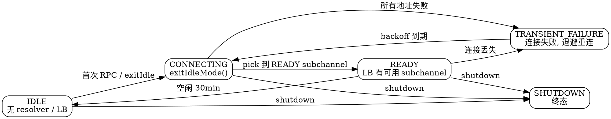

# gRPC Java ManagedChannel: State and Subchannel Lifecycle

## Introduction

`ManagedChannelImpl` 是 grpc-java 客户端 channel 的核心实现：它持有 resolver、LB、subchannel 与一个"延迟 transport"，并维护一条从 IDLE 到 SHUTDOWN 的状态机。理解它就能回答两个高频问题：为什么 channel 不调用就一直 IDLE？连接断了为什么不需要应用重连？

> 版本基线：grpc-java 1.75.0（commit 3abc0e6）。以下片段均取自该 tag。

两个反直觉点：

- **IDLE 超时默认 30 分钟**：`IDLE_MODE_DEFAULT_TIMEOUT_MILLIS = 30 min`，超时后 `enterIdleMode()` 会**彻底销毁** resolver 与 LB，下次 RPC 重新创建。
- **IDLE 时 RPC 不丢，积压在 delayedTransport**：channel 在 IDLE 时来的调用不会失败，而是排队；`exitIdleMode()` 后由 `delayedTransport.reprocess()` 放行。

## Channel State Machine



## IDLE: Lazy by Default

Channel 构造后不建立任何连接。`exitIdleMode()` 同时创建 LB 与 resolver（顺序关键：LB 先就位，避免 resolver 回调时无处安放），并把状态切到 CONNECTING：

```java
// core/src/main/java/io/grpc/internal/ManagedChannelImpl.java
if (lbHelper != null) {
  return;
}
channelLogger.log(ChannelLogLevel.INFO, "Exiting idle mode");
LbHelperImpl lbHelper = new LbHelperImpl();
lbHelper.lb = loadBalancerFactory.newLoadBalancer(lbHelper);
this.lbHelper = lbHelper;

channelStateManager.gotoState(CONNECTING);
NameResolverListener listener = new NameResolverListener(lbHelper, nameResolver);
nameResolver.start(listener);
nameResolverStarted = true;
```

反向的 `enterIdleMode()` 做彻底的清理——shutdown resolver 与 LB（LB 又会 shutdown 它持有的 subchannel），再把积压在 delayedTransport 的请求重新放行（若还有 in-use 对象，立刻再 `exitIdleMode()`）：

```java
// core/src/main/java/io/grpc/internal/ManagedChannelImpl.java
private void enterIdleMode() {
  shutdownNameResolverAndLoadBalancer(true);
  delayedTransport.reprocess(null);
  channelLogger.log(ChannelLogLevel.INFO, "Entering IDLE state");
  channelStateManager.gotoState(IDLE);
  // If the inUseStateAggregator still considers pending calls to be queued up or the delayed
  // transport to be holding some we need to exit idle mode to give these calls a chance to
  // be processed.
  if (inUseStateAggregator.anyObjectInUse(pendingCallsInUseObject, delayedTransport)) {
    exitIdleMode();
  }
}
```

IDLE 超时默认 30 分钟（可配，最小 1 秒，`0` 表示禁用）：

```java
// core/src/main/java/io/grpc/internal/ManagedChannelImplBuilder.java
static final long IDLE_MODE_DEFAULT_TIMEOUT_MILLIS = TimeUnit.MINUTES.toMillis(30);
static final long IDLE_MODE_MIN_TIMEOUT_MILLIS = TimeUnit.SECONDS.toMillis(1);
```

## Subchannel: One Backend's Connection Pool

`InternalSubchannel` 维护**单个后端**（或 pick_first 下的整组地址）的连接状态，核心字段是一个 volatile 的 `ConnectivityStateInfo`：

```java
// core/src/main/java/io/grpc/internal/InternalSubchannel.java
// The transport for new outgoing requests. Non-null only in READY state.
private volatile ConnectivityStateInfo state = ConnectivityStateInfo.forNonError(IDLE);
```

它的状态迁移受 `syncContext` 串行化，连接失败进入 TRANSIENT_FAILURE 后由 backoff 重新调度（不是应用重连）：

```java
// core/src/main/java/io/grpc/internal/InternalSubchannel.java
// Only called after all addresses attempted and failed (TRANSIENT_FAILURE).
// ...
channelLogger.log(ChannelLogLevel.INFO, "CONNECTING after backoff");
gotoNonErrorState(CONNECTING);
```

`getTransportFromPickResult` 展示了 LB pick 结果如何变成真实 transport——pick 返回 subchannel，subchannel 再 `obtainActiveTransport()`，取不到（未 READY）则返回 null，调用被缓冲：

```java
// core/src/main/java/io/grpc/internal/GrpcUtil.java
@Nullable
static ClientTransport getTransportFromPickResult(PickResult result, boolean isWaitForReady) {
  final ClientTransport transport;
  Subchannel subchannel = result.getSubchannel();
  if (subchannel != null) {
    transport = ((TransportProvider) subchannel.getInternalSubchannel()).obtainActiveTransport();
  } else {
    transport = null;
  }
  // ...
  return transport;
}
```

## The Delayed Transport Trick

channel 在 IDLE / CONNECTING 期间到来的 RPC 不会失败，而是进入 `DelayedTransport` 队列。这是"连接故障被收敛在 channel 内部，应用只看到这次调用慢了/失败了，而不是'连接断了'"的工程基础。等 LB 选出可用 transport，`delayedTransport.reprocess()` 把积压的流一次性转交出去。

> [!NOTE]
> `waitForReady=true` 的调用会在 TRANSIENT_FAILURE 时继续等待而不是立即失败；`false`（默认）则快速失败。这是 `getTransportFromPickResult` 里 `isWaitForReady` 参数的意义，也是重试策略决策的入口（见 [Ecosystem](/docs/CS/Framework/gRPC/Ecosystem.md)）。

## Links

- [gRPC](/docs/CS/Framework/gRPC/gRPC.md) — 枢纽：架构与纠偏
- [LoadBalancing](/docs/CS/Framework/gRPC/LoadBalancing.md) — resolver 与 LB 如何挂在 channel 上
- [ClientCallChain](/docs/CS/Framework/gRPC/ClientCallChain.md) — RPC 如何进入 delayed transport
- [FlowControl](/docs/CS/Framework/gRPC/FlowControl.md) — transport 层的流控
- [Ecosystem](/docs/CS/Framework/gRPC/Ecosystem.md) — waitForReady 与重试
- [Nacos 客户端](/docs/CS/Framework/nacos/client.md) — 另一套客户端连接管理对照

## References

- [grpc-java v1.75.0 ManagedChannelImpl.java](https://github.com/grpc/grpc-java/blob/v1.75.0/core/src/main/java/io/grpc/internal/ManagedChannelImpl.java)
- [grpc-java v1.75.0 InternalSubchannel.java](https://github.com/grpc/grpc-java/blob/v1.75.0/core/src/main/java/io/grpc/internal/InternalSubchannel.java)
- [gRFC: gRPC Client Connectivity States](https://github.com/grpc/proposal/blob/master/A8-client-side-connection-backoff.md)
