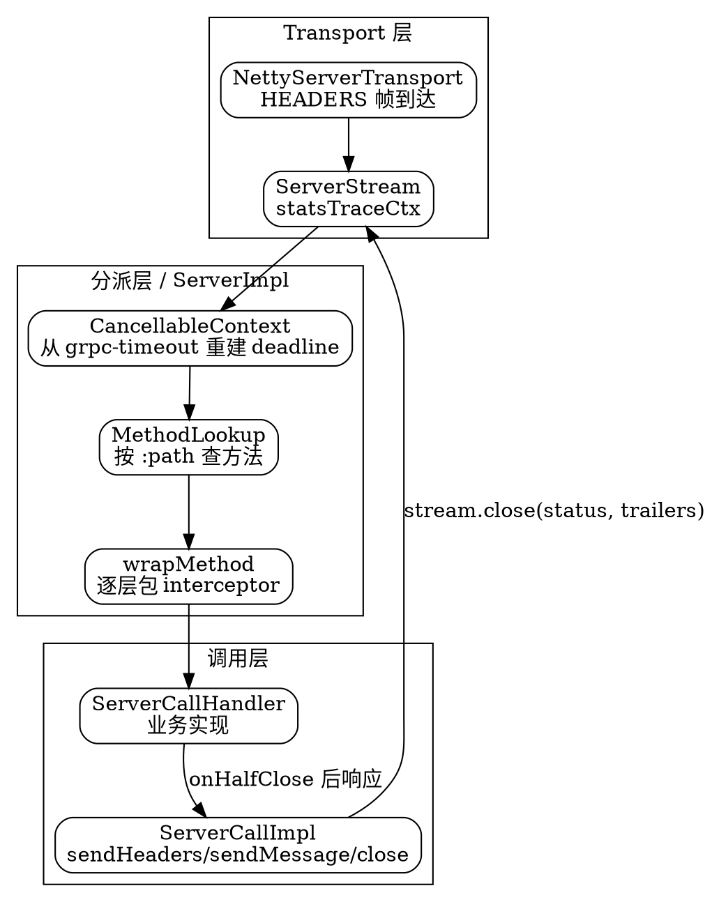

# gRPC Java Server Call Chain

## Introduction

服务端的一次调用从 Netty 收到 HTTP/2 HEADERS 帧开始，到业务 handler 返回状态、状态写入 trailer 结束。本页沿 grpc-java 1.75.0 源码走这条链：`ServerImpl` 按 `:path` 查方法 → 为请求建 `CancellableContext` → 逐层包 interceptor → `ServerCallImpl` 收发消息 → `close` 写状态码。

> 版本基线：grpc-java 1.75.0（commit 3abc0e6）。以下片段均取自该 tag。

三个反直觉点：

- **unary 方法返回 OK 却没发消息 → 强制 INTERNAL**：`ServerCallImpl.closeInternal` 检查 `serverSendsOneMessage() && !messageSent`，避免"成功但无响应"的幽灵结果。
- **rootContext 被 fork**：`ServerImpl` 启动时对传入的 rootContext 调 `fork()`，只继承值、不继承取消——否则一个请求的取消会传染到所有请求。
- **interceptor 逐层包裹 handler**：for 循环里 `handler = interceptCallHandlerCreate(interceptor, handler)`，注册的拦截器越靠后、越靠近网络层——与客户端拦截器方向相反。

## The Server Dispatch Flow



## Context Creation: Deadline from the Wire

每个 RPC 到达时，`ServerImpl` 用 `createContext` 建一个 `CancellableContext`。请求头里的 `grpc-timeout` 已经被 transport 解析成纳秒 Long 存在 `TIMEOUT_KEY`，这里用它重建 deadline——这印证了"deadline 每跳重算、不是透传字符串"的说法。

```java
// core/src/main/java/io/grpc/internal/ServerImpl.java
private Context.CancellableContext createContext(
    Metadata headers, StatsTraceContext statsTraceCtx) {
  Long timeoutNanos = headers.get(TIMEOUT_KEY);

  Context baseContext =
      statsTraceCtx
          .serverFilterContext(rootContext)
          .withValue(io.grpc.InternalServer.SERVER_CONTEXT_KEY, ServerImpl.this);

  if (timeoutNanos == null) {
    return baseContext.withCancellation();
  }

  Context.CancellableContext context =
      baseContext.withDeadline(
          Deadline.after(timeoutNanos, NANOSECONDS, ticker),
          transport.getScheduledExecutorService());

  return context;
}
```

rootContext 在构造时就被 `fork()`：

```java
// core/src/main/java/io/grpc/internal/ServerImpl.java
// Fork from the passed in context so that it does not propagate cancellation, it only
// inherits values from the parent.
this.rootContext = Preconditions.checkNotNull(rootContext, "rootContext").fork();
```

分派用两个 `ContextRunnable`（`MethodLookup` 与 `HandleServerCall`），都通过 `wrappedExecutor.execute()` 派发，保证业务代码运行在正确的 Context 里：

```java
// core/src/main/java/io/grpc/internal/ServerImpl.java
context.addListener(new ServerStreamCancellationListener(), directExecutor());
// ...
wrappedExecutor.execute(new MethodLookup());
wrappedExecutor.execute(new HandleServerCall());
```

## Interceptor Wrapping

`wrapMethod` 把注册的 interceptor 逐层包住 handler——注意迭代顺序：每轮用上一轮的 `handler` 包当前 interceptor，所以**最后注册的 interceptor 在最内层、最接近业务 handler**。

```java
// core/src/main/java/io/grpc/internal/ServerImpl.java
ServerCallHandler<ReqT, RespT> handler = methodDef.getServerCallHandler();
for (ServerInterceptor interceptor : interceptors) {
  handler = InternalServerInterceptors.interceptCallHandlerCreate(interceptor, handler);
}
ServerMethodDefinition<ReqT, RespT> interceptedDef = methodDef.withServerCallHandler(handler);
```

## ServerCallImpl: sendHeaders / sendMessage / close

`sendHeadersInternal` 会主动丢弃客户端传来的 `content-length` 和 `message-encoding` 头（防止被误导），再按压缩器补上正确的 `grpc-encoding` / `grpc-accept-encoding`：

```java
// core/src/main/java/io/grpc/internal/ServerCallImpl.java
private void sendHeadersInternal(Metadata headers) {
  // ...
  headers.discardAll(CONTENT_LENGTH_KEY);
  headers.discardAll(MESSAGE_ENCODING_KEY);
  // ...
  headers.put(MESSAGE_ENCODING_KEY, compressor.getMessageEncoding());
  // ...
  headers.discardAll(MESSAGE_ACCEPT_ENCODING_KEY);
  headers.put(MESSAGE_ACCEPT_ENCODING_KEY, advertisedEncodings);
  // Don't check if sendMessage has been called, since it requires that sendHeaders was already
  // called, which is enforced by the transport.
  stream.writeHeaders(headers, !getMethodDescriptor().getType().serverSendsOneMessage());
}
```

`closeInternal` 是状态回传的终点。unary 方法 OK 但没消息的校验就在这里：

```java
// core/src/main/java/io/grpc/internal/ServerCallImpl.java
private void closeInternal(Status status, Metadata trailers) {
  checkState(!closeCalled, "call already closed");
  try {
    closeCalled = true;

    if (status.isOk() && method.getType().serverSendsOneMessage() && !messageSent) {
      handleInternalError(Status.INTERNAL.withDescription(MISSING_RESPONSE).asRuntimeException());
      return;
    }

    stream.close(status, trailers);
  } finally {
    serverCallTracer.reportCallEnded(status.isOk());
  }
}
```

状态码和描述最终由 transport 写进 trailers（见 [Status](/docs/CS/Framework/gRPC/Status.md)）。

## Cancellation: Context → RST_STREAM

服务端从两个来源感知取消：**客户端主动 cancel**（HTTP/2 RST_STREAM → stream listener → context.cancel）与**deadline 到期**（`withDeadline` 调度的任务 → context.cancel）。`ServerStreamCancellationListener` 监听 Context 取消，但**只在 DEADLINE_EXCEEDED 时才主动 cancel stream**：

```java
// core/src/main/java/io/grpc/internal/ServerImpl.java
// Delay of setting cancellationListener to context will fix the issue.
final class ServerStreamCancellationListener implements Context.CancellationListener {
  @Override
  public void cancelled(Context context) {
    Status status = statusFromCancelled(context);
    if (DEADLINE_EXCEEDED.getCode().equals(status.getCode())) {
      // This should rarely get run, since the client will likely cancel the stream
      // before the timeout is reached.
      stream.cancel(status);
    }
  }
}
context.addListener(new ServerStreamCancellationListener(), directExecutor());
```

为什么只对 deadline 生效？因为客户端主动取消时，RST_STREAM 已经让服务端 stream 关闭了，无需再 cancel；只有 deadline 在服务端本地到期、客户端还没来得及发 RST_STREAM 时，才需要这条路径主动 cancel。注释也点明"这条路径很少跑到"——正常情况客户端会先取消。注册动作被刻意延后（`// Delay of setting cancellationListener to context will fix the issue.`），避开 context 刚创建时的竞态。

> [!NOTE]
> 取消能传到 Context 是框架提供的能力，但**业务 handler 必须主动检查** `ServerCallStreamObserver.isCancelled()` 或 `Context.current().isCancelled()` 才能及时停止计算。框架取消的是传输与 Context，不是你的线程池——这正是 [RPC](/docs/CS/Distributed/RPC/RPC.md) 里"孤儿（orphan）"问题的现代解答的边界。

## Links

- [gRPC](/docs/CS/Framework/gRPC/gRPC.md) — 枢纽：架构与纠偏
- [ClientCallChain](/docs/CS/Framework/gRPC/ClientCallChain.md) — 客户端调用链（方向相反的 interceptor）
- [Status](/docs/CS/Framework/gRPC/Status.md) — 状态码与 trailer 编码
- [ContextDeadline](/docs/CS/Framework/gRPC/ContextDeadline.md) — 服务端 deadline 重建与取消
- [Streaming](/docs/CS/Framework/gRPC/Streaming.md) — 服务端流式响应
- [Ecosystem](/docs/CS/Framework/gRPC/Ecosystem.md) — 拦截器、健康检查与网关

## References

- [grpc-java v1.75.0 ServerImpl.java](https://github.com/grpc/grpc-java/blob/v1.75.0/core/src/main/java/io/grpc/internal/ServerImpl.java)
- [grpc-java v1.75.0 ServerCallImpl.java](https://github.com/grpc/grpc-java/blob/v1.75.0/core/src/main/java/io/grpc/internal/ServerCallImpl.java)
- [gRPC Java Server Concepts](https://grpc.io/docs/what-is-grpc/core-concepts/#server-side)
