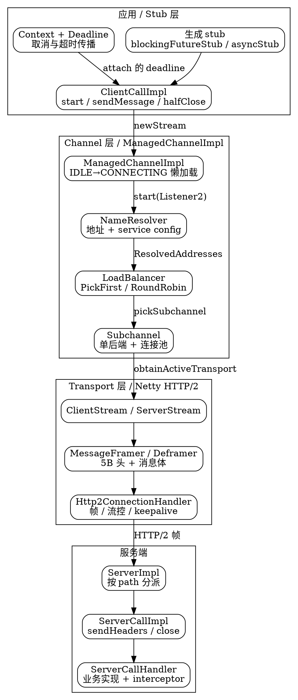

# gRPC

## Introduction

[gRPC](https://grpc.io/) 是 CNCF 毕业项目，一套跨语言的高性能 RPC 框架：服务方用 Protocol Buffers 定义接口契约，工具链为各语言生成 stub，调用方写出的代码看起来就是一次普通方法调用，底下由框架负责连接管理、编码、流控、超时传播与状态映射。它正是 [RPC](/docs/CS/Distributed/RPC/RPC.md) 概念模型里 **client stub / server stub + marshalling** 的工业化实现，只是把当年停留在论文里的部分做成了可插拔运行时组件。

> 版本基线：gRPC **Java 1.75.0**（tag `v1.75.0`，commit `3abc0e6`）。本页及 `gRPC/` 下各分册的源码片段、默认值均取自该 tag 的 grpc-java 源码，路径为模块相对路径（如 `core/src/main/java/io/grpc/internal/`）。各语言实现共享 minor 版本号，但**默认值与实现细节各不相同**，不可把 grpc-go 的结论直接套到 Java。

三个最容易理解错的点（下面各有源码级展开）：

- **默认负载均衡不是"均衡"**：`pick_first` 把**全部**解析地址塞进**同一个** subchannel，连上第一个就一直用，不做分摊；真正分发要显式切 `round_robin`。
- **超时不是简单透传**：service config 的 timeout、CallOptions deadline、Context deadline 三方取最早者，再由 `TimeoutMarshaller` 用贪心精度编码——`2 秒`会被编码成 `2000000u` 而不是 `2S`。
- **流控窗口不是 HTTP/2 默认 64 KiB**：grpc-java Netty 初始窗口 **1 MiB**，且默认**开启** BDP 自动调优；`flowControlWindow()` 恰恰是**关闭**调优的开关。

## Why HTTP/2

选择 HTTP/2 而不是自定义 TCP 协议，是 gRPC 最关键的取舍。它换来三样东西：**多路复用**（一条 TCP 连接并发多个 stream，一次 RPC 对应一个 stream，HEADERS 帧传元数据、DATA 帧传消息、trailer 传状态）、**HPACK 头部压缩**、**标准化的流控与优先级**。代价是调试门槛——线上抓包看到的是二进制帧，必须靠 `grpcurl` 或服务端日志还原语义。

跨语言互通的前提是双方对"一次 RPC 如何映射到帧序列"有完全一致的约定，这份约定就是 [gRFC: gRPC over HTTP/2](https://github.com/grpc/grpc/blob/master/doc/PROTOCOL-HTTP2.md)。线协议层——HEADERS / DATA / Trailers 的完整帧序列与强制头部——见 [Architecture](/docs/CS/Framework/gRPC/Architecture.md)；Java 实现里把字节流切成"5 字节头 + 消息体"的是 `MessageFramer` / `MessageDeframer`（见 [Framing](/docs/CS/Framework/gRPC/Framing.md)）。

## Architecture

### Layered Architecture

gRPC Java 把一次调用压进三层：面向应用的 **Stub / Channel 层**（`ManagedChannelImpl` 持有 NameResolver 与 LoadBalancer）、面向单连接的 **Subchannel 层**、面向字节的 **Transport 层**（Netty HTTP/2）。一次 RPC 的过程就是：LB 从 subchannel 里 pick 一个 → 拿到它的 active transport → 建一个 ClientStream → 消息经 framer 变成带长度前缀的帧 → 写进 HTTP/2 stream。

> 版本基线：grpc-java 1.75.0（commit 3abc0e6）。以下片段均取自该 tag。



### The Client Boot Chain

Channel 的 resolver 和 LB 都是**懒加载**的：`ManagedChannelImpl` 初始处于 IDLE，第一次真正发起 RPC 时才通过 `exitIdleMode()` 创建它们。这段代码也解释了"为什么 DNS 解析慢会被算进 deadline"——解析发生在 `start()` 之后、建流之前。

```java
// core/src/main/java/io/grpc/internal/ManagedChannelImpl.java
if (lbHelper != null) {
  return;
}
channelLogger.log(ChannelLogLevel.INFO, "Exiting idle mode");
LbHelperImpl lbHelper = new LbHelperImpl();
lbHelper.lb = loadBalancerFactory.newLoadBalancer(lbHelper);
// Delay setting lbHelper until fully initialized, since loadBalancerFactory is user code
// and may throw. We don't want to confuse our state, even if we will enter panic mode.
this.lbHelper = lbHelper;

channelStateManager.gotoState(CONNECTING);
NameResolverListener listener = new NameResolverListener(lbHelper, nameResolver);
nameResolver.start(listener);
nameResolverStarted = true;
```

resolver 的结果不是"地址列表"这么简单——它同时携带 service config（含 LB 策略、重试、超时），一起喂给 LB：

```java
// core/src/main/java/io/grpc/internal/ManagedChannelImpl.java
ResolvedAddresses.Builder resolvedAddresses = ResolvedAddresses.newBuilder()
    .setAddresses(serversOrError.getValue())
    .setAttributes(attributes)
    .setLoadBalancingPolicyConfig(effectiveServiceConfig.getLoadBalancingConfig());
Status addressAcceptanceStatus = helper.lb.tryAcceptResolvedAddresses(
    resolvedAddresses.build());
```

### One RPC, One Stream

`ClientCallImpl.start()` 是客户端调用的枢纽：先算有效 deadline、准备 headers，再建 stream。注意 deadline 已经超时时**根本不建真实 stream**，而是直接返回一个 `FailingClientStream`，把错误立刻上抛。

```java
// core/src/main/java/io/grpc/internal/ClientCallImpl.java
Deadline effectiveDeadline = effectiveDeadline();
boolean contextIsDeadlineSource = effectiveDeadline != null
    && effectiveDeadline.equals(context.getDeadline());
cancellationHandler = new CancellationHandler(effectiveDeadline, contextIsDeadlineSource);
boolean deadlineExceeded = effectiveDeadline != null && cancellationHandler.remainingNanos <= 0;
if (!deadlineExceeded) {
  stream = clientStreamProvider.newStream(method, callOptions, headers, context);
} else {
  // ... assemble description with name resolution delay ...
  stream = new FailingClientStream(DEADLINE_EXCEEDED.withDescription(description), tracers);
}
// ...
if (effectiveDeadline != null) {
  stream.setDeadline(effectiveDeadline);
}
stream.start(new ClientStreamListenerImpl(observer));
// Propagate later Context cancellation to the remote side.
cancellationHandler.setUp();
```

`effectiveDeadline()` 是三方取最小：CallOptions 的 deadline 与 Context 的 deadline 先取 min，service config 的 timeout 再参与比较（见 [ContextDeadline](/docs/CS/Framework/gRPC/ContextDeadline.md)）。取消监听 `setUp()` 特意放在 `stream.start()` 之后——注释点明"多数 transport 在 start 前收到 cancel 会出问题（Issue #1343）"。

发送侧 `sendMessage` 对 unary 调用不立即 flush，把 END_STREAM 标志 piggy-back 到最后一帧上：

```java
// core/src/main/java/io/grpc/internal/ClientCallImpl.java
if (stream instanceof RetriableStream) {
  // ...
  retriableStream.sendMessage(message);
} else {
  stream.writeMessage(method.streamRequest(message));
}
// For unary requests, we don't flush since we know that halfClose should be coming soon.
// This allows us to piggy-back the END_STREAM=true on the last message frame
if (!unaryRequest) {
  stream.flush();
}
```

### The Server Side

服务端按 `:path` 查方法定义，把 interceptor 逐层包住 handler，然后为每个请求建一个 `CancellableContext`（携带从 `grpc-timeout` 还原的 deadline）。注意 interceptor 的包裹顺序是 for 循环逐层调用 `interceptCallHandlerCreate`。

```java
// core/src/main/java/io/grpc/internal/ServerImpl.java
ServerCallHandler<ReqT, RespT> handler = methodDef.getServerCallHandler();
for (ServerInterceptor interceptor : interceptors) {
  handler = InternalServerInterceptors.interceptCallHandlerCreate(interceptor, handler);
}
ServerMethodDefinition<ReqT, RespT> interceptedDef = methodDef.withServerCallHandler(handler);
```

状态通过 trailer 传回。`ServerCallImpl.closeInternal` 有个反直觉校验：unary 方法（`serverSendsOneMessage()`）若以 OK 结束却一条消息都没发，会被强制改成 `INTERNAL: MISSING_RESPONSE`。

```java
// core/src/main/java/io/grpc/internal/ServerCallImpl.java
if (status.isOk() && method.getType().serverSendsOneMessage() && !messageSent) {
  handleInternalError(Status.INTERNAL.withDescription(MISSING_RESPONSE).asRuntimeException());
  return;
}
stream.close(status, trailers);
```

### Ports at a Glance

gRPC 本身没有固定端口——它只是 HTTP/2 over TCP，端口由部署决定。常见默认值来自生态而非协议：grpc-go 的健康检查 `:50051`、Nacos 的 gRPC `:9848`、Envoy 常见 `:8080`。HTTP/2 明文优先 `h2c`（priority / HTTP/1.1 upgrade 两种），TLS 走 ALPN 协商 `h2`。

## Communication Patterns

gRPC 定义四种模式，区别只在"请求是不是流""响应是不是流"：

| 模式 | 请求 | 响应 | 典型场景 |
| :--- | :--- | :--- | :--- |
| Unary | 单条 | 单条 | 普通请求-响应 |
| Server streaming | 单条 | 流 | 订阅推送、大结果集分批下发 |
| Client streaming | 流 | 单条 | 大文件上传、批量写入 |
| Bidirectional | 流 | 流 | 实时双向通信、代理隧道 |

流式是 gRPC 相对传统 RPC 最有价值的扩展——双向流里请求流与响应流**相互独立**，各自用自己的 END_STREAM 结束。四模式的 IDL 写法、帧序列、背压与取消语义见 [Streaming](/docs/CS/Framework/gRPC/Streaming.md)。

## Corrections

本子树早期笔记以 gRFC 规范 + grpc-go 为基线，迁移到 grpc-java 1.75.0 源码后，以下结论被纠正：

| 主题 | 旧结论（规范 / grpc-go） | 源码核实（grpc-java 1.75.0） |
| :--- | :--- | :--- |
| 默认 LB | pick_first 挑第一个可用后端 | pick_first 把**全部**地址给**同一个** subchannel，`updateAddresses` 刷新；`shuffleAddressList` 可打乱 |
| RoundRobin 起点 | 从 0 开始轮询 | `new Random().nextInt()` 随机起点，pick 用 `getAndIncrement() & Integer.MAX_VALUE` 再取模 |
| 超时编码 | 秒用 `S`、按语义选单位 | `cutoff=1e8`，贪心精度，`2s → 2000000u`；`parseAsciiString` 允许最多 9 字符（8 位数字 + 单位） |
| 初始流控窗口 | HTTP/2 默认 65535 字节 | Netty `DEFAULT_FLOW_CONTROL_WINDOW = 1024*1024`（1 MiB），默认开 BDP 自动调优 |
| keepalive | go 客户端默认关闭、服务端 2h | Java 客户端 `KEEPALIVE_TIME_NANOS_DISABLED=Long.MAX_VALUE`（关闭）、服务端 2h、超时 20s |
| header 上限 | go 默认 16 MiB（8 KiB 是"计划值"） | Java `DEFAULT_MAX_HEADER_LIST_SIZE = 8192`（8 KiB，即规范建议值） |
| 默认 deadline 来源 | 服务端假定无限超时 | `ClientCallImpl.effectiveDeadline()` 取 CallOptions 与 Context 的 min；service config timeout 再取更早者 |
| 帧头保留位 | 规范写"0/1" | 源码用位掩码：`COMPRESSED_FLAG_MASK=1`、`RESERVED_MASK=0xFE`，高 7 位非零直接 `INTERNAL` |

## Version Baseline

gRPC 各语言实现共享 minor.point 版本号，便于对照；本子树锁定 **Java 1.75.0**（2025 年发布线）。其它语言/组件的近似版本仅作参考，具体以各自仓库 tag 为准。

| 组件 | 版本 | 备注 |
| :--- | :--- | :--- |
| gRPC Java（本子树基线） | 1.75.0 | tag `v1.75.0`，commit `3abc0e6` |
| gRPC C core | 1.75.0 | 共享 minor 号 |
| grpc-go | 1.75.0 | 默认值与本子树不同，见 Corrections |
| protoc-gen-go-grpc | 1.5.x | 代码生成器版本线独立 |
| Protocol Buffers | 30.x | Edition 2023/2024 需 27.0/32.0+ |

## Links

- [Framing](/docs/CS/Framework/gRPC/Framing.md) — 5 字节头与消息定界
- [ClientCallChain](/docs/CS/Framework/gRPC/ClientCallChain.md) — 客户端调用链与截获点
- [ServerCallChain](/docs/CS/Framework/gRPC/ServerCallChain.md) — 服务端分派与状态回传
- [LoadBalancing](/docs/CS/Framework/gRPC/LoadBalancing.md) — Resolver 与 LB 策略
- [ContextDeadline](/docs/CS/Framework/gRPC/ContextDeadline.md) — 超时与取消传播
- [Streaming](/docs/CS/Framework/gRPC/Streaming.md) — 四种流模式与背压

## References

- [grpc-java v1.75.0 源码（core）](https://github.com/grpc/grpc-java/tree/v1.75.0/core/src/main/java/io/grpc/internal)
- [gRFC: gRPC over HTTP/2](https://github.com/grpc/grpc/blob/master/doc/PROTOCOL-HTTP2.md)
- [gRPC Java 官方文档](https://grpc.io/docs/languages/java/)
- [gRFC: gRPC Load Balancing](https://github.com/grpc/grpc/blob/master/doc/load-balancing.md)
- [RFC 7540 - HTTP/2](https://datatracker.ietf.org/doc/rfc7540/)
- [gRPC Status Codes](https://github.com/grpc/grpc/blob/master/doc/statuscodes.md)
