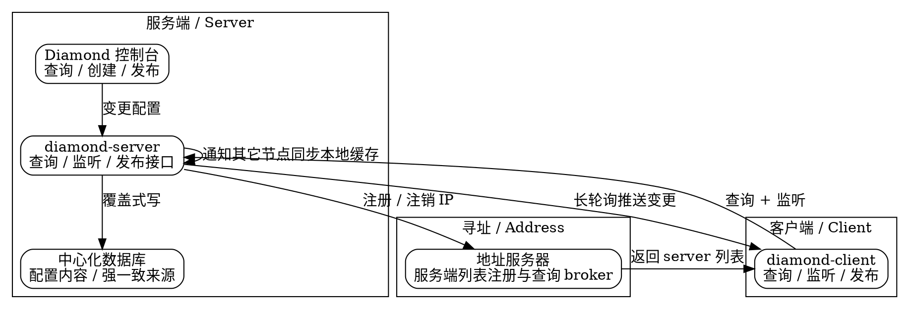
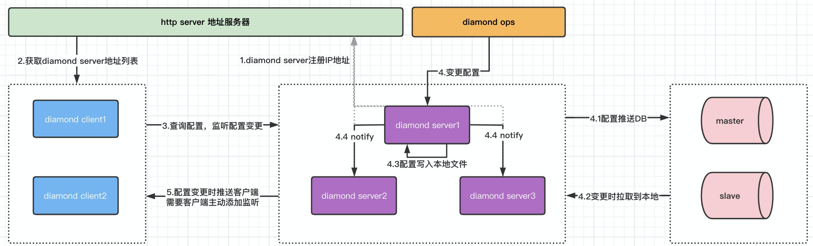

# Diamond (Alibaba Internal Origin)

## Introduction

Diamond 是阿里集团内广泛使用的**配置中心**，提供持久化配置管理与动态推送；Nacos 的 config 子系统正是 Diamond 这条线的开源延续。

> 版本基线：本篇是历史演进篇，事实以阿里 / Nacos 官方文档与博客为准；对照片段锚定 Nacos 3.2.4（commit 2c587c0）。Diamond 未开源、不在 Nacos 源码树内，无源码可摘。

反直觉点：

- Diamond 的设计目标是「可靠、易用、高效」，原则是 **make it simple**——它对配置的体积、变更频率、回调重量都做了硬约束，这些约束在今天的 Nacos 上依然成立。
- 它只保证**最终一致性**：最后一次推送的值一定到达，但不保证中间的每次变更都送达；回调里应直接用回调参数，不要再回查一次。
- 它的动态推送建立在 **HTTP 长轮询**上（推拉结合），这是 Nacos 1.x 配置推送的直系祖先；Nacos 2.x 起主通道改为 gRPC，3.x 已移除 HTTP 长轮询。

## Use Cases and Design Goals

Diamond 服务于淘宝内部几乎所有应用，典型场景包括：数据库动态切换与扩容、双十一限流开关、HSF 流控与超时规则、预案与降级开关、Notify 订阅关系变更、Tair / HBase / ZK 地址、单元化切流、MESH 流量拦截规则、黑白名单、日志级别与采样率、线程池 / 连接池阈值等。

> Switch 是对 Diamond 的封装：Switch 管简单值，Diamond 管复杂结构配置；Switch 的全部配置项是 Diamond 中的一项。

## Usage Rules (make it simple)

| 规则 | 约束 | 原因 |
| :-- | :-- | :-- |
| 小配置 | 单个配置宜 ≤ 100KB；超过 1MB 禁止变更 | 配置中心发布的是 meta-data，不是数据存储 |
| 低频变更 | < 1 次/分钟；单个配置 ≤ 1 次/5s、分钟级 ≤ 20 次 | 配置不是流量链路产品，高频写会打满 DB |
| 低频查询 | 启动时查一次，后续只监听变化 | 不要在流量链路里查配置 |
| 最终一致性 | 只保证最后一次值到达 | 覆盖式写 + 推送任务合并，中间态会被跳过 |
| 幂等 | 订阅者要能处理重复通知 | 配置中心可能重复推送 |
| 轻回调 | 回调里不要读文件 / 远程 RPC | 阻塞回调线程会拖垮其它配置的推送 |

常见误用恰好都是反面：热点 key 高频更新、用配置变更当事件通知、批量定时写入、把非元数据塞进配置——共同结局是 DB 行锁排队、连接池耗尽、IO hang。

## Architecture

一次完整流程：diamond-server 集群向地址服务器注册 IP；客户端初始化时从地址服务器拿列表；客户端向 server 查询配置并注册监听（实现 `ManagerListener`、`receiveConfigInfo`）；控制台 / API 变更配置后，server 先写 DB 再刷新本地缓存并通知其它节点同步；本地缓存变更触发对该配置监听的客户端；客户端收到通知后回查最新值并回调业务监听器。心跳用于保证 server 列表可用。

## Dynamic Push: HTTP Long Polling

推的实时性本质是「服务器如何把变更源源不断送出去」。TCP 长连接是最自然的方案，但 Diamond 选择用 HTTP 提供服务，于是采用**基于长轮询的推拉结合**：

- 客户端发起请求，服务端在没有变更时**不立即返回**，把请求挂起直到有变更或超时；
- 有变更时立即返回，客户端再回查拿最新值；
- 效果上获得接近长连接的实时性，但服务端不必维护海量长连接状态。

> [!WARNING]
> 这条 HTTP 长轮询链路是 Nacos 1.x 配置推送的祖先，但**不是 3.x 的现状**：Nacos 2.x 起配置监听改走 gRPC（9848），3.2.4 中 v1 长轮询路由已无 controller 映射、配套的 `longPolling` 指标恒为 0（见 [Monitoring](/docs/CS/Framework/nacos/monitoring.md) 与 [Config Push](/docs/CS/Framework/nacos/config-push.md)）。读旧资料时务必区分「Diamond / Nacos 1.x」与「Nacos 3.x」。

## From Diamond to Nacos

官方表述：Nacos 是阿里内部 **ConfigServer / Diamond / VIPServer** 内核的开源形态，源于 2008 年五彩石项目，2018 年开源。三条线在 Nacos 里的对应关系：

- Diamond（配置中心）→ `config` 模块，配置经 JRaft 多数派确认后落库（CP），见 [config](/docs/CS/Framework/nacos/config.md)。
- ConfigServer（非持久注册中心）→ 临时实例 / Distro（AP），见 [ConfigServer](/docs/CS/Framework/nacos/ConfigServer.md)。
- VIPServer（持久注册中心）→ 持久实例 / JRaft（CP）。

> [!NOTE]
> 旧笔记里「Diamond 已完全以开源 Nacos 内核完成重构」属于阿里内部系统状态的描述，公开文档无法逐句核实；可确认的公开事实是「Nacos 开源了 Diamond 的内核能力」。此处按可核实口径改写。

## Issues (historical debugging flow)

配置「没有推送」时，先分清是**真的没推**还是**回调里业务处理不符合预期**，再确认变更环境与客户端环境一致（当年用 `curl jmenv.tbsite.net:8080/env` 查环境标识）。确认配置确实变更后，在控制台查「配置被哪些 IP 监听」：

- IP 推送状态为 ok → 服务端已正常回调，去查监听器里的业务逻辑，或检查是否有其它入口改了内存值。
- 状态持续 error → 检查是否有 beta / tag 发布工单；客户端取值优先级是 beta > tag > 分批 > 持久化。
- IP 没监听任何配置 → 选错环境、代码没走到 `addListener`、或推送线程被回调阻塞（`jstack | grep longPullingdefault`）。
- 监听超过 3000 个配置且列表不全 → 查 `receiveConfigInfo` 回调线程是否被业务逻辑堵住。

`NoClassDefFoundError` 通常是 jar 版本冲突，或类初始化时连不上地址服务器拿不到 server 列表（`fail to get diamond-server serverlist`）。

这些排查思路在 Nacos 里演变为：客户端本地缓存、`-D` 日志、以及 [Troubleshooting](/docs/CS/Framework/nacos/troubleshooting.md) 里的端口 / token / 堆积检查表。

## Links

- [Nacos](/docs/CS/Framework/nacos/Nacos.md)
- [ConfigServer](/docs/CS/Framework/nacos/ConfigServer.md)
- [config](/docs/CS/Framework/nacos/config.md)
- [Config Push](/docs/CS/Framework/nacos/config-push.md)

## References

- <https://nacos.io/docs/ebook/iez8a4.mdx>
- <https://developer.aliyun.com/article/912197>
