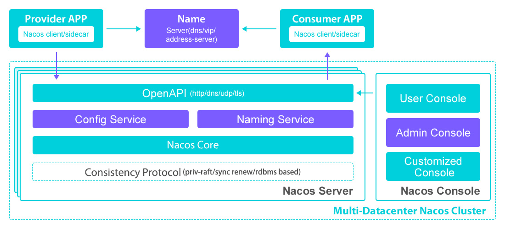
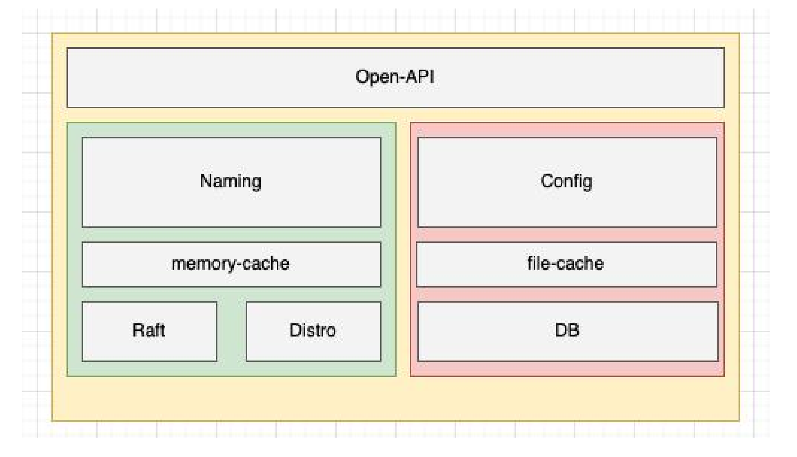
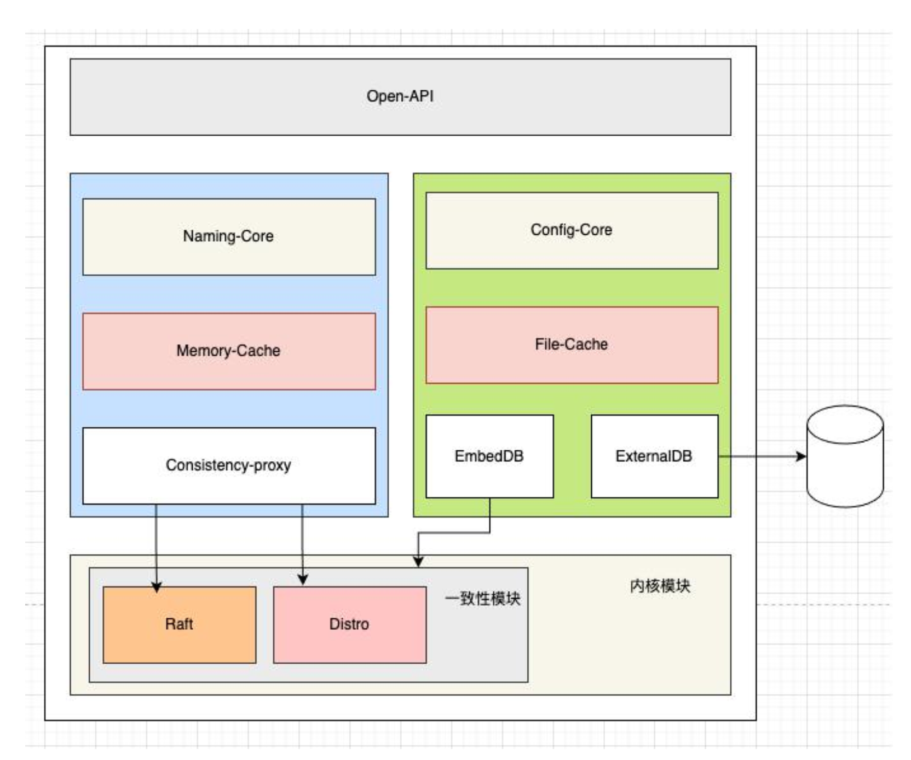

# Nacos

## Introduction

Nacos `/nɑ:kəʊs/` 是 Dynamic Naming and Configuration Service的首字母简称，一个更易于构建云原生应用的动态服务发现、配置管理和服务管理平台 
来源于阿里内部三个产品（Configserver 非持久注册中心， VIPServer 持久化注册中心， Diamond 配置中心 最早⼀个产品逐步演化成 3 个产品的）   

Nacos 支持将注册中心(Service Registry）与配置中心(Config Center) 在一个进程合并部署或者将2者分离部署的两种模式 
服务（Service）是 Nacos 世界的一等公民。Nacos 支持几乎所有主流类型的“服务”的发现、配置和管理


Nacos 的关键特性包括:

- **Service Discovery And Service Health Check**
  Nacos supports both DNS-based and RPC-based (Dubbo/gRPC) [service discovery](/docs/CS/Framework/nacos/registry.md). 
  After a service provider registers a service with native, OpenAPI, or a dedicated agent, a consumer can discover the service with either DNS or HTTP.
  Nacos provides real-time health check to prevent services from sending requests to unhealthy hosts or service instances. 
  Nacos supports both transport layer (PING or TCP) health check and application layer (such as HTTP, Redis, MySQL, and user-defined protocol) health check. 
  For the health check of complex clouds and network topologies(such as VPC, Edge Service etc), Nacos provides both agent mode and server mode health check. 
  Nacos also provide a unity service health dashboard to help you manage the availability and traffic of services.
- **Dynamic configuration management**
  [Dynamic configuration](/docs/CS/Framework/nacos/config.md) service allows you to manage the configuration of all applications and services in a centralized, externalized and dynamic manner across all environments.
  Dynamic configuration eliminates the need to redeploy applications and services when configurations are updated.
  Centralized management of configuration makes it more convenient for you to achieve stateless services and elastic expansion of service instances on-demand.
  Nacos provides an easy-to-use UI (DEMO) to help you manage all of your application or services's configurations. 
  It provides some out-of-box features including configuration version tracking, canary/beta release, configuration rollback, and client configuration update status tracking to ensure the safety and control the risk of configuration change.

- **Dynamic DNS service**
  Dynamic DNS service which supports weighted routing makes it easier for you to implement mid-tier load balancing, flexible routing policies, traffic control, and simple DNS resolution services in your production environment within your data center. 
  Dynamic DNS service makes it easier for you to implement DNS-based Service discovery.
  Nacos provides some simple DNS APIs TODO for you to manage your DNS domain names and IPs.
- **Service governance and metadata management**
  Nacos allows you to manage all of your services and metadata from the perspective of a microservices platform builder. 
  This includes managing service description, life cycle, service static dependencies analysis, service health status, service traffic management，routing and security rules, service SLA, and first line metrics.

> [!NOTE]
> 版本基线（2026-10 核实）：**Nacos 3.2.4**（2026-08-27 发布，Java 17）为当前稳定版，3.2.x 是活跃维护线；**2.5.4**（2026-08-27，Java 8）为 2.x 遗留线，供 JDK8 用户；**3.3.0-RC**（2026-09-21）为待发候选。3.0.0 GA 于 2025-04-25（首个 3.x，gRPC 原生，Java 17 起）。3.x 与 2.x 差异：默认鉴权策略加强（3.3+ Docker 镜像默认开启 Client API 鉴权）、`/v3` API 上下文、PostgreSQL 等多数据源插件。

## Installation

Run and Debug

```shell
git clone https://github.com/alibaba/nacos.git
cd nacos/
# -Drat.skip=true 
mvn -Prelease-nacos -Dmaven.test.skip=true clean install -U  
ls -al distribution/target/

// change the $version to your actual path
cd distribution/target/nacos-server-$version/nacos/bin
```

Run Nacos.java file in module nacos-console with VM options `-Dnacos.standalone=true`

cluster.conf文件需配置在 ～/nacos/conf/下
在console module下的application.properties里配置mysql

> [!TIP]
>
> Windows下编译太困难 在protobuf上

## Architecture

整体架构分为用户层、 业务层、 内核层和插件， 用户层主要解决用户使用的易用性问题， 业务层主要解决服务发现和配置管理的功能问题， 内核层解决分布式系统⼀致性、 存储、 高可用等核心问题，插件解决扩展性问题。  


<div style="text-align: center;">



</div>

<p style="text-align: center;">Fig.1. Architecture</p>


采⽤了阿⾥巴巴内部⾃研的 Distro 协议来实现数据弱⼀致性同步。其中所有节点都将存储集群内所有服务元数据，因此都可以提供数据读取服务，但每个节点只负责⼀部分客户端的数据写服务

## start

com.alibaba.nacos.core.code.SpringApplicationRunListener

```java
public class SpringApplicationRunListener implements org.springframework.boot.SpringApplicationRunListener, Ordered {

}
```

专有线程池做log 在 started后shutdownNow

```java
public class StartingApplicationListener implements NacosApplicationListener {
    @Override
    public void contextPrepared(ConfigurableApplicationContext context) {
        logClusterConf();

        logStarting();
    }

    private void logStarting() {
        if (!EnvUtil.getStandaloneMode()) {
            
            scheduledExecutorService = ExecutorFactory
                    .newSingleScheduledExecutorService(new NameThreadFactory("com.alibaba.nacos.core.nacos-starting"));
            
            scheduledExecutorService.scheduleWithFixedDelay(() -> {
                if (starting) {
                    LOGGER.info("Nacos is starting...");
                }
            }, 1, 1, TimeUnit.SECONDS);
        }
    }
}
```

judge if is storage mode

```java
public class StartingApplicationListener implements NacosApplicationListener {
    @Override
    public void started(ConfigurableApplicationContext context) {
    starting = false;
    
    closeExecutor();
    
    ApplicationUtils.setStarted(true);
    judgeStorageMode(context.getEnvironment());
    }
}
```


## grpc

sdkserver 端口 server.port+1000

grpcserver端口 server.port+1001

 ## Consistency


Nacos 是⼀个集服务注册发现以及配置管理于⼀体的组件， 因此对于集群下， 各个节点之间的数据⼀致性保障问题， 需要拆分成两个方面
- 对于服务注册
  - 针对于 Nacos 服务发现注册中的非持久化服务 为了满足服务发现注册中心的可用性， 强⼀致性的共识算法不太合适
  - 而对于 Nacos 服务发现注册中的持久化服务， 因为所有的数据都是直接使用调用 Nacos服务端直接创建， 因此需要由 Nacos 保障数据在各个节点之间的强⼀致性， 故而针对此类型的服务数据， 选择了强⼀致性共识算法来保障数据的⼀致性
- 配置数据的管理， 是必须要求集群中大部分的节点是强⼀致的， 而这里的话只能使用强⼀致性共识算法



在早期的 Nacos 架构中， 服务注册和配置管理⼀致性协议是分开的， 没有下沉到 Nacos 的内核模块作为通用能力演进， 服务发现模块⼀致性协议的实现和服务注册发现模块的逻辑强耦合在⼀起， 并且充斥着服务注册发现的⼀些概念。 
这使得 Nacos 的服务注册发现模块的逻辑变得复杂且难以维护， 耦合了⼀致性协议层的数据状态， 难以做到计算存储彻底分离， 以及对计算层的无限水平扩容能力也有⼀定的影响

需要对 Nacos 的⼀致性协议做抽象以及下沉， 使其成为 Core 模块的能力， 彻底让服务注册发现模块只充当计算能力， 同时为配置模块去外 部数据库存储打下了架构基础



⼀致性协议抽象

其实， ⼀致性协议，就是用来保证数据⼀致的，而数据的产生，必然有 个写入的动作；同时还要能够读数据，并且保证读数据的动作以及得到的数据结果，并且能够得到 致性协议的保障。因此，⼀致性协议最最基础的两个方法，就是写动作和读动作

```java
public interface ConsistencyProtocol<T extends Config, P extends RequestProcessor> extends CommandOperations {
    Response getData(ReadRequest request) throws Exception;
    Response write(WriteRequest request) throws Exception;
    // ...
}
```

一致性协议已经被抽象在了 consistency 的包中，Nacos 对于 AP、CP 的 致性协议接口使用抽象都在里面，并且在实现具体的 致性协议时，采用了插件可插拔的形式，一步将一致性协议具体实现逻辑和服务注册发现、配置管理两个模块达到解耦的目的


```java
@Component(value = "ProtocolManager")
public class ProtocolManager extends MemberChangeListener implements DisposableBean {
    private void initCPProtocol() {
        ApplicationUtils.getBeanIfExist(CPProtocol.class, protocol -> {
            Class configType = ClassUtils.resolveGenericType(protocol.getClass());
            Config config = (Config) ApplicationUtils.getBean(configType);
            injectMembers4CP(config);
            protocol.init(config);
            ProtocolManager.this.cpProtocol = protocol;
        });
    }
}
```

服务发现以及配置模块，更多应该专注于数据的使用以及计算，而非数据怎么存储、怎么保障数据 致性，数据存储以及多节点 致的问题应该交由存储层来保证。为了进 步降低 致性协议出现在服务注册发现以及配置管理两个模块的频次以及尽可能让 致性协议只在内核模块中感知，Nacos 这里又做了另 份工作 数据存储抽象。


致性协议，就是用来保证数据 致的，如果利用 致性协议实现 个存储，那么服务模块以及配置模块，就由原来的依赖 致性协议接口转变为了依赖存储接口，而存储接口后面的具体实现，就比 致性协议要丰富得多了，并且服务模块以及配置模块也无需为直接依赖 致性协议而承担多余的编码工作（快照、状态机实现、数据同步）。使得这两个模块可以更加的专注自己的核心逻辑。


由于 Nacos 的服务模块存储，更多是按唯一 key 做点查，因此 KV 语义的存储抽象最合适。3.x 里这层抽象落在 **Core 一致性层**（`ConsistencyProtocol` / `ProtocolManager`）：命名临时实例读本地内存（`DataStore`，即 Distro 的 AP 内存注册表），持久实例与配置走 `CPProtocol`（`JRaftProtocol`）经 Raft 日志 + `NacosStateMachine` 落外部 DB。

> [!WARNING]
> 早期文档里出现的 `KvStorage` 接口与 `KvType{File, Memory, RocksDB}` 枚举，**在 3.x 源码中已不存在**（全树 `git grep` 仅剩 `KvStorageException`，无 `interface KvStorage`、无 `enum KvType`）。不要据此理解当前实现——当前存储分界见 [Storage](/docs/CS/Framework/nacos/storage.md)。


### JRaft

A concrete implementation of CP protocol: JRaft.

```java
/**
 * <pre>
 *                                           ┌──────────────────────┐
 *            ┌──────────────────────┐       │                      ▼
 *            │   ProtocolManager    │       │        ┌───────────────────────────┐
 *            └──────────────────────┘       │        │for p in [NacosStateMachine] │
 *                        │                  │        └───────────────────────────┘
 *                        ▼                  │                      │
 *      ┌──────────────────────────────────┐ │                      ▼
 *      │    discovery NacosStateMachine     │ │             ┌─────────────────┐
 *      └──────────────────────────────────┘ │             │  get p.group()  │
 *                        │                  │             └─────────────────┘
 *                        ▼                  │                      │
 *                 ┌─────────────┐           │                      │
 *                 │ RaftConfig  │           │                      ▼
 *                 └─────────────┘           │      ┌──────────────────────────────┐
 *                        │                  │      │  create raft group service   │
 *                        ▼                  │      └──────────────────────────────┘
 *              ┌──────────────────┐         │
 *              │  JRaftProtocol   │         │
 *              └──────────────────┘         │
 *                        │                  │
 *                     init()                │
 *                        │                  │
 *                        ▼                  │
 *               ┌─────────────────┐         │
 *               │   JRaftServer   │         │
 *               └─────────────────┘         │
 *                        │                  │
 *                        │                  │
 *                        ▼                  │
 *             ┌────────────────────┐        │
 *             │JRaftServer.start() │        │
 *             └────────────────────┘        │
 *                        │                  │
 *                        └──────────────────┘
 * </pre>
 *
 */
```

端口号 server.port - 1000


## 3.x Module Map and Evolution (baseline 3.2.4)

读源码先认模块。3.2.4 的顶层 Maven 模块（节选，已 `ls` 核实）与 2.x 差异明显——**3.x 把持久化、AI、控制台前端、MCP/Copilot 都拆了出来或新增**：

| 模块 | 作用（3.2.4） |
| :-- | :-- |
| `api` / `common` / `core` | 公共 API、工具、内核（一致性 `core/distributed`、集群寻址 `core/cluster`、安全 `core/plugin`） |
| `naming` | 服务发现（v2 Client 模型在 `naming/core/v2/`，`naming/consistency/KeyBuilder` 仍在但 API 已变） |
| `config` | 配置中心（含 `controller/v3` 的 `/v3` API） |
| `consistency` | 独立的一致性抽象模块（`com.alibaba.nacos.consistency.ap/.cp`，`ProtocolManager` 取用的 `APProtocol`/`CPProtocol` 来自这里） |
| `persistence` | **3.x 新增**：持久化拆为独立模块，数据源**插件化**（`plugin-default-impl/nacos-default-datasource-plugin/` 内含 `mysql` / `derby` / `oracle` / `postgresql` 实现；PostgreSQL 官方支持已验证） |
| `auth` / `plugin-default-impl/nacos-default-auth-plugin` | 鉴权（含 `controller/v3`） |
| `ai` / `ai-registry-adaptor` | **3.x 新增**：AI / MCP 相关，库里有 `ai_resource` 等资源表（schema 已验证） |
| `console` / `console-ui` / `console-ui-next` | 控制台；`console-ui-next` 是 **3.x 新前端** |
| `prometheus` | **独立应用**（`PrometheusApp`）：对外提供 **Prometheus HTTP Service Discovery** 端点，见 [Monitoring](/docs/CS/Framework/nacos/monitoring.md) |
| `istio` | **独立应用**（`IstioApp` + `IstioServer` + `NacosMcpService`）：以 MCP over gRPC 把 Nacos 服务数据喂给 Istio，让 Nacos 充当服务网格的注册源 |
| `address` | **AddressServer 寻址服务**：`AddressServerMemberLookup` 依赖的那个「地址服务器」，见下文 `## Cluster` |
| `cmdb` | CMDB 插件（`CmdbProvider` / `SwitchAndOptions`），用于就近路由等扩展元数据 |
| `copilot` / `k8s-sync` / `lock` / `skills` / `specs` / `bootstrap` / `client-basic` / `maintainer-client` / `server` | 3.x 陆续新增（Copilot、K8s 同步、分布式锁、技能、Bootstrap/Server 拆分、运维客户端等） |

与 2.x 的关键差异（事实已在 Nacos.md 顶部 NOTE 说明，这里给**模块级证据**）：

- **持久化下沉为 `persistence` 模块 + 数据源插件**：3.x 不再把 DB 访问写死在 config 模块，而是走 `plugin-default-impl` 的多方言实现；切换数据源（含 PostgreSQL）改插件而非改业务代码。
- **`/v3` API 上下文**：core / config / naming / auth 下均有 `controller/v3` 包，3.x 在 2.x gRPC 基础上进一步统一了 v3 HTTP API。
- **AI / MCP 成为一等公民**：`ai` 与 `ai-registry-adaptor` 模块 + `ai_resource` 表，对应 3.x 把模型/工具/MCP 资源纳入 namespace 体系。
- **控制台前端重写**：`console-ui-next` 与老 `console-ui` 并存，新控制台基于新前端。

> [!NOTE]
> 2.x 文档里常见的「`config` 模块直接持有一堆 Mapper」的描述在 3.x 已不准确；DB 访问统一走 `persistence` + 数据源插件。源码路径以 `git grep` 在 `3.2.4` tag 上核实为准。

#### External Ecosystem Integrations

Nacos 不只被 SDK 直连，也常被**网关 / 服务网格 / 监控系统**当作数据源接进去。3.2.4 里为此留了专门的模块与端点：

| 集成方 | Nacos 侧承担者 | 说明 |
| :-- | :-- | :-- |
| Prometheus | `prometheus` 模块 | HTTP SD 端点 `/prometheus`，见 [Monitoring](/docs/CS/Framework/nacos/monitoring.md) |
| Istio | `istio` 模块 | `NacosMcpService` 提供 MCP over xDS（`ServiceEntryMcpGenerator` 与 `CdsGenerator` / `EdsGenerator` / `LdsGenerator` / `RdsGenerator`），开关 `nacos.istio.mcp.server.enabled=false` |
| Higress | 外部项目接 Nacos 为注册源 | [Higress 服务发现](/docs/CS/Framework/Higress/Service_Discovery.md) 的 `McpBridge` 支持 `nacos` / `nacos2` / `nacos3` 三种 `type` |
| Kubernetes | `k8s-sync` 模块 | Service 双向同步 |

### 3.x Additions: AI Registry / Distributed Lock / K8s Sync

除了「注册 + 配置」两块老本行，3.x 还长出了三个独立子系统。它们的共同点是**复用 Nacos 既有的 namespace 体系与一致性设施**，而不是另起炉灶：

| 子系统 | 模块 | 一致性 | 落库 |
| :-- | :-- | :-- | :-- |
| AI Registry | `ai` / `ai-registry-adaptor` / `skills` / `copilot` | 规格走配置（CP）+ 端点走注册（AP） | `ai_resource` + `ai_resource_version` + `pipeline_execution` |
| 分布式锁 | `lock` | **CP**（JRaft） | Raft 日志 + 快照 |
| K8s 同步 | `k8s-sync` | —（旁路同步进程） | 无独立表 |

#### AI Registry

3.x 把 **MCP Server / Agent / Skill / Prompt / A2A** 这类 AI 资源也当作「可注册的公民」，纳入与配置同样的 namespace 隔离。Admin 侧与 Client 侧各有独立 controller：`McpAdminController`、`AgentSpecAdminController`、`SkillAdminController`、`PromptAdminController`、`A2aAdminController`，外加 `PipelineAdminController` 与 `AiResourceImportAdminController`（导入 / 同步）。

存储层是 `NacosConfigAiResourceStorage` + `AiResourcePersistServiceImpl`，最终落在 `ai_resource` 表。该表几个值得注意的列（3.2.4 `mysql-schema.sql` 实测）：

- `type`：资源类型（MCP / Agent / Skill / Prompt …），与 `name` + `namespace_id` 一起定位资源。
- `scope`：`PUBLIC` / `PRIVATE`，决定跨 namespace 可见性。
- `meta_version`：乐观锁版本号，避免并发覆盖。
- `c_from`：来源标识（默认 `local`），用于区分本地创建与从外部导入 / 同步。

> 五类资源（MCP Server / A2A Agent / Skill / AgentSpec / Prompt）各自的 group、dataId、API 前缀、gRPC 推送、MCP Registry 协议适配（独立端口 `9080`）与内置 Copilot，见 [AI Registry](/docs/CS/Framework/nacos/ai-registry.md)。

#### Distributed Lock

`lock` 模块提供可重入互斥锁：`NacosLockManager implements LockManager`，底层是 `MutexAtomicLock` 与 `AtomicLockService`，并带 `RequestLockAspect` 注解切面、`LockMetricsMonitor` 监控。

**它走 CP**——`LockOperationServiceImpl extends RequestProcessor4CP`，构造时取 `ProtocolManager.getCpProtocol()`，加锁请求作为 `WriteRequest` 经 `onApply()` 走 Raft 提交，快照由 `NacosLockSnapshotOperation` 处理。也就是说，分布式锁与持久实例、配置变更共用同一条 JRaft 通道，代价是每次加锁都要过一轮多数派确认。

> [!NOTE]
> 官方文档把分布式锁归在 **experimental** 目录下，接口与配置项在 3.x 内仍可能调整，生产使用前建议先压测确认时延。

#### K8s Sync

`k8s-sync` 是一个旁路同步组件（`K8sSyncServer` + `K8sSyncConfig` + `K8sSyncEnabledFilter`），负责把 Kubernetes 的 Service 与 Nacos 的服务数据做双向同步，让 K8s 内的服务与 Nacos 注册中心保持一致。它不参与 Nacos 的一致性协议，独立启停。

## Cluster

目前需要手动配置在cluster.conf文件里 未来预期通过其它web服务获取

### MemberLookup


#### StandaloneMemberLookup

单机模式的寻址模式很简单，其实就是找到自己的 P:PORT 组合信息，然后格式化为 个节点信息

```java
public class StandaloneMemberLookup extends AbstractMemberLookup {
    
    @Override
    public void doStart() {
        String url = EnvUtil.getLocalAddress();
        afterLookup(MemberUtil.readServerConf(Collections.singletonList(url)));
    }
    
    @Override
    public boolean useAddressServer() {
        return false;
    }
}
```

#### FileConfigMemberLookup

文件寻址模式是 Nacos 集群模式下的默认寻址实现。文件寻址模式很简单，其实就是每个 Nacos节点需要维护 个叫做 cluster.conf 的文件。

该文件默认只需要填写每个成员节点的 P 信息即可，端口会自动选择 Nacos 的默认端口 8848，如过说有特殊需求更改了 Nacos 的端口信息，则需要在该文件将该节点的完整网路地址信息补充完整（ P:PORT）。

当 Nacos 节点启动时，会读取该文件的内容，然后将文件内的 P 解析为节点列表，调用 afterLookup 存入 ServerMemberManager

WatchFileCenter注册文件变更监听

```java
public class WatchFileCenter {
    public static synchronized boolean registerWatcher(final String paths, FileWatcher watcher) throws NacosException {
        checkState();
        if (NOW_WATCH_JOB_CNT == MAX_WATCH_FILE_JOB) {
            return false;
        }
        WatchDirJob job = MANAGER.get(paths);
        if (job == null) {
            job = new WatchDirJob(paths);
            job.start();
            MANAGER.put(paths, job);
            NOW_WATCH_JOB_CNT++;
        }
        job.addSubscribe(watcher);
        return true;
    }
}
```

FileConfigMemberLookup实现了Watcher并在时间处理中重新解析cluster配置文件

```java
public class FileConfigMemberLookup extends AbstractMemberLookup {
    
    private static final String DEFAULT_SEARCH_SEQ = "cluster.conf";
    
    private FileWatcher watcher = new FileWatcher() {
        @Override
        public void onChange(FileChangeEvent event) {
            readClusterConfFromDisk();
        }
        
        @Override
        public boolean interest(String context) {
            return StringUtils.contains(context, DEFAULT_SEARCH_SEQ);
        }
    };
    
    private void readClusterConfFromDisk() {
        Collection<Member> tmpMembers = new ArrayList<>();
        try {
            List<String> tmp = EnvUtil.readClusterConf();
            tmpMembers = MemberUtil.readServerConf(tmp);
        } catch (Throwable e) {
            Loggers.CLUSTER
                    .error("nacos-XXXX [serverlist] failed to get serverlist from disk!, error : {}", e.getMessage());
        }
        
        afterLookup(tmpMembers);
    }
}
```


如果发现集群扩缩容，那么就需要修改每个 Nacos 节点下的 cluster.conf 文件，然后 Nacos 内部的文件变动监听中心会自动发现文件修改，重新读取文件内容、加载 P 列表信息、更新新增的节点。


但是，这种默认寻址模式有 个缺点 运维成本较大，可以想象下，当你新增 个 Nacos 节点时，需要去手动修改每个 Nacos 节点下的 cluster.conf 文件，这是多么辛苦的 件工作，或者稍微高端 点，利用 ansible 等自动化部署的工具去推送 cluster.conf 文件去代替自己的手动操作，虽然说省去了较为繁琐的人工操作步骤，但是仍旧存在 个问题 每 个 Nacos 节点都存在 份cluster.conf 文件，如果其中 个节点的 cluster.conf 文件修改失败，就造成了集群间成员节点列表数据的不 致性，因此，又引申出了新的寻址模式 地址服务器寻址模式。


#### AddressServerMemberLookup

地址服务器寻址模式是 Nacos 官方推荐的 种集群成员节点信息管理，该模式利用了 个简易的web 服务器，用于管理 cluster.conf 文件的内容信息，这样，运维人员只需要管理这 份集群成员节点内容即可，而每个 Nacos 成员节点，只需要向这个 web 节点定时请求当前最新的集群成员节点列表信息即可。


因此，通过地址服务器这种模式，大大简化了 Nacos 集群节点管理的成本，同时，地址服务器是个非常简单的 web 程序，其程序的稳定性能够得到很好的保障。


Nacos 的集群节点管理，还都是属于人工操作，因此，未来期望能够基于寻址模式，实现集群节点自动管理的功能

```java
public class AddressServerMemberLookup extends AbstractMemberLookup {

    @Override
    public void doStart() throws NacosException {
        this.maxFailCount = Integer.parseInt(EnvUtil.getProperty(HEALTH_CHECK_FAIL_COUNT_PROPERTY, DEFAULT_HEALTH_CHECK_FAIL_COUNT));
        initAddressSys();
        run();
    }


    private void initAddressSys() {
        String envDomainName = System.getenv(ADDRESS_SERVER_DOMAIN_ENV);
        if (StringUtils.isBlank(envDomainName)) {
            domainName = EnvUtil.getProperty(ADDRESS_SERVER_DOMAIN_PROPERTY, DEFAULT_SERVER_DOMAIN);
        } else {
            domainName = envDomainName;
        }
        String envAddressPort = System.getenv(ADDRESS_SERVER_PORT_ENV);
        if (StringUtils.isBlank(envAddressPort)) {
            addressPort = EnvUtil.getProperty(ADDRESS_SERVER_PORT_PROPERTY, DEFAULT_SERVER_POINT);
        } else {
            addressPort = envAddressPort;
        }
        String envAddressUrl = System.getenv(ADDRESS_SERVER_URL_ENV);
        if (StringUtils.isBlank(envAddressUrl)) {
            addressUrl = EnvUtil.getProperty(ADDRESS_SERVER_URL_PROPERTY, EnvUtil.getContextPath() + "/" + "serverlist");
        } else {
            addressUrl = envAddressUrl;
        }
        addressServerUrl = HTTP_PREFIX + domainName + ":" + addressPort + addressUrl;
        envIdUrl = HTTP_PREFIX + domainName + ":" + addressPort + "/env";
    }

    @SuppressWarnings("PMD.UndefineMagicConstantRule")
    private void run() throws NacosException {
        // With the address server, you need to perform a synchronous member node pull at startup
        // Repeat three times, successfully jump out
        boolean success = false;
        Throwable ex = null;
        int maxRetry = EnvUtil.getProperty(ADDRESS_SERVER_RETRY_PROPERTY, Integer.class, DEFAULT_SERVER_RETRY_TIME);
        for (int i = 0; i < maxRetry; i++) {
            try {
                syncFromAddressUrl();
                success = true;
                break;
            } catch (Throwable e) {
                ex = e;
                Loggers.CLUSTER.error("[serverlist] exception, error : {}", ExceptionUtil.getAllExceptionMsg(ex));
            }
        }
        if (!success) {
            throw new NacosException(NacosException.SERVER_ERROR, ex);
        }

        GlobalExecutor.scheduleByCommon(new AddressServerSyncTask(), DEFAULT_SYNC_TASK_DELAY_MS);
    }
}
```


## Tuning

生产面的限流、黑名单、长连接上限、端口冲突等内容已抽到独立笔记，避免 Nacos.md 过度膨胀：

- [Nacos 运维与调优（tuning.md）](/docs/CS/Framework/nacos/tuning.md)：Nginx 侧 QPS 限流（单接口 / 单机约 500QPS / 全服务）、长连接上限（8C16G 约 9000 gRPC 连接）、IP / 读写 / 应用维度黑名单、9848 端口被占用等坑。

> [!NOTE]
> Nacos 自身无内置细粒度 QPS 限流，限流与黑名单主要在 **Nacos 前层的 Nginx** 实现；3.x 默认鉴权加强，运维接入注意 token（见 [Security](/docs/CS/Framework/nacos/security.md)）。


## Comparison with etcd

Nacos 与 etcd 定位有交集也有分野：etcd 是**通用的强一致 KV 协调底座**，Nacos 是**配置中心 + 服务注册中心**（完整维度矩阵见 [etcd 横向对照](/docs/CS/Framework/etcd/compare.md)）。

| 维度 | Nacos | etcd |
| :--- | :--- | :--- |
| 定位 | 配置中心 + 服务注册发现 | 通用 CP KV 协调 |
| 一致性（服务发现） | **默认 AP**（Distro，最终一致，分区可分歧） | **始终 CP**（Raft） |
| 一致性（配置 / CP） | CP，基于 **JRaft**（简化 Raft 实现） | CP，基于 etcd-raft |
| 数据模型 | namespace / group / service / instance + 配置（dataId/group） | 扁平 KV + 前缀 |
| 持久化依赖 | **需 MySQL** 存配置（外部依赖，会挂） | 零外部依赖（bbolt 单文件） |
| Watch | 长轮询 + gRPC 推送（2.x） | gRPC 双向流，按 revision 回溯 |
| 服务发现 | **原生主打**（Spring / Dubbo 生态成熟） | 需自行封装 |
| 配置管理 | **原生版本化、专用** | 仅 KV，无版本化特性 |
| 语言 / 依赖 | Java | Go，单二进制 |

**最大差异是可用性取向。** Nacos 的服务发现默认走 AP（Distro 协议，分区时各节点可独立响应、允许短暂分歧），把"注册中心不因网络分区全挂"看得比强一致更重；etcd 始终 CP，分区时少数派不可用但数据绝不分歧。Nacos 的配置模块与 CP 模式才用 JRaft（自研简化 Raft）保证一致——与 etcd 全量 Raft 不同。

**运维依赖是另一道分水岭。** Nacos 需要 MySQL 持久化配置，多一个会挂的外部组件；etcd 单二进制 + 一个 data-dir，零外部依赖。Nacos 用 Java（JVM 开销），etcd 用 Go（更轻）。

**选型**：要配置中心 + 注册中心开箱即用（尤其 Spring Cloud Alibaba / Dubbo）→ Nacos；要云原生通用协调底座、K8s 后端、或需要 Txn 原子事务与线性一致读 → etcd。两者都常被拿来和 ZooKeeper、Consul 比较（见 [etcd 横向对照](/docs/CS/Framework/etcd/compare.md)）。

## Links

- [Nacos 目录索引](/docs/CS/Framework/nacos/README.md)
- [一致性抽象层](/docs/CS/Framework/nacos/consistency.md)
- [Distro（AP 协议深潜）](/docs/CS/Framework/nacos/distro.md)
- [JRaft（CP 共识）](/docs/CS/Framework/nacos/jraft.md)
- [Config Push（配置推送深潜）](/docs/CS/Framework/nacos/config-push.md)
- [Spring Cloud Alibaba](/docs/CS/Framework/Spring_Cloud/Alibaba.md)

## References

- <https://nacos.io/docs/latest/quick-start/>
- <https://nacos.io/en-us/docs/quick-start-spring-boot.html>
- <https://nacos.io/docs/latest/manual/admin/deployment/deployment-cluster/>
- <https://nacos.io/docs/latest/manual/user/ai/ai-registry-overview/>
- <https://nacos.io/docs/latest/experimental/distributed-lock/>
- <https://nacos.io/docs/latest/ecology/use-nacos-with-k8s-sync/>
