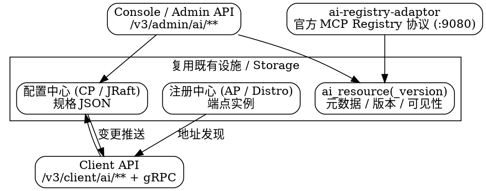

# Nacos AI Registry

## Introduction

3.x 把 **MCP Server、A2A Agent、Skill、AgentSpec、Prompt** 变成可注册、可版本化、可检索的一等资源。理解它的捷径是：**AI Registry 没有新建存储，而是把 Nacos 已有的两套设施重新组合了一遍**。

> 版本基线：Nacos 3.2.4（commit 2c587c0）。`ai` / `ai-registry-adaptor` / `skills` / `copilot` 四个模块在 2.x 完全不存在；AI 资源元数据实体标注 `@since 3.2.0`。

反直觉点：

- **规格进配置中心（CP），端点进注册中心（AP）**：改一个 MCP Tool 的描述，客户端不用重启就生效——本质是「改配置触发 gRPC 推送」，不是新同步机制。
- **统一元数据进关系库**：`ai_resource` / `ai_resource_version` 只做跨类型检索、版本、可见性与下载计数，不存正文；3.2.4 另加 `pipeline_execution` 存发布审核记录。
- **双端口**：主服务 8848 / gRPC 9848，MCP Registry 协议适配另起 **9080**（`nacos.ai.registry.port`），且默认关闭。
- A2A 端点 metadata 的键**全部以双下划线结尾**（`__nacos.agent.endpoint.path__`），与 MCP 侧的 `__nacos.ai.mcp.service__` 不是一套命名。



## Constants: Group, dataId and Paths

五类资源共用 `ai_resource.type` 做区分，但各自的 group / dataId 与 API 前缀不同。常量集中在 `ai/src/main/java/com/alibaba/nacos/ai/constant/Constants.java`，MCP 部分如下：

```java
public static final String MCP_SERVER_VERSIONS_GROUP = "mcp-server-versions";

public static final String MCP_SERVER_GROUP = "mcp-server";

public static final String MCP_SERVER_TOOL_GROUP = "mcp-tools";

public static final String MCP_SERVER_RESOURCE_GROUP = "mcp-resources";

public static final String MCP_SERVER_SPEC_DATA_ID_SUFFIX = "-mcp-server.json";

public static final String MCP_SERVER_VERSION_DATA_ID_SUFFIX = "-mcp-versions.json";

public static final String MCP_SERVER_TOOL_DATA_ID_SUFFIX = "-mcp-tools.json";

public static final String MCP_SERVER_RESOURCE_DATA_ID_SUFFIX = "-mcp-resources.json";

public static final String MCP_SERVER_ENDPOINT_GROUP = "mcp-endpoints";

public static final String MCP_SERVER_ENDPOINT_CLUSTER =
    com.alibaba.nacos.api.common.Constants.DEFAULT_CLUSTER_NAME;

public static final String MCP_BACKEND_INSTANCE_PROTOCOL_KEY = "transportProtocol";

public static final String MCP_SERVER_ENDPOINT_ADDRESS = "address";

public static final String MCP_SERVER_ENDPOINT_PORT = "port";

public static final String MCP_SERVER_ENDPOINT_METADATA_MARK = "__nacos.ai.mcp.service__";
```

dataId 模板是「名称-版本 + 后缀」：`%s-%s-mcp-server.json` / `-mcp-tools.json` / `-mcp-resources.json`；版本清单例外，只有 `%s-mcp-versions.json`。搜索侧另有 `MCP_LIST_SEARCH_BLUR` / `MCP_LIST_SEARCH_ACCURATE` 与 `MAX_LIST_SIZE = 100`。

| 资源 | 配置 group | dataId 形态 | 端点 group | Admin 路径 |
| :-- | :-- | :-- | :-- | :-- |
| MCP Server | `mcp-server`、`mcp-tools`、`mcp-resources`、`mcp-server-versions` | `{name}-{version}-mcp-server.json` 等 | `mcp-endpoints` | `/v3/admin/ai/mcp` |
| A2A Agent | `agent`、`agent-version` | — | `agent-endpoints` | `/v3/admin/ai/a2a` |
| Skill | `skill`、`skill-version` | zip 包上传 | — | `/v3/admin/ai/skills` |
| AgentSpec | `agentspec_*` | `manifest.json` | — | `/v3/admin/ai/agentspecs` |
| Prompt | `nacos-ai-prompt` | `{key}.json` | — | `/v3/admin/ai/prompt` |

## Resource Metadata: ai_resource / ai_resource_version

`AiResource` 继承 `VisibilityResource`，因此 `scope` / `owner` 两列来自可见性基类，而非它自己声明：

```java
public class AiResource extends VisibilityResource {
    
    private Long id;
    
    private Timestamp gmtCreate;
    
    private Timestamp gmtModified;
    
    private String name;
    
    private String type;
    
    private String desc;
    
    private String status;
    
    private String namespaceId;
    
    private String bizTags;
    
    private String ext;
    
    private String from;
    
    private String versionInfo;
    
    private Long metaVersion;
    
    private Long downloadCount;
```

MySQL 建表脚本（随数据源插件分发，见 [Storage](/docs/CS/Framework/nacos/storage.md)）揭示了乐观锁与来源字段：

```sql
CREATE TABLE `ai_resource` (
    `id` bigint(20) NOT NULL AUTO_INCREMENT COMMENT 'id',
    `gmt_create` datetime NOT NULL DEFAULT CURRENT_TIMESTAMP COMMENT '创建时间',
    `gmt_modified` datetime NOT NULL DEFAULT CURRENT_TIMESTAMP COMMENT '修改时间',
    `name` varchar(256) NOT NULL COMMENT '资源名称',
    `type` varchar(32) NOT NULL COMMENT '资源类型',
    `c_desc` varchar(2048) DEFAULT NULL COMMENT '资源描述',
    `status` varchar(32) DEFAULT NULL COMMENT '资源状态',
    `namespace_id` varchar(128) NOT NULL DEFAULT '' COMMENT '命名空间ID',
    `biz_tags` varchar(1024) DEFAULT NULL COMMENT '业务标签',
    `ext` longtext DEFAULT NULL COMMENT '扩展信息(JSON)',
    `c_from` varchar(256) NOT NULL DEFAULT 'local' COMMENT '来源标识(导入/同步来源)',
    `version_info` longtext DEFAULT NULL COMMENT '版本信息(JSON)',
    `meta_version` bigint(20) NOT NULL DEFAULT 1 COMMENT '元数据版本(乐观锁)',
    `scope` varchar(16) NOT NULL DEFAULT 'PRIVATE' COMMENT '可见性: PUBLIC/PRIVATE',
    `owner` varchar(128) NOT NULL DEFAULT '' COMMENT '创建者用户名',
    `download_count` bigint(20) NOT NULL DEFAULT 0 COMMENT '下载次数',
    PRIMARY KEY (`id`),
    UNIQUE KEY `uk_ai_resource_ns_name_type` (`namespace_id`,`name`,`type`,`c_from`),
    KEY `idx_ai_resource_name` (`name`),
    KEY `idx_ai_resource_type` (`type`),
    KEY `idx_ai_resource_gmt_modified` (`gmt_modified`)
) ENGINE=InnoDB DEFAULT CHARSET=utf8mb4 COLLATE=utf8mb4_unicode_ci COMMENT='AI资源元数据表';
```

唯一键含 `c_from`，意味着同一 `namespace + name + type` 可以并存多个来源（local / 导入插件 / 同步）。`ai_resource_version` 存版本正文指针：`storage` 是 JSON，Skill 在其中记 `contentMd5`；版本表另有 `publish_pipeline_info` 字段挂发布流水线信息。存储实现是 `NacosConfigAiResourceStorage`（`TYPE = "nacos_config"`）配合 `AiResourcePersistServiceImpl`。

## MCP Server

MCP Server 与 A2A Agent 是五类里「双写」的两类：规格写配置中心，端点写注册中心；Skill / AgentSpec / Prompt 只有规格、没有端点。

端点被注册成普通服务实例——服务名就是 MCP 名，group 固定 `mcp-endpoints`：

```java
public Service generateService(String namespaceId, String mcpName) {
    return Service.newService(namespaceId, Constants.MCP_SERVER_ENDPOINT_GROUP, mcpName);
}
```

实例 metadata 用 `__nacos.ai.mcp.service__` 做标记，`address` / `port` / `transportProtocol` 描述可达地址与协议（http / https）。多版本时可把其中一个设为默认版本，这就是 MCP 侧的灰度手段；namespace 复用 Nacos 的租户隔离。

## A2A Agent

A2A（Agent-to-Agent）Agent 与 MCP Server 同构：规格存 `agent` / `agent-version`，端点存 `agent-endpoints`。端点 metadata 的键**全部带 `__nacos.agent.endpoint.` 前缀且以 `__` 结尾**：

```java
public static final String AGENT_ENDPOINT_PATH_KEY = "__nacos.agent.endpoint.path__";

public static final String AGENT_ENDPOINT_TRANSPORT_KEY =
    "__nacos.agent.endpoint.transport__";

public static final String NACOS_AGENT_ENDPOINT_SUPPORT_TLS =
    "__nacos.agent.endpoint.supportTls__";

public static final String NACOS_AGENT_ENDPOINT_PROTOCOL_KEY =
    "__nacos.agent.endpoint.protocol__";

public static final String NACOS_AGENT_ENDPOINT_QUERY_KEY =
    "__nacos.agent.endpoint.query__";

public static final String NACOS_AGENT_ENDPOINT_PROTOCOL_VERSION_KEY =
    "__nacos.agent.endpoint.protocolVersion__";

public static final String NACOS_AGENT_ENDPOINT_TENANT_KEY =
    "__nacos.agent.endpoint.tenant__";
```

> [!WARNING]
> 旧资料里把这些键写成 `__nacos.agent.endpoint.path`（无结尾 `__`），按 3.2.4 `Constants.A2A` 源码这是错的，客户端按错键读不到端点元数据。

## Skill and AgentSpec

这两类走**制品包**：以 zip 上传，元数据进 `ai_resource` / `ai_resource_version`，包体由 `storage` JSON 指向。

- 默认 namespace 都是 `public`；Skill 默认上限 10MB，AgentSpec 50MB，可用 `nacos.ai.skill.zip.max-upload-size-mb` / `nacos.ai.agentspec.zip.max-upload-size-mb` 上调。
- 客户端按 label 查版本时，响应头回带校验值：Skill 是 `X-Nacos-Skill-Md5` / `X-Nacos-Skill-Resolved-Version`，AgentSpec 是 `X-Nacos-AgentSpec-Md5` / `X-Nacos-AgentSpec-Resolved-Version`，据此判断本地缓存是否过期。
- AgentSpec 的存储后端可选，配置键 `nacos.ai.agentspec.storage.provider`；`skills/` 目录里的 `nacos-skill-registry/SKILL.md` 是最小样例。

## Prompt

Prompt 最「配置化」：固定 group `nacos-ai-prompt`，dataId 为 `{promptKey}.json`，另有 `.descriptor.json`（描述元数据）与 `.label-version-mapping.json`（运行时 label → version 映射）两份伴生配置。版本与提交备注放在配置 `extInfo` 的 `prompt_version` / `prompt_commit_msg` 键里。

## Index and Search

跨资源检索不扫库，而是走一层索引：`ai/index/` 下 `McpServerIndex` 有三个实现——`PlainMcpServerIndex`（直查）、`CachedMcpServerIndex`（带缓存）、`MemoryMcpCacheIndex`（纯内存），共同父类 `AbstractMcpServerIndex`。搜索模式只有 `blur` 与 `accurate`（`MCP_LIST_SEARCH_BLUR` / `MCP_LIST_SEARCH_ACCURATE`），单次列表上限 `MAX_LIST_SIZE = 100`。

## Visibility and Anonymous Access

`AiResource` 继承的 `VisibilityResource` 默认 `scope = PRIVATE`、`owner = ""`，可见性由 visibility 插件统一处理。3.2.4 新增的匿名访问开关与鉴权模块联动：

```java
    /**
     * System-reserved anonymous user name. Used for unauthenticated access to PUBLIC AI resources.
     */
    public static final String ANONYMOUS_USER = "__nacos_anonymous__";
    
    /**
     * System-reserved anonymous role name bound to {@link #ANONYMOUS_USER}.
     */
    public static final String ANONYMOUS_ROLE = "__nacos_anonymous_role__";
```

开关键是 `nacos.core.auth.nacos.anonymous.ai.enabled`（默认 `false`）。开启后 `AnonymousAccessInitializer` 自动建这个用户 / 角色，并授予 `public:*:ai/*` 的读权限，让 PUBLIC 范围资源可免登录读取（详见 [Security](/docs/CS/Framework/nacos/security.md)）。

## gRPC Channel: Dynamic Push to Clients

AI 资源不只走 HTTP。`ai/remote/handler/` 下挂着 `McpServerEndpointRequestHandler`、`QueryMcpServerRequestHandler`、`ReleaseMcpServerRequestHandler`、`QueryPromptRequestHandler` 以及 `a2a` 子包的四个 handler；连接由 `AiConnectionBasedClientManager` 管理。Agent 侧可通过长连接**订阅** MCP Server / Prompt 变化，Tool 开关、描述修改、版本切换都靠这条通道实时下发。

## Protocol Adaptor: MCP Registry and Skills Registry

`ai-registry-adaptor` 负责**对外协议兼容**，让 Nacos 能被标准 MCP 客户端当成 Registry 直接访问：

- `McpRegistryController`：对齐 MCP 官方 Registry REST API（`GET /servers` 风格的列表 / 详情 / 搜索）。
- `SkillsRegistryController`：Skills 搜索与文件查询，响应模型 `SkillsSearchResponse` / `SkillsFileQueryForm`。
- 两者分别受 `nacos.ai.mcp.registry.enabled` / `nacos.ai.skill.registry.enabled` 控制，**默认都是 false**。
- 开启后另起独立端口：`nacos-ai-registry.properties` 里是 `server.port=${nacos.ai.registry.port:${nacos.ai.mcp.registry.port:9080}}`；旧键 `nacos.ai.mcp.registry.port` 已废弃。

官方 MCP Registry 只提供公共托管，Nacos 这一步等于让企业能在内网自建 MCP 元数据仓库。

## Publish Pipeline

`ai/pipeline/` + `PipelineAdminController`（`/v3/admin/ai/pipelines`）提供发布流水线，资源发布前可挂外部检查节点（如 Skill 安全扫描）。执行记录落 `pipeline_execution`（3.2.4 新增）：

```sql
CREATE TABLE `pipeline_execution` (
    `execution_id`  varchar(64)  NOT NULL COMMENT '执行ID',
    `resource_type` varchar(32)  NOT NULL COMMENT '资源类型',
    `resource_name` varchar(256) NOT NULL COMMENT '资源名称',
    `namespace_id`  varchar(128) DEFAULT NULL COMMENT '命名空间ID',
    `version`       varchar(64)  DEFAULT NULL COMMENT '版本',
    `status`        varchar(32)  NOT NULL COMMENT '执行状态',
    `pipeline`      longtext     NOT NULL COMMENT 'pipeline节点结果JSON',
    `create_time`   bigint(20)   NOT NULL COMMENT '创建时间',
    `update_time`   bigint(20)   NOT NULL COMMENT '修改时间',
    PRIMARY KEY (`execution_id`)
) ENGINE=InnoDB DEFAULT CHARSET=utf8mb4 COLLATE=utf8mb4_unicode_ci COMMENT='AI资源发布审核Pipeline执行记录';
```

配置形如 `nacos.plugin.ai-pipeline.enabled=true` + `nacos.plugin.ai-pipeline.type=skill-scanner`；**不配 `type` 时 Pipeline 不执行**——开关开了但没节点等于空转。

## Copilot: Built-in Skill / Prompt Assistant

`copilot` 模块是控制台里的 AI 助手，HTTP 控制器实际落在 `console` 模块（`ConsoleCopilotController`），走 `/v3/console/copilot/**`：`/skill/generate`、`/skill/optimize`、`/prompt/optimize`、`/prompt/debug`、`/chat`、`/chat/history`。

`CopilotProperties` 的默认值：`enabled=true`、`model=qwen-turbo`、`defaultNamespace=public`、`studioProject=NacosCopilot`；`apiKey` 与 `studioUrl` 需自行填写（后端接 AgentScope Studio）。**默认开启意味着不配 `apiKey` 时这些入口能点开但跑不通**，生产建议显式关掉。

## Switches

| 配置键 | 默认 | 说明 |
| :-- | :-- | :-- |
| `nacos.extension.ai.enabled` | `true` | AI 模块总开关；`microservice` 功能模式下不加载 |
| `nacos.ai.mcp.registry.enabled` | `false` | 官方 MCP Registry 协议适配 |
| `nacos.ai.skill.registry.enabled` | `false` | Skills Registry 协议适配 |
| `nacos.ai.registry.port` | `9080` | 协议适配独立端口；旧键 `nacos.ai.mcp.registry.port` 废弃 |
| `nacos.plugin.ai-pipeline.type` | 空 | Pipeline 节点类型，逗号分隔；为空则不执行 |
| `nacos.ai.resource.import.enabled` | `false` | 启用显式配置的 AI 资源导入来源 |
| `nacos.core.auth.nacos.anonymous.ai.enabled` | `false` | PUBLIC AI 资源匿名读 |
| `nacos.istio.mcp.server.enabled` | `false` | Istio MCP over xDS 服务端 |

## Links

- [Nacos](/docs/CS/Framework/nacos/Nacos.md)
- [Storage](/docs/CS/Framework/nacos/storage.md)
- [Security](/docs/CS/Framework/nacos/security.md)
- [Config Push](/docs/CS/Framework/nacos/config-push.md)
- [MCP](/docs/CS/AI/LLM/Protocol/MCP.md)
- [A2A](/docs/CS/AI/LLM/Protocol/A2A.md)

## References

- <https://nacos.io/docs/latest/manual/user/ai/ai-registry-overview/>
- <https://nacos.io/docs/latest/manual/user/ai/mcp-auto-register>
- <https://nacos.io/docs/latest/manual/admin/system-configurations/>
