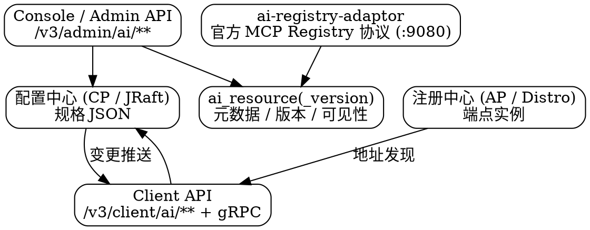

# Nacos AI Registry

> NOTE：本文以 **Nacos 3.2.4**（tag `3.2.4`）源码为准。AI Registry 是 3.x 才长出来的子系统，`ai` / `ai-registry-adaptor` / `skills` / `copilot` 四个模块在 2.x 完全不存在。

## Introduction

3.x 把 **MCP Server、A2A Agent、Skill、AgentSpec、Prompt** 变成可注册、可版本化、可检索的一等资源。理解它的捷径是：**AI Registry 并没有新建一套存储，而是把 Nacos 已有的两套设施重新组合了一遍**——

- **规格（spec）放进[配置中心](/docs/CS/Framework/nacos/config.md)**：MCP Server 的定义、Tools、Resources、版本清单都是「配置」，跟着配置中心走 JRaft（CP）落库，因而天然具备灰度发布、历史版本、变更推送能力。
- **端点（endpoint）放进[注册中心](/docs/CS/Framework/nacos/registry.md)**：MCP Server / A2A Agent 的可达地址是「服务实例」，注册到命名服务里走 Distro（AP），由心跳维持健康状态。

（CP / AP 的分工见[一致性抽象层](/docs/CS/Framework/nacos/consistency.md)。）
- **统一元数据放进关系库**：`ai_resource` / `ai_resource_version` 两张表只做跨类型的检索、版本、可见性与下载计数，不存正文。

所以「在 Nacos 上改一个 MCP Tool 的描述，客户端不用重启就生效」这件事，本质是**改配置触发推送**，而不是什么新的同步机制——这一点想通了，后面五类资源都是同一个套路的不同投影。



## Resource Model: Five Types of AI Resource

五类资源共用 `ai_resource.type` 这一个字段做区分，但各自的 group / dataId 形态与 API 前缀不同（常量均取自 `ai/src/main/java/com/alibaba/nacos/ai/constant/Constants.java`）：

| 资源 | 配置 group | dataId 形态 | 端点 group | Admin 路径 | Client 路径 |
| --- | --- | --- | --- | --- | --- |
| MCP Server | `mcp-server`、`mcp-tools`、`mcp-resources`、`mcp-server-versions` | `{name}-{version}-mcp-server.json` 等 | `mcp-endpoints` | `/v3/admin/ai/mcp` | gRPC |
| A2A Agent | `agent`、`agent-version` | — | `agent-endpoints` | `/v3/admin/ai/a2a` | — |
| Skill | `skill`、`skill-version` | zip 包上传 | — | `/v3/admin/ai/skills` | `/v3/client/ai/skills` |
| AgentSpec | `agentspec_*` | `manifest.json` | — | `/v3/admin/ai/agentspecs` | `/v3/client/ai/agentspecs` |
| Prompt | `nacos-ai-prompt` | `{key}.json` | — | `/v3/admin/ai/prompt` | `/v3/client/ai/prompt` |

### MCP Server

MCP Server 与 A2A Agent 是五类里「双写」的两类：规格写配置、端点写注册中心；Skill / AgentSpec / Prompt 只有规格，没有端点。

- **规格**：`McpServerOperationService` 负责 CRUD，按 `mcp-server` / `mcp-tools` / `mcp-resources` / `mcp-server-versions` 四个 group 分别落配置，dataId 以 `-mcp-server.json` / `-mcp-tools.json` / `-mcp-resources.json` / `-mcp-versions.json` 结尾。
- **端点**：`McpEndpointOperationService` 用 `Service.newService(namespaceId, "mcp-endpoints", mcpName)` 把端点注册成普通服务实例，靠 `instanceOperator` 增删；实例 metadata 里的 `__nacos.ai.mcp.service__`、`address`、`port`、`transportProtocol` 是客户端识别协议（http/https）与地址的键。
- **多命名空间与多版本**：MCP Server 可以注册到任意 namespace，复用 Nacos 的租户隔离；版本发布后可选其中一个设为默认版本，这就是 MCP 侧的灰度手段。

### A2A Agent

A2A（Agent-to-Agent）Agent 与 MCP Server 同构：规格存 `agent` / `agent-version` 两个 group，端点存 `agent-endpoints`。端点 metadata 的键全部带 `__nacos.agent.endpoint.` 前缀——`path`、`transport`、`supportTls`、`protocol`、`query`、`protocolVersion`、`tenant`。

### Skill and AgentSpec

这两类不走「配置」而走**制品包**：以 zip 上传，元数据进 `ai_resource` / `ai_resource_version`，包体本身由 `ai_resource_version.storage` 这个 JSON 字段指向（Skill 在其中记 `contentMd5`）。

- 默认 namespace 都是 `public`；Skill 默认上限 10MB，AgentSpec 50MB，分别可用 `nacos.ai.skill.zip.max-upload-size-mb`、`nacos.ai.agentspec.zip.max-upload-size-mb` 上调。
- 客户端按 label 查版本时，服务端用响应头回带校验值：Skill 是 `X-Nacos-Skill-Md5` / `X-Nacos-Skill-Resolved-Version`，AgentSpec 是 `X-Nacos-AgentSpec-Md5` / `X-Nacos-AgentSpec-Resolved-Version`——客户端据此判断本地缓存是否过期。
- AgentSpec 的存储后端可选，配置键 `nacos.ai.agentspec.storage.provider`。

### Prompt

Prompt 是五类里最「配置化」的：固定 group `nacos-ai-prompt`，dataId 为 `{promptKey}.json`，另有两份伴生配置——`.descriptor.json`（描述元数据）和 `.label-version-mapping.json`（运行时 label → version 映射）。版本与提交备注放在配置 `extInfo` 的 `prompt_version` / `prompt_commit_msg` 键里。

## Index and Search

跨资源的模糊/精确检索不直接扫库，而是走一层索引：`ai/index/` 下 `McpServerIndex` 有三个实现——`PlainMcpServerIndex`（直查）、`CachedMcpServerIndex`（带缓存）、`MemoryMcpCacheIndex`（纯内存），共同父类 `AbstractMcpServerIndex`。搜索模式只有两种：`blur` 与 `accurate`（常量 `MCP_LIST_SEARCH_BLUR` / `MCP_LIST_SEARCH_ACCURATE`），单次列表上限 `MAX_LIST_SIZE = 100`。

资源的可见性由 visibility 插件统一处理（`VisibilityHelper` + `plugin/visibility`），落到 `ai_resource` 的 `scope`（`PUBLIC` / `PRIVATE`，默认 `PRIVATE`）与 `owner` 两列——这也是 `AiResource` 要继承 `VisibilityResource` 的原因。

## gRPC Channel: Dynamic Push to Clients

AI 资源不只走 HTTP。`ai/remote/handler/` 下挂着 `McpServerEndpointRequestHandler`、`QueryMcpServerRequestHandler`、`ReleaseMcpServerRequestHandler`、`QueryPromptRequestHandler` 以及 `a2a` 子包，连接由 `AiConnectionBasedClientManager` 管理。也就是说 Agent 侧可以通过长连接**订阅** MCP Server / Prompt 的变化——Tool 开关、描述修改、版本切换都靠这条通道实时下发，不必轮询。

## Protocol Adaptor: MCP Registry and Skills Registry

`ai-registry-adaptor` 模块负责**对外协议兼容**，让 Nacos 能被标准 MCP 客户端当成一个 Registry 直接访问：

- `McpRegistryController`：对齐 MCP 官方 Registry REST API（`GET /servers` 风格的列表 / 详情 / 搜索）。
- `SkillsRegistryController`：Skills 的搜索与文件查询，响应模型 `SkillsSearchResponse` / `SkillsFileQueryForm`。
- 两个 Controller 都带 `@ConditionalOnProperty`，分别受 `nacos.ai.mcp.registry.enabled` 与 `nacos.ai.skill.registry.enabled` 控制，**默认都是 false**。
- 开启后不是在 8848/9848 上多挂几个路径，而是**另起独立端口**：`nacos.ai.registry.port=9080`。旧键 `nacos.ai.mcp.registry.port` 已标记 deprecated。

官方 MCP Registry 只提供公共托管、没有私有化部署方案，Nacos 这一步等于让企业能在内网自建一个 MCP 元数据仓库——这是 3.0.1 的主打能力之一。

顺带一提，`skills/` 目录里放着 Nacos 自己发布的 Skill（`nacos-skill-registry/SKILL.md`），可作为「一个 Skill 长什么样」的最小样例。

## Publish Pipeline

`ai/pipeline/` + `PipelineAdminController`（`/v3/admin/ai/pipelines`）提供**发布流水线**：资源发布前可挂外部检查节点（例如 Skill 安全扫描）。执行记录落 `pipeline_execution` 表，可用 `/list`、`/detail` 查询。配置形如：

```properties
nacos.plugin.ai-pipeline.enabled=true
nacos.plugin.ai-pipeline.type=skill-scanner
nacos.plugin.ai-pipeline.skill-scanner.command=/path/to/scanner
```

不配 `type` 时 Pipeline 不会执行——开关开了但没节点，等于空转。

## Copilot: Built-in Skill / Prompt Assistant

`copilot` 模块（3.2.4 新增）是控制台里的 AI 助手，走 `/v3/console/copilot/**`：

| 路径 | 能力 |
| --- | --- |
| `/skill/generate` | 生成 Skill |
| `/skill/optimize` | 优化已有 Skill |
| `/prompt/optimize` | 优化 Prompt |
| `/prompt/debug` | 调试 Prompt |
| `/chat`、`/chat/history` | 多轮对话与历史 |

配置前缀 `nacos.copilot`，默认值：`enabled=true`、`model=qwen-turbo`、`defaultNamespace=public`、`studioProject=NacosCopilot`；`apiKey` 与 `studioUrl` 需要自行填写（后端接的是 AgentScope Studio）。**默认开启意味着不配 `apiKey` 时这些入口是能点开但跑不通的**，生产环境建议显式关掉。

## Switches

| 配置键 | 默认 | 说明 |
| --- | --- | --- |
| `nacos.extension.ai.enabled` | `true` | AI 模块总开关，需配置中心与服务发现模块同时启用；`microservice` 功能模式下无论何值都不加载 |
| `nacos.ai.mcp.registry.enabled` | `false` | 官方 MCP Registry 协议适配，开启后占用 `nacos.ai.registry.port` |
| `nacos.ai.skill.registry.enabled` | `false` | Skills Registry 协议适配，同上 |
| `nacos.ai.registry.port` | `9080` | 协议适配独立端口；旧键 `nacos.ai.mcp.registry.port` 已废弃 |
| `nacos.plugin.ai-pipeline.type` | 空 | Pipeline 节点类型，逗号分隔；为空则 Pipeline 不执行 |
| `nacos.ai.skill.auto-publish-after-review.enabled` | `false` | Skill 审核通过后是否自动发布版本 |
| `nacos.ai.resource.import.enabled` | `false` | 是否启用显式配置的 AI 资源导入来源 |
| `nacos.ai.resource.import.legacy-mcp-api-enabled` | `false` | 临时重开已废弃的 MCP 导入 API |
| `nacos.ai.resource.import.allow-user-url` | `false` | 重开旧导入 API 时是否允许抓取用户提供的 URL |
| `nacos.istio.mcp.server.enabled` | `false` | Istio MCP over xDS 服务端，见下 |

## Links

- [Nacos](/docs/CS/Framework/nacos/Nacos.md)
- [Storage](/docs/CS/Framework/nacos/storage.md)
- [Config Push](/docs/CS/Framework/nacos/config-push.md)
- [Higress 服务发现](/docs/CS/Framework/Higress/Service_Discovery.md)
- [MCP](/docs/CS/AI/LLM/Protocol/MCP.md)
- [A2A](/docs/CS/AI/LLM/Protocol/A2A.md)

## References

- <https://nacos.io/docs/latest/manual/user/ai/mcp-auto-register>
- <https://nacos.io/docs/latest/manual/admin/system-configurations/>
- <https://nacos.io/blog/release-301/>
