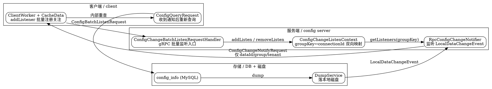

# Nacos Config Push Mechanism Deep Dive

## Introduction

配置中心的核心价值不只是「能存」，更是「变了客户端能马上知道」。Nacos 客户端感知配置变更的机制，从 HTTP 长轮询演进到 gRPC 长连接推送——这是注册发现之外 Nacos 的第二大实时能力。服务端把 DB 落盘的 dump 机制见 [Storage](/docs/CS/Framework/nacos/storage.md)；本文聚焦**变更如何触达客户端**。

> 版本基线：Nacos 3.2.4（commit 2c587c0）。以下片段均取自该 tag，路径为模块相对路径。

三个必须先摆正的直觉：

- **3.x Client OpenAPI 已无 HTTP 长轮询监听**：路由 `configs/listener` 全树 0 命中；`LongPollingService` 还在源码里，但它的请求入口 `ConfigServletInner.doPollingConfig()` 已无任何调用方（死代码）。
- **「30 s / 29.5 s」不是 3.2.4 服务端的数**：那是 2.x 客户端默认值。3.2.4 服务端超时取 `max(MIN_LONG_POOLING_TIMEOUT 默认 10000 ms, Long-Pulling-Timeout 头 − delayTime)`。
- **推送不带内容**：服务端只推 `dataId + group + tenant`，客户端收到后自己再发一次 `ConfigQueryRequest` 查全文、比对 md5 才回调 `Listener`。

## Design Philosophy: Lightweight Notification + Active Pull

推送刻意「小」：`ConfigChangeNotifyRequest` 只携带变更标识，**不携带配置内容**。客户端收到通知后，重新发起查询拿最新内容。这与 etcd watch 直接返回变更后的 KV 不同（见 [etcd Watch](/docs/CS/Framework/etcd/watch.md)）。好处是推送消息极小、网络开销低，最终内容仍走正常查询路径，保证一致性。

## 2.x Long Polling (已不在 3.x OpenAPI 中)

2.x 及以前，客户端用 HTTP 长轮询监听（`/v1/cs/configs/listener`）：把订阅的 dataId 列表连同本地 md5 发到服务端，服务端比对后——有变更立即返回，无变更则用 `AsyncContext` 把请求挂起，期间配置发布则被 `LocalDataChangeEvent` 唤醒提前返回。

3.2.4 里 `LongPollingService.addLongPollingClient()` 的代码仍在，且已用 `jakarta.servlet.AsyncContext`；超时是动态计算的，不是写死的 29.5 s：

```java
// Must be called by http thread, or send response.
final AsyncContext asyncContext = req.startAsync();
// AsyncContext.setTimeout() is incorrect, Control by oneself
asyncContext.setTimeout(0L);
```

```java
int delayTime = SwitchService.getSwitchInteger(SwitchService.FIXED_DELAY_TIME, 500);
int minLongPoolingTimeout =
    SwitchService.getSwitchInteger("MIN_LONG_POOLING_TIMEOUT", 10000);

// Add delay time for LoadBalance, and one response is returned 500 ms in advance to avoid client timeout.
String requestLongPollingTimeOut = req.getHeader(LongPollingService.LONG_POLLING_HEADER);
long timeout =
    Math.max(minLongPoolingTimeout, Long.parseLong(requestLongPollingTimeOut) - delayTime);
ConfigExecutor.executeLongPolling(
    new ClientLongPolling(asyncContext, clientMd5Map, ip, probeRequestSize, timeout,
        appName, tag));
```

`ClientLongPolling.run()` 把「到点返回」作为定时任务投递，`allSubs` 保存所有挂起连接；`DataChangeTask` 在 `LocalDataChangeEvent` 到来时找出关注该 groupKey 的连接，提前 `sendResponse()`：

```java
@Override
public void run() {
    asyncTimeoutFuture = ConfigExecutor.scheduleLongPolling(() -> {
        try {
            getRetainIps().put(ClientLongPolling.this.ip, System.currentTimeMillis());
            boolean removeFlag = allSubs.remove(ClientLongPolling.this);
            if (removeFlag) {
                sendResponse(null);
            }
        } catch (Throwable t) {
            LogUtil.DEFAULT_LOG.error("long polling error:" + t.getMessage(), t.getCause());
        }
    }, timeoutTime, TimeUnit.MILLISECONDS);

    allSubs.add(this);
}
```

> [!WARNING]
> 3.2.4 里 `LongPollingService` 仍被 `LocalConfigListenerStateServiceImpl`、`ConfigSubscriberMetricsCollector` 等用于**监听器状态查询与指标采集**，但 HTTP 长轮询的**请求入口已经断了**：`configs/listener` 路由 0 命中，`ConfigServletInner.doPollingConfig()`（唯一调 `addLongPollingClient()` 的地方）在 main 树里没有任何调用方。不要把长轮询当作 3.x 可用的监听方式。

## 3.x gRPC Long-Connection Push

3.x 配置监听改走 gRPC 长连接。服务端用 `ConfigChangeListenContext`（`config/server/remote/`）维护「哪些连接关注哪些配置」——**不是** `ClientWatchContext`（该名在 3.2.4 全树 0 命中）。



### Batch Listen Registration

`ConfigChangeBatchListenRequestHandler.handle()` 遍历批量监听项：注册（或注销）关注关系，并在注册时立刻比对一次 md5——若服务端已不是客户端手里的版本，就在响应里直接返回变更项，省得等下一次推送：

```java
for (ConfigBatchListenRequest.ConfigListenContext listenContext : configChangeListenRequest
    .getConfigListenContexts()) {
    String namespaceId = NamespaceUtil.processNamespaceParameter(listenContext.getTenant());
    String groupKey =
        GroupKey2.getKey(listenContext.getDataId(), listenContext.getGroup(), namespaceId);
    groupKey = StringPool.get(groupKey);
    String md5 = StringPool.get(listenContext.getMd5());

    if (configChangeListenRequest.isListen()) {
        configChangeListenContext.addListen(groupKey, md5, connectionId,
            isNeedTransferNamespace);
        boolean isUptoDate =
            ConfigCacheService.isUptodate(groupKey, md5, meta.getClientIp(), tag,
                meta.getAppLabels());
        if (!isUptoDate) {
            configChangeBatchListenResponse.addChangeConfig(listenContext.getDataId(),
                listenContext.getGroup(),
                listenContext.getTenant());
        }
    } else {
        configChangeListenContext.removeListen(groupKey, connectionId);
    }
}
```

### The Watch Context

`ConfigChangeListenContext` 用两张 `ConcurrentHashMap` 维护双向索引：`groupKey → connectionId 集合`（推送时按配置找连接）与 `connectionId → (groupKey → md5)`（连接断开时反查清理）：

```java
/**
 * groupKey-> connection set.
 */
private ConcurrentHashMap<String, HashSet<String>> groupKeyContext = new ConcurrentHashMap<>();

/**
 * connectionId-> group key set.
 */
private ConcurrentHashMap<String, HashMap<String, ConfigListenState>> connectionIdContext =
    new ConcurrentHashMap<>();

public synchronized void addListen(String groupKey, String md5, String connectionId,
    boolean isNamespaceTransfer) {
    // 1.add groupKeyContext
    groupKeyContext.computeIfAbsent(groupKey, k -> new HashSet<>()).add(connectionId);
    // 2.add connectionIdContext
    ConfigListenState listenState = new ConfigListenState(md5);
    listenState.setNamespaceTransfer(isNamespaceTransfer);
    connectionIdContext.computeIfAbsent(connectionId, k -> new HashMap<>(16)).put(groupKey,
        listenState);
}
```

### Notify on Change

配置发布后 `RpcConfigChangeNotifier` 收到 `LocalDataChangeEvent`，从 `ConfigChangeListenContext.getListeners(groupKey)` 取关注该配置的连接，构造 `ConfigChangeNotifyRequest.build(dataId, group, tenant)` 推下去——注意请求里**没有 content / md5**：

```java
public void configDataChanged(String groupKey, String dataId, String group, String tenant) {
    Set<String> listeners = configChangeListenContext.getListeners(groupKey);
    if (CollectionUtils.isEmpty(listeners)) {
        return;
    }
    int notifyClientCount = 0;
    for (final String client : listeners) {
        Connection connection = connectionManager.getConnection(client);
        if (connection == null) {
            continue;
        }
        ConfigChangeNotifyRequest notifyRequest =
            ConfigChangeNotifyRequest.build(dataId, group, tenant);
        RpcPushTask rpcPushRetryTask = new RpcPushTask(notifyRequest,
            ConfigCommonConfig.getInstance().getMaxPushRetryTimes(), client, clientIp,
            metaInfo.getAppName());
        push(rpcPushRetryTask, connectionManager);
        notifyClientCount++;
    }
}
```

### Client Side: Notify then Re-query

客户端 `ClientWorker` 收到通知后只把对应 `CacheData` 标记为「与服务端不一致」，并触发内部任务重新查询；查询回来才 `checkListenerMd5()` 判断要不要回调 `Listener`：

```java
ConfigChangeNotifyResponse handleConfigChangeNotifyRequest(
    ConfigChangeNotifyRequest configChangeNotifyRequest,
    String clientName) {
    String groupKey = GroupKey.getKeyTenant(configChangeNotifyRequest.getDataId(),
        configChangeNotifyRequest.getGroup(), configChangeNotifyRequest.getTenant());
    CacheData cacheData = cacheMap.get().get(groupKey);
    if (cacheData != null) {
        synchronized (cacheData) {
            cacheData.getReceiveNotifyChanged().set(true);
            cacheData.setConsistentWithServer(false);
            notifyListenConfig();
        }
    }
    return new ConfigChangeNotifyResponse();
}
```

```java
private void refreshContentAndCheck(RpcClient rpcClient, CacheData cacheData, boolean notify) {
    try {
        ConfigResponse response =
            this.queryConfigInner(rpcClient, cacheData.dataId, cacheData.group,
                cacheData.tenant, requestTimeout, notify);
        cacheData.setEncryptedDataKey(response.getEncryptedDataKey());
        cacheData.setContent(response.getContent());
        cacheData.checkListenerMd5();
    } catch (Exception e) {
        LOGGER.error("refresh content and check md5 fail ,dataId={},group={},tenant={} ",
            cacheData.dataId, cacheData.group, cacheData.tenant, e);
    }
}
```

一条 gRPC 长连接复用所有请求，毫秒级延迟，连接数远低于长轮询。

## dump Full Sync

服务端启动时把 MySQL `config_info` 全量 dump 到本地磁盘，供客户端直读、降低 DB 压力。落盘根目录由 `ConfigRawDiskService` 的常量定义，并以 `${nacos.home}` 为基准：普通配置落在 `${nacos.home}/data/config-data/{group}/{dataId}`（`{group}` / `{dataId}` 是真正的目录层级），带命名空间的配置落在 `data/tenant-config-data`，灰度配置分别落在 `data/gray-data` / `data/tenant-gray-data`。其中 `dataId` / `group` / `tenant` 在拼路径前还会经 `PathEncoderManager.getInstance().encode(...)` 编码（fix issue #10067）。定时全量间隔是 `DUMP_ALL_INTERVAL_IN_MINUTE = 6 * 60` 分钟。这是「服务端 → 磁盘」的持久化同步，与「服务端 → 客户端」的推送是两条独立链路，细节见 [Storage](/docs/CS/Framework/nacos/storage.md)。

```java
private static final String BASE_DIR = File.separator + "data" + File.separator + "config-data";
private static final String TENANT_BASE_DIR = File.separator + "data" + File.separator + "tenant-config-data";
private static final String GRAY_DIR = File.separator + "data" + File.separator + "gray-data";
private static final String TENANT_GRAY_DIR = File.separator + "data" + File.separator + "tenant-gray-data";
```

## Canary Watch (gray)

灰度发布由 `DumpAllGrayProcessor`（+ `DumpAllGrayTask`）把灰度配置单独落盘；监听侧客户端可订阅灰度配置，验证无误后全量发布。灰度与主配置共用同一推送通道，只是 dataId / grayName 维度不同。

> [!WARNING]
> 2.x 的 `DumpAllBetaProcessor` / `DumpAllTagProcessor` 在 3.2.4 **已删除**（0 命中），与 `config_info_beta` / `config_info_tag` 表被移除一致；3.x 只剩 `DumpAllProcessor` 与 `DumpAllGrayProcessor`。灰度模型统一叫 **gray**（`ConfigInfoGrayWrapper` / `config_info_gray` / `dumpGray`），不再叫 beta。

## 3.x Breaking Changes

Nacos 3.x 的 Client OpenAPI **不再提供 HTTP 长轮询的配置监听能力**——配置监听必须走官方 SDK 的 gRPC 长连接。迁移到 3.x 时若仍用旧版 SDK 的 HTTP 长轮询监听，会收不到变更通知（见 [Troubleshooting](/docs/CS/Framework/nacos/troubleshooting.md) 的版本错配段）。

> [!NOTE]
> 3.2.4 源码可验证：`configs/listener` 全树 0 命中；`LongPollingService` 唯一的生产请求入口 `ConfigServletInner.doPollingConfig()` 没有任何调用方（死代码）。
> 注意 v3 的 `/listener` 是**管理员查询「哪些客户端在监听」**的接口（`ConfigControllerV3.getListeners`），别当成长轮询端点。
>
> 生态侧：Spring Cloud Alibaba **2025.1.0.0**（适配 Spring Boot 4.0 / Spring Cloud 2025.1）内置 **Nacos Client 3.1.1**，并正式移除 `bootstrap.yml`，改用 `spring.config.import`——配置监听自此完全走 gRPC。

## Comparison with etcd Watch

| 维度 | Nacos 配置推送 | etcd Watch |
| :-- | :-- | :-- |
| 通道 | 2.x 长轮询 / 3.x gRPC 推送 | gRPC 续接流（watch stream） |
| 推送内容 | 仅 dataId + group + tenant（需再拉取） | 完整 KV |
| 一致性语义 | 通知 + 查询保证最终一致 | 线性一致（从某 revision 连续） |
| 版本维度 | dataId 有发布历史 / 回滚 | revision 单调 |

## Links

- [Nacos](/docs/CS/Framework/nacos/Nacos.md)
- [Config（dump / 服务端）](/docs/CS/Framework/nacos/config.md)
- [Storage](/docs/CS/Framework/nacos/storage.md)
- [Client（SDK 最佳实践）](/docs/CS/Framework/nacos/client.md)
- [etcd Watch](/docs/CS/Framework/etcd/watch.md)

## References

- <https://github.com/alibaba/nacos/tree/3.2.4/config/src/main/java/com/alibaba/nacos/config/server/remote>
- <https://github.com/alibaba/nacos/blob/3.2.4/config/src/main/java/com/alibaba/nacos/config/server/service/LongPollingService.java>
- <https://nacos.io/docs/latest/manual/user/config/publish-query-listen/>
