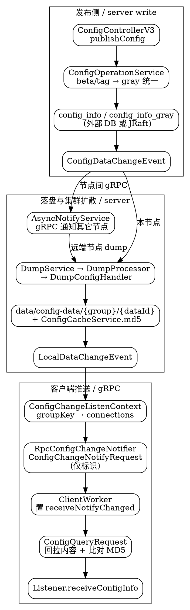

# Nacos Config Center

## Introduction

Nacos Config Center（配置中心子系统）回答一个问题：一份配置从控制台/API 发布后，如何落库、如何扩散到集群每个节点、又如何在毫秒级通知到成千上万个客户端。它与 [Service Registry](/docs/CS/Framework/nacos/registry.md) 同进程，却选了与命名临时实例相反的强一致路径。

> 版本基线：Nacos 3.2.4（commit 2c587c0，Java 17 / Spring Boot 3）。以下片段均取自该 tag，行号不落正文。

> [!WARNING]
> 旧笔记开篇称「配置采用 **AP** 一致性协议，脑裂时可用性高于一致性」——**这是把命名临时实例（Distro/AP）的结论张冠李戴到了配置中心**。3.x 真相是：配置写入先落外部 DB（或走 JRaft 状态机），节点间靠「落库 + 变更通知 + dump」达成最终一致，客户端靠 MD5 比对拉新。它不是 Distro 那种纯内存 AP 协议。请以本页下述链路为准。

配置的一致性要分两层看，二者机制完全不同：

- **Server 间**：写先持久化到 DB（集群/MySQL 模式）；主写节点落库后，通过 gRPC 通知其它节点「某 dataId 变了」，各节点各自回 DB dump 到本地磁盘。单机 Derby 模式则依靠 JRaft 保证一致。Server 之间对等，都能接受写。
- **SDK 与 Server**：3.x 建立 gRPC 长连接并**批量注册关心的 dataId**（`ConfigBatchListenRequest`）；发布后服务端只推「变更标识」（`ConfigChangeNotifyRequest`，仅 dataId/group/tenant），客户端内部再发 `ConfigQueryRequest` 拉回内容、比对 MD5 后回调 Listener。2.x 之前的 HTTP 长轮询已整体删除。

从整体上Nacos服务端的配置存储分为三层：

- 内存：Nacos每个节点都在内存里缓存了配置，但是只包含配置的md5（缓存配置文件太多了），所以内存级别的配置只能用于比较配置是否发生了变更，只用于客户端长轮询配置等场景。
- 文件系统：文件系统配置来源于数据库写入的配置。如果是集群启动或mysql单机启动，服务端会以本地文件系统的配置响应客户端查询。
- 数据库：所有写数据都会先写入数据库。只有当以derby数据源（-DembeddedStorage=true）单机（-Dnacos.standalone=true）启动时，客户端的查询配置请求会实时查询derby数据库。


对于写请求，Nacos会将数据先更新到数据库，之后异步写入所有节点的文件系统并更新内存。

CacheItem在Nacos服务端对应一个配置文件，缓存了配置的md5，持有一把读写锁控制访问冲突。

### Publish Pipeline

一次配置发布横跨「控制台 → DB → 落盘 → 集群扩散 → 客户端推送 → 回拉」六段。先把主链路画出来，后面各节逐一展开（注意推给客户端的只是「变更标识」，内容要靠客户端回拉）：



> [!WARNING]
> 下面这版 `CacheItem`（`md5` / `lastModifiedTs` / `isBeta` / `md54Beta`）是 **2.x 形态**。
> 3.2.4 里 `CacheItem` 已重构：md5 不再直接挂在 `CacheItem` 上，而是下沉到
> `ConfigCache`（由 `ConfigCacheFactoryDelegate` 创建），beta 也被统一的**灰度模型 `ConfigCacheGray`** 取代。
> 3.x 真实结构见本段第二段代码。

```java
public class CacheItem {

    public CacheItem(String groupKey) {
        this.groupKey = StringPool.get(groupKey);
    }

    final String groupKey;

    public volatile String md5 = Constants.NULL;

    public volatile long lastModifiedTs;

    /**
     * Use for beta.
     */
    public volatile boolean isBeta = false;

    public volatile String md54Beta = Constants.NULL;
}
```

3.2.4 的 `config/src/main/java/com/alibaba/nacos/config/server/model/CacheItem.java`：

```java
public class CacheItem {
    
    final String groupKey;
    
    public String type;
    
    ConfigCache configCache = ConfigCacheFactoryDelegate.getInstance().createConfigCache();
    
    /**
     * Use for gray.
     */
    private volatile Map<String, ConfigCacheGray> configCacheGray = null;
    
    List<ConfigCacheGray> sortedConfigCacheGrayList = null;
    
    private final SimpleReadWriteLock rwLock = new SimpleReadWriteLock();
    
    public CacheItem(String groupKey, String encryptedDataKey) {
        this.groupKey = StringPool.get(groupKey);
        this.getConfigCache().setEncryptedDataKey(encryptedDataKey);
    }
    
    public CacheItem(String groupKey) {
        this.groupKey = StringPool.get(groupKey);
    }
}
```

对应地，`ConfigCacheService` 在 3.x **没有** `PersistService` 成员（也不再是 `private static final`）：

```java
public class ConfigCacheService {
    /**
     * groupKey -> cacheItem.
     */
    static final ConcurrentHashMap<String, CacheItem> CACHE = new ConcurrentHashMap<>();
}
```


Config change pointcut aspect,which config change plugin services will pointcut.


```java
@Aspect
@Component
public class ConfigChangeAspect {

    private Object configChangeServiceHandle(ProceedingJoinPoint pjp,
            List<ConfigChangePluginService> configChangePluginServiceList,
            ConfigChangeRequest configChangeRequest) {
        configChangeRequest.setArg("modifyTime", TimeUtils.getCurrentTimeStr());
        ConfigChangePointCutTypes handleType = configChangeRequest.getRequestType();
        ConfigChangeResponse configChangeResponse = new ConfigChangeResponse(handleType);
        // default success,when before plugin service verify failed , set false
        configChangeResponse.setSuccess(true);

        List<ConfigChangePluginService> beforeExecutePluginServices = new ArrayList<>(DEFAULT_BEFORE_LIST_CAPACITY);
        List<ConfigChangePluginService> afterExecutePluginServices = new ArrayList<>(DEFAULT_AFTER_LIST_CAPACITY);
        
        Object retVal = null;
        Object[] args = pjp.getArgs();
        configChangeRequest.setArg(ConfigChangeConstants.ORIGINAL_ARGS, args);
        
        for (ConfigChangePluginService ccs : configChangePluginServiceList) {
            if (!isEnabled(ccs)) {
                continue;
            }
            if (ConfigChangeExecuteTypes.EXECUTE_BEFORE_TYPE.equals(ccs.executeType())) {
                beforeExecutePluginServices.add(ccs);
            } else {
                afterExecutePluginServices.add(ccs);
            }
        }
        
        // before plugin service execute
        for (ConfigChangePluginService ccs : beforeExecutePluginServices) {
            final String serviceType = ccs.getServiceType().toLowerCase(Locale.ROOT);
            final Properties properties = configChangeConfigs.getPluginProperties(serviceType);
            configChangeRequest.setArg("pluginProperties", properties);
            ccs.execute(configChangeRequest, configChangeResponse);
            if (null != configChangeResponse.getArgs()) {
                // update args by filter with whitelist
                args = configChangeResponse.getArgs();
            }
            // prevent execute next before plugins service
            if (!configChangeResponse.isSuccess()) {
                retVal = wrapErrorResp(configChangeResponse);
                break;
            }
        }
        
        try {
            // if validate failed,skipped directly
            if (configChangeResponse.isSuccess()) {
                retVal = pjp.proceed(args);
            }
        } catch (Throwable e) {
            LOGGER.warn("config change join point failed {}", e.getMessage());
            configChangeResponse.setMsg("config change join point fail" + e.getMessage());
            retVal = wrapErrorResp(configChangeResponse);
        }
        
        // after plugin service execute
        ConfigExecutor.executeAsyncConfigChangePluginTask(() -> {
            for (ConfigChangePluginService ccs : afterExecutePluginServices) {
                try {
                    final String serviceType = ccs.getServiceType().toLowerCase(Locale.ROOT);
                    final Properties properties = configChangeConfigs.getPluginProperties(serviceType);
                    configChangeRequest.setArg(ConfigChangeConstants.PLUGIN_PROPERTIES, properties);
                    ccs.execute(configChangeRequest, configChangeResponse);
                } catch (Throwable throwable) {
                    LOGGER.warn("execute async plugin services failed {}", throwable.getMessage());
                }
            }
        });
        
        return retVal;
    }
}
```

ProceedingJoinPoint.proceed前后都有ConfigChangePluginService的执行

### publishConfig


`ConfigOperationService.publishConfig`（3.2.4 是 **class** 不是 interface，位于 `config/server/service/ConfigOperationService.java`）

`ConfigInfoPersistService.insertOrUpdate`（3.2.4 是 **interface**，按存储形态有两个实现：`EmbeddedConfigInfoPersistServiceImpl` 走 Derby / `ExternalConfigInfoPersistServiceImpl` 走外部库）

这里有tag和cas的一些处理


publish一个ConfigDataChangeEvent

#### ConfigDataChangeEvent

AsyncNotifyService处理ConfigDataChangeEvent事件 通过封装的多个异步任务 在任务中rpc通知其它serve


```java
void handleConfigDataChangeEvent(Event event) {
        if (event instanceof ConfigDataChangeEvent) {
            ConfigDataChangeEvent evt = (ConfigDataChangeEvent) event;
            long dumpTs = evt.lastModifiedTs;
            String dataId = evt.dataId;
            String group = evt.group;
            String tenant = evt.tenant;
            String tag = evt.tag;
            MetricsMonitor.incrementConfigChangeCount(tenant, group, dataId);
            
            Collection<Member> ipList = memberManager.allMembersWithoutSelf();
            
            // In fact, any type of queue here can be
            Queue<NotifySingleRpcTask> rpcQueue = new LinkedList<>();
            
            for (Member member : ipList) {
                // grpc report data change only
                rpcQueue.add(
                        new NotifySingleRpcTask(dataId, group, tenant, tag, dumpTs, evt.isBeta, evt.isBatch, member));
            }
            if (!rpcQueue.isEmpty()) {
                ConfigExecutor.executeAsyncNotify(new AsyncRpcTask(rpcQueue));
            }
        }
    }
```

Dump Service也会处理ConfigDataChangeEvent事件 

```java
void handleConfigDataChange(Event event) {
// Generate ConfigDataChangeEvent concurrently
if (event instanceof ConfigDataChangeEvent) {
    ConfigDataChangeEvent evt = (ConfigDataChangeEvent) event;

    DumpRequest dumpRequest = DumpRequest.create(evt.dataId, evt.group, evt.tenant, evt.lastModifiedTs,
                                                 NetUtils.localIP());
    dumpRequest.setBeta(evt.isBeta);
    dumpRequest.setBatch(evt.isBatch);
    dumpRequest.setTag(evt.tag);
    DumpService.this.dump(dumpRequest);
}
}
```


创建task添加到TaskManager里 NacosDelayTaskExecuteEngine 负责100ms执行一条任务


处理此任务是在DumpPocessor里

- ConfigInfoPersistService从存储层获取配置
- DumpConfigHandler configDump
- ConfigCacheService.dump
- ConfigDiskService写入到Disk或者RocksDB
- ConfigCache Service md5 value 发布 LocalDataChangedEvent
- rpcConfigChangeNotifier处理事件 遍历所有的listener 在其中通过rpc通知客户端


3.2.4 的 `RpcConfigChangeNotifier` 签名已简化为 `(groupKey, dataId, group, tenant)`——**没有 `isBeta` / `betaIps` / `tag`，也没有 tag 比对分支**：灰度选择下推到了服务端 `ConfigCacheService.isUptodate` 与客户端 connection meta，`ConfigChangeNotifyRequest` 本身只携带 dataId/group/tenant 三个标识：

```java
@Component(value = "rpcConfigChangeNotifier")
public class RpcConfigChangeNotifier extends Subscriber<LocalDataChangeEvent> {

    public void configDataChanged(String groupKey, String dataId, String group, String tenant) {

        Set<String> listeners = configChangeListenContext.getListeners(groupKey);
        if (CollectionUtils.isEmpty(listeners)) {
            return;
        }
        int notifyClientCount = 0;
        for (final String client : listeners) {
            Connection connection = connectionManager.getConnection(client);
            if (connection == null) {
                continue;
            }
            boolean ifNamespaceTransfer = configChangeListenContext
                .getConfigListenState(client, groupKey).isNamespaceTransfer();
            if (ifNamespaceTransfer) {
                tenant = null;
            }
            ConnectionMeta metaInfo = connection.getMetaInfo();
            String clientIp = metaInfo.getClientIp();

            ConfigChangeNotifyRequest notifyRequest =
                ConfigChangeNotifyRequest.build(dataId, group, tenant);

            RpcPushTask rpcPushRetryTask = new RpcPushTask(notifyRequest,
                ConfigCommonConfig.getInstance().getMaxPushRetryTimes(), client, clientIp,
                metaInfo.getAppName());
            push(rpcPushRetryTask, connectionManager);
            notifyClientCount++;
        }
        Loggers.REMOTE_PUSH.info("push [{}] clients, groupKey=[{}]", notifyClientCount, groupKey);
    }

    @Override
    public void onEvent(LocalDataChangeEvent event) {
        String groupKey = event.groupKey;
        String[] strings = GroupKey.parseKey(groupKey);
        String dataId = strings[0];
        String group = strings[1];
        String tenant = strings.length > 2 ? strings[2] : "";
        configDataChanged(groupKey, dataId, group, tenant);
    }
}
```

反直觉点：`LocalDataChangeEvent` 里也只有 `groupKey`，没有内容；`onEvent` 现场把它拆成 dataId/group/tenant 再拼成 `ConfigChangeNotifyRequest`。**推给客户端的永远只是「哪个 dataId 变了」，不含新值**——客户端收到后要自己回拉（见 `Config Refresh` 一节）。


### dump


> [!WARNING]
> Nacos 2.x 的 `dumpOperate(DumpProcessor, DumpAllProcessor, DumpAllBetaProcessor, DumpAllTagProcessor)` 依赖 `DumpAllBetaProcessor` / `DumpAllTagProcessor` / `BETA_TABLE_NAME` / `DiskUtil.clearAllBeta()` / `DiskUtil.clearAllTag()` 这一整套 beta/tag 灰度 processor，这些类在 3.2.4 中已删除；beta 与 tag 灰度被统一的 **gray 灰度**（数据库表 `config_info_gray` / `ConfigInfoGrayPersistService`，磁盘处理器 `DumpAllGrayProcessor`，任务 `DumpAllGrayTask`）取代，`dumpOperate()` 也已变为无参方法。下方给出 3.2.4 的真实实现，请勿再把已删除的 beta/tag processor 当作现行代码。

```java
/**
 * config history clear.
 */
class DumpAllProcessorRunner implements Runnable {

    @Override
    public void run() {
        dumpAllTaskMgr.addTask(DumpAllTask.TASK_ID, new DumpAllTask());
    }
}

/**
 * dump all gray processor runner.
 */
class DumpAllGrayProcessorRunner implements Runnable {

    @Override
    public void run() {
        dumpAllTaskMgr.addTask(DumpAllGrayTask.TASK_ID, new DumpAllGrayTask());
    }
}

protected void dumpOperate() throws NacosException {
    String dumpFileContext = "CONFIG_DUMP_TO_FILE";
    TimerContext.start(dumpFileContext);
    try {
        LogUtil.DEFAULT_LOG.warn("DumpService start");

        Timestamp currentTime = new Timestamp(System.currentTimeMillis());

        try {
            dumpAllConfigInfoOnStartup(dumpAllProcessor);
            dumpAllGrayConfigInfoOnStartup(dumpAllGrayProcessor);
        } catch (Exception e) {
            LogUtil.FATAL_LOG.error(
                "Nacos Server did not start because dumpservice bean construction failure :\n"
                    + e);
            throw new NacosException(NacosException.SERVER_ERROR,
                "Nacos Server did not start because dumpservice bean construction failure :\n"
                    + e.getMessage(),
                e);
        }
        if (!EnvUtil.getStandaloneMode()) {

            long initialDelay =
                ThreadLocalRandom.current().nextInt(INITIAL_DELAY_IN_MINUTE) + 10;
            LogUtil.DEFAULT_LOG.warn("initialDelay:{}", initialDelay);

            ConfigExecutor.scheduleConfigTask(new DumpAllProcessorRunner(), initialDelay,
                DUMP_ALL_INTERVAL_IN_MINUTE, TimeUnit.MINUTES);
            ConfigExecutor.scheduleConfigTask(new DumpAllGrayProcessorRunner(), initialDelay,
                DUMP_ALL_INTERVAL_IN_MINUTE, TimeUnit.MINUTES);

            ConfigExecutor.scheduleConfigChangeTask(
                new DumpChangeConfigWorker(this.configInfoPersistService,
                    this.historyConfigInfoPersistService,
                    this.configMigrateService,
                    currentTime),
                ThreadLocalRandom.current()
                    .nextInt((int) PropertyUtil.getDumpChangeWorkerInterval()),
                TimeUnit.MILLISECONDS);
            ConfigExecutor.scheduleConfigChangeTask(
                new DumpChangeGrayConfigWorker(this.configInfoGrayPersistService, currentTime,
                    this.historyConfigInfoPersistService, this.configMigrateService),
                ThreadLocalRandom.current()
                    .nextInt((int) PropertyUtil.getDumpChangeWorkerInterval()),
                TimeUnit.MILLISECONDS);
        }

        HistoryConfigCleaner cleaner = HistoryConfigCleanerManager.getHistoryConfigCleaner(
            HistoryConfigCleanerConfig.getInstance().getActiveHistoryConfigCleaner());
        ConfigExecutor.scheduleConfigTask(new ConfigHistoryClear(cleaner), 10, 10,
            TimeUnit.MINUTES);

    } finally {
        TimerContext.end(dumpFileContext, LogUtil.DUMP_LOG);
    }

}

private void dumpAllConfigInfoOnStartup(DumpAllProcessor dumpAllProcessor) {

    try {
        LogUtil.DEFAULT_LOG.info("start clear all config-info.");
        ConfigDiskServiceFactory.getInstance().clearAll();
        dumpAllProcessor.process(new DumpAllTask(true));
    } catch (Exception e) {
        LogUtil.FATAL_LOG.error("dump config fail" + e.getMessage());
        throw e;
    }
}

private void dumpAllGrayConfigInfoOnStartup(DumpAllGrayProcessor dumpAllGrayProcessor) {
    try {
        LogUtil.DEFAULT_LOG.info("start to clear all gray-config-info on startup.");
        ConfigDiskServiceFactory.getInstance().clearAllGray();
        dumpAllGrayProcessor.process(new DumpAllGrayTask());
    } catch (Exception e) {
        LogUtil.FATAL_LOG
            .error("failed to dump all gray-config-info on startup." + e.getMessage());
        throw e;
    }
}
```

以上片段来自 `config/src/main/java/com/alibaba/nacos/config/server/service/dump/DumpService.java`，涉及 `dumpOperate()`、`DumpAllProcessorRunner`、`DumpAllGrayProcessorRunner`、`dumpAllConfigInfoOnStartup()` 与 `dumpAllGrayConfigInfoOnStartup()`。


```java

@Component(value = "internalConfigChangeNotifier")
public class InternalConfigChangeNotifier extends Subscriber<LocalDataChangeEvent> {

    @Autowired
    private ConfigQueryRequestHandler configQueryRequestHandler;

    public InternalConfigChangeNotifier() {
        NotifyCenter.registerToPublisher(ConnectionLimitRuleChangeEvent.class, 16384);
        NotifyCenter.registerToPublisher(TpsControlRuleChangeEvent.class, 16384);
        NotifyCenter.registerSubscriber(this);

    }

    private static final String DATA_ID_TPS_CONTROL_RULE = "nacos.internal.tps.control_rule_";

    private static final String DATA_ID_CONNECTION_LIMIT_RULE = "nacos.internal.connection.limit.rule";

    private static final String NACOS_GROUP = "nacos";

    @Override
    public void onEvent(LocalDataChangeEvent event) {
        String groupKey = event.groupKey;
        String dataId = GroupKey.parseKey(groupKey)[0];
        String group = GroupKey.parseKey(groupKey)[1];
        if (DATA_ID_CONNECTION_LIMIT_RULE.equals(dataId) && NACOS_GROUP.equals(group)) {

            try {
                String content = loadLocalConfigLikeClient(dataId, group);
                NotifyCenter.publishEvent(new ConnectionLimitRuleChangeEvent(content));

            } catch (NacosException e) {
                Loggers.REMOTE.error("connection limit rule load fail.", e);
            }
        }

        if (dataId.startsWith(DATA_ID_TPS_CONTROL_RULE) && NACOS_GROUP.equals(group)) {
            try {
                String pointName = dataId.replaceFirst(DATA_ID_TPS_CONTROL_RULE, "");

                String content = loadLocalConfigLikeClient(dataId, group);
                NotifyCenter.publishEvent(new TpsControlRuleChangeEvent(pointName, content));

            } catch (NacosException e) {
                Loggers.REMOTE.error("connection limit rule load fail.", e);
            }

        }

    }
}
```


在Nacos的设计中，Mysql是一个中心数据仓库，且认为在Mysql中的数据是绝对正确的。 除此之外，Nacos在启动时会把Mysql中的数据写一份到本地磁盘。

这么设计的好处是可以提高性能，当客户端需要请求某个配置项时，服务端会想Ian从磁盘中读取对应文件返回，而磁盘的读取效率要比数据库效率高。

当配置发生变更时：

- Nacos会把变更的配置保存到数据库，然后再写入本地文件。
- 接着发送一个HTTP请求，给到集群中的其他节点，其他节点收到事件后，从Mysql中dump刚刚写入的数据到本地文件中。


另外，NacosServer启动后，会同步启动一个定时任务，每隔6小时，会dump一次全量数据到本地文件


```java
public class ConfigChangePublisher {
    
    public static void notifyConfigChange(ConfigDataChangeEvent event) {
        if (PropertyUtil.isEmbeddedStorage() && !EnvUtil.getStandaloneMode()) {
            return;
        }
        NotifyCenter.publishEvent(event);
    }
    
}
```


> [!WARNING]
> 下面这段 `AsyncNotifyService` 是 **2.x 双通道（HTTP + gRPC）通知**的形态：按 `MemberUtil.isSupportedLongCon(member)`
> 把成员分到 `httpQueue`（`NotifySingleTask` + `NacosAsyncRestTemplate`）或 `rpcQueue`。
> **3.2.4 里 HTTP 通道已完全移除**——`AsyncNotifyService` 中 `httpQueue` / `NacosAsyncRestTemplate` / `NotifySingleTask`
> 全部 0 命中，只剩 `rpcQueue`（即上文 `handleConfigDataChangeEvent` 那版）。
> 配套的 `CommunicationController` 的 `/dataChange` HTTP 回调端点在 3.x **也已不存在**（全树 0 命中），
> 节点间变更通知统一走 gRPC。

```java

@Service
public class AsyncNotifyService {

    @Autowired
    private DumpService dumpService;

    @Autowired
    private ConfigClusterRpcClientProxy configClusterRpcClientProxy;

    private ServerMemberManager memberManager;

    @Autowired
    public AsyncNotifyService(ServerMemberManager memberManager) {
        this.memberManager = memberManager;

        // Register ConfigDataChangeEvent to NotifyCenter.
        NotifyCenter.registerToPublisher(ConfigDataChangeEvent.class, NotifyCenter.ringBufferSize);

        // Register A Subscriber to subscribe ConfigDataChangeEvent.
        NotifyCenter.registerSubscriber(new Subscriber() {

            @Override
            public void onEvent(Event event) {
                // Generate ConfigDataChangeEvent concurrently
                if (event instanceof ConfigDataChangeEvent) {
                    ConfigDataChangeEvent evt = (ConfigDataChangeEvent) event;
                    long dumpTs = evt.lastModifiedTs;
                    String dataId = evt.dataId;
                    String group = evt.group;
                    String tenant = evt.tenant;
                    String tag = evt.tag;
                    Collection<Member> ipList = memberManager.allMembers();

                    // In fact, any type of queue here can be
                    Queue<NotifySingleTask> httpQueue = new LinkedList<NotifySingleTask>();
                    Queue<NotifySingleRpcTask> rpcQueue = new LinkedList<NotifySingleRpcTask>();

                    for (Member member : ipList) {
                        if (!MemberUtil.isSupportedLongCon(member)) {
                            httpQueue.add(new NotifySingleTask(dataId, group, tenant, tag, dumpTs, member.getAddress(),
                                    evt.isBeta));
                        } else {
                            rpcQueue.add(
                                    new NotifySingleRpcTask(dataId, group, tenant, tag, dumpTs, evt.isBeta, member));
                        }
                    }
                    if (!httpQueue.isEmpty()) {
                        ConfigExecutor.executeAsyncNotify(new AsyncTask(nacosAsyncRestTemplate, httpQueue));
                    }
                    if (!rpcQueue.isEmpty()) {
                        ConfigExecutor.executeAsyncNotify(new AsyncRpcTask(rpcQueue));
                    }

                }
            }

            @Override
            public Class<? extends Event> subscribeType() {
                return ConfigDataChangeEvent.class;
            }
        });
    }
}
```

async

```java

    class AsyncTask implements Runnable {
        
        private Queue<NotifySingleTask> queue;
        
        private NacosAsyncRestTemplate restTemplate;
        
        public AsyncTask(NacosAsyncRestTemplate restTemplate, Queue<NotifySingleTask> queue) {
            this.restTemplate = restTemplate;
            this.queue = queue;
        }
        
        @Override
        public void run() {
            executeAsyncInvoke();
        }
        
        private void executeAsyncInvoke() {
            while (!queue.isEmpty()) {
                NotifySingleTask task = queue.poll();
                String targetIp = task.getTargetIP();
                if (memberManager.hasMember(targetIp)) {
                    // start the health check and there are ips that are not monitored, put them directly in the notification queue, otherwise notify
                    boolean unHealthNeedDelay = memberManager.isUnHealth(targetIp);
                    if (unHealthNeedDelay) {
                        // target ip is unhealthy, then put it in the notification list
                        ConfigTraceService.logNotifyEvent(task.getDataId(), task.getGroup(), task.getTenant(), null,
                                task.getLastModified(), InetUtils.getSelfIP(), ConfigTraceService.NOTIFY_EVENT_UNHEALTH,
                                0, task.target);
                        // get delay time and set fail count to the task
                        asyncTaskExecute(task);
                    } else {
                        Header header = Header.newInstance();
                        header.addParam(NotifyService.NOTIFY_HEADER_LAST_MODIFIED,
                                String.valueOf(task.getLastModified()));
                        header.addParam(NotifyService.NOTIFY_HEADER_OP_HANDLE_IP, InetUtils.getSelfIP());
                        if (task.isBeta) {
                            header.addParam("isBeta", "true");
                        }
                        AuthHeaderUtil.addIdentityToHeader(header);
                        restTemplate.get(task.url, header, Query.EMPTY, String.class, new AsyncNotifyCallBack(task));
                    }
                }
            }
        }
    }
```


### Example

```java
public static void main(String[] args) throws NacosException, InterruptedException {
        Properties properties = new Properties();
        properties.put("serverAddr", "xxx.xxx.xxx.xxx:8848");
        String dataId = "info";
        ConfigService configService = new NacosConfigService(properties);
        String defaultGroup = "DEFAULT_GROUP";
        String config = configService.getConfig(dataId, defaultGroup, 5000);
        System.out.println(config);
        configService.addListener(dataId, defaultGroup, new Listener() {
            @Override
            public Executor getExecutor() {
                return null;
            }

            @Override
            public void receiveConfigInfo(String s) {
                System.out.println("Config has been changed! :" + s);
            }
        });

        TimeUnit.MINUTES.sleep(5);
    }
```


```java
@RestController
@RequestMapping(Constants.COMMUNICATION_CONTROLLER_PATH)
public class CommunicationController {
    @GetMapping("/dataChange")
    public Boolean notifyConfigInfo(HttpServletRequest request, @RequestParam("dataId") String dataId,
                                    @RequestParam("group") String group,
                                    @RequestParam(value = "tenant", required = false, defaultValue = StringUtils.EMPTY) String tenant,
                                    @RequestParam(value = "tag", required = false) String tag) {
        dataId = dataId.trim();
        group = group.trim();
        String lastModified = request.getHeader(NotifyService.NOTIFY_HEADER_LAST_MODIFIED);
        long lastModifiedTs = StringUtils.isEmpty(lastModified) ? -1 : Long.parseLong(lastModified);
        String handleIp = request.getHeader(NotifyService.NOTIFY_HEADER_OP_HANDLE_IP);
        String isBetaStr = request.getHeader("isBeta");
        if (StringUtils.isNotBlank(isBetaStr) && Boolean.parseBoolean(isBetaStr)) {
            dumpService.dump(dataId, group, tenant, lastModifiedTs, handleIp, true);
        } else {
            dumpService.dump(dataId, group, tenant, tag, lastModifiedTs, handleIp);
        }
        return true;
    }
}
```


## Config Refresh

### PropertySourceLocator
1. init [ConfigService](/docs/CS/Framework/nacos/config.md?id=configservice)
2. merge configurations

```java
@Configuration(proxyBeanMethods = false)
@ConditionalOnProperty(name = "spring.cloud.nacos.config.enabled", matchIfMissing = true)
public class NacosConfigBootstrapConfiguration {
    @Bean
    public NacosPropertySourceLocator nacosPropertySourceLocator(
            NacosConfigManager nacosConfigManager) {
        return new NacosPropertySourceLocator(nacosConfigManager);
    }
}

public class NacosPropertySourceLocator implements PropertySourceLocator {
    @Override
    public PropertySource<?> locate(Environment env) {
        nacosConfigProperties.setEnvironment(env);
        ConfigService configService = nacosConfigManager.getConfigService();

        if (null == configService) {
            log.warn("no instance of config service found, can't load config from nacos");
            return null;
        }
        long timeout = nacosConfigProperties.getTimeout();
        nacosPropertySourceBuilder = new NacosPropertySourceBuilder(configService,
                timeout);
        String name = nacosConfigProperties.getName();

        String dataIdPrefix = nacosConfigProperties.getPrefix();
        if (StringUtils.isEmpty(dataIdPrefix)) {
            dataIdPrefix = name;
        }

        if (StringUtils.isEmpty(dataIdPrefix)) {
            dataIdPrefix = env.getProperty("spring.application.name");
        }

        CompositePropertySource composite = new CompositePropertySource(
                NACOS_PROPERTY_SOURCE_NAME);

        loadSharedConfiguration(composite);
        loadExtConfiguration(composite);
        loadApplicationConfiguration(composite, dataIdPrefix, nacosConfigProperties, env);
        return composite;
    }
}
```

### ConfigService
ClientWorker
```java
public NacosConfigService(Properties properties) throws NacosException {
    PreInitUtils.asyncPreLoadCostComponent();
    final NacosClientProperties clientProperties = NacosClientProperties.PROTOTYPE.derive(properties);
    ValidatorUtils.checkInitParam(clientProperties);

    initNamespace(clientProperties);
    this.configFilterChainManager = new ConfigFilterChainManager(clientProperties.asProperties());
    ServerListManager serverListManager = new ServerListManager(clientProperties);
    serverListManager.start();

    this.worker = new ClientWorker(this.configFilterChainManager, serverListManager, clientProperties);
    // will be deleted in 2.0 later versions
    agent = new ServerHttpAgent(serverListManager);

}
```


> [!WARNING]
> 下面这一整块是 **2.0 之前的「HTTP 长轮询」客户端模型**，在 3.2.4 已被**整体删除**：
> - `LongPollingRunnable`、`ClientWorker.checkConfigInfo()`、`checkUpdateDataIds(...)`、`HttpAgent` 在全树 **0 命中**。
> - 2.0 起配置监听改为 **gRPC 长连接**：服务端通过 `ConfigChangeNotifyRequest` 主动推送变更的 dataId/group，
>   客户端再按需拉取内容，不再有「10ms 轮询 + 长轮询线程」这一套。
> 保留原文用于理解演进，实现请以下面的 3.x 结构为准。

3.2.4 的 `ClientWorker`（`client/src/main/java/com/alibaba/nacos/client/config/impl/ClientWorker.java`）只依赖一个基于 gRPC 的传输客户端：

```java
public class ClientWorker implements Closeable {

    /**
     * groupKey -> cacheData.
     */
    private final AtomicReference<Map<String, CacheData>> cacheMap =
        new AtomicReference<>(new HashMap<>());

    private final ConfigFilterChainManager configFilterChainManager;

    private final ConfigFuzzyWatchGroupKeyHolder configFuzzyWatchGroupKeyHolder;

    /** 3.x：传输层统一为 gRPC，不再是 HttpAgent。 */
    private final ConfigRpcTransportClient agent;

    public ClientWorker(final ConfigFilterChainManager configFilterChainManager,
        ConfigServerListManager serverListManager, final NacosClientProperties properties)
        throws NacosException {
        this.configFilterChainManager = configFilterChainManager;
        init(properties);
        agent = new ConfigRpcTransportClient(properties, serverListManager);
        configFuzzyWatchGroupKeyHolder = new ConfigFuzzyWatchGroupKeyHolder(agent, uuid);
        ThreadPoolExecutor executor = instantiateClientExecutor(properties);
        agent.setExecutor(executor);
        agent.start();
        configFuzzyWatchGroupKeyHolder.start();
    }
}
```

收到服务端推送后，客户端**只标记脏、不更新内容**——`handleConfigChangeNotifyRequest` 把对应 `CacheData` 的 `receiveNotifyChanged` 置真、`consistentWithServer` 置假，再唤醒监听线程：

```java
ConfigChangeNotifyResponse handleConfigChangeNotifyRequest(
    ConfigChangeNotifyRequest configChangeNotifyRequest,
    String clientName) {
    LOGGER.info("[{}] [server-push] config changed. dataId={}, group={},tenant={}",
        clientName,
        configChangeNotifyRequest.getDataId(), configChangeNotifyRequest.getGroup(),
        configChangeNotifyRequest.getTenant());
    String groupKey = GroupKey.getKeyTenant(configChangeNotifyRequest.getDataId(),
        configChangeNotifyRequest.getGroup(), configChangeNotifyRequest.getTenant());

    CacheData cacheData = cacheMap.get().get(groupKey);
    if (cacheData != null) {
        synchronized (cacheData) {
            cacheData.getReceiveNotifyChanged().set(true);
            cacheData.setConsistentWithServer(false);
            notifyListenConfig();
        }
    }
    return new ConfigChangeNotifyResponse();
}
```

真正的内容拉取走 `ConfigQueryRequest`，成功后写本地快照并回填 md5，再由上层比对触发 Listener：

```java
ConfigResponse queryConfigInner(RpcClient rpcClient, String dataId, String group,
    String tenant,
    long readTimeouts, boolean notify) throws NacosException {
    ConfigQueryRequest request = ConfigQueryRequest.build(dataId, group, tenant);
    request.putHeader(NOTIFY_HEADER, String.valueOf(notify));

    ConfigQueryResponse response =
        (ConfigQueryResponse) requestProxy(rpcClient, request, readTimeouts);

    ConfigResponse configResponse = new ConfigResponse();
    if (response.isSuccess()) {
        LocalConfigInfoProcessor.saveSnapshot(this.getName(), dataId, group, tenant,
            response.getContent());
        configResponse.setContent(response.getContent());
        configResponse.setMd5(response.getMd5());
        // ... 推断 configType、处理 encryptedDataKey
        return configResponse;
    }
    // ... 失败分支读本地快照 / 抛异常
}
```

几个与 2.x 对照的关键变化：

| 2.x（长轮询） | 3.x（长连接） |
| :-- | :-- |
| `HttpAgent` / `ServerHttpAgent` | `ConfigRpcTransportClient extends ConfigTransportClient` |
| `executor.scheduleWithFixedDelay(checkConfigInfo, 1L, 10L, MILLISECONDS)` | 无轮询；由服务端推送 `ConfigChangeNotifyRequest` 触发 |
| `LongPollingRunnable` 批量 `checkUpdateDataIds` | 变更通知直接落到 `CacheData`，再回调 listener |
| 两个线程池（Worker + longPolling） | 一个 `ThreadPoolExecutor`（`SynchronousQueue` + `CallerRunsPolicy`），大小由 `PropertyKeyConst.CLIENT_WORKER_THREAD_COUNT` 控制 |

> [!NOTE]
> 3.x 客户端还新增了**模糊监听**（fuzzy watch，按 dataId / group 的模式匹配批量订阅），由 `ConfigFuzzyWatchGroupKeyHolder` 单独维护——这是 2.x 完全不存在的能力。


### Refresh Listener

Register listeners for Publish RefreshEvent to [Spring RefreshEventListener](/docs/CS/Framework/Spring/IoC.md).

```java
public class NacosContextRefresher
        implements ApplicationListener<ApplicationReadyEvent>, ApplicationContextAware {
    @Override
    public void onApplicationEvent(ApplicationReadyEvent event) {
        // many Spring context
        if (this.ready.compareAndSet(false, true)) {
            this.registerNacosListenersForApplications();
        }
    }


    private void registerNacosListenersForApplications() {
        if (isRefreshEnabled()) {
            for (NacosPropertySource propertySource : NacosPropertySourceRepository.getAll()) {
                if (!propertySource.isRefreshable()) {
                    continue;
                }
                String dataId = propertySource.getDataId();
                registerNacosListener(propertySource.getGroup(), dataId);
            }
        }
    }

    private void registerNacosListener(final String groupKey, final String dataKey) {
        String key = NacosPropertySourceRepository.getMapKey(dataKey, groupKey);
        Listener listener = listenerMap.computeIfAbsent(key,
                lst -> new AbstractSharedListener() {
                    @Override
                    public void innerReceive(String dataId, String group,
                                             String configInfo) {
                        refreshCountIncrement();
                        nacosRefreshHistory.addRefreshRecord(dataId, group, configInfo);
                        // todo feature: support single refresh for listening
                        applicationContext.publishEvent(new RefreshEvent(this, null, "Refresh Nacos config"));
                    }
                });
        try {
            configService.addListener(dataKey, groupKey, listener);
        }
        catch (NacosException e) {
            log.warn(String.format(
                    "register fail for nacos listener ,dataId=[%s],group=[%s]", dataKey,
                    groupKey), e);
        }
    }
}
```


## Server Config


```java
public void dump(String dataId, String group, String tenant, long lastModified, String handleIp, boolean isBeta) {
        String groupKey = GroupKey2.getKey(dataId, group, tenant);
        String taskKey = String.join("+", dataId, group, tenant, String.valueOf(isBeta));
        dumpTaskMgr.addTask(taskKey, new DumpTask(groupKey, lastModified, handleIp, isBeta));
        DUMP_LOG.info("[dump-task] add task. groupKey={}, taskKey={}", groupKey, taskKey);
    }
```


```java
@Override
    public void addTask(Object key, AbstractDelayTask newTask) {
        super.addTask(key, newTask);
        MetricsMonitor.getDumpTaskMonitor().set(tasks.size());
    }
```


NacosDelayTaskExecuteEngine


```java

public class NacosDelayTaskExecuteEngine extends AbstractNacosTaskExecuteEngine<AbstractDelayTask> {

    private final ScheduledExecutorService processingExecutor;

    protected final ConcurrentHashMap<Object, AbstractDelayTask> tasks;

    protected final ReentrantLock lock = new ReentrantLock();

    public NacosDelayTaskExecuteEngine(String name, int initCapacity, Logger logger, long processInterval) {
        super(logger);
        tasks = new ConcurrentHashMap<>(initCapacity);
        processingExecutor = ExecutorFactory.newSingleScheduledExecutorService(new NameThreadFactory(name));
        processingExecutor
                .scheduleWithFixedDelay(new ProcessRunnable(), processInterval, processInterval, TimeUnit.MILLISECONDS);
    }

}
```

ProcessRunnable

```java

private class ProcessRunnable implements Runnable {
    
    @Override
    public void run() {
        try {
            processTasks();
        } catch (Throwable e) {
            getEngineLog().error(e.toString(), e);
        }
    }
}

protected void processTasks() {
    Collection<Object> keys = getAllTaskKeys();
    for (Object taskKey : keys) {
        AbstractDelayTask task = removeTask(taskKey);
        if (null == task) {
            continue;
        }
        NacosTaskProcessor processor = getProcessor(taskKey);
        if (null == processor) {
            getEngineLog().error("processor not found for task, so discarded. " + task);
            continue;
        }
        try {
            // ReAdd task if process failed
            if (!processor.process(task)) {
                retryFailedTask(taskKey, task);
            }
        } catch (Throwable e) {
            getEngineLog().error("Nacos task execute error ", e);
            retryFailedTask(taskKey, task);
        }
    }
}
```

### DumpProcessor

> [!WARNING]
> 下面这版用的是 `PersistService`（`dumpService.getPersistService()`）+ `findConfigInfo4Beta` + tag 分支。
> **3.2.4 里 `PersistService` 与 `getPersistService()` 已全树 0 命中**，
> 取而代之的是构造注入的 `ConfigInfoPersistService` + `ConfigInfoGrayPersistService`；
> `ConfigCacheService.dumpBeta` / `dumpTag` 也已删除（只剩 `removeBeta` / `removeTag` 的兼容痕迹），
> 灰度统一走 `dumpGray` / `removeGray`。3.x 真实实现见下方代码。

3.2.4 的 `config/src/main/java/com/alibaba/nacos/config/server/service/dump/processor/DumpProcessor.java`：

```java
public class DumpProcessor implements NacosTaskProcessor {

    final ConfigInfoPersistService configInfoPersistService;

    final ConfigInfoGrayPersistService configInfoGrayPersistService;

    public DumpProcessor(ConfigInfoPersistService configInfoPersistService,
            ConfigInfoGrayPersistService configInfoGrayPersistService) {
        this.configInfoPersistService = configInfoPersistService;
        this.configInfoGrayPersistService = configInfoGrayPersistService;
    }

    @Override
    public boolean process(NacosTask task) {
        // ... 从 dumpTask 取 dataId / group / tenant / lastModified / handleIp / grayName
        ConfigDumpEvent.ConfigDumpEventBuilder build =
                ConfigDumpEvent.builder().namespaceId(tenant).dataId(dataId)
                        .group(group).grayName(grayName).handleIp(handleIp);

        // 3.x：灰度分支用 grayName 判定，不再是 isBeta
        if (StringUtils.isNotBlank(grayName)) {
            ConfigInfoGrayWrapper cf =
                    configInfoGrayPersistService.findConfigInfo4Gray(dataId, group, tenant, grayName);
            build.remove(Objects.isNull(cf));
            build.content(Objects.isNull(cf) ? null : cf.getContent());
            build.type(Objects.isNull(cf) ? null : cf.getType());
            build.encryptedDataKey(Objects.isNull(cf) ? null : cf.getEncryptedDataKey());
            build.lastModifiedTs(Objects.isNull(cf) ? lastModifiedOut : cf.getLastModified());
            build.grayName(grayName);
            build.grayRule(Objects.isNull(cf) ? null : cf.getGrayRule());
            return DumpConfigHandler.configDump(build.build());
        }

        ConfigInfoWrapper cf = configInfoPersistService.findConfigInfo(dataId, group, tenant);
        build.remove(Objects.isNull(cf));
        build.content(Objects.isNull(cf) ? null : cf.getContent());
        build.type(Objects.isNull(cf) ? null : cf.getType());
        build.encryptedDataKey(Objects.isNull(cf) ? null : cf.getEncryptedDataKey());
        build.lastModifiedTs(Objects.isNull(cf) ? lastModifiedOut : cf.getLastModified());
        return DumpConfigHandler.configDump(build.build());
    }
}
```

### DumpConfigHandler

落地侧同样按 **gray** 而非 beta 分支（3.2.4 `dump/DumpConfigHandler.java`）：

```java
public static boolean configDump(ConfigDumpEvent event) {
    // gray
    if (StringUtils.isNotBlank(event.getGrayName())) {
        boolean result = false;
        if (!event.isRemove()) {
            result = ConfigCacheService.dumpGray(dataId, group, namespaceId, event.getGrayName(),
                    event.getGrayRule(), content, lastModified, event.getEncryptedDataKey());
            if (result) {
                ConfigTraceService.logDumpGrayNameEvent(dataId, group, namespaceId,
                        event.getGrayName(), null, lastModified, event.getHandleIp(),
                        ConfigTraceService.DUMP_TYPE_OK,
                        System.currentTimeMillis() - lastModified, content.length());
            }
        } else {
            result = ConfigCacheService.removeGray(dataId, group, namespaceId, event.getGrayName());
            // ... DUMP_TYPE_REMOVE_OK
        }
        return result;
    }

    // 正式配置
    boolean result;
    if (!event.isRemove()) {
        result = ConfigCacheService.dump(dataId, group, namespaceId, content, lastModified,
                event.getType(), event.getEncryptedDataKey());
        // ... ConfigTraceService.logDumpEvent(..., DUMP_TYPE_OK, ...)
    } else {
        result = ConfigCacheService.remove(dataId, group, namespaceId);
        // ... DUMP_TYPE_REMOVE_OK
    }
    return result;
}
```

> [!NOTE]
> 3.x 的 dump 链路里还有两处细节与 2.x 不同：
> ① 常量名 `SwitchService.SWITCH_META_DATA_ID`（3.x）取代了 2.x 的 `SWITCH_META_DATAID`；
> ② `AggrWhitelist`（聚合配置白名单）分支在 3.x 的 `configDump` 中已不存在——与 `config_info_aggr` 表的移除一致。


## Summary

以 3.2.4 为准，配置中心的完整链路可归纳为：

1. **发布**：`ConfigOperationService.publishConfig` 写 DB（`config_info` / `config_info_gray`，beta/tag 统一为 gray），成功后发 `ConfigDataChangeEvent`。
2. **扩散与落盘**：`AsyncNotifyService` 通过 gRPC 通知其它节点；各节点 `DumpService → DumpProcessor → DumpConfigHandler` 从 DB 回读、写本地磁盘 `data/config-data/{group}/{dataId}`，并更新 `ConfigCacheService` 的 md5、发 `LocalDataChangeEvent`。
3. **推送**：`RpcConfigChangeNotifier` 查 `ConfigChangeListenContext` 的订阅连接，推 `ConfigChangeNotifyRequest`（仅 dataId/group/tenant 标识）。
4. **回拉**：客户端 `ClientWorker` 标记脏后发 `ConfigQueryRequest` 拉内容、比对 md5、回调 Listener。**全程无 HTTP 长轮询**。

> [!WARNING]
> 旧的「use ScheduledThreadPool.scheduleWithFixedDelay and longPoll」小结是 **2.0 之前**的结论，已废弃：
> ① **客户端不再长轮询**——`LongPollingRunnable` / `checkConfigInfo` / `checkUpdateDataIds` 已删除（`configs/listener` 的 HTTP 长轮询路由 0 命中，`ConfigControllerV3` 里残留的 `GET /listener` 是「查询订阅该配置的客户端」的运维端点，不是监听接口）；
> ② **服务端仍保留 `scheduleWithFixedDelay`**——`NacosDelayTaskExecuteEngine` 处理 dump 任务，`DumpService` 的 `DUMP_ALL_INTERVAL_IN_MINUTE = 6 * 60`（每 6 小时全量 dump 一次）依然成立；
> ③ **节点间通知只剩 gRPC**——HTTP 的 `/dataChange` 回调端点已移除。
> ④ **dump 路径无 `worker_${port}`**——3.2.4 的落盘目录是 `${nacos.home}/data/config-data/{group}/{dataId}`（见 `ConfigRawDiskService.targetFile`），`worker_${port}` 子目录是 2.x 形态。


## Links

- [Nacos](/docs/CS/Framework/nacos/Nacos.md)
- [Nacos Service Registry](/docs/CS/Framework/nacos/registry.md)
- [Nacos Storage and Persistence](/docs/CS/Framework/nacos/storage.md)
- [Nacos Client SDK and Best Practices](/docs/CS/Framework/nacos/client.md)
- [Nacos Config Push](/docs/CS/Framework/nacos/config-push.md)


## References
- <https://nacos.io/en-us/docs/open-api.html>
