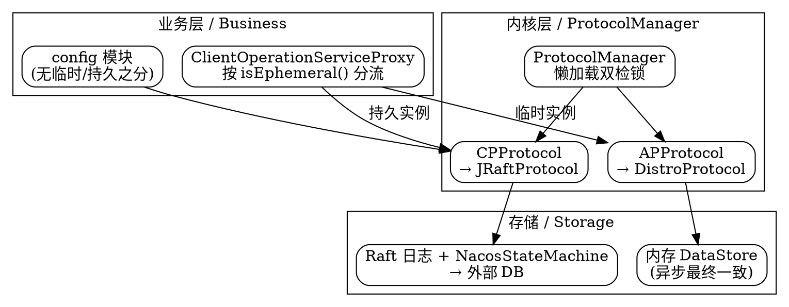

# Nacos Consistency Layer: AP/CP Routing

## Introduction

Nacos 最容易被误读的一点是：同一个进程里**服务发现默认 AP、配置管理却走 CP**——这不是两套产品拼装，而是同一套一致性抽象层上挂了两种可插拔协议。理解它的钥匙是 `core/distributed/ProtocolManager`：把「数据怎么存、怎么在节点间达成一致」从 naming / config 两个业务模块里抽出来，下沉成内核能力。

> 版本基线：Nacos 3.2.4（commit 2c587c0，Java 17 / Spring Boot 3）。以下片段均取自该 tag，路径为模块相对路径。

三个先要扭转的直觉：

- **不是非此即彼**：AP（Distro）与 CP（JRaft）在同一个 `ProtocolManager` 里并存，业务侧只依赖抽象、不碰实现。
- **`LogProcessor4CP` 不是类型**：它是 `consistency/Config.java` 的 javadoc 与 `JRaftProtocol.java` ASCII 图里的概念名，全树没有一个叫这个名字的 Java 类；真正的状态机是 `NacosStateMachine`。
- **两路协议都是懒加载**：第一次 `getApProtocol()` / `getCpProtocol()` 才初始化，且注入给两路的成员格式不同——AP 用 `address`，CP 用 `ip:raftPort`。

## The Abstraction: ConsistencyProtocol

一致性协议最基础的两个动作是「读」与「写」。`consistency` 是 3.x 独立出来的模块（包名 `com.alibaba.nacos.consistency`），它把协议契约定死在接口上，具体实现以 SPI 插件形式接入：

```java
public interface ConsistencyProtocol<T extends Config, P extends RequestProcessor>
    extends CommandOperations {

    void init(T config);

    void addRequestProcessors(Collection<P> processors);

    ProtocolMetaData protocolMetaData();

    Response getData(ReadRequest request) throws Exception;

    CompletableFuture<Response> aGetData(ReadRequest request);

    Response write(WriteRequest request) throws Exception;

    CompletableFuture<Response> writeAsync(WriteRequest request);

    void memberChange(Set<String> addresses);

    boolean isReady();

    void shutdown();
}
```

在这个总接口之上，AP 与 CP 只是两个几乎空的标记子接口——差异体现在泛型参数（各自的 `Config` 与 `RequestProcessor` 子类型）与 CP 独有的 `isLeader()`：

```java
public interface APProtocol<C extends Config, P extends RequestProcessor4AP>
    extends ConsistencyProtocol<C, P> {

}
```

```java
public interface CPProtocol<C extends Config, P extends RequestProcessor4CP>
    extends ConsistencyProtocol<C, P> {

    boolean isLeader(String group);

}
```

> [!WARNING]
> `Config.java` 的 javadoc 写的是「Corresponding LogProcessor sub-interface: LogProcessor4AP or LogProcessor4CP」，但这只是设计文档概念。3.2.4 全树检索 `LogProcessor4CP` 只命中两处注释（`Config.java` 的 javadoc 与 `JRaftProtocol.java` 的 ASCII 架构图），**不存在对应的 Java 类型**。不要据此描述当前实现——CP 侧的 processor 是 `RequestProcessor4CP`，状态机是 `NacosStateMachine`。

## ProtocolManager: Lazy Dual Protocol

`core/distributed/ProtocolManager.java` 是最上层的协议开关，持有 `APProtocol` / `CPProtocol` 各一路，外加两把锁与两个 `volatile` 初始化标志：

```java
@Component(value = "ProtocolManager")
public class ProtocolManager extends MemberChangeListener implements DisposableBean {

    private CPProtocol cpProtocol;

    private APProtocol apProtocol;

    private final ServerMemberManager memberManager;

    private volatile boolean apInit = false;

    private volatile boolean cpInit = false;

    private final Object cpLock = new Object();

    private final Object apLock = new Object();
```

两路协议都是**双检锁懒加载**：第一次取用时才从 Spring 容器找实现、注入成员、初始化。CP 侧如下，AP 侧 `getApProtocol()` 完全对称：

```java
public CPProtocol getCpProtocol() {
    if (!cpInit) {
        synchronized (cpLock) {
            if (!cpInit) {
                initCPProtocol();
                cpInit = true;
            }
        }
    }
    return cpProtocol;
}
```

初始化时通过 `ClassUtils.resolveGenericType` 解析出协议实现声明的 `Config` 泛型类型，再从容器取对应 config bean，注入成员后调用 `protocol.init(config)`：

```java
private void initCPProtocol() {
    ApplicationUtils.getBeanIfExist(CPProtocol.class, protocol -> {
        Class configType = ClassUtils.resolveGenericType(protocol.getClass());
        Config config = (Config) ApplicationUtils.getBean(configType);
        injectMembers4CP(config);
        protocol.init(config);
        ProtocolManager.this.cpProtocol = protocol;
    });
}
```

注入给两路的成员**格式不同**——AP 用每个节点的 `address`（`ip:port`），CP 用 `ip:raftPort`（raft 端口 = 主端口 − 1000，由 `MemberUtil.calculateRaftPort` 计算）：

```java
public static Set<String> toAPMembersInfo(Collection<Member> members) {
    Set<String> nodes = new HashSet<>();
    members.forEach(member -> nodes.add(member.getAddress()));
    return nodes;
}

public static Set<String> toCPMembersInfo(Collection<Member> members) {
    Set<String> nodes = new HashSet<>();
    members.forEach(member -> {
        final String ip = member.getIp();
        final int raftPort = MemberUtil.calculateRaftPort(member);
        nodes.add(ip + ":" + raftPort);
    });
    return nodes;
}
```

CP 的自成员地址取自 `MemberMetaDataConstants.RAFT_PORT` 扩展字段，AP 的自成员直接是 `getSelf().getAddress()`：

```java
private void injectMembers4CP(Config config) {
    final Member selfMember = memberManager.getSelf();
    final String self = selfMember.getIp() + ":" + Integer
        .parseInt(String.valueOf(selfMember.getExtendVal(MemberMetaDataConstants.RAFT_PORT)));
    Set<String> others = toCPMembersInfo(memberManager.allMembers());
    config.setMembers(self, others);
}

private void injectMembers4AP(Config config) {
    final String self = memberManager.getSelf().getAddress();
    Set<String> others = toAPMembersInfo(memberManager.allMembers());
    config.setMembers(self, others);
}
```

### Members Change Is Serialized per Protocol

集群成员变化时 `onEvent` 不直接调协议，而是经 `ProtocolExecutor` 的两个**独立单线程池**串行投递。源码注释明确说明：不同协议间的节点变更事件不能互相阻塞，且同一协议内的多次变更要串行，避免并发冲击一致性层：

```java
@Override
public void onEvent(MembersChangeEvent event) {
    // Here, the sequence of node change events is very important.
    // Node change events between different protocols should not block each other.
    // and we use a single thread pool to inform the consistency layer of node changes,
    // to avoid multiple tasks simultaneously carrying out the consistency layer of
    // node changes operation
    if (Objects.nonNull(apProtocol)) {
        ProtocolExecutor
            .apMemberChange(() -> apProtocol.memberChange(toAPMembersInfo(event.getMembers())));
    }
    if (Objects.nonNull(cpProtocol)) {
        ProtocolExecutor
            .cpMemberChange(() -> cpProtocol.memberChange(toCPMembersInfo(event.getMembers())));
    }
}
```

```java
public final class ProtocolExecutor {

    private static final ExecutorService CP_MEMBER_CHANGE_EXECUTOR = ExecutorFactory.Managed
        .newSingleExecutorService(ClassUtils.getCanonicalName(ProtocolManager.class));

    private static final ExecutorService AP_MEMBER_CHANGE_EXECUTOR = ExecutorFactory.Managed
        .newSingleExecutorService(ClassUtils.getCanonicalName(ProtocolManager.class));

    public static void cpMemberChange(Runnable runnable) {
        CP_MEMBER_CHANGE_EXECUTOR.execute(runnable);
    }

    public static void apMemberChange(Runnable runnable) {
        AP_MEMBER_CHANGE_EXECUTOR.execute(runnable);
    }
}
```

## How Naming Splits AP vs CP

3.x 命名走 v2 Client 模型，**不再依赖旧 `KeyBuilder.matchEphemeralKey`**（该方法在 3.x 已删除）。分流点是 `Instance.isEphemeral()`：对外的 `ClientOperationServiceProxy` 据此选择 ephemeral 或 persistent 的 operation service：

```java
private ClientOperationService chooseClientOperationService(final Instance instance) {
    return instance.isEphemeral() ? ephemeralClientOperationService
        : persistentClientOperationService;
}
```

两条写路径的落点完全不同：

- **临时实例（AP）**：注册 / 心跳写入内存中的 Client，随后由 `DistroClientDataProcessor` 监听 `ClientChangedEvent` 等事件，转发给 `DistroProtocol.sync()` 做异步同步；它甚至显式跳过非 ephemeral client：

```java
private void syncToAllServer(ClientEvent event) {
    Client client = event.getClient();
    if (isInvalidClient(client)) {
        return;
    }
    if (event instanceof ClientEvent.ClientDisconnectEvent) {
        DistroKey distroKey = new DistroKey(client.getClientId(), TYPE);
        distroProtocol.sync(distroKey, DataOperation.DELETE);
    } else if (event instanceof ClientEvent.ClientChangedEvent) {
        DistroKey distroKey = new DistroKey(client.getClientId(), TYPE);
        distroProtocol.sync(distroKey, DataOperation.CHANGE);
    }
}

private boolean isInvalidClient(Client client) {
    // Only ephemeral data sync by Distro, persist client should sync by raft.
    return null == client || !client.isEphemeral();
}
```

- **持久实例（CP）**：构造时直接取 `getCpProtocol()` 并把自身注册为 processor，注册实例时把请求序列化成 `WriteRequest` 走 `protocol.write()` 过 Raft：

```java
public PersistentClientOperationServiceImpl(final PersistentIpPortClientManager clientManager) {
    this.clientManager = clientManager;
    this.protocol = ApplicationUtils.getBean(ProtocolManager.class).getCpProtocol();
    this.protocol.addRequestProcessors(Collections.singletonList(this));
}
```

```java
final WriteRequest writeRequest = WriteRequest.newBuilder().setGroup(group())
    .setData(ByteString.copyFrom(serializer.serialize(request)))
    .setOperation(DataOperation.ADD.name())
    .build();

try {
    protocol.write(writeRequest);
    Loggers.RAFT.info("Client registered. service={}, clientId={}, instance={}", service,
        clientId, instance);
} catch (Exception e) {
    throw new NacosRuntimeException(NacosException.SERVER_ERROR, e);
}
```



## Config Side: Always CP

配置（config）没有「临时 / 持久」之分，必须强一致，因此 config 模块只接 `CPProtocol`（`JRaftProtocol`），不接 Distro。配置内容、灰度、标签、历史、租户、权限全部经 Raft 复制并落外部数据库（见 [Storage](/docs/CS/Framework/nacos/storage.md)）。

## Why AP and CP Coexist

CAP 理论针对的是**数据的一致性粒度**，不是整个组件。Nacos 把数据按性质拆开：

- 命名的临时实例：允许短暂分歧、分区可独立响应 → AP（Distro）。
- 命名的持久实例 + 配置：要求读己之写、全局有序、不丢 → CP（JRaft）。

两套策略的**存储互不影响**——Distro 的内存注册表与 JRaft 的日志 + DB 各管各的，所以一个组件内 AP 与 CP 并存并不矛盾。这正是 Eureka（纯 AP）和 ZooKeeper（纯 CP）做不到的。etcd 全程 Raft、Zab 全程强一致，不需要分流；Nacos 是「注册中心 + 配置中心」合体，才需要把可用性留给注册发现、把可靠性留给配置。

> [!WARNING]
> 早期文档里那套 naming 内的 KV 一致性层——`ConsistencyService` / `DelegateConsistencyServiceImpl` / `EphemeralConsistencyService` / `DistroConsistencyServiceImpl` / `PersistentConsistencyServiceDelegateImpl` / `BasePersistentServiceProcessor` / `EmbeddedDistroProtocol` / `JRaftConsistencyServiceImpl` / `KeyBuilder.matchEphemeralKey`——**在 3.2.4 全树 0 命中，已整体移除**。读老 issue / 老博客时会遇到它们，但不要当作 3.x 现状。

## Links

- [Nacos](/docs/CS/Framework/nacos/Nacos.md)
- [Distro（AP 协议深潜）](/docs/CS/Framework/nacos/distro.md)
- [JRaft（CP 共识）](/docs/CS/Framework/nacos/jraft.md)
- [Storage](/docs/CS/Framework/nacos/storage.md)
- [etcd 横向对照](/docs/CS/Framework/etcd/compare.md)

## References

- <https://github.com/alibaba/nacos/tree/3.2.4/consistency/src/main/java/com/alibaba/nacos/consistency>
- <https://github.com/alibaba/nacos/tree/3.2.4/core/src/main/java/com/alibaba/nacos/core/distributed>
- <https://nacos.io/docs/latest/manual/admin/deployment/deployment-cluster/>
