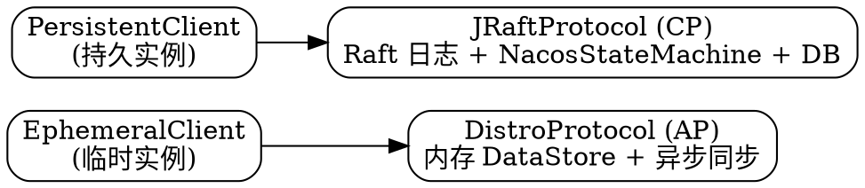

# Nacos Consistency Layer: AP/CP Routing

## Introduction

Nacos 最容易被混淆的一点是：同一个组件里**服务发现默认 AP、配置管理却是 CP**。这不是两套独立产品，而是同一进程内两套一致性协议并存。理解它的钥匙，是 Nacos 的**一致性抽象层**——把「数据怎么存、怎么在节点间达成一致」从业务模块（naming / config）里抽出来，做成可插拔的协议能力。

> [!WARNING]
> 本文早期版本详细讲解的「老 KV 层 `ConsistencyService`」（`DelegateConsistencyServiceImpl` / `EphemeralConsistencyService` / `DistroConsistencyServiceImpl` / `PersistentConsistencyServiceDelegateImpl` / `BasePersistentServiceProcessor` / `EmbeddedDistroProtocol` / `JRaftConsistencyServiceImpl` / `KeyBuilder.matchEphemeralKey`）**已在 3.x 整体移除**，仅作为历史保留在文末「历史」段。下面以 **3.2.4 源码**为准描述当前（3.x）模型。

当前 3.x 的一致性抽象只有**一套**还活在内核里：

- **Core 层 `ConsistencyProtocol` / `ProtocolManager`**：协议接口下沉到内核（`core/distributed/`），`ProtocolManager` 选 `CPProtocol`(`JRaftProtocol`) / `APProtocol`(`DistroProtocol`)。这是 3.x 命名 Client 模型与配置模块的主路径，[Nacos](/docs/CS/Framework/nacos/Nacos.md) 的 `## Consistency` 已详述。

## Core 层一致性抽象（3.x 当前模型）

`ProtocolManager`（`core/distributed/ProtocolManager.java`）从 Spring 容器取 `APProtocol` / `CPProtocol` 两个 bean（包名分别在 `com.alibaba.nacos.consistency.ap` / `com.alibaba.nacos.consistency.cp`，即独立的 `consistency` 模块），分别对应：

- **`APProtocol` → `DistroProtocol`**（`core/distributed/distro/DistroProtocol.java`）：命名临时实例的 AP 弱一致同步。
- **`CPProtocol` → `JRaftProtocol`**（`core/distributed/raft/JRaftProtocol.java`）：持久实例 + 配置的 CP 强一致复制。

Raft 侧的「状态机入口」在官方注释里沿用概念名 **`LogProcessor4CP`**（consistency 模块的 `Config.java` javadoc），**具体实现类是 `NacosStateMachine`**（`core/distributed/raft/NacosStateMachine.java`，配合 `RaftConfig` / `JRaftServer`）。配置与持久实例的写请求经 `JRaftProtocol` → Raft 日志复制 → `NacosStateMachine` 应用 → 落外部 DB（Derby / MySQL / PostgreSQL 插件）。

```java
// core/distributed/ProtocolManager.java（3.x 真实结构）
public class ProtocolManager extends MemberChangeListener implements DisposableBean {
    private CPProtocol cpProtocol;   // 实际注入 JRaftProtocol
    private APProtocol apProtocol;   // 实际注入 DistroProtocol

    public CPProtocol getCpProtocol() { /* initCPProtocol() */ }
    public APProtocol getApProtocol() { /* initAPProtocol()  */ }
}
```

## 命名 v2 Client 模型：AP/CP 如何分流

3.x 命名走 **v2 Client 模型**（`naming/core/v2/client/` 下的 `Client` 抽象与 `AbstractClient`）。ephemeral / persistent 的分流**不再依赖旧 `KeyBuilder.matchEphemeralKey`**（该方法在 3.x 已删除），而是由 Client 类型与 `isEphemeral()` 决定：

- **临时实例**：归属 ephemeral client，写路径走 `DistroProtocol`（AP，写本地内存 `DataStore` + 异步 Distro 责任分片同步），靠心跳保活；心跳断了被摘除，重新上报再注册。
- **持久实例**：归属 persistent client，写路径走 `JRaftProtocol`（CP，过 Raft 落 DB）。

落到代码，操作服务分两套：`EphemeralClientOperationServiceImpl` / `PersistentClientOperationServiceImpl`（`naming/core/v2/service/impl/`），分别对 ephemeral / persistent client 做注册、心跳、订阅推送。这就是「双协议」在 3.x 的落点——比旧 KV 层的三行 `if-else` 更内聚，也让命名模块真正只充当计算层。



## 配置侧：全程 CP

配置（config）没有「临时/持久」之分，必须强一致，因此 **config 模块只接 `CPProtocol`（`JRaftProtocol`）**，不接 Distro。配置内容、灰度、标签、历史、租户、权限全部经 Raft 复制并落外部数据库（见 [Storage](/docs/CS/Framework/nacos/storage.md)）。

## Why AP + CP Can Coexist

CAP 理论针对的是「**数据的一致性**」，不是「整个组件」。Nacos 把数据按性质拆开：

- 命名的临时实例：允许短暂分歧、分区可独立响应 → AP（Distro）。
- 命名的持久实例 + 配置：要求读己之写、全局有序、不丢 → CP（Raft/JRaft）。

两套一致性策略的**数据存储互不影响**——Distro 的内存注册表与 JRaft 的日志 + DB 各管各的，所以一个组件内 AP 与 CP 并存不矛盾。这正是 Eureka（纯 AP）和 ZooKeeper（纯 CP）做不到的。

## Config Side vs Naming Side

- **配置（config）**：全程走 `CPProtocol`（`JRaftProtocol`）+ MySQL。配置没有「临时/持久」之分，必须强一致，因此 config 模块不接 Distro。
- **命名（naming）**：临时实例走 Distro，持久实例走 JRaft。3.x 的 Client 模型把 naming 的写路径接到 Core 层（`DistroProtocol` / `JRaftProtocol` + `NacosStateMachine`，官方注释称 `LogProcessor4CP`），「临时 vs 持久」的分流语义不变——持久实例仍映射到 JRaft。

## Comparison with etcd-raft / Zab

| 维度 | Nacos (3.x) | etcd | ZooKeeper |
| :-- | :-- | :-- | :-- |
| 一致性范围 | AP（命名临时）+ CP（命名持久/配置）并存 | 全程 CP | 全程 CP |
| 协议 | Distro + JRaft | etcd-raft | Zab |
| 分流点 | Client 类型 / `isEphemeral()` | 无（全 Raft） | 无（全 Zab） |
| 内核抽象 | `ProtocolManager` → `APProtocol`/`CPProtocol` | — | — |
| 存储 | Distro 内存 + Raft 日志/DB（`NacosStateMachine`） | bbolt | DataTree + txnlog/snapshot |

etcd / ZK 不需要分流，因为它们是「通用协调底座」，所有数据都走同一强一致协议；Nacos 是「注册中心 + 配置中心」合体，把可用性（AP）留给注册发现、把可靠性（CP）留给配置。

## 历史：旧 KV 一致性层（≤2.1，3.x 已移除）

> [!NOTE]
> 以下为 **3.x 之前（主要是 1.x / 早期 2.x）** 的架构，列在此仅供追溯演进，**3.2.4 源码中这些类均已不存在**（已用 `git grep` 全树核实：`ConsistencyService` / `DelegateConsistencyServiceImpl` / `EphemeralConsistencyService` / `DistroConsistencyServiceImpl` / `PersistentConsistencyServiceDelegateImpl` / `BasePersistentServiceProcessor` / `EmbeddedDistroProtocol` / `JRaftConsistencyServiceImpl` / `KeyBuilder.matchEphemeralKey` 全部 0 命中）。

早期 Nacos 在 naming 模块内嵌了一套以 key 为粒度的 KV 存储抽象 `ConsistencyService`：

- `DelegateConsistencyServiceImpl`（bean 名 `consistencyDelegate`）按 key 路由：`KeyBuilder.matchEphemeralKey(key)` 命中则走 `EphemeralConsistencyService`（`DistroConsistencyServiceImpl`，AP），否则走 `PersistentConsistencyService`（CP）。
- 持久侧早期是老 Raft（`RaftConsistencyServiceImpl`），2.x Client 模型后用 `PersistentConsistencyServiceDelegateImpl` 经 `switchNewPersistentService` 切到 `BasePersistentServiceProcessor`，它**组合** `EmbeddedDistroProtocol`（把持久实例也同步进 Distro 内存供读）+ `JRaftConsistencyServiceImpl`（过 Raft 写 DB）——即「双写」。

这套实现与 naming 逻辑强耦合，难以做到计算存储分离，因此在 3.x 被彻底下沉为 Core 层 `ProtocolManager` + `DistroProtocol` / `JRaftProtocol`，naming 改为 v2 Client 模型。理解历史有助于读老文档/老 issue，但**不要把它当作 3.x 的现状**。

## Links

- [Registry（Distro 事件驱动层）](/docs/CS/Framework/nacos/registry.md)
- [Distro（AP 协议深潜）](/docs/CS/Framework/nacos/distro.md)
- [JRaft（CP 共识）](/docs/CS/Framework/nacos/jraft.md)
- [etcd Raft](/docs/CS/Framework/etcd/raft.md)
- [etcd 横向对照](/docs/CS/Framework/etcd/compare.md)

## References

- <https://nacos.io/docs/latest/manual/admin/deployment/deployment-cluster/>
- <https://github.com/alibaba/nacos/tree/3.2.4/core/src/main/java/com/alibaba/nacos/core/distributed>
- <https://github.com/alibaba/nacos/tree/3.2.4/naming/src/main/java/com/alibaba/nacos/naming/core/v2/client>
