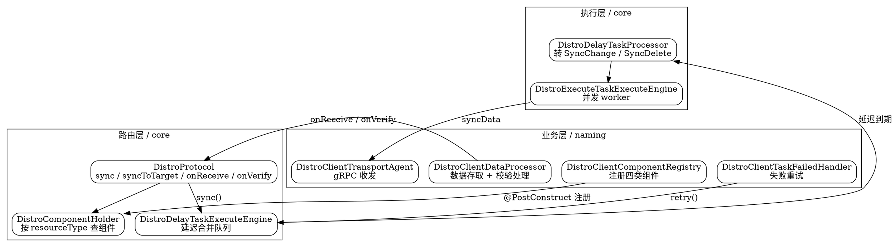

# Nacos Distro Protocol Source Deep Dive

## Introduction

Distro 是 Nacos 自研的 **AP 分布式一致性协议**，专为**临时实例（ephemeral instance）**设计：数据存内存、启动时全量拉取、定期校验补全，保证部分节点宕机后临时实例系统仍可工作。它是 Nacos「命名默认 AP」的基石——etcd / ZooKeeper 没有 AP 分支，全程 Raft/Zab（见 [JRaft](/docs/CS/Framework/nacos/jraft.md) 与 [一致性抽象层](/docs/CS/Framework/nacos/consistency.md)）。

> 版本基线：Nacos 3.2.4（commit 2c587c0）。以下片段均取自该 tag，路径为模块相对路径。

三个容易理解错的点：

- **`DistroProtocol` 不是协议引擎本体**：它自身不存数据、不发网络包，只是路由层——写调 `sync()` 投递延迟任务，收数据走 `onReceive()`，收校验走 `onVerify()`，都按 `resourceType` 从 `DistroComponentHolder` 找 processor。
- **责任分片用的不是一致性哈希**：`DistroMapper` 实际是 `Math.abs(tag.hashCode() % Integer.MAX_VALUE) % servers.size()` 的取模哈希。
- **失败重试是固定延迟、不是指数退避**：失败后原样重投一个 `DistroDelayTask`，延迟固定取 `sync.retryDelayMs`（默认 3000 ms）。

## Protocol Positioning: Optimization of Gossip

Distro 常被类比 Gossip，但关键差异在「谁说话」：

- **Gossip**：每个节点把变更广播给所有人，消息冗余高。
- **Distro**：每个节点只负责自己那一片数据的**写**，变更后只把这一片的新状态通知其他节点，消息量显著下降。

设计三原则：节点平等、写单一入口（非责任节点转发给责任节点）、读任意节点都从本地内存返回——最后一条是 AP 读高可用的来源。

## Three-Layer Architecture

源码分 `core` 与 `naming` 两模块：`core/distributed/distro/` 定义协议框架，`naming/.../distro/v2/` 提供临时实例的具体组件：



`DistroComponentHolder` 是四张 `Map<String, …>`，把「数据类型 → 组件」解耦，其它模块（如 config）也能注册自己的 processor 复用同一框架：

```java
@Component
public class DistroComponentHolder {

    private final Map<String, DistroTransportAgent> transportAgentMap = new HashMap<>();

    private final Map<String, DistroDataStorage> dataStorageMap = new HashMap<>();

    private final Map<String, DistroFailedTaskHandler> failedTaskHandlerMap = new HashMap<>();

    private final Map<String, DistroDataProcessor> dataProcessorMap = new HashMap<>();

    public DistroTransportAgent findTransportAgent(String type) {
        return transportAgentMap.get(type);
    }

    public DistroDataStorage findDataStorage(String type) {
        return dataStorageMap.get(type);
    }

    public DistroFailedTaskHandler findFailedTaskHandler(String type) {
        return failedTaskHandlerMap.get(type);
    }

    public DistroDataProcessor findDataProcessor(String processType) {
        return dataProcessorMap.get(processType);
    }
}
```

临时实例的四类组件由 `DistroClientComponentRegistry` 在 `@PostConstruct` 阶段注册，`dataProcessor` 一身兼 `DataStorage` 与 `DataProcessor` 两职：

```java
@PostConstruct
public void doRegister() {
    DistroClientDataProcessor dataProcessor =
        new DistroClientDataProcessor(clientManager, distroProtocol);
    DistroTransportAgent transportAgent = new DistroClientTransportAgent(clusterRpcClientProxy,
        serverMemberManager);
    DistroClientTaskFailedHandler taskFailedHandler =
        new DistroClientTaskFailedHandler(taskEngineHolder);
    componentHolder.registerDataStorage(DistroClientDataProcessor.TYPE, dataProcessor);
    componentHolder.registerDataProcessor(dataProcessor);
    componentHolder.registerTransportAgent(DistroClientDataProcessor.TYPE, transportAgent);
    componentHolder.registerFailedTaskHandler(DistroClientDataProcessor.TYPE, taskFailedHandler);
}
```

## The Routing Layer: sync / syncToTarget

`DistroProtocol.sync()` 遍历除自己以外的所有成员，为每个目标调 `syncToTarget`；后者构造 `DistroDelayTask` 投入延迟引擎，**这一步没有任何网络调用**：

```java
public void sync(DistroKey distroKey, DataOperation action, long delay) {
    for (Member each : memberManager.allMembersWithoutSelf()) {
        syncToTarget(distroKey, action, each.getAddress(), delay);
    }
}
```

```java
public void syncToTarget(DistroKey distroKey, DataOperation action, String targetServer,
    long delay) {
    DistroKey distroKeyWithTarget =
        new DistroKey(distroKey.getResourceKey(), distroKey.getResourceType(),
            targetServer);
    DistroDelayTask distroDelayTask = new DistroDelayTask(distroKeyWithTarget, action, delay);
    distroTaskEngineHolder.getDelayTaskExecuteEngine().addTask(distroKeyWithTarget,
        distroDelayTask);
}
```

收到数据时按 `resourceType` 找 processor，交给 `processData()` / `processVerifyData()`；找不到就记 warn 并返回 false：

```java
public boolean onReceive(DistroData distroData) {
    String resourceType = distroData.getDistroKey().getResourceType();
    DistroDataProcessor dataProcessor = distroComponentHolder.findDataProcessor(resourceType);
    if (null == dataProcessor) {
        Loggers.DISTRO.warn("[DISTRO] Can't find data process for received data {}",
            resourceType);
        return false;
    }
    return dataProcessor.processData(distroData);
}
```

## Two-Phase Task Engine

### Phase 1: Delayed Merge

`DistroDelayTask.merge()` 把同一 `DistroKey` 在窗口内的多次变更合并。注意真实逻辑：只有当**新旧 action 不同且新任务创建时间更早**时才用旧 task 的值覆盖——即保留创建时间更新的那次操作；最后把 `lastProcessTime` 对齐到旧任务，以免重复延长窗口：

```java
@Override
public void merge(AbstractDelayTask task) {
    if (!(task instanceof DistroDelayTask)) {
        return;
    }
    DistroDelayTask oldTask = (DistroDelayTask) task;
    if (!action.equals(oldTask.getAction()) && createTime < oldTask.getCreateTime()) {
        action = oldTask.getAction();
        createTime = oldTask.getCreateTime();
    }
    setLastProcessTime(oldTask.getLastProcessTime());
}
```

合并窗口由 `nacos.core.protocol.distro.data.sync.delayMs` 控制，默认 **1000 ms**。

### Phase 2: Concurrent Execution

延迟到期后，`DistroDelayTaskProcessor` 按 action 把任务转成 `DistroSyncDeleteTask` 或 `DistroSyncChangeTask`，投入并发执行引擎：

```java
@Override
public boolean process(NacosTask task) {
    if (!(task instanceof DistroDelayTask)) {
        return true;
    }
    DistroDelayTask distroDelayTask = (DistroDelayTask) task;
    DistroKey distroKey = distroDelayTask.getDistroKey();
    switch (distroDelayTask.getAction()) {
        case DELETE:
            DistroSyncDeleteTask syncDeleteTask =
                new DistroSyncDeleteTask(distroKey, distroComponentHolder);
            distroTaskEngineHolder.getExecuteWorkersManager().addTask(distroKey, syncDeleteTask);
            return true;
        case CHANGE:
        case ADD:
            DistroSyncChangeTask syncChangeTask =
                new DistroSyncChangeTask(distroKey, distroComponentHolder);
            distroTaskEngineHolder.getExecuteWorkersManager().addTask(distroKey, syncChangeTask);
            return true;
        default:
            return false;
    }
}
```

`DistroSyncChangeTask.doExecute()` 先从 `DataStorage` 取数据，再经 `TransportAgent.syncData()` 发往目标节点：

```java
@Override
protected boolean doExecute() {
    String type = getDistroKey().getResourceType();
    DistroData distroData = getDistroData(type);
    if (null == distroData) {
        Loggers.DISTRO.warn("[DISTRO] {} with null data to sync, skip", toString());
        return true;
    }
    return getDistroComponentHolder().findTransportAgent(type)
        .syncData(distroData, getDistroKey().getTargetServer());
}
```

## Responsibility Sharding

`DistroMapper.responsible(tag)` 判断本机是否负责某个 tag；`mapSrv(tag)` 算出负责节点。v1 的 tag 是 serviceName，v2 是客户端标识。算法是取模哈希，且要求所有节点的 `healthyList` 顺序一致（成员变更时 `Collections.sort` 保证）：

```java
public boolean responsible(String responsibleTag) {
    final List<String> servers = healthyList;

    if (!switchDomain.isDistroEnabled() || EnvUtil.getStandaloneMode()) {
        return true;
    }

    if (CollectionUtils.isEmpty(servers)) {
        return false;
    }

    String localAddress = EnvUtil.getLocalAddress();
    int index = servers.indexOf(localAddress);
    int lastIndex = servers.lastIndexOf(localAddress);
    if (lastIndex < 0 || index < 0) {
        return true;
    }

    int target = distroHash(responsibleTag) % servers.size();
    return target >= index && target <= lastIndex;
}

private int distroHash(String responsibleTag) {
    return Math.abs(responsibleTag.hashCode() % Integer.MAX_VALUE);
}
```

> [!WARNING]
> 很多资料把 Distro 的分片说成「一致性哈希（consistent hashing）」。3.2.4 的 `DistroMapper` 实际是 `hashCode % servers.size()` 的简单取模，**没有虚拟节点、没有哈希环**。节点数变化时大量 key 的归属会跟着变，靠后面的全量加载 + 校验来收敛，而不是靠一致性哈希减少迁移。

责任分片 ≠ 读写分片：读请求任意节点都从本地内存直接返回（全量数据每节点都有）；只有**写**被约束到责任节点。

## Startup: Verify and Full Load

`DistroProtocol` 构造时即调 `startDistroTask()`：单机模式直接 `isInitialized = true`；集群模式同时起校验任务与全量加载任务：

```java
private void startDistroTask() {
    if (EnvUtil.getStandaloneMode()) {
        isInitialized = true;
        return;
    }
    startVerifyTask();
    startLoadTask();
}
```

`DistroVerifyTimedTask` 按 `verify.intervalMs`（默认 5000 ms）周期运行，对每个已初始化完成的 `DataStorage` 取校验数据，为每个目标成员生成一个 `DistroVerifyExecuteTask`：

```java
private void verifyForDataStorage(String type, List<Member> targetServer) {
    DistroDataStorage dataStorage = distroComponentHolder.findDataStorage(type);
    if (!dataStorage.isFinishInitial()) {
        Loggers.DISTRO.warn(
            "data storage {} has not finished initial step, do not send verify data",
            dataStorage.getClass().getSimpleName());
        return;
    }
    List<DistroData> verifyData = dataStorage.getVerifyData();
    if (null == verifyData || verifyData.isEmpty()) {
        return;
    }
    for (Member member : targetServer) {
        DistroTransportAgent agent = distroComponentHolder.findTransportAgent(type);
        if (null == agent) {
            continue;
        }
        executeTaskExecuteEngine.addTask(member.getAddress() + type,
            new DistroVerifyExecuteTask(agent, verifyData, member.getAddress(), type));
    }
}
```

临时实例的校验载荷是 `DistroClientVerifyInfo(clientId, revision)`——只发标识与版本号，不发实例内容；对端 `verifyClient()` 不通过时触发补 sync：

```java
DistroClientVerifyInfo verifyData = new DistroClientVerifyInfo(client.getClientId(),
    client.getRevision());
DistroKey distroKey = new DistroKey(client.getClientId(), TYPE);
DistroData data = new DistroData(distroKey,
    ApplicationUtils.getBean(Serializer.class).serialize(verifyData));
data.setType(DataOperation.VERIFY);
```

新节点启动时 `DistroLoadDataTask` 向已有节点拉全量快照，成功后 `finishInitial()` + `loadCallback.onSuccess()`；未全部完成则按 `load.retryDelayMs`（默认 **30000 ms**）重新提交自己：

```java
@Override
public void run() {
    try {
        load();
        if (!checkCompleted()) {
            GlobalExecutor.submitLoadDataTask(this, distroConfig.getLoadDataRetryDelayMillis());
        } else {
            loadCallback.onSuccess();
            Loggers.DISTRO.info("[DISTRO-INIT] load snapshot data success");
        }
    } catch (Exception e) {
        loadCallback.onFailed(e);
        Loggers.DISTRO.error("[DISTRO-INIT] load snapshot data failed. ", e);
    }
}
```

加载完成后每台机器都持有集群内全部临时实例数据——这正是「读本地即全量」的前提。

## Failure Retry

同步失败不抛异常、不指数退避。执行任务失败后调 `handleFailedTask()`，从 `DistroComponentHolder` 找到该类型的 `DistroFailedTaskHandler`：

```java
protected void handleFailedTask() {
    String type = getDistroKey().getResourceType();
    DistroFailedTaskHandler failedTaskHandler =
        distroComponentHolder.findFailedTaskHandler(type);
    if (null == failedTaskHandler) {
        Loggers.DISTRO.warn("[DISTRO] Can't find failed task for type {}, so discarded", type);
        return;
    }
    failedTaskHandler.retry(getDistroKey(), getDataOperation());
}
```

临时实例的实现固定延迟重投一个 `DistroDelayTask`：

```java
@Override
public void retry(DistroKey distroKey, DataOperation action) {
    DistroDelayTask retryTask = new DistroDelayTask(distroKey, action,
        DistroConfig.getInstance().getSyncRetryDelayMillis());
    distroTaskEngineHolder.getDelayTaskExecuteEngine().addTask(distroKey, retryTask);
}
```

> [!NOTE]
> Distro 的全部超时 / 重试参数由 `core/distributed/distro/DistroConfig.java` 统一持有，属性名一律带 `.data.` 中段与 `Ms` 后缀，常量定义在 `DistroConstants`。3.2.4 默认值：`data.sync.delayMs=1000`、`data.sync.timeoutMs=3000`、`data.sync.retryDelayMs=3000`、`data.verify.intervalMs=5000`、`data.verify.timeoutMs=3000`、`data.load.retryDelayMs=30000`、`data.load.timeoutMs=30000`。

## Distro vs Gossip / etcd

| 维度 | Distro（Nacos AP） | Gossip | etcd-raft（CP） |
| :-- | :-- | :-- | :-- |
| 一致性 | 最终一致 | 最终一致 | 强一致（线性一致读） |
| 消息模型 | 责任分片，只通知本片 | 全网广播 | Leader 定序，多数派复制 |
| 读路径 | 任意节点本地内存 | 任意节点 | Leader 或 ReadIndex |
| 分区行为 | 各节点独立响应 | 各节点独立响应 | 少数派不可用 |
| 设计目标 | 注册中心高可用 | 成员发现 | 通用协调底座 |

## Links

- [Nacos](/docs/CS/Framework/nacos/Nacos.md)
- [一致性抽象层](/docs/CS/Framework/nacos/consistency.md)
- [Registry（Distro 事件驱动层）](/docs/CS/Framework/nacos/registry.md)
- [JRaft（CP 共识）](/docs/CS/Framework/nacos/jraft.md)
- [etcd 横向对照](/docs/CS/Framework/etcd/compare.md)

## References

- <https://github.com/alibaba/nacos/tree/3.2.4/core/src/main/java/com/alibaba/nacos/core/distributed/distro>
- <https://github.com/alibaba/nacos/tree/3.2.4/naming/src/main/java/com/alibaba/nacos/naming/consistency/ephemeral/distro/v2>
- <https://nacos.io/docs/latest/manual/admin/deployment/deployment-cluster/>
