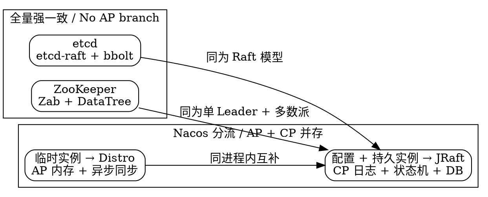

# Nacos CP Consensus: JRaft

## Introduction

Nacos 的「配置中心」与「命名里的持久实例」要求**强一致 + 可持久化**，不能走 Distro 的 AP 最终一致，于是 CP 侧引入了 **JRaft**——阿里巴巴基于 Raft 共识算法的 Java 库（SOFA-JRaft，包路径 `com.alibaba.nacos.core.distributed.raft`）。

> 版本基线：Nacos 3.2.4（commit 2c587c0）。以下片段均取自该 tag，路径为模块相对路径。

三个容易理解错的点：

- **`LogProcessor4CP` 不是类型**：它只在 `consistency/Config.java` 的 javadoc 与 `JRaftProtocol.java` 的 ASCII 架构图里出现，全树没有同名 Java 类。真正的状态机是 `NacosStateMachine`（`class NacosStateMachine extends StateMachineAdapter`）。
- **CP 写是「先过 Raft 日志、再 apply 到 processor」**：`NacosStateMachine.onApply()` 收到已提交日志后，才调业务 `processor.onApply()`；业务 processor 自己负责把数据落到 DB。
- **JRaft 端口是主端口 − 1000（7848）**：由 `MemberUtil.calculateRaftPort(member)` 计算，且注入给 CP 协议的成员格式是 `ip:raftPort`，与 AP 的 `address` 不同。

## Why Raft on the Config Side

配置变更要求「读己之写」「全局有序」「不丢」：发布后所有节点、所有客户端必须看到同一份值；灰度 / 回滚 / 监听依赖全局版本单调；节点宕机不能丢配置。这些正是 Raft 的强项——单一 Leader 定序、日志复制到多数派、提交后应用。etcd-raft、Zab 为同样诉求服务，只是 Nacos 把 JRaft 限定在 CP 子系统内（见 [一致性抽象层](/docs/CS/Framework/nacos/consistency.md)）。

## Components and Startup Chain

Nacos 把一个 CP 数据类型抽象成一个 `RequestProcessor4CP`：配置、命名持久元数据等各自注册自己的 processor，按 `processor.group()` 划分 Raft group。启动链路：`ProtocolManager.getCpProtocol()` → `JRaftProtocol.init(RaftConfig)` → `JRaftServer.init()` / `start()` → `createMultiRaftGroup(processors)` → 每个 processor 建一个 Raft group + `NacosStateMachine`。

JRaftProtocol 的 `init()` 用 CAS 保证只初始化一次，并把 `RaftEvent` 的元数据刷新进协议元数据（leader、term、成员列表）：

```java
@Override
public void init(RaftConfig config) {
    if (initialized.compareAndSet(false, true)) {
        this.raftConfig = config;
        NotifyCenter.registerToSharePublisher(RaftEvent.class);
        this.raftServer.init(this.raftConfig);
        this.raftServer.start();

        // There is only one consumer to ensure that the internal consumption
        // is sequential and there is no concurrent competition
        NotifyCenter.registerSubscriber(new Subscriber<RaftEvent>() {

            @Override
            public void onEvent(RaftEvent event) {
                Loggers.RAFT.info("This Raft event changes : {}", event);
                final String groupId = event.getGroupId();
                Map<String, Map<String, Object>> value = new HashMap<>();
                Map<String, Object> properties = new HashMap<>();
                final String leader = event.getLeader();
                final Long term = event.getTerm();
                final List<String> raftClusterInfo = event.getRaftClusterInfo();
                final String errMsg = event.getErrMsg();

                MapUtil.putIfValNoEmpty(properties, MetadataKey.LEADER_META_DATA, leader);
                MapUtil.putIfValNoNull(properties, MetadataKey.TERM_META_DATA, term);
                MapUtil.putIfValNoEmpty(properties, MetadataKey.RAFT_GROUP_MEMBER,
                    raftClusterInfo);
                MapUtil.putIfValNoEmpty(properties, MetadataKey.ERR_MSG, errMsg);
                MetricsMonitor.refreshRaftGroupMetrics(groupId, leader, term,
                    raftConfig.getSelfMember());

                value.put(groupId, properties);
                metaData.load(value);
                injectProtocolMetaData(metaData);
            }

            @Override
            public Class<? extends Event> subscribeType() {
                return RaftEvent.class;
            }
        });
    }
}
```

`addRequestProcessors` 触发 Raft group 的创建：

```java
@Override
public void addRequestProcessors(Collection<RequestProcessor4CP> processors) {
    raftServer.createMultiRaftGroup(processors);
}
```

`JRaftServer.createMultiRaftGroup()` 是核心：每个 processor 用自己的 group 名，复制一份 `NodeOptions`，构造 `NacosStateMachine` 塞进 `setFsm()`，再 `start` 出 `RaftGroupService`：

```java
for (RequestProcessor4CP processor : processors) {
    final String groupName = processor.group();
    if (multiRaftGroup.containsKey(groupName)) {
        throw new DuplicateRaftGroupException(groupName);
    }

    Configuration configuration = conf.copy();
    NodeOptions copy = nodeOptions.copy();
    JRaftUtils.initDirectory(parentPath, groupName, copy);

    // Here, the LogProcessor is passed into StateMachine, and when the StateMachine
    // triggers onApply, the onApply of the LogProcessor is actually called
    NacosStateMachine machine = new NacosStateMachine(this, processor);

    copy.setFsm(machine);
    copy.setInitialConf(configuration);

    // If the business module does not implement a snapshot processor, cancel the snapshot
    int doSnapshotInterval =
        ConvertUtils.toInt(raftConfig.getVal(RaftSysConstants.RAFT_SNAPSHOT_INTERVAL_SECS),
            RaftSysConstants.DEFAULT_RAFT_SNAPSHOT_INTERVAL_SECS);
    doSnapshotInterval =
        CollectionUtils.isEmpty(processor.loadSnapshotOperate()) ? 0 : doSnapshotInterval;
    copy.setSnapshotIntervalSecs(doSnapshotInterval);

    RaftGroupService raftGroupService =
        new RaftGroupService(groupName, localPeerId, copy, rpcServer, true);
    Node node = raftGroupService.start(false);
    machine.setNode(node);
    multiRaftGroup.put(groupName,
        new RaftGroupTuple(node, processor, raftGroupService, machine));
}
```

> [!WARNING]
> 上面源码注释里的 `LogProcessor` / ASCII 图里的 `LogProcessor4CP` 是**历史概念名**。3.2.4 里实际类型是 `RequestProcessor4CP`（processor 接口）与 `NacosStateMachine`（状态机）。不要把「状态机由 LogProcessor4CP 实现」写进当前实现的描述。

### Raft Config Defaults

`JRaftServer.init()` 里选举超时取配置值与下限的 `Math.max`，下限默认 **5000 ms**（`RaftSysConstants.DEFAULT_ELECTION_TIMEOUT`）；快照间隔默认 **1800 s**（`DEFAULT_RAFT_SNAPSHOT_INTERVAL_SECS = 30 * 60`），且业务未提供 `loadSnapshotOperate()` 时直接置 0（关闭快照）：

```java
int electionTimeout = Math.max(
    ConvertUtils.toInt(config.getVal(RaftSysConstants.RAFT_ELECTION_TIMEOUT_MS),
        RaftSysConstants.DEFAULT_ELECTION_TIMEOUT),
    RaftSysConstants.DEFAULT_ELECTION_TIMEOUT);
```

## Leader Election

Raft 选举算法本身在 SOFA-JRaft 库（`com.alipay.sofa.jraft`，Nacos 的外部依赖）里实现；Nacos 侧不重写选举，只通过状态机回调**感知** Leader 变化。节点角色 Leader / Candidate / Follower、随机化 election timeout、term 单调增、多数派投票这些标准语义都在库内。

Nacos 的 `NacosStateMachine` 在 `onLeaderStart()` / `onStartFollowing()` 里更新 leader / term 并发布 `RaftEvent`，供元数据与监控消费：

```java
@Override
public void onLeaderStart(final long term) {
    super.onLeaderStart(term);
    this.term = term;
    this.isLeader.set(true);
    this.leaderIp = node.getNodeId().getPeerId().getEndpoint().toString();
    NotifyCenter.publishEvent(
        RaftEvent.builder().groupId(groupId).leader(leaderIp).term(term)
            .raftClusterInfo(allPeers()).build());
}
```

`JRaftProtocol.isLeader(group)` 直接查底层 `Node`：

```java
@Override
public boolean isLeader(String group) {
    Node node = raftServer.findNodeByGroup(group);
    if (node == null) {
        throw new NoSuchRaftGroupException(group);
    }
    return node.isLeader();
}
```

## Log Replication and Commit

一次 CP 写（如持久实例注册或 `publishConfig`）的路径：

1. `JRaftProtocol.write()` → `writeAsync()` → `raftServer.commit(group, request, future)`。
2. `commit()` 判断本节点是不是 Leader：是则本地 `applyOperation()`，否则 `invokeToLeader()` 把请求转发给 Leader——**Follower 不自己提交写**。
3. `applyOperation()` 把请求序列化成 Raft `Task`，在头部打上「读 / 写」标记，调 `node.apply(task)` 进入 Raft 日志复制。
4. 日志复制到多数派并提交后，JRaft 回调 `NacosStateMachine.onApply()`，由它调业务 processor 的 `onApply()` 落内存 + 落 DB。
5. 只有 committed 的日志才 apply，保证读己之写与崩溃恢复。

```java
public CompletableFuture<Response> commit(final String group, final Message data,
    final CompletableFuture<Response> future) {
    FailoverClosureImpl closure = new FailoverClosureImpl(future);
    final Node node = tuple.node;
    if (node.isLeader()) {
        // The leader node directly applies this request
        applyOperation(node, data, closure);
    } else {
        // Forward to Leader for request processing
        invokeToLeader(group, data, rpcRequestTimeoutMs, closure);
    }
    return future;
}
```

```java
public void applyOperation(Node node, Message data, FailoverClosure closure) {
    final Task task = new Task();
    task.setDone(new NacosClosure(data, status -> {
        NacosClosure.NacosStatus nacosStatus = (NacosClosure.NacosStatus) status;
        closure.setThrowable(nacosStatus.getThrowable());
        closure.setResponse(nacosStatus.getResponse());
        closure.run(nacosStatus);
    }));

    // add request type field at the head of task data.
    byte[] requestTypeFieldBytes = new byte[2];
    requestTypeFieldBytes[0] = ProtoMessageUtil.REQUEST_TYPE_FIELD_TAG;
    if (data instanceof ReadRequest) {
        requestTypeFieldBytes[1] = ProtoMessageUtil.REQUEST_TYPE_READ;
    } else {
        requestTypeFieldBytes[1] = ProtoMessageUtil.REQUEST_TYPE_WRITE;
    }
    node.apply(task);
}
```

同步 API 的等待超时：读 `getData()` 等 **5 s**，写 `write()` 等 **10 s**；异步 API（`aGetData` / `writeAsync`）直接返回 `CompletableFuture`：

```java
@Override
public Response write(WriteRequest request) throws Exception {
    CompletableFuture<Response> future = writeAsync(request);
    // Here you wait for 10 seconds, as long as possible, for the request to complete
    return future.get(10_000L, TimeUnit.MILLISECONDS);
}
```

### State Machine: NacosStateMachine.onApply

`NacosStateMachine` 继承 `StateMachineAdapter`，`onApply(Iterator)` 遍历已提交日志：写请求调 `processor.onApply()`，读请求调 `processor.onRequest()`；`iter.done() == null` 表示当前节点是 Follower，读操作直接跳过（Follower 上的读请求是在提交前就路由走的）：

```java
if (iter.done() != null) {
    closure = (NacosClosure) iter.done();
    message = closure.getMessage();
} else {
    final ByteBuffer data = iter.getData();
    message = ProtoMessageUtil.parse(data.array());
    if (message instanceof ReadRequest) {
        //'iter.done() == null' means current node is follower, ignore read operation
        applied++;
        index++;
        iter.next();
        continue;
    }
}

if (message instanceof WriteRequest) {
    Response response = processor.onApply((WriteRequest) message);
    postProcessor(response, closure);
}

if (message instanceof ReadRequest) {
    Response response = processor.onRequest((ReadRequest) message);
    postProcessor(response, closure);
}
```

以命名持久实例为例，`PersistentClientOperationServiceImpl.onApply()` 反序列化 `InstanceStoreRequest`，按 `DataOperation`（ADD / DELETE / CHANGE）更新本地 Client 状态——这就是「Raft 日志 → 业务状态机」的落点：

```java
@Override
public Response onApply(WriteRequest request) {
    final InstanceStoreRequest instanceRequest =
        serializer.deserialize(request.getData().toByteArray());
    final DataOperation operation = DataOperation.valueOf(request.getOperation());
    switch (operation) {
        case ADD:
            onInstanceRegister(instanceRequest.service, instanceRequest.instance,
                instanceRequest.getClientId());
            break;
        case DELETE:
            onInstanceDeregister(instanceRequest.service, instanceRequest.getClientId());
            break;
        case CHANGE:
            if (instanceAndServiceExist(instanceRequest)) {
                onInstanceRegister(instanceRequest.service, instanceRequest.instance,
                    instanceRequest.getClientId());
            }
            break;
        default:
            return Response.newBuilder().setSuccess(false)
                .setErrMsg("unsupport operation : " + operation)
                .build();
    }
    return Response.newBuilder().setSuccess(true).build();
}
```

## Snapshot

Raft 日志无限增长需要快照瘦身。`NacosStateMachine.onSnapshotSave()` / `onSnapshotLoad()` 把快照动作委托给一组 `JSnapshotOperation`——它们由业务 processor 的 `loadSnapshotOperate()` 经 `adapterToJraftSnapshot()` 适配而来。如果业务没提供快照操作，`createMultiRaftGroup()` 会把 `snapshotIntervalSecs` 置 0 关闭快照。

```java
@Override
public void onSnapshotSave(SnapshotWriter writer, Closure done) {
    for (JSnapshotOperation operation : operations) {
        try {
            operation.onSnapshotSave(writer, done);
        } catch (Throwable t) {
            Loggers.RAFT.error(
                "There was an error saving the snapshot , error : {}, operation : {}", t,
                operation.info());
            throw t;
        }
    }
}
```

注意区分两套持久化：**外部 DB（如 MySQL 的 `config_info`）是 Nacos 的业务持久层**，Raft 快照是共识层自身的恢复点，两者不是一回事（见 [Storage](/docs/CS/Framework/nacos/storage.md)）。

## Member Change

集群成员变化时 `ProtocolManager` 把 `ip:raftPort` 列表交给 `JRaftProtocol.memberChange()`，它重试 5 次调用 `raftServer.peerChange()`（每次间隔 100 ms）：

```java
@Override
public void memberChange(Set<String> addresses) {
    for (int i = 0; i < 5; i++) {
        if (this.raftServer.peerChange(jRaftMaintainService, addresses)) {
            return;
        }
        ThreadUtils.sleep(100L);
    }
    Loggers.RAFT.warn("peer removal failed");
}
```

运维侧通过 `JRaftMaintainService` → `JRaftOps` 枚举提供 `transferLeader` / `changePeers` / `resetPeers` / `removePeer(s)` / `doSnapshot` 等命令，底层调 JRaft 的 `CliService`：

```java
TRANSFER_LEADER(JRaftConstants.TRANSFER_LEADER) {
    @Override
    public RestResult<String> execute(CliService cliService, String groupId, Node node,
        Map<String, String> args) {
        final Configuration conf = node.getOptions().getInitialConf();
        final PeerId leader = PeerId.parsePeer(args.get(JRaftConstants.COMMAND_VALUE));
        Status status = cliService.transferLeader(groupId, conf, leader);
        if (status.isOk()) {
            return RestResultUtils.success();
        }
        return RestResultUtils.failed(status.getErrorMsg());
    }
},
```

成员变更本质是 Raft 配置日志，需经多数派提交，保证「加/减节点」过程不丢 committed 日志；`cluster.conf` / 地址服务器里的成员要与 Raft group 成员保持一致（见 [Troubleshooting](/docs/CS/Framework/nacos/troubleshooting.md)）。

## Port (Distinguish from Distro / gRPC)

JRaft 端口由 `MemberUtil.calculateRaftPort(member)` 算出——**主端口 − 1000**（默认 8848 → 7848）：

```java
private static final int DEFAULT_RAFT_OFFSET_PORT = 1000;

public static int calculateRaftPort(Member member) {
    return member.getPort() - DEFAULT_RAFT_OFFSET_PORT;
}
```

`ProtocolManager.toCPMembersInfo()` 用 `ip + ":" + raftPort` 注入给 CP 协议，`JRaftServer.init()` 把这个 `self` 解析成 `localPeerId` 与 RPC 监听地址：

```java
final String self = config.getSelfMember();
String[] info = InternetAddressUtil.splitIpPortStr(self);
selfIp = info[0];
selfPort = Integer.parseInt(info[1]);
localPeerId = PeerId.parsePeer(self);
```

| 端口 | 计算 | 用途 |
| :-- | :-- | :-- |
| 8848 | `server.port` | HTTP OpenAPI / 控制台 |
| 9848 | `+1000`（`SDK_GRPC_PORT_DEFAULT_OFFSET`） | SDK gRPC |
| 9849 | `+1001`（`CLUSTER_GRPC_PORT_DEFAULT_OFFSET`） | 集群间 gRPC |
| **7848** | `−1000`（`calculateRaftPort`） | **JRaft CP 共识** |

集群部署必须保证 7848 在节点间互通，否则 CP 侧选不出 Leader 或日志复制失败。

## Comparison with etcd-raft / Zab



三者都解决「单 Leader 定序 + 多数派复制 + 提交后应用」，差异在**作用范围**：etcd 全程 Raft（KV 全强一致）、ZooKeeper 全程 Zab、Nacos 的 Raft 只覆盖 CP 子系统，命名默认走 Distro（AP）。这就是 Nacos「既能做注册中心又能做配置中心」的代价。

## Links

- [Nacos](/docs/CS/Framework/nacos/Nacos.md)
- [一致性抽象层](/docs/CS/Framework/nacos/consistency.md)
- [Distro（AP 协议）](/docs/CS/Framework/nacos/distro.md)
- [Storage](/docs/CS/Framework/nacos/storage.md)
- [etcd Raft](/docs/CS/Framework/etcd/raft.md)

## References

- <https://github.com/alibaba/nacos/tree/3.2.4/core/src/main/java/com/alibaba/nacos/core/distributed/raft>
- <https://nacos.io/docs/latest/manual/admin/deployment/deployment-cluster/>
- <https://nacos.io/docs/latest/manual/admin/deployment/deployment-best-practices>
