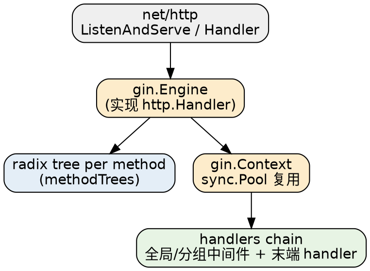

# Gin

## Introduction

Gin 是 Go 生态最流行的 HTTP Web 框架之一（GitHub ~89k stars，MIT），定位与 [Echo](/docs/CS/Go/Echo.md)、[Hertz](/docs/CS/Go/Framework/Hertz.md) 同档：在标准库 `net/http` 之上提供 radix tree 路由、洋葱式中间件、请求绑定/校验与 JSON 渲染，把"写 REST API / 微服务"所需的样板压到最低。官方自称 "Martini-like API, up to 40x faster"——这 40x 来自用 radix tree 替代 Martini 的反射路由，而不是 Gin 自身比 `net/http` 快：Gin 本质上是 `net/http` 的一层薄封装（详见 [Architecture](/docs/CS/Go/Framework/Gin/Architecture.md)）。

> [!NOTE]
>
> 消歧：Gin 指 gin-gonic/gin。它**运行在标准库 `net/http` 之上**（默认网络库就是 Go 原生 `net/http`），与 Hertz 默认跑在自研 Netpoll 上不同；也**不自带 HTTP 客户端**，需要发请求时直接用 `net/http` 或 [go-resty](/docs/CS/Go/Framework/go-resty.md)。

版本基线（2026-10-25 现场核实 GitHub Releases + go.mod 一手来源）：

- 最新稳定版 **v1.12.0**（2026-02-28 发布，MIT，默认分支 `master`）。
- `go.mod` 声明 **`go 1.25.0`**——即 **Go 1.25 是最低要求**（一手来源：jsdelivr `gin-gonic/gin@v1.12.0/go.mod`）。README 仍写 "Go 1.23+"，属文档滞后；v1.11.0 才是 go 1.23，v1.12.0 把下限跳到了 1.25。
- 绑定/校验依赖 **`github.com/go-playground/validator/v10` v10.30.1**；`golang.org/x/net` v0.51.0；**`github.com/quic-go/quic-go` v0.59.0**（因此 Gin 借助 `net/http` 可启用 HTTP/3，框架本身不另写传输层）。
- v1.12.0 新增：错误检索 `c.GetError` / `c.GetErrorSlice`、URI/Query 绑定支持 `encoding.UnmarshalText`、内容协商加入 Protobuf。

## Quick Start

```go
package main

import (
    "net/http"

    "github.com/gin-gonic/gin"
)

func main() {
    r := gin.Default() // 等价于 gin.New() + Logger() + Recovery()

    r.GET("/ping", func(c *gin.Context) {
        c.JSON(http.StatusOK, gin.H{"message": "pong"})
    })

    // 默认监听 :8080；底层调用 http.ListenAndServe(addr, engine)
    r.Run()
}
```

`gin.Context` 把请求上下文（Request、ResponseWriter、参数、handler 链、错误）收在一个对象里；`gin.H` 是 `map[string]any` 的速记别名，专用于 JSON 响应构造。

## Architecture

Gin 的全部能力都挂在 `gin.Engine` 上：它**实现了 `http.Handler` 接口**，因此可以被 `http.ListenAndServe` 直接托管；每个请求到来时被分配一个从 `sync.Pool` 复用的 `gin.Context`，经路由树取出 handler 链后由 `c.Next()` 顺序执行。运行模式（Debug/Release/Test）、路由注册、中间件挂载都围绕 Engine 展开。



- [Architecture](/docs/CS/Go/Framework/Gin/Architecture.md)：Engine 与 `http.Handler` 的关系、请求生命周期（`handleHTTPRequest`）、`gin.Context` 对象池复用、`Run` 系列启动方式、三种运行模式与 DebugPrint 行为。

## Routing

路由基于 radix tree（前缀压缩 trie），思路源自 httprouter；每个 HTTP method 一棵独立的树（`methodTrees`）。支持静态段、参数 `:name`、通配 `*path` 三类节点与明确优先级，注册冲突会在启动时 panic。路由分组可无限嵌套且不损失性能。

- [Routing](/docs/CS/Go/Framework/Gin/Routing.md)：radix tree 与 methodTrees、三类路径段优先级、参数/查询/表单取用 API、路由分组 `Group`、重定向/尾斜杠策略、`NoRoute` / `NoMethod` 兜底、嵌入 `net/http` 体系。

## Middleware

中间件就是普通 handler，靠 `c.Next()` 把控制权交向下一个、自己再在 `Next()` 返回后做"后置"逻辑，形成洋葱模型。全局 `engine.Use` 与分组级 `g.Use` 分层挂载；`gin.Default` 已内置 Logger 与 Recovery。

- [Middleware](/docs/CS/Go/Framework/Gin/Middleware.md)：`Next` / `Abort` / `AbortWithStatus`、全局与分组中间件执行顺序、内置 Logger/Recovery 行为、自定义中间件写法、Recovery 如何捕获 panic 并返回 500。

## Binding and Validation

Gin 把"按 Content-Type 自动选绑定器 + 按 `binding` 标签校验"打包成 `ShouldBind` / `Bind` 系列方法，底层用 `go-playground/validator/v10` 做结构体校验。绑定与校验是写业务 handler 最高频的动作。

- [Binding and Validation](/docs/CS/Go/Framework/Gin/Binding_Validation.md)：`ShouldBind` vs `Bind`（`MustBindWith`）的差异、Content-Type 自动分发、绑定标签（`json`/`form`/`query`/`uri`/`header`/`xml`/`yaml`/`protobuf`/`toml`/`msgpack`）、validator 校验标签、自定义校验器与多语言。

## Rendering

handler 通过 `c.JSON` / `c.XML` / `c.HTML` / `c.String` / `c.Data` / `c.File` / `c.Redirect` / `c.Negotiate` 返回响应，渲染逻辑集中在 `gin/render` 包，JSON 默认走 `encoding/json`，可整体替换。

- [Rendering](/docs/CS/Go/Framework/Gin/Rendering.md)：各渲染方法语义、`render` 包的可替换点、模板渲染（`LoadHTMLGlob`）、`SecureJSON` / `JSONP` / `AsciiJSON` / `PureJSON` 等变体、内容协商。

## Extensions and Ecosystem

Gin 自身保持精简，生态由 `gin-contrib` 与社区补齐：CORS、Session、Gzip、静态文件、JWT、Zap 日志、Prometheus、Sentry 等。`gin-swagger` / `swag` 做 OpenAPI 文档。注意 Gin **没有内置 HTTP 客户端**（这点与 Hertz 不同）。

- [Extensions](/docs/CS/Go/Framework/Gin/Extensions.md)：`gin-contrib` 组件地图、`gin-swagger` 文档生成、与 Hertz 在客户端/代码生成上的差异、选型建议。

## Gin vs Echo vs Hertz

| 维度 | Gin | Echo | Hertz |
| :-- | :-- | :-- | :-- |
| 定位 | 极简高性能 Go Web 框架 | 极简高性能 Go Web 框架 | 大规模微服务 HTTP 框架（CloudWeGo） |
| 默认网络库 | 标准库 `net/http` | 标准库 `net/http` | 自研 Netpoll（可切 Go Net） |
| 路由 | radix tree（源自 httprouter） | radix tree | radix tree（trie） |
| Handler 签名 | `func(*gin.Context)` | `func(c echo.Context) error` | `func(ctx, *app.RequestContext)` 显式带 context |
| 中间件 | `c.Next()` 洋葱模型 | 同左思路 | 同左思路 |
| 绑定/校验 | validator/v10（`binding` 标签） | 内置 validator | tagexpr + validator |
| JSON 引擎 | `encoding/json`（可替换） | `encoding/json` | bytedance/sonic（默认加速） |
| HTTP 客户端 | 无（用 `net/http`） | 无 | 自带 HTTP client |
| 代码生成 | 无官方生成器 | 无 | `hz`（Thrift/Protobuf） |
| 最新版本 | v1.12.0（2026-02，需 Go 1.25） | v4 主线（活跃维护） | v0.10.6 |

一句话取舍：**要最轻、生态最熟、与 `net/http` 语义最贴近，选 Gin 或 Echo；要极致吞吐且接受 fasthttp 血统与 IDL 脚手架，选 Hertz。** 中小服务用 Go 1.22+ 增强的 `net/http` 也能省掉框架依赖。

## Links

- [Go](/docs/CS/Go/Go.md)
- [Echo](/docs/CS/Go/Echo.md) — 同类极简 Web 框架对照
- [Hertz](/docs/CS/Go/Framework/Hertz.md) — CloudWeGo 高性能 HTTP 框架（枢纽 + 7 分册）
- [Iris](/docs/CS/Go/Framework/Iris.md) — 全内置一站式 Web 框架（枢纽 + 8 分册）
- [Go net](/docs/CS/Go/net.md) — Gin 所依托的标准库网络层
- [go-resty](/docs/CS/Go/Framework/go-resty.md) — Gin 场景下的 HTTP 客户端选择

## References

- <https://gin-gonic.com/>
- <https://github.com/gin-gonic/gin/releases>
- <https://pkg.go.dev/github.com/gin-gonic/gin>
- <https://github.com/gin-gonic/gin/blob/master/README.md>
- <https://github.com/go-playground/validator>
- <https://github.com/julienschmidt/httprouter>
