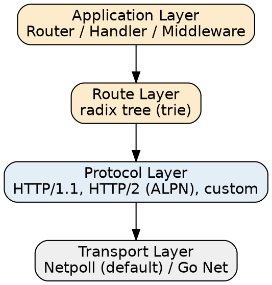

# Hertz

## Introduction

Hertz [`həːts`] 是 CloudWeGo（字节跳动）开源的**高性能、高扩展、高易用**的 Golang HTTP 框架，定位与 [Gin](/docs/CS/Go/Framework/Gin.md)、[Echo](/docs/CS/Go/Echo.md) 同档——在标准库 `net/http` 之上提供路由、中间件、参数绑定、统一错误处理等 Web 服务常用能力，但面向**大规模微服务**做了纵深优化。它脱胎于字节内部的 HTTP 框架，最初是 [fasthttp](https://github.com/valyala/fasthttp) 的一个 fork，并借鉴了 gin / echo 的 API 设计，再结合字节的高并发场景需求重新分层。2022 年正式开源，Apache-2.0。

Hertz 的三条产品主线，本目录所有分册都围绕它们展开：

1. **默认跑在自研网络库 Netpoll 上**：Netpoll 是字节自研的高性能 NIO 网络库（与 Go 原生 `netpoll` 事件轮询同名但不同物），默认承载 Hertz 的连接与 I/O；Hertz 也提供切换到标准库 `net` 的能力。
2. **分层可插拔**：应用层 / 路由层 / 协议层 / 传输层各层都有接口与默认实现，可以仅替换某一层（如换协议、换网络库、换 JSON 引擎）。
3. **IDL 驱动的脚手架**：配套代码生成工具 `hz` 从 Thrift / Protobuf IDL 直接产出 handler、router、model、client 骨架，把「先写接口还是先写代码」统一收口到 IDL。

> [!NOTE]
>
> 消歧：Hertz 指 CloudWeGo 的 Go HTTP 框架。同一组织下的 Kitex 是 RPC 框架（Thrift/gRPC），二者共享 Netpoll 与代码生成理念但协议层不同；不要与物理单位「赫兹」混淆。

版本基线（2026-10-25 现场核实 GitHub Releases）：

- 框架本体 **v0.10.6**（2026，最新稳定线；版本号仍 < 1.0，API 以兼容为主）。
- 代码生成工具 `hz` 独立发版 **cmd/hz/v0.9.8**。
- 底层网络库 `github.com/cloudwego/netpoll` 跟随演进（Hertz `go.mod` 通常约束到 v0.7.x）。

## Quick Start

```go
package main

import (
    "context"
    "github.com/cloudwego/hertz/pkg/app"
    "github.com/cloudwego/hertz/pkg/app/server"
    "github.com/cloudwego/hertz/pkg/common/utils"
)

func main() {
    h := server.Default() // 默认 engine：Netpoll + 内置 Recovery / AccessLog
    h.GET("/ping", func(c context.Context, ctx *app.RequestContext) {
        ctx.JSON(200, utils.H{"message": "pong"})
    })
    h.Spin() // 阻塞启动，等价于 ListenAndServe
}
```

与 gin/echo 的对照：Hertz 的 handler 签名是 `func(c context.Context, ctx *app.RequestContext)`——它**显式携带 `context.Context`**（用于超时 / 取消 / 链路透传），而 gin 的 `gin.Context`、echo 的 `echo.Context` 把 context 内聚在自有类型里。这是 Hertz 与 fasthttp 血统一脉相承的设计取舍（fasthttp 的 `*fasthttp.RequestCtx` 同样把请求上下文作为一个大对象）。

## Layered Architecture



- [Architecture](/docs/CS/Go/Framework/Hertz/Architecture.md)：分层职责边界、引擎 `server.Hertz` 的启动链路、协议层与传输层的可替换接口、为什么从 fasthttp fork 走向分层、与 `net/http` / fasthttp 的关系。

## Routing

- [Routing](/docs/CS/Go/Framework/Hertz/Routing.md)：基于 radix tree（trie）的路由实现，静态 / 参数 `:name` / 通配 `*` 共存与优先级，路由分组 `h.Group`，以及注册顺序与冲突处理。

## Middleware

- [Middleware](/docs/CS/Go/Framework/Hertz/Middleware.md)：洋葱式中间件链（前置 → next → 后置），全局 `h.Use` 与分组级中间件，内置 Recovery / AccessLog / BasicAuth 等，自定义中间件写法与执行顺序。

## Binding and Rendering

- [Binding and Rendering](/docs/CS/Go/Framework/Hertz/Binding_Rendering.md)：按 `Content-Type` 与标签（`query`/`path`/`header`/`json`/`form`）把请求绑定到结构体、基于 tagexpr/validator 的校验、JSON（默认接 bytedance/sonic 加速）/ HTML / 自定义渲染，以及错误统一处理。

## Client

- [Client](/docs/CS/Go/Framework/Hertz/Client.md)：Hertz 自带 HTTP 客户端（`host client` / `standard client` / `load balancing client`），客户端中间件、连接复用、与 `net/http.Client` 的对照。

## Code Generation

- [Code Generation](/docs/CS/Go/Framework/Hertz/Code_Generation.md)：`hz` 从 Thrift / Protobuf IDL 生成项目骨架（`new` / `update` / `model` / `client` 四个子命令）、标准布局（`biz/handler`、`biz/router`、`biz/model`、`.hz` 清单），以及 IDL 注解驱动的 Swagger/OpenAPI 文档生成。

## Extensions and Observability

- [Extensions](/docs/CS/Go/Framework/Hertz/Extensions.md)：社区扩展组织 `hertz-contrib`（注册发现、OpenTelemetry、JWT、CORS、Gzip、pprof、限流等 37+ 仓库）、`hlog` 日志抽象与可插拔实现、可观测性接入。

## Hertz vs Gin / Echo / Kitex

| 维度 | Hertz | Gin / Echo | Kitex |
| :-- | :-- | :-- | :-- |
| 定位 | 高性能 Go HTTP 框架（微服务） | 轻量 Go Web 框架 | Go RPC 框架（Thrift/gRPC） |
| 默认网络库 | Netpoll（可切 Go Net） | 标准库 `net/http` | Netpoll |
| Handler 签名 | `func(ctx, *RequestContext)` 显式带 context | 自有 Context 类型 | 由 IDL 生成 |
| 路由 | radix tree（trie） | httprouter 系 radix tree | 按 method 分发（RPC） |
| 代码生成 | `hz`（Thrift/Protobuf） | 无官方生成器 | `kitex`（Thrift/Protobuf） |
| JSON 引擎 | bytedance/sonic（默认加速） | encoding/json / 自选 | 由 codec 决定 |
| 客户端 | 自带 HTTP client | 通常直接用 `net/http` | 自带 RPC client |
| 协议 | HTTP/1.1、HTTP/2(ALPN)、自定义 | HTTP/1.1（HTTP/2 需扩展） | Thrift / gRPC |

一句话取舍：**要极致吞吐、且愿意接受 fasthttp 血统的 handler 模型，选 Hertz；要最轻、生态最熟，选 Gin/Echo；要 RPC 而非 HTTP，选同门的 Kitex**。对于中小服务，Go 1.22+ 增强的 `net/http` 也能省掉框架依赖。

## Links

- [Gin](/docs/CS/Go/Framework/Gin.md)
- [Echo](/docs/CS/Go/Echo.md)
- [Iris](/docs/CS/Go/Framework/Iris.md) — 同为 Go Web 框架，内置 MVC/DI 与 macro 路由
- [Go net](/docs/CS/Go/net.md)
- [Go netpoller](/docs/CS/Go/netpoller.md)
- [Go](/docs/CS/Go/Go.md)

## References

- <https://github.com/cloudwego/hertz>
- <https://github.com/cloudwego/hertz/releases>
- <https://www.cloudwego.io/docs/hertz/>
- <https://pkg.go.dev/github.com/cloudwego/hertz/cmd/hz>
- <https://github.com/cloudwego/netpoll>
