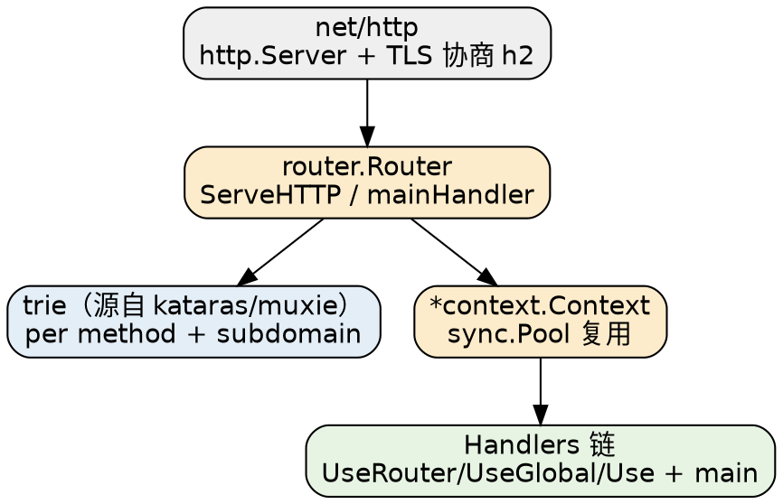

# Iris

## Introduction

Iris 是 Go 生态中**功能面最宽**的 HTTP Web 框架（GitHub ~25.5k stars，BSD-3-Clause，2016 年由 Gerasimos Maropoulos 发起）。它与 [Gin](/docs/CS/Go/Framework/Gin.md)、[Echo](/docs/CS/Go/Echo.md) 一样跑在标准库 `net/http` 之上，但定位不同：Gin/Echo 追求"薄封装 + 插件补齐"，Iris 追求"开箱即全"——路由、中间件、MVC、依赖注入、Session、视图引擎、WebSocket、i18n、gRPC、测试套件都内置在同一个仓库里，不依赖外部 contrib 组织。

> [!NOTE]
>
> 消歧：本页的 Iris 指 `github.com/kataras/iris`。同名干扰项还有 SciTools/iris（Python 气象数据处理库）、Iris（分布式 KV 数据库）、虹膜识别。Go 生态里另一个常被并列的是 [Hertz](/docs/CS/Go/Framework/Hertz.md)（CloudWeGo，跑在自研 Netpoll 上）。

版本基线（2026-10-26 现场核实 GitHub Releases / goproxy.cn / jsdelivr 源码）：

- 最新公开发布 **v12.2.11**，发布于 **2024-04-24**，是 v12 线的最后一个版本。
- 模块路径 `github.com/kataras/iris/v12`，`go.mod` 声明 **`go 1.22`**（一手来源：`cdn.jsdelivr.net/gh/kataras/iris@v12.2.11/go.mod`）。同时带 `retract [v12.0.0, v12.1.8]`——Go 工具链会拒绝拉取旧版本，这是 Iris 特有的强约束。
- 许可证 **BSD-3-Clause**（`LICENSE` 头，Copyright 2016-2024）；默认分支 `main`。
- **v12 分支已冻结**：最后一条提交是 2024-04-24 的 `last version of v12`；`main` 分支仍在滚动（模块路径仍是 v12，但 `go.mod` 已升到 `go 1.26`，最后 push 2026-07-27），也就是**主线代码已经两年多没有正式发布**。
- **v14 尚未发布**：据作者 2026-08 的自述，v14 在私有仓库中开发，将改用新模块路径 `github.com/kataras/iris/v14`、要求 Go 1.27，主打 Go 泛型重写、编译期校验的应用构建器 `iris.NewBuilder()`、一等公民 SSE、`ai` 包与 30 个内置中间件。**这些特性当前均不可通过 `go get` 获得**，不要据此写代码。

> [!WARNING]
>
> 仓库根目录的 `VERSION` 文件写的是 `v12.2.0`，与真实 tag `v12.2.11` 不一致——判断版本请以 `go.mod`、Release 页、模块代理为准，不要读这个文件。

## Quick Start

```go
package main

import "github.com/kataras/iris/v12"

func main() {
    app := iris.New()

    app.Get("/ping", func(ctx iris.Context) {
        ctx.JSON(iris.Map{"message": "pong"})
    })

    // 默认 :8080，等价于 app.Run(iris.Addr(":8080"))
    app.Listen(":8080")
}
```

`iris.New()` 返回 `*iris.Application`；`iris.Default()` 会额外注册三个中间件：`requestid`、`recover` 与 `cors`（源码 `iris.go:145-187`）。handler 签名统一为 `func(ctx iris.Context)`，`iris.Map` 是 `map[string]interface{}` 的别名。

## Architecture

`Application` 是一个**组合体**：它嵌入 `*router.APIBuilder`（路由注册面）、`*router.Router`（运行时分发面）与 `ContextPool`（`*context.Pool`），因此既能 `app.Get(...)` 注册路由，又能作为 `http.Handler` 被 `http.Server` 托管——`ServeHTTP` 实际由嵌入的 `Router` 提供（`core/router/router.go:340`）。请求进来时从 `sync.Pool` 取一个 `*context.Context`（注意 Iris 的 Context 是**结构体**不是接口，与 Echo 相反），经 trie 匹配取出 handler 链后由 `ctx.Do` / `ctx.Next` 逐个执行。



- [Architecture](/docs/CS/Go/Framework/Iris/Architecture.md)：Application 的组合结构、请求生命周期逐帧拆解、Context 对象池、Runner/Listen/Run 启动方式与优雅关闭、Configuration 关键字段与默认值、Configurator 写法。

## Routing

路由用的是 Iris **自研 trie**，源码注释明确写了它是 `kataras/muxie` v1.0.0 的同构改编版（`core/router/trie.go:21`），与 Gin 那套源自 httprouter 的压缩前缀 radix tree 不是同一实现。每个 HTTP method（以及 subdomain）各一棵树。Iris 路由最有辨识度的特性是 **macro**：路径参数可以带类型与内联校验函数，如 `/users/{id:uint64 min(1)}`、`/files/{path:path}`、`/mail/{addr:email}`——类型不匹配直接在路由层 404，不需要进 handler 再判断。

- [Routing](/docs/CS/Go/Framework/Iris/Routing.md)：macro 全类型表与内联函数、`Party` 分组与中间件继承、路由命名与反向生成 URL、`HandleDir` 静态资源与 SPA、路径修正与 404/405 兜底、`versioning` 版本路由、`rewrite` 引擎。

## Middleware

Iris 的中间件也是 `func(ctx iris.Context)`，但**挂载点被切成多层**，这是它比 Gin 复杂的地方：`UseRouter`（主路由之前，连 404 都跑）、`UseGlobal`（无视注册顺序，前置到全部路由）、`Use`（当前 Party 及子路由，顺序敏感）、`Done`/`DoneGlobal`（响应写出后的收尾）。框架源码里有一份执行顺序测试给出唯一权威次序：`WrapRouter → UseRouter → UseGlobal → Use → Main Handler`（`core/router/router_handlers_order_test.go:292`）。

内置中间件在 `middleware/` 下 17 个子包：accesslog、basicauth、cors、grpc、hcaptcha、jwt、logger、methodoverride、modrevision、monitor、pprof、rate、recaptcha、recover、requestid、rewrite；根包另暴露 `iris.Compression`、`iris.Cache`、`iris.NoCache`、`iris.StaticCache` 四个别名。

- [Middleware](/docs/CS/Go/Framework/Iris/Middleware.md)：多层挂载点语义与执行顺序、`Next`/`StopExecution`/`IsStopped`、各内置中间件入口与配置、`recover` 的真实行为、accesslog 结构化日志与 broker 订阅。

## Binding and Validation

Iris **没有** Gin 那种 `binding:"required"` 标签体系。它走另一条路：`Read* ` 系列按来源分派给 `github.com/iris-contrib/schema` 解码器，每个来源认自己的 tag——`ReadForm` 认 `form`、`ReadQuery` 认 `url`、`ReadHeaders` 认 `header`、`ReadParams` 认 `param`；解码失败只返回 error，**不自动设置状态码**，状态码由业务自己用 `ctx.StopWithError` 决定。真正的结构体校验钩子是 `app.Validator`（接口 `Struct(interface{}) error`）。

- [Binding and Validation](/docs/CS/Go/Framework/Iris/Binding_Validation.md)：`ReadJSON/ReadXML/ReadForm/ReadQuery/ReadHeaders/ReadParams/ReadBody` 的分派规则、schema tag 与错误类型（`EmptyFieldError`/`UnknownKeyError`/`MultiError`）、`app.Validator` 接入、文件上传 API。

## Rendering

响应方法集中在 `context/context.go`（Iris 没有独立的 render 包）：`JSON`、`JSONP`、`XML`、`YAML`、`TextYAML`、`Markdown`、`Protobuf`、`MsgPack`、`Text`、`HTML`、`Binary`、`View`、`Negotiate`、`Redirect`、`ServeFile`、`SendFile`、`StreamWriter`。**JSON 编码器是标准库 `encoding/json`**（`context.go:4176`），jsoniter 只在 accesslog 的缩进场景用到；`EnableOptimizations` 与 JSON 编码无关，它管的是动态 handler。

- [Rendering](/docs/CS/Go/Framework/Iris/Rendering.md)：各渲染方法签名与语义、`ctx.Negotiation()` 内容协商 builder、`StreamWriter` 流式输出（v12.2.11 **无内置 SSE**，需手写）、`Protobuf`/`MsgPack` 与 `EnableProtoJSON`/`EnableEasyJSON` 开关。

## MVC and Dependency Injection

这是 Iris 区别于 Gin/Echo 最大的一块。`mvc` 包允许把 controller 结构体整个挂到 Party 上，方法名自动映射为路由（`Get()` → GET、`GetBy(id int)` → `GET /{param1:int}`）；`hero` 包提供基于反射的依赖注入容器，handler 可以按类型声明入参，由容器按路径参数/服务/请求体自动填充。代价是**反射发生在请求路径上**（除非依赖全是静态值）。`mvc` 本身就是用 `hero` 实现的。

- [MVC and Dependency Injection](/docs/CS/Go/Framework/Iris/MVC_and_Dependency_Injection.md)：`mvc.New(...).Handle(...)` 用法、方法名到路由的映射规则、生命周期回调（`BeginRequest`/`EndRequest`/`BeforeActivation`/`AfterActivation`）、`hero` 容器 API 与内建依赖清单、性能注意事项。

## Sessions, Views and Real-time

- `sessions`：`sessions.New(sessions.Config{Cookie: "..."})` + `app.Use(sess.Handler())`，会话后端内置 badger、boltdb（bbolt）、redis 三种；另有 flash message。
- `view`：`app.RegisterView(view.HTML("./views", ".html"))` + `ctx.View("index.html", data)`，引擎含 HTML、Django（底层 pongo2）、Handlebars、Pug/Jade、Jet、Ace、Blocks。
- `websocket`：`websocket.New` 是 `neffos.New` 的别名，默认 upgrader 为 gobwas（也可切 gorilla）。

- [Sessions and Authentication](/docs/CS/Go/Framework/Iris/Sessions_and_Auth.md)：Session 生命周期与后端、flash、`middleware/jwt` 与 `middleware/basicauth` 的入口与配置。

## Extensions and Ecosystem

- [Extensions](/docs/CS/Go/Framework/Iris/Extensions.md)：视图引擎清单与注册、`websocket`/neffos、`i18n`、`cache` 服务端缓存、`httptest` 测试包（`iris-contrib/httpexpect/v2`）、CLI/`tunnel`（ngrok 内网穿透）、v14 前瞻与迁移风险、生态现状与选型建议。

## Iris vs Gin vs Echo vs Hertz

| 维度 | Iris | Gin | Echo | Hertz |
| :-- | :-- | :-- | :-- | :-- |
| 定位 | 全内置的一站式 Web 框架 | 极简薄封装 | 极简薄封装 | 大规模微服务（CloudWeGo） |
| 默认网络库 | 标准库 `net/http` | 标准库 `net/http` | 标准库 `net/http` | 自研 Netpoll（可切 Go Net） |
| 路由结构 | 自研 trie（源自 muxie） | radix tree（源自 httprouter） | radix tree | radix tree |
| 路径参数类型 | **macro 类型化**（`:uint64 min(1)`） | 仅 string / wildcard | 仅 string / wildcard | 仅 string / wildcard |
| Handler 签名 | `func(ctx iris.Context)` | `func(*gin.Context)` | `func(c echo.Context) error` | `func(ctx, *app.RequestContext)` |
| 中间件挂载点 | **四层**（Router/Global/Use/Done） | 全局 + 分组 | 全局 + 分组 | 全局 + 分组 |
| 绑定 tag | 按来源分 tag（`form`/`url`/`header`/`param`） | 统一 `binding` | 统一 `query`/`param`/`form` | tagexpr + validator |
| JSON 引擎 | `encoding/json` | `encoding/json` | `encoding/json` | bytedance/sonic |
| MVC / DI | **内置 mvc + hero** | 无 | 无 | 无 |
| Session / 视图 / WS | 全部内置 | 靠 contrib | 靠中间件 | 靠扩展 |
| 最新版本 | v12.2.11（2024-04，需 Go 1.22） | v1.12.0（2026-02，需 Go 1.25） | v4 主线 | v0.10.6 |

一句话取舍：**要"框架把活都干了"（MVC、DI、Session、视图、WS 全套自带）选 Iris，但要接受 v12 线已停更两年的事实；要生态最活跃、与 `net/http` 语义最贴近选 Gin 或 Echo；要极致吞吐与 IDL 脚手架选 Hertz。**

## Links

- [Gin](/docs/CS/Go/Framework/Gin.md)
- [Echo](/docs/CS/Go/Echo.md)
- [Hertz](/docs/CS/Go/Framework/Hertz.md)
- [Go](/docs/CS/Go/Go.md)
- [Go net](/docs/CS/Go/net.md)
- [gorm](/docs/CS/Go/Framework/gorm.md)

## References

- <https://github.com/kataras/iris>
- <https://github.com/kataras/iris/releases>
- <https://pkg.go.dev/github.com/kataras/iris/v12>
- <https://www.iris-go.com/>
- <https://github.com/kataras/muxie>
- <https://github.com/iris-contrib/schema>
- <https://github.com/kataras/neffos>
- <https://dev.to/kataras/i-ran-24000-of-claude-through-my-terminal-in-august-here-is-what-it-built-37h5>
